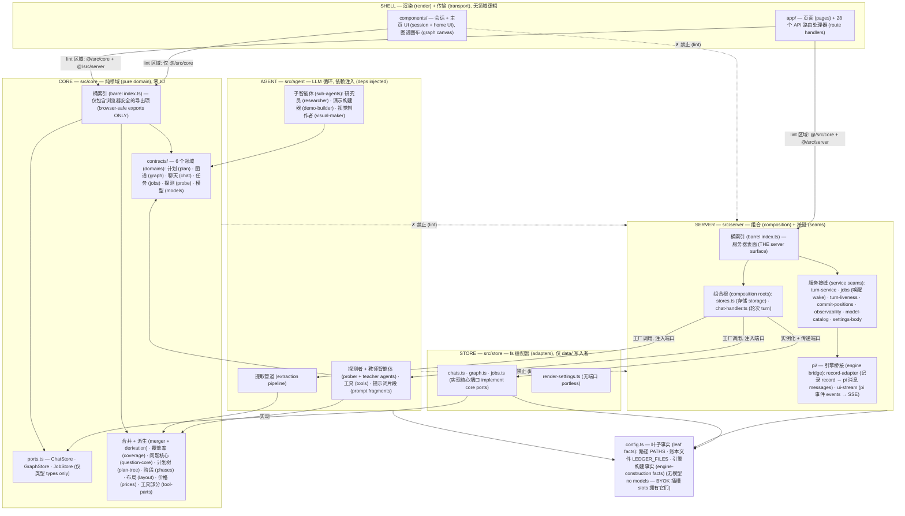
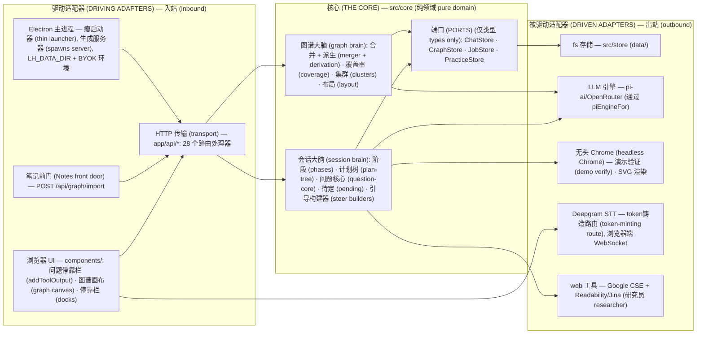
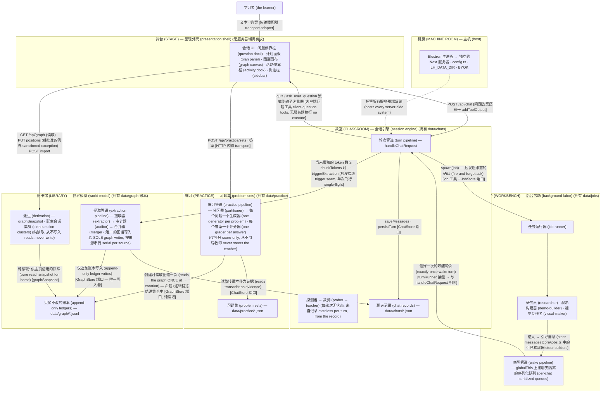
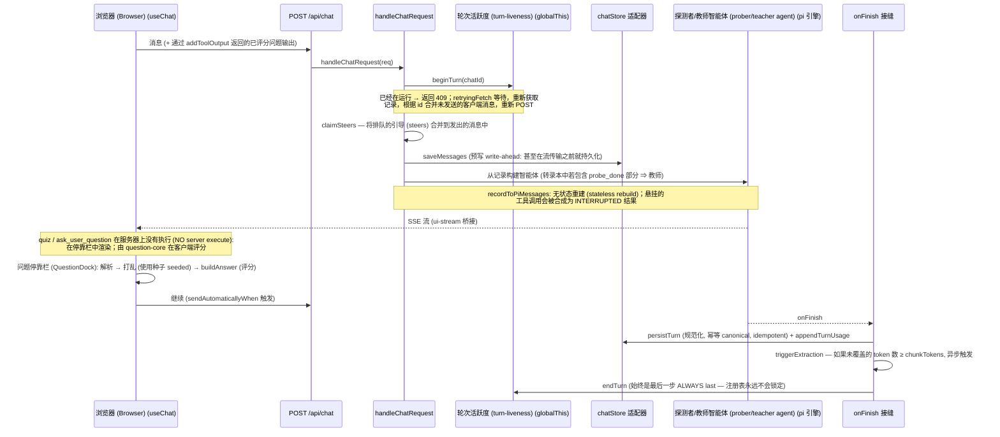
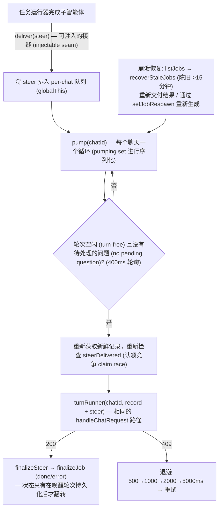
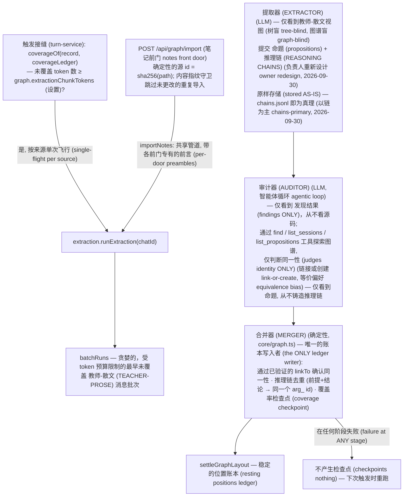
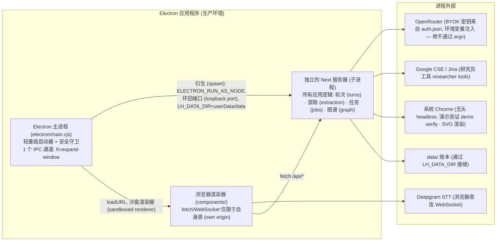

# 学习线束 (Learning Harness) — 架构 (Architecture)

状态：**规范的架构规范 (the canonical architecture spec)** — 描述了建成的系统 (as-built system)，并通过 2026-09-18 的全面审计针对代码进行了验证（审计了 `src/`、`app/`、`components/`、`electron/`、`scripts/` 下的每个文件，以及 lint 配置和测试套件 (test suite)；审计的树上的 `lint` 和 `typecheck` 均干净无误）。审计前的规范存档于 [`archive/architecture-2026-09-08.md`](archive/architecture-2026-09-08.md) — 仅作为历史记录。产品维度的推理位于 [`docs/vision.md`](vision.md)；逐个文件的布局说明位于 README 中。

**这是什么。** 一个独立的学习应用 (web + Electron 桌面端)：学习者的知识积累成一个持久的、跨会话的知识图谱 (knowledge graph)，它建立在辅导会话 (tutoring sessions) 之上。在会话中，教师智能体 (teacher agent) 会编写一个正式且可见的依赖树 (dependency tree)（即计划树 (plan tree)），并通过结构化问题 (structured questions) 来验证理解情况。图谱 (graph) 是主页；会话 (session) 是教室；其余一切都服务于这两者。

**设计原则，按优先级排列：**

1. **最大化控制 (Maximum control)。** 每条依赖边 (dependency edge) 都是明确且由机器检查的。任何代码都不会为了方便而进行横向访问。
2. **易于编辑 (Easy editability)。** 工作人员可以将任何行为追踪到单个文件。层 (layers) 按其职责命名，而不是按框架的偶然性命名。
3. **零技术债务 (Zero technical debt)。** 你看到的形状就是运行的形状。被弃用 (deprecated) 的路径会被删除，而不是被保留。
4. **清晰明了的架构 (Crystal-clear architecture)。** 两个桶文件 (barrels) 作为整个公共 API (public API)，两个组合根 (composition roots)，每个存储 (store) 只有一个写入器 (writer)，以及命名的接缝 (seams)。只要规则能成为 lint 规则，它就会被设为 lint 规则。

**一句话模型：** 中心是一个纯粹的领域核心 (domain core)；每一个外部副作用 (external effect)（文件系统 fs、大语言模型 LLMs、浏览器 browser、操作系统 OS）都位于边缘的适配器 (adapter) 后面；两个组合根 (composition roots) 是边缘与核心连接的唯一位置；每个持久化存储 (persistent store) 都由且仅由一个系统 (system) 写入。

---

## 1. 两个轴心，一个法则 (Two axes, one law)

沿着两个正交的轴心来把握架构：

**静态结构 (Static structure) — 六边形 (the hexagon)。** 一个纯粹的核心 (pure core) (`src/core`)；其他所有一切都是 *适配器 (adapter)*（实现核心端口或驱动核心）或 *组合根 (composition root)*（将适配器连接到核心的唯一代码）。依赖箭头 (dependency arrows) **只指向内部** — 指向纯粹，指向稳定。两个桶文件 (barrels) 是整个公共 API：`@/src/core`（浏览器安全）和 `@/src/server`（服务器端表面）。

**运行时所有权 (Runtime ownership) — 六个系统 (six systems)。** 每个持久化存储都有且仅有一个所属的写入系统 (writer-system)；系统之间只通过命名的、幂等的协议 (idempotent protocols) 进行通信：

| 系统 (System) | 拥有（唯一写入者） | 角色 (Role) |
|---|---|---|
| **教室 (Classroom)** — 会话引擎 (session engine) | `data/chats/*.json` | 轮次管道 (turn pipeline)、探测者→教师 (prober→teacher)、计划树 (plan tree)、问题 (questions)、阶段 (phases) |
| **工作台 (Workbench)** — 后台劳动 (background labor) | `data/jobs/*.json` | 任务运行器 (job runner)、研究员 (researcher) / 演示构建器 (demo-builder) / 视觉制作者 (visual-maker)、引导交付 (steer delivery) |
| **图书馆 (Library)** — 世界模型 (world model) | `data/graph/*` 账本 (ledgers) | 提取管道 (extraction pipeline)（唯一的图谱写入者）、派生 (derivation)、诞生会话集群 (birth-session clusters) |
| **练习 (Practice)** — 习题集 (problem sets) | `data/practice/*.json` | 分区器→生成器→评分器管道 (partitioner→generator→grader pipeline)、自包含集合 (self-contained sets) (§7) |
| **舞台 (Stage)** — 呈现外壳 (presentation shell) | 无服务器端拥有权 | components/、图谱画布 (graph canvas)、停靠栏 (docks) — 通过 `/api/*` 的纯消费者 (pure consumer) |
| **机房 (Machine room)** — 主机 (host) | 进程 + 配置 (process + config) | Electron 主进程 (main)、独立的 Next 服务器、`config.ts`、数据目录接缝 (data-dir seam)、自带密钥 (BYOK keys) |

**统一法则 (The unifying law)**（由此产生其他一切）：**导入指向内部 (imports point inward)，写入指向只加不改的证据 (writes point to append-only evidence)，其他一切都是派生而来的 (everything else is derived)。** 依赖流向纯粹；数据流向证据；任何可以通过重新计算得出的状态，都不会被存储。

---
## 2. 层与导入法则 (The layers and the import law)

依赖箭头 (dependency arrows) **只能向下** 指向。每层都可以导入核心桶 (core barrel)；没有任何东西可以为了方便而跨越边界。

```
┌──────────────────────────────────────────────────────────────┐
│ SHELL (外壳) app/            Next.js 路由处理器 (route handlers) (传输 transport) │
│            components/     会话 + 主页 UI (session + home UI) (仅渲染 render only) │
├──────────────────────────────────────────────────────────────┤
│ SERVER (服务器) src/server      组合根 (composition roots) (stores.ts,      │
│            chat-handler.ts) + 命名的服务接缝 (service seams) +       │
│            pi 引擎桥接 (pi engine bridge)。零业务逻辑 (Zero business logic) │
├──────────────────────────────────────────────────────────────┤
│ AGENT (智能体) src/agent       探测者 + 教师循环 (prober + teacher loops)、工具       │
│            表面 (tool surfaces)、提示词片段 (prompt fragments)、子智能体 (sub-agents)、      │
│            提取管道 (extraction pipeline)。依赖通过工厂 (factories) 注入 —  │
│            绝不从下层导入                          │
├──────────────────────────────────────────────────────────────┤
│ CORE (核心) src/core        纯领域 (pure domain): 契约 (contracts) (6 个领域)、│
│            端口 (ports)、合并 + 派生 (merger + derivation)、覆盖率 (coverage)、问题核心 (question-core)、   │
│            计划树 (plan-tree)、阶段 (phases)、布局 (layout)、价格 (prices)。无 IO     │
│            (有两个文件使用了 node:crypto — 纯粹                  │
│            但绑定于 node，因此未包含在桶文件中)      │
├──────────────────────────────────────────────────────────────┤
│ STORE (存储) src/store       fs 适配器 (adapters): 聊天 (chats) · 图谱 (graph)        │
│            账本 (ledgers) · 任务 (jobs) (实现核心端口) + 两个       │
│            无端口设置适配器 (portless settings adapters)。唯一能触及     │
│            data/ 目录的模块                                   │
└──────────────────────────────────────────────────────────────┘
```

**导入法则 (The import law)**（`eslint.config.mjs` — 此配置的唯一作用；四个 `import/no-restricted-paths` 区域，全部设为 `"error"`；且经验证会生效；`lint` 是每次代码变更的门槛）：

| 区域 (Zone) | 允许导入 (May import) | 理由 (Rationale) |
|---|---|---|
| `components/**` | 仅 `@/src/core`（桶文件 barrel） | UI 渲染领域数据；它从不运行领域逻辑或接触 IO |
| `app/**` | `@/src/core` + `@/src/server`（桶文件 barrels） | 路由处理器 (Route handlers) 是传输层；它们委托给服务器的入口点 |
| `src/core/**` | 不能导入它下方的任何东西（绝不能导入 `agent`/`server`/`store`） | 核心是纯粹的；适配器实现它的端口，绝不反过来 |
| `src/agent/**` | 绝不能导入 `server`/`store` | 智能体层通过工厂/闭包 (factories/closures) 接收其依赖项（端口 ports、引擎 engines、接缝 seams） |



**按照设计，有两条规则仅供参考 (documentation-only)。** ESLint 插件的 `except` 无法表达 "除了一个之外的所有" (all but one)，所以 (a) `src/server/stores.ts` *预期* 是唯一导入适配器的服务器模块 — 但是服务器桶 (server barrel) 也会重新导出那两个无端口设置适配器 (portless settings adapters)，并且 `observability.ts` 直接导入了 `chatStore`；以及 (b) 核心桶 (core barrel) 的浏览器安全性 (browser-safety) 是一种文档注释约定 (doc-comment convention) (参见 §2.1)。`tests/`、`scripts/` 和 `electron/` 被故意放在法则之外（不受 lint 约束）；测试 (tests) 可以自由跨层导入，脚本 (scripts) 作为额外的组合根 (composition roots) 运行。

### 2.1 核心桶与浏览器安全性 (The core barrel and browser-safety)

`src/core/index.ts` 仅导出浏览器安全的模块 (browser-safe modules) — 纯逻辑 + 类型，没有 Node 内置模块，没有 fs，没有网络请求。故意 **不** 在桶中导出的有（服务器代码会直接导入它们）：`graph.ts` 和 `coverage.ts`（需要 `node:crypto`），`clusters.ts`、`session-clusters.ts` 和 `layout-settle.ts`（服务器专用角色）。端口 (Port) *类型 (types)* 仅是类型，因此重新导出是安全的。正是这种拆分，使得同一个核心既能服务于浏览器（评分 grading、布局 layout、计划状态 plan statuses、成本折算 cost folding），又能服务于服务器（合并 merger、派生 derivation、覆盖率 coverage）。

### 2.2 契约 — 每个领域一个文件 (Contracts — one file per domain)

`src/core/contracts.ts` 是一个跨越七个领域文件的桶，每个文件都由其对应的流 (stream) 完全拥有（你不拥有的领域中的模式变更 schema changes 需经过主会话）：

- `contracts/plan.ts` — 计划树类型 (plan tree types) + 派生状态 (derived statuses) (`derivePlanStatuses`)
- `contracts/graph.ts` — 图谱领域 (graph domain): 账本 (ledgers)、发现/审计形状 (findings/audit shapes)、快照 (snapshot)、诞生会话集群 (birth-session clusters)
- `contracts/chat.ts` — 会话记录 (session records)、使用量/金钱渠道 (usage/money channel)、设置 (settings)、交接文本 (handoff text)
- `contracts/jobs.ts` — 确认并引导协议 (ack-and-steer protocol): 任务记录 (job records)、引导消息构建器 (steer message builders)、确定性的引导 ID (deterministic steer ids)、使用量累积 (usage accumulation)
- `contracts/probe.ts` — 探测评估 (probe assessment) + 共享的 zod 模式 (shared zod schema)
- `contracts/models.ts` — 客户端安全的模型目录形状 (client-safe model-catalog shapes)
- `contracts/practice.ts` — 习题集 (problem sets)、推理链 (reasoning chains)、参数 (params)、评分分数 (grade scores)

---
## 3. 端口、适配器与组合根 (Ports, adapters, and the composition roots)

存储采用的是 **每个实体的语义端口 (per-entity semantic ports)**，而不是一个通用接口：`ChatStore`、`GraphStore`、`JobStore`、`PracticeStore` (`src/core/ports.ts` — 仅类型)。fs 适配器 (`src/store/{chats,graph,jobs,practice}.ts`) 实现了它们，并且除了持久化之外不包含任何其他内容。还有一个适配器 (`src/store/render-settings.ts`) 是一个无端口的自由函数 (portless free function)，通过服务器桶 (server barrel) 重新导出 — 这是一种深思熟虑的实用性绕过，在此记录以免有人将其误认为一种模式 (pattern)。

**惯用模式 (Idioms)。** 图谱证据 (Graph evidence) 保存在 **只加不改的 JSONL 账本 (append-only JSONL ledgers)** 中（允许损坏行的读取 corrupt-line-tolerant reads；严格的形状守卫 strict shape guards 会丢弃无效行，从不靠猜）。聊天 (Chats)、任务 (jobs)、位置 (positions)、来源 (sources) 和设置的 blob 都是全文件读取-修改-写入的 JSON (whole-file read-modify-write JSON)。所有的写入都是同步的、单进程的 (atomicity rides the Node event loop，原子性依赖 Node 事件循环)。合并/去重/派生语义 (Merge/dedup/derivation semantics) **在读取端、在核心中 (reader-side, in core)** 完成 — 存储从不做决定。

- **`src/server/stores.ts` 是存储的绝对组合根 (THE composition root for storage)**：它实例化适配器并将端口对象 (port objects) 传递给其他所有组件（chat-handler、job runner、extraction pipeline、practice pipeline、graph/positions/chats 路由、turn services）。这是唯一可以重新决定存储方案（JSON 还是 SQLite，本地还是远程）的地方。
- **`src/server/chat-handler.ts` 是轮次的绝对组合根 (THE composition root for a turn)**：它将存储 (stores)、任务运行器 (job runner)、提取管道 (extraction pipeline)、练习管道 (practice pipeline) 和 pi 引擎桥接到流响应 (stream response) 中（`setTurnRunner`/`setJobRespawn` 为唤醒管道注册它的接缝）。所有逻辑都隐藏在它所调用的接缝 (seams) 后面。
- 智能体层 (agent layer) 始终是依赖倒置的 (dependency-inverted)：`createJobRunner({ chatStore, jobStore, deliver })`，`createExtractionPipeline({ chatStore, graphStore, extractor?, auditor?, embedder })`，`createTeacherTools({ chatId, chatStore, jobStore, spawn })`，`createProberAgent`/`createTeacherAgent(engine?, tools?, …)`。测试时注入的端口与生产环境注入的端口相同 — 或者替换为内存端口 (in-memory port)。

引擎端也是被适配的：`src/agent/models.ts` (`piEngineFor`) 根据用户的 **模型插槽 (model slots)** 为每个角色解析相应的引擎（BYOK: `settings.json` `models` 部分 — 强 strong/廉价 cheap/视觉 vision；如果链条为空，则诚实地拒绝并返回 503 `models_not_configured`） — 并且，教师/探测者的对话运行的是 **会话自身的记录 (SESSION'S OWN record)**：`POST /api/chats` 使用强插槽 (strong slot) 将每个新诞生的会话一字不差地打上标记 (stamps)（这是在新会话的设置中选择的默认值），会话内的选择会写入会话的记录 (`PUT /api/chats/:id/settings`)，强插槽再也不会去碰一个已存在的会话（传统的未标记记录在解析时回退到它） — 每会话的模型 (per-session models)，负责人 2026-09-28 确立。除了对话之外，`src/server/pi/` 桥接了两个 SDK 世界：`record-adapter.ts`（持久化的 UIMessage 记录 → 无状态的 pi `Message[]`，悬挂的工具调用 dangling tool calls 会被合成为 INTERRUPTED 结果）和 `ui-stream.ts`（pi 智能体事件 → AI-SDK UIMessage SSE）。



---
## 4. 六大系统（运行时所有权与协议） (The six systems (runtime ownership and protocols))

系统视图：每个方框拥有其对应的存储；边代表协议，每条边都由实现了该协议的适配器/接缝组成。



四个服务器端系统，每个都是其自身存储的唯一写入者，通过命名的协议连接：**轮次请求 (turn request)** (舞台→教室)，**确认并引导循环 (ack-and-steer loop)** (教室→工作台→教室)，**提取触发 + 转录本读取 (extraction trigger + transcript read)** (教室→图书馆)，以及 **练习请求 (practice request)** (舞台→练习，通过 HTTP，加上练习在创建时对图谱快照的一次性读取)。舞台 (Stage) 仅通过极薄的 HTTP 传输层接触系统；教师智能体通过受限的探测工具 (prober tools) (`list_sessions` / `list_propositions`) 直接访问图书馆 (Library)，而不是通过任何注入的上下文。

---

## 5. 会话（单次聊天轮次） (The session (one chat turn))

`handleChatRequest` 是无框架的 (framework-free) (纯 `Request`/`Response`)，带有一个 `buildAgent` 测试接缝，因此测试可以通过脚本化的引擎来驱动它。轮次的精确顺序如下：



- **客户端问题工具 (Client-side question tools)** (`quiz`, `ask_user_question`) 在服务器上没有执行：调用会流式传输到浏览器，学习者在停靠栏 (dock) 中回答，客户端通过 `question-core` 进行评分，并通过 `addToolOutput` 返回判定结果，这会触发后续操作 (continuation)。一个持久化在记录中的待定测验，正是使得 **在问题中途恢复变得免费 (resume mid-question free)** 的原因。确定的带种子打乱 (deterministic seeded shuffling)（以 toolCallId 为键）使服务器和客户端的渲染保持一致。
- **探测者→教师交接 (The prober→teacher handoff)**：最初的一个或多个轮次运行的是探测者 (prober) (通过 quiz 确定上下限 floor/ceiling，通过 ask 确定目标 goal)；`probe_done`（在服务器执行）提交评估并排队一个交接引导 (handoff steer)；从转录本中的第一个 `tool-probe_done` 部分开始，处理器为后续的每个轮次构建教师智能体 (teacher agent)。阶段 (`core/phases.ts`) 严格折叠 (fold strictly)：探测 (probe) → 计划 (plan) → 教学 (teach)。
- **正式的计划树是编写一次的 (The formal plan tree is author-once)**：教师通过单个经过模式验证 (schema-validated) 的 `plan_init` 工具（mermaid-subset 图，被确定性地解析并带有行号错误提示，被验证为 DAG）编写该会话的依赖图。进度永远不会发生突变 — 状态 (`current`/`visited`/upcoming) 都是根据转录本中带标签的 quiz 调用 **派生 (derived)** 而来的；树面板 (tree panel) 和计划块 (plan blocks) 渲染的正是这种派生。
- **任务工具在服务器执行，确认并引导 (Job tools are server-executed, ack-and-steer)**：`research`/`demo`/`visual` 在轮次中途立即解析，并带有一个触发后即忘的确认 (fire-and-forget ack)（教师继续教学）；`spawn(job, input)` 会触发后台运行器 (background runner)。
- 每一个轮次服务 (turn service) 都是一个命名的、包含错误的接缝 (error-contained seam)，需要显式传入依赖；失败时仅记录一行 `[chat <id>]`，并且永远不接触响应。交换其中任何一个都不会影响其他部分。

### 5.1 唤醒管道 (The wake pipeline) (工作台 Workbench → 教室 Classroom)

在子智能体完成后，运行器会构建一条 **引导消息 (steer message)** — 一个用户角色 (user-role) 的 `UIMessage`，其文本部分是面向模型的结果，而其 `data-subagent-artifact` 部分带有供客户端使用的完整结果（提供商转换时会丢弃 data 部分）— 并将其交给唤醒管道：



任务状态只有在唤醒轮次 (wake turn) 持久化后才会翻转为 done/error。交付 (Delivery) 是 **恰好一次 (exactly-once)** 的：确定性的引导 ID (`steer_<jobId>`, `steer_probe_<chatId>`)，在每个认领点 (claim point) 都有 `steerDelivered` 检查，并且 `claimSteers` 最终确定的是转录本中的引导 (in-transcript steers) 而不是重新追加。客户端通过与中途返回流相同的 `turnInFlight` 机制（繁忙微光 busy shimmer、输入框门控 composer gate、只加不改的 `mergeAdopted` 接收）接收唤醒轮次，并将引导渲染为制品 (artifacts) — 绝不渲染为气泡。

子智能体 **会进行验证，从不一次性尝试 (verify, never one-shot)**：演示构建器 (demo-builder) 在交付前，会先在系统 Chrome 中以无头模式执行其 HTML；视觉制作者 (visual-maker) 会渲染每个 SVG 并查看它（需要一个具备视觉能力的模型 — 即设置中的 `vision` 插槽）。

---
## 6. 知识图谱 — 两条渠道，唯一的写入者 (The knowledge graph — two channels, one writer)

**提取管道是唯一的图谱写入者 (The extraction pipeline is the sole graph writer)。** 没有其他任何东西会追加到 `data/graph/*.jsonl` — 教师不会，服务器不会，迁移脚本也不会。（唯一经批准的例外情况是：`PUT /api/graph/positions` 仅写入经过清理的布局位置，如果图谱有所增长，还会进行增量布局计算。根据设计，回填脚本 backfill scripts 会绕过此规则，因为它们是一次性操作。）



**仅限原始推理链 (Raw reasoning chains only)**（2026-09-27 清理；教师-散文视图 teacher-prose view 2026-09-28）：提取器 (extractor) 仅读取会话 (session) — 并且自 2026-09-28 裁决以来，仅读取教师智能体的散文 (teacher agent's prose)：会话标题下的纯段落，没有学习者的消息，没有思考过程 (thinking)，没有工具调用或结果，没有测验块。覆盖率指纹 (Coverage fingerprints)、插槽 token 和批次预算全部派生自相同的选择范围 (`core/coverage.ts` 中的 `messageViewLines`)，因此“已覆盖 (covered)”完全等同于“提取器所看到的 (what the extractor saw)”— 测验答案或学习者的编辑绝不会开启一次运行，只有教师散文的编辑才会重新打开其消息。旧有的调用+结果不可分离的绑定 (call+result inseparability bond) 已被删除（没什么留下来需要保持在一起的）；批处理采用的是纯粹的贪婪填充 (greedy fill)。共享的 markdown 引擎 (`core/session-markdown.ts`) 为未来的面向用户的导出功能保留了完整的会话格式，不再用于提取。提取器的交付物是 命题 (propositions) + 推理链 (REASONING CHAINS)（负责人重新设计，2026-09-30）：一条链指 共同 (JOINTLY) 导致某个结论的前提 — 为同一结论提供独立论证的，是不同的链；结论可以通过 id 作为前提重复使用；而一个纯粹的命题 (bare proposition) 则单独存在于命题列表中。网络传输模式 (wire schema) 携带着命题（id/名称 name/陈述 statement/可选的别名 aliases）+ 推理链（前提 premises minItems 1/结论 conclusion）— 并且自从确立“以链为主 (chains-primary)”的裁决 (2026-09-30) 后，存储的正是那个网络形状 (wire shape)：推理链原封不动地追加到 `chains.jsonl`（`SessionFindings` 现即为存储形状；`chainsToEdges` 和 `chainsToGraph` 已被删除 — 不再有翻译接缝 translation seam）。**支持边 (Supports edges) 已被彻底弃用**（负责人，当晚）：`EdgeType`、支持边绘制切换开关和粗细滑块，以及所有相关的代码路径都已不复存在 — 存储的类型化边 (stored typed edge) 在任何地方都不再存在，画布上的每个箭头都是从推理链中派生出来的。没有迁移 (migration)，没有向后兼容 (backcompat)：按照裁决，采用链之前的图谱数据已被清空。链法则 (chain laws) 由提交接缝 (submit seam) 处的经实践验证的带错误提示的回调钩子 (error-back hook) 强制执行：每个前提/结论的 id 必须解析为已提交的命题，前提不能为空，没有自引用 (self-reference) — 若有违反，则返回错误字符串，模型将在其轮次内重新提交。提示词以目标为先 (GOAL-FIRST)，没有规则装甲 (no rule armor)（负责人的哲学裁决，2026-09-30）：共享的 `EXTRACTION_CORE`（包含目标、真理法则 the truth law、提交机制）加上两个一句话的语境化内容 — 会话和笔记的前言 (preambles) — 在调用点进行组装。这样一来，两个前门从构造上共享了核心逻辑；所有旧的防御性列表（DROP 列表、merge-your-own-output、名称墙、when-in-doubt-omit、忠实度段落）全被删减，描述 Quiz/Recall-check/Question 块的旧有开场白（自确立教师散文原则后已失效）被直接略去。验证前接缝处的 `prepareArguments` 修复逻辑可以挽救被字符串化的负载提交（命题或推理链）。每个节点都是客观的、面向世界的事实。没有测验结果，没有理解力评估 — 事件账本 (events ledger) 和 `UnderstandingLevel` 已被删除；学习者与命题之间的关系是属于练习领域 (practice territory) 的事 — 该功能于 2026-09-29 落地为 **仅供反馈的强化 (feedback-only strengthening)** (§7)：成绩记录在习题集上，并且绝没有任何东西将学习者的状态写回图谱。

**基于摘要的序列化提取 — 提取器即组装器 (Digest-aware serialized extraction — the extractor is the assembler)** (负责人重新设计, 2026-09-30 晚)：被称为“脊柱 (spine)”的阶段出现又在一天内消失 — 负责人的实时测试表明，事后组装阶段增加了复杂性，却没有带来明显的收益，因为真正的问题（重述的节点、肤浅的重新推导）都是在创建时 (mint-time) 产生的。替代方案是将组装过程移入提取器：当来源（如笔记、会话）已经产出过素材时，后续每个片段的提取器提示词中都会包含 **图谱迄今为止的状态 (THE GRAPH SO FAR)**（该来源已合并的命题和链，id 原样保留），提取器在此基础上进行构建 — 引用现有的 id 而不是重述它们，依靠已建立的结论作为前提。因此，链可以跨越片段 (stretches)：端点是混合的命名空间，包含新鲜的本地 id 或现有的 `n_` id（在提交接缝处验证，error-back；合并器的作业本地映射会将现有的 id 原样传递）。系统提示词将目标重新构建为：揭示来源的 **核心思想 (core ideas)**，并展示一切是如何 **从基础派生 (derives from the foundations)** 出来的 — 方向向上，偏好精简的推导，绝不重新推导图谱中已有的内容。由于每个片段必须读取之前所有的合并结果，因此一个来源的批次/块必须 **严格按顺序运行 (STRICTLY IN ORDER)** (按来源序列化)；不同来源的提取则保持并行。一个来源的第一个片段是“裸跑”的（没有摘要，没有额外的消耗）。

**链的简化 — 合并器的维护传递 (Chain simplification — the merger's maintenance pass)** (负责人, 2026-09-30 晚)：同一个结论通常有多个得出角度 — `[A,B]⟹X`，`[X,C]⟹Y`，然后是 `[A,B,C]⟹Y`，最后这个并没有增加任何新内容。在每次合并时，`simplifyChains` (`core/graph.ts`) 遍历整个链账本 (WHOLE chain ledger) 并丢弃可证明的冗余链：在每个结论分组中，按照（前提数量，创建时间）的顺序进行贪婪处理。当一条链的前提集被保留链的前提严格包含时（**偏好最少的前提 prefer the fewest premises**），或者当每个前提都被保留链的前提及其传递祖先覆盖时（**祖先覆盖 ancestry-cover** — `[A,B]⟹X` + `[X,C]⟹Y` 覆盖了 `[A,B,C]⟹Y`，并通过更深层次的派生传递），这条链就是冗余的。具有相同（前提，结论）的行被视为同一个逻辑链 — 每次出现出处行 (provenance line) 时就丢弃一个键 (key)。重写操作搭载在合并 (merge) 具有审计锁定的关键段 (audit-locked critical section)（原子的 `rewriteLedgers`）中进行；运行统计单独计算这些丢弃的数量 (`droppedChains`)，因此追加和维护的操作绝不会混淆。简化操作在合并时运行，因为一个新链可能使旧链变得冗余 — 没有什么是被追溯性地重新推导的，只有可证明的冗余会被移除。

**单块作业，按源串行 (Per-chunk jobs, serial per source)** (负责人裁决，2026-09-28 和 2026-09-30 晚)：每个块（笔记文件）和每个批次（聊天覆盖范围）都是属于它自己的 **作业 (JOB)** — 拥有注册表行 (registry row)、使用记录、故障域 — 但一个源的作业将 **严格按顺序运行 (STRICTLY IN ORDER)**（每个提取器继续处理该源的摘要；见上文）。跨源提取 (Cross-source extracts) 保持并行，受到 `globalThis` 上的进程级 3 个许可提取信号量的限制（这是提供商面临的速率限制；等待许可的作业显示为 `queued`）。审计→合并段 (audit→merge section) 仍保持为进程级的 FIFO 关键段 — `globalThis` 上的互斥锁（与运行注册表的模块实例习惯相同）：在任何审计器 LLM 调用或读取图谱之前，作业会等待（`waiting` 阶段）直到所有更早的作业完成合并，因此每个审计器都在探索图谱的真实当前状态 — 两个并发的审计将会分别链接到对方即将修改的图谱，从而在结构上造成重复节点的产生。故障隔离 (Failure isolation)：一个作业失败（如坏块、模型输出降低）被吸收 — 它的消息保持未覆盖并可诚实地重运行，同时它的兄弟作业仍在进行合并；运行返回实际合并的内容。中断是整个源级别的 (Abort is source-wide)：串行循环在遇到第一个 `AbortError` 时停止，并且已经合并的作业将保留它们的检查点 (checkpoints)。状态 feed 界面每个作业显示一行（对于分块源，使用 `file.md · 2/5` 后缀），并且每个作业会保留它自己的使用记录（失败的作业也会计费它的部分消耗）。

**信任分工 (Division of trust)**（该管道的核心规则）：提取器是完全受信任的，并且是唯一见过原始文本的阶段。审计器从不见转录本 — 它收到的只剩发现的 **命题 (PROPOSITIONS ONLY)**（推理链绝不会到达审计器：它们是提取器→存储 的交付物，也是合并器的业务 — 负责人裁决，2026-09-30），它通过只读工具（`find`, `list_sessions`, `list_propositions` — 包含陈述文本，无时间戳）去探索现有的图谱以做出裁决。**仅裁决 (VERDICTS-ONLY)**（负责人裁决 2026-09-28）：审计器提交的内容只有 `{ links }` — 即身份链接（将提取出的命题与现有节点关联）。`edges` 参数已经消失（负责人，同日晚）：审计器从不创建命题间的关系 — 跨源连接完全通过确认出的等价性来完成，论证结构仅仅来自提取器。审计器从不重述发现；合并器结合发现 + 裁决，从而使得输出减少了一个数量级，并且从结构上来说，审计器无法修改或丢弃提取器的输出。**等价偏好 (Equivalence bias)**（负责人裁决 2026-09-27）：针对同一声明的释义、改写和压缩都会 **合并 (MERGE)**；只有真正不同的命题才会分开。确定的合并器会验证并追加内容：解析链接、通过作业本地映射（对于支持摘要的提取器的混合命名空间链，原样传递现有的 `n_` ID）解析链、按（已排序的前提，结论）对链去重 — 其他聊天应用重新声明的已知论证，将追加到相同的 `arg_` ID 下（采用链接的风格：第一行的 ID 和 createdAt 保留，并产生来源并集）、进行链简化维护（见下文）、保存覆盖率检查点 (coverage checkpoints)。没有任何阶段会拒绝提取器的输出；简化过程仅移除可证明的冗余部分。**按作业进行的内存解析 (Per-job in-memory resolution)**（负责人，2026-09-29）：映射账本 (mappings ledger) 被删除了 — 每个作业在内存中独立解析其命题 ID 并在合并时完成比对，因此没有任何作业可以看到或与另一个作业的 ID 冲突（由于之前持久化的表格曾在各块间默默丢弃了同 ID 的命题并由此造成了错误的边焊接）。跨作业和跨运行的唯一身份标识就是审计器的链接 (auditor's links)，以及覆盖率账本（任何已提取的内容都不会再提取一遍），再加上笔记的内容指纹防护。

**覆盖率而非测验计数 (Coverage, not quiz-counting)** (取代了 v1 的每 N 次测验答复触发)：每条消息的视图 (view)（由 `core/coverage.ts` 一直用来做哈希的紧凑行格式）会被哈希计算到每聊天对应的指纹账本中 (`coverage.jsonl`)；"已覆盖" 的确切含义是 "在此内容上提交了一次提取运行"。提示词视图使用更丰富的 Markdown 格式 — 这是 2026-09-27 时特意做的分离：展示格式的变化绝不应重开已被覆盖的历史记录。未覆盖 (Uncovered) = 指纹对比，绝不采用双轨追踪；提取运行采用按 token 预算分配贪婪批次的方式（设置项是 `graph.extractionChunkTokens`，自从支持摘要的设计 2026-09-30 翻倍了该值后默认为 8192，底线是 500，每一轮次都会新鲜读取）拉取最早未覆盖的消息 — 无测验的会话同样会进行提取。粗略的 `sessions.jsonl` 检查点仍会标记每个合并运行。触发器缝合点（`turn-service.ts`）在管道角度是触发不可知的：若采用了更好的机制（如会话结束、空闲、显式刷新），只有接缝部分需要修改。每个源均为单路飞行 (Single-flight per source)；运行注册表支持了覆盖率 UI 以及真实的中断操作。

**两扇前门，一条管道 (Two front doors, one pipeline)**: 聊天转录本（测验触发）和原始个人笔记（`POST /api/graph/import` — 每个文件成为扮演 `chatId` 角色的 `NotesSource`，来自路径哈希确定 ID；内容指纹标记保证了未更改的重新导入真的是不做任何操作，无模型调用、无使用量，而文本改变时则对整个文件重新运行，由负责人于 2026-09-29 确认）。笔记的切块与聊天相同（负责人，2026-09-28）：大型文件在行边界按照同样的 token 预算进行切块，每个块就像聊天的批次一样作为独立的作业来运行 — 每个源序列化（依据摘要顺序），被审计锁定限制。没有单一的模型调用能处理一整个文件。两种提交工具都需要其顶级字段（`chains`/`links` 即使为空也必须出现）：负载丢失这些字段无法通过验证，而不是默许没有结构的节点被合并。

**读取通道即纯粹的推导 (The read channel is pure derivation)。** `GET /api/graph` 会读取账本 — 首页视图绝不会触发写入。**以链为主 (Chains-primary)** (负责人决定, 2026-09-30): 存储的真实数据是 命题 (`nodes.jsonl`) + 推理链 (`chains.jsonl`)；画布呈现的是从实际存储中 **有损派生的图像 (LOSSY DERIVED IMAGE)**。`graphSnapshot` 会合并这些账本，随后 `deriveView` (`core/graph.ts`) 在每次读取时重新构建视图：每个存储的链会铸造出一个 **蕴含节点 (IMPLICATION NODE)**（id = 该链的 `arg_` id，名称为 `⟹`，陈述为链的内容行），加上从 前提→蕴含→结论 的无类型箭头；悬空的链（其组成节点后来被删除了的）会被抛弃。这就是边存储无法维持的 **双射 (BIJECTION)**：对于同一个结论，两个独立论证（`A∧B⇒E`, `C∧D⇒E`）将呈现为两个独特的菱形节点，而不是一个人造出来的多点汇入 `A∧B∧C∧D⇒E` — 即一个存储论证对应一个视觉论证。蕴含节点目前是常规的物理实体（关于渲染的特化是有意留给未来的工作）。聚类是对单纯的命题在 **诞生会话 (BIRTH-SESSION)** 上的划分（`core/session-clusters.ts` 中的 `birthSessionPartition` — 即会话的出处，没有任何所谓的 Louvain 聚类，之前那些旧注释都已被清理）；蕴含节点不被划分到任何聚类中，而在物理效果中自由漂浮。节点详情卡片显示 名称 + 命题 + 诞生会话；过去那种边列表，随着类型化边的废弃而一同消亡了（负责人, 2026-09-30）。

**删除即彻底消失且支持级联 (Deletion is full death, cascade-aware)。** 删除一个命题将会杀掉所有引用它的被存储下来的链（不管是作为前提还是结论） — 派生的蕴含节点将在最后一个链消失时一并消逝，并在界面上修剪这些位置。删除一个蕴含节点（具有任何带 `arg_` 前缀的 id — 画布将其视作可被删除的节点）将精准地删除那 **一个 (ONE)** 存储下来的论证，再无其它。与画布的右键操作相同，这里的链表提供了同样精简的删除确认对话框。

**教师负责探测，没有任何内容会被强行注入 (The teacher probes, nothing is injected)**（该决定取代了语义注入的实验，后者于 2026-09-23 被砍）：教师根据它自身的决定，通过两个仅供读取的探测工具来访问图谱 — `list_sessions`（即诞生会话，学习者对应的文件）与 `list_propositions`（某会话已覆盖的内容名称）— 并通过 `agent.graphTools` 配置与 `graph.enabled` 进行联动开关控制。这里不再有主题嵌入 (topic embedding)，不再有 top-K 筛选，不再有会话开始的预设引导；究竟应该看什么全凭智能体决定，未受召唤的信息，图谱绝不会把它写进课文中。

**渲染引擎 (Rendering)**: 这是在一个手写的 Canvas 2D 渲染器之上（`components/graph-canvas.ts` — 基于 requestAnimationFrame 的循环、支持脏标记以便休眠、带有 d3-zoom 镜头功能、并带门限检测的标签淡入淡出、在绘制时计算包围壳的聚类效果）叠加于在核心中用 d3-force 实现的布局之上（`layout.ts`，由温启动的 `incrementalLayout` + `settleGraphLayout` 负责）。渲染设置与用户拖拽提交的位置信息在服务端持久化，相机位置保留在每一台设备的 `localStorage` 中。

---
## 7. 练习 — 强化而非评估 (Practice — strengthening, not assessment) (负责人裁决 2026-09-29)

练习将图谱转化为习题集 (problem sets)，让学习者大声说出他们的推理。首先是目标裁决：这是 **强化 (strengthening)，不是评估 (assessment)**。分数是给学习者的反馈 — 一个数值、一段简短的理由，以及模型给出的参考答案 — 仅此而已。评分不会向图谱写入任何内容，任何地方都不存在“理解水平 (understanding levels)”，愿景文档 (vision doc) 中的考试机制（分数、连击 streaks、基于失败率的间隔重复 spaced repetition）仍被搁置。习题集只是练习学习者已经遇到过的内容；它不提供任何认证。

**链模型 (The chain model)。** 练习直接读取已存储的链（以链为主 chains-primary，2026-09-30）：`chainsForSelection` (`src/core/practice.ts`) 仅当一个已存储论证的结论以及 **所有 (every)** 前提都被选中时，才会将其包含进来 — 缺少任何成员的论证将被完全排除，而未被包含在任何幸存论证中的节点则变成单节点链 (singleton chain)；仅作为前提的节点不属于任何链。每个论证保留其自己的 `arg_` id：针对同一个结论的两个独立论证仍然是两条链（绝不会合并成一个前提集合 — 正是这种合并曾导致边分组的错误）。分区 (partition) 必须 **恰好一次 (exactly once)** 覆盖每条链 — 这是一个真正的分区；重复 (duplicates) 会像缺漏 (gaps) 一样导致验证失败（负责人 2026-09-29 修正：多样性在不同习题集 **之间** 积累，绝不在同一个习题集内部；“至少一次 (at-least-once)” 的教条已死）。`chainCoverage` 是合理性检查：只有 `missing`（缺漏）会导致分区失败，`duplicated`（重复）仅作为提示信息。

**自包含的集合 (Self-contained sets)。** 一个 `ProblemSet` 在创建时冻结了它的世界：选定的节点 id、**命题快照 (propositions snapshot)** (`Record<nodeId, {name, statement}>`)，以及派生的链都会持久化到这个集合中（`data/practice/*.json`，每个集合一个文件，`PracticeStore` 端口）。生成、评分、覆盖率计算和 UI 都 **只 (ONLY)** 读取这个集合 — 后来发生的提取绝不会动摇当前或历史习题集的基础。

**三个轴心是被离散化的命名级别 (The three axes are discretized named levels)**（负责人，2026-09-29 — 绝不是一个需要插值的数字；级别之间不存在连续统 continuum）：**阶梯层级 (ladder rung)**（主轴 — 0 演算示例 Worked example，1 填空 Completion，2 直接练习 Direct exercise，3 组合 Composition，4 寻路 Path-finding；调用时指定名称，生成器就会精确构建出那个 **类 (CLASS)** 的问题），**线索距离 (cue distance)**（0 课程语境 Lesson context — 教学自身框架中的教科书/玩具示例；1 相邻语境 Adjacent context — 基于教学世界构建的全新情境；2 远距离语境 Far context — 可识别带的边缘，命题仍必须真实适用且通过观察能够找到），以及 **呈现方式 (presentation)**（理论 Theory — 使用学科术语，或应用 Application — 命题结构在现实世界中出现的具体事务；它只是包装情境，绝不改变阶梯层级或线索距离）。名称 + 一句话定义存在于一个地方（`src/core/practice.ts` 的级别表），并被所有地方使用：智能体的提示词（`renderParams`）、创建对话框的分步控件、考试头部的级别行。创建默认值：阶梯层级 2 直接练习 · 线索距离 1 相邻语境 · 理论。API 会验证精确的组合 — 阶梯层级之间的浮点数会返回 400；遗留的浮点参数集合会在存储验证器处失败并被跳过（无需迁移 — `data/practice` 只是可丢弃的草稿数据）。

**两阶段生成 (Two-stage generation)。** 一个 **分区器 (partitioner)** 智能体读取链和三个命名级别参数 (NAMED-LEVEL parameters)，并提交真正的分区；每个分区成为一个问题的目标。然后 **每个问题一个生成器智能体 (one generator agent per problem)**：其提示词原样携带问题工程框架 (problem-engineering framework)（负责人的教条 — 三个距离、从搜索到求解轴 search-to-solution axis、阶梯层级、反向/辨别/探测前提 reverse/discriminate/probe-the-premises、常设禁令 standing prohibitions、格式教条 formatting doctrine — 完整的 Markdown、LaTeX 数学公式、带栅栏的代码块、表格/列表；将结构化内容仅渲染为散文是一个缺陷），**你的目标 (YOUR TARGET)**（分配给它的链，需原样回显 echo verbatim — 回显法则：提交的链集合必须与分配的链完全相等），以及 **完整集合 (THE FULL SET)**（整个选中内容：外部命题是可以利用的支持材料，生成器应最少地使用它们，最大化聚焦；不宣称法则 never-announce law 涵盖了 **所有** 命题）。提交流程是“先作答后提问 (commit-before-pose)”— 陈述、解答和评分标准 (rubric) 一起到达（测验/解释机制使用的也是这种缓解模型迎合倾向 sycophancy mitigation 的方法）；没有预先写好的答案，问题就不存在。生成器并行运行（与评分器共享一个进程级的 3 许可信号量 process-wide 3-permit semaphore），具有问题级别的故障隔离 (per-problem failure isolation)：一个坏问题会单独报错；集合仍然能到达 `ready` 状态。**跨集合去重 (Dedup across sets)**：每个生成器还能看到最近的最多 5 个共享某个节点的习题集中的问题，以便情境不会在不同集合间重复；在一个集合内部，并行生成器彼此看不见 — V1 版本已接受这一点（负责人裁决）。

**评分仅限打分 (Grading is score-only)** (负责人重新设计，2026-09-29)。**一次尝试 (ONE ATTEMPT)**：每个问题都有自己的提交按钮；一旦提交，答案即被持久化且问题完成 — 路由随后将永远拒绝重新提交。提交后会 **立即 (INSTANTLY)** 显示结果（无需等待评分器 grader）：答案锁定为只读，模型参考解答显示出来，评分标准折叠在下方。评分过程触发一个 **评分器 (grader)** 任务来处理已回答的问题 — 评分器会看到问题本身、其链涉及的命题、预先写好的解答和评分标准，以及学习者的答案，但绝不看整个习题集（根据规定，采取最小化信息）— 并返回一个 **0–10的整数分数，以及一两句话的理由推理**（指明达到了或错过了哪些评分点，哪个命题没有被想到）。分数通过页面的事件通道 tick (`activity-changed` → 防抖 debounce 的存活状态读取 liveness read，见 S7) 落地在问题上，并实时更新；成绩绝不在整个习题集层面串行处理（提交了 B 问题时，A 问题还在评分，这是完全没问题的 — 共享池界定了并行度）。没有任何内容被写入知识图谱中，任何地方都不记录等级 (level)、也没有计数 (count)。如果评分过程意外中断，答案依旧会保留，并坦诚地显示“评分被打断 (grade interrupted)”— 只有一次尝试，不可重新提交。

**任务模式 — 仅注册表而无 JobRecords (The jobs pattern — registry, not JobRecords)。** 练习运行并不是 Workbench（工作台）的作业：没有 `JobStore` 记录，没有引导信息 (steer messages)，也没有任何东西会唤醒教师 (teacher) — 练习运行并不限定于聊天范围 (chat-scoped)（一个习题集的生命周期超过它的诞生会话，也没有需要重新进入的课程；它的结果就是它自身，保存在它自己的存储中，并被它自己的页面读取）。它与 Workbench 共享的是可观测性表面 (observability surface)：一个放在 `globalThis` 的运行注册表（基于模块实例习惯 — `__lhPracticeRuns`），包含 **按问题细分的行数据 (PER-PROBLEM ROWS)** (负责人裁决，2026-09-29 — 匹配 extraction 按区块处理的模式)：在分区器运行时是 `setId:partition`（“正在分区 Partitioning — 标题”），接着每个问题一个 `setId:gen:problemId`（“已排队 queued”→“正在生成 generating”，标签“问题 i/N — 标题”），每个已回答的问题一个 `setId:grade:problemId`（“已排队 queued”→“正在评分 grading”，“正在评分 i/N — 标题”）— 每一行都有它 **自己 (OWN)** 的中断控制器 (abort controller) 和它自己的使用量累积；这行的键 (key) 就是信息流 id (feed id，即 dock 重复键规则)，也是中止目标 (abort target)。**基于行形态的中止路由 (ABORT ROUTES BY ROW SHAPE)**：生成行 (gen-row) 的中止只会杀掉 **那个** 问题（兄弟节点继续；该习题集仍然能凭借一个报错的问题进入 `ready` 状态），分区行 (partition-row) 的中止结束整个运行过程，评分行 (grade-row) 的中止丢弃该成绩（保留答案 — 仅一次尝试，问题状态仍是完成 done）；习题集级别 (set-level) 的中止（即删除操作）由各个行中止加上同步的持久化标记共同组成。模型调用 — 包括分区器 — 全都在 **共享后台 LLM 信号量 (SHARED background-LLM semaphore)**（`bg-llm-semaphore.ts`）下运行：这是一个全进程范围内的、容量为 3 个许可的池，供所有后台 LLM 任务使用，提取大段文本时也包括在内（无论谁调用，所有后台 LLM 的总并发上限都被限制在 3）。一次启动扫描 (boot sweep) 会将孤立的 `partitioning`/`generating` 集合标记为 `error "Interrupted (server restarted)"` — 每次进程启动只执行一次，并且仅在该集合的 `updatedAt` 心跳超时大于 120 秒时执行（存活任务的 30 秒文件看门狗可以保证甚至在开发者的 per-worker 进程中，心跳也是新鲜的 — 注册表在进程间不共享；这个守卫组合修复了第一次实时测试中的一个实时标记 bug）— 这是任务运行器在习题集粒度下的崩溃诚实度 (crash-honesty)。存储写入会在一个基于习题集 (per-set) 的互斥锁后序列化执行；管道 (pipeline) 是 `data/practice` 的唯一写入者。

**API + UI。** 创建过程属于 **图谱领域 (GRAPH-DOMAIN)**，而不是聊天领域（负责人裁决 2026-09-29："习题集总是接受节点 — 即图谱对象"）：`POST /api/practice/sets` 仅接受 `{nodeIds, params, title?, note?}` — 没有 chatId，没有 clusterId；UI 负责将选中的簇 (cluster) 解析为其成员节点的 ids，并将簇的标签 (label) 作为标题传入。`note` (笔记) 是学习者可选的自由形式的创建输入（负责人，当晚：更多的学习者控制权，没有其他目的）：去除首尾空格 (trimmed)，限制在 2000 个字符以内，持久化在集合中，并作为 `学习者的笔记 (THE LEARNER'S NOTE)` 传递给分区器和每一个生成器 — 这是智能体会去 **权衡 (WEIGH)** 但永远没有义务去遵守的额外输入（教条明确了立场：它永远不会让问题偏离其对应的层级或脱离其预设频段，且分区法则总是拥有最高优先级）。`GET /api/graph/clusters` 为选择器提供数据：即基于诞生会话进行划分 (birth-session partition) 的本身（`birthSessionPartition`，相同的排序方式 — 规模降序，相同则按 id 排序）— 无论大小，**每个 (EVERY)** 分组都会呈现（负责人裁决，当晚：MIN_CLUSTER_SIZE 只是一个用于绘制外壳的规则；练习的可用性决不能继承这种视觉阈值），每个分组的形式为 `{key, kind: "chat"|"notes", label, nodeIds, nodeCount}`；如果一个簇的命名记录消失了，则保留 `label: null` — 诚实呈现，绝不靠猜。202 `{id}` 并带有即发即弃的生成；400 空选择 (empty selection)（与存活节点的交集为空 — 节点消失的边缘情况） / 错误的参数；503 模型/密钥拒绝。`GET /api/practice/sets` · `GET/DELETE /api/practice/sets/[id]` (删除操作会先中止活动的运行) · `POST /api/practice/sets/[id]/answers` (202；当未就绪时返回 409；400 重新回答一个已提交的问题 — 仅限一次尝试)。表面 (Surfaces)：`/practice` (列表 — 这是 **共享 TopBar** (`components/top-bar.tsx`)，标准化裁决 2026-09-29：仅此一个元素，用于每个表面 — h-15 匹配侧边栏的词标区域，`lh-drag` 会使 原生的 交互子元素能 **自动 (AUTOMATICALLY)** 切割出拖拽区 (globals.css 自动切割：在任何拖拽区域内，`button/input/textarea/select/a/summary/[contenteditable]` 就是无拖拽的孤岛 — 负责人标准化裁决 2026-09-29 夜间；手动指定 `lh-no-drag` 仅适用于那些可点击的非原生元素)，`select-none` 保证拖拽时绝不选中文本，SidebarToggle 会使用 Electron 的红绿灯空白区 reopen 侧边栏，`px-3` + 一根边框线；聊天的重命名模式会传递 `drag={false}` — 这是唯一的逃生出口)。面罩法则 (mask law) 的叠加层双生体与它同行：app 区域扣减 (app-region subtraction) 由 DOM 顺序而非 z-index 决定，所以任何包含 TopBar 且 **覆盖 (COVERS)** 其他内容（如全出血叠加层 full-bleed overlay）的表面，必须是其容器的 **最后 (LAST)** 一个子元素 — 这个规则诞生于 chains-overlay bug，在这个 bug 中，图谱界面的 lh-no-drag 区域 (DOM顺序靠后，几何位置在叠加层之下) 在状态/计数行、删除确认框、具有命名等级控制项（一个 5 档的阶梯滑块、一个 3 档的线索滑块、一个 Theory|Application 切换键 — 各自显示该级别的名称+定义）的新建集合对话框、簇选择器、以及可选的自由形式的笔记文本区（仅输入用）之上的区域打出了无效点击区 (dead zones) 并在右边缘切出了一个包含了新建 (New) 动作的控制区。**第二种创建入口 (The SECOND creation entry)** (负责人重新设计，同日晚)：图谱视图中的 **链表 (chain table)** — 图谱界面中的 `Chains` 按钮 (图谱为空时：隐藏) 打开一个 全出血 (FULL-BLEED) 表格叠加层 (图谱区域内绝对定位；模糊效果 + 半透明背景 **就是** 该表面，无内部卡片；顶栏就是 共享 TopBar — 标准标题尺寸和拖拽机制，侧边栏重新打开功能，以及右侧边缘的关闭 X 按钮，以便主页的窗口拖拽遮罩永远不会吞噬它 (打开时叠加层覆盖主页悬浮头部，并且 TopBar 自带的切换键即为重开路径)；Esc 或点击 X 可取消)。层次结构分为三个层级，每次点击展开一层：簇 CLUSTER (诞生会话 — 一次聊天或一个笔记文件；一条链就位于其 **结论 (CONCLUSION)** 诞生的地方) → 推理链 REASONING CHAIN → 命题陈述 PROPOSITION STATEMENTS — 展开一条链，其成员的陈述文本直接显现 (名称存在于链这一行中，绝不出现两次；单独节点单点一次就会显示其唯一声明)；所有内容一开始都是折叠的。表格的外观 (负责人改进，当晚第二轮)：通过 **显著的 (PROMINENT)** 缩进体现层次结构（在对应的文件夹下，链逐层深入，陈述最深），而水平线条将表格 **框起来 (FRAME)** (负责人第五轮) — 即簇组之间、表头之下、最后一个分组之下各有一条水平线 — 单行线条和垂直列线依然被移除，而打开的文件夹/链会丢下一个 **树状牵引线 (TREE THREAD)** (负责人第五轮，试用阶段)：这是一条垂直的引导线，位于展开箭头所在的列 (簇为 37px / 链为 73px)，并由复选框的底边 **定界 (BRACKETED)** (负责人第六轮)：它起始于父行复选框的最底部 — 箭头笔划下方有一个可见的间隙，绝不与箭头相连 — 并且准确终止于最后一个子行复选框的最底部 (实测定位点：簇是 23/8px，链是 22/8px)；陈述行保持 **简单 (PLAIN)** (派生逻辑已经存在于链这一行中了 — 没有任何结论标记)。**所有三个**列都支持排序 (负责人：“一致性是关键”) — 名称 Name (默认 A→Z)、属性 Props (最大优先)、创建时间 Created (最新优先) — 点击切换升序/降序，同时对簇的行和簇内链的行进行排序；一个 **小的 (SMALL)** 箭头 (chevron) 标记当前激活的表头。在链所在的这一行中，每个命题名称都被做成带浅色轮廓的 **筹码 (CHIP)**，而 **逻辑部分就是连接词 (THE LOGIC IS THE CONNECTIVE)** (负责人裁决，2026-09-30)：前提使用 LaTeX 的 与 (`∧`) 连接，结论使用 LaTeX 的 推导 (`⟹`) 分隔 — 呈现为 `A ∧ B ⟹ C`，绝不用那种容易误导的 `A → B → C` — 这里的字符全部是 **真实 (REAL)** 的 KaTeX 渲染 (`components/latex-glyph.tsx`，`katex.renderToString` — 它是应用范围内的数学渲染引擎，绝不用 SVG 或者依赖字体的 unicode)；它们在主题前景中显得 **醒目 (PROMINENT)**（在暗黑主题下呈白色 — 逻辑是负载的主体，而不是装饰）；一个独立的筹码被视作一个独立的命题，不带任何逻辑符号 (界面中那个 "(无前提 no premises)" 的注释已死；唯有它和纯文本的 `→` 作为本行的 aria-label 留存了下来)；图标：**只有** 代表簇的 FolderIcon（展开时变为 open-folder）被保留了下来（负责人裁决，晚间第三轮：链的路径点图标不再需要了 — 筹码 + 连接词已经能让人一眼认出这是链了）；箭头 (chevrons) 会随展开动作旋转，并与复选框共用 14px 宽度，这使得每一列的宽度精确到 18px 并且保证了 **对齐阶梯 (ALIGNMENT STAIRCASE)** 的精确性 (负责人裁决，第三~四轮)：每个层级的复选框恰好位于其父级 **图标 (ICON)** 槽的正下方 — 比如打开一个文件夹，里头各链的复选框正好和 **FOLDER** 图标对齐；陈述的阶梯也会停留在某个链图标 **本该出现 (WOULD)** 的位置（每级台阶相差 **两列 (TWO columns) = 36px** — "双倍缩进"）：簇是 pl-3 → 链是 pl-12 → 陈述是 pl-21。选中操作支持选中整簇、整条链或单个命题的复选框 — 即扁平化节点 id 集合（在不同链中的同一节点只算被选中一次）— 累积在 **悬浮底栏 (FLOATING BOTTOM BAR)** 中 (类似 Google-Photos 模式：只有在选中项存在时才出现，绝不会打乱表格布局)，上面展示智能体 **实际 (ACTUAL)** 的输入（即被选中部分对应的 `chainsForSelection`：一个前提如果没连同它的结论一起被选，就会被算作单节点）显示为 `N nodes → M chains` (**NODE** 是用来指代图谱对象 UI 词汇 — 负责人裁决，2026-09-30，该叫法标准化到了每一个表面的文本中)，并且附有 Clear（清除）和 **Generate problem set（生成习题集）** 按钮，该按钮将打开 **自定义模式 (custom mode)** 下的 **同一个** 创建对话框：没有簇选取器 — 只提供一个选择内容的总结（派生的形态 + 管道给出的含日期的默认标题）— 以 `{nodeIds, params, note}` 形式进行 POST 请求，不带标题。对 链 提供模糊查询（匹配名称、别名、陈述），按所属簇进行分组并 **自动展开 (auto-expanded)**（不匹配的簇会隐藏；清除后恢复折叠视图）。**没有** understanding-levels 列（有意未构建）。底栏上同样也搭载了被 **隔离 (FENCED)** 在其最右端的 **Delete (删除)** 功能 (负责人，2026-09-29 晚："这才是在应该进行删除操作的视图") — 一个分隔线 + 破坏性的红色字体配对 + 垃圾桶图标，安全操作与致命开关泾渭分明、绝不相混 — 并且它会打开画布中所使用的那个 **完全一样的执行彻底清除动作的确认对话框 (full-death confirm dialog)**（`DeleteNodeDialog`，挂在 body-portal，z-index 为 50）— 按照负责人裁决 (2026-09-30)，它的信息需做到 **极简 (MINIMAL)**：**没有** 删除前的影响阅览 (彻底清除意味着什么是不言而喻的，因为去获取数据会导致画面闪烁，而在删除语义朝着重连方向进化时，提供更多的细节往往只会导致困惑)，它只包含 `Delete node?` / `Delete N nodes?` + 等宽字体块内的名称列表（最多显示 8 个并附加 "and K more" 字样）+ 单行永久性提示语 + Cancel/Delete 按钮（`GET /api/graph/nodes/[id]` 影响路由以及它的引擎已随着这一阅览功能的下线而消亡）；确认后会 **依次串行 (SEQUENTIALLY)** 运行针对各节点的 DELETE 请求 — 当遇到失败时则停止操作（处于 extraction_running 状态的内容绝对不碰），已删掉的则彻底消失 — 然后清理刚刚选中的那些内容，并发出 `lh:graph-revision` 广播好让快照能够重新拉取数据。自此，覆盖层的只读属性就被打破了：链表 (chain table) 已成为图谱的 **管理 (MANAGEMENT)** 表面，并且 `/practice/[id]`（考试界面 — 那个共享 TopBar、一个包含级别及状态的行、附有数字标号的多个考题、展示支持数学渲染并能治愈渲染边界漏洞的 markdown 描述陈述、每个问题配有一个多行文本框 textarea + 受焦点门控的听写条以及其 **专属** 的 Submit 按钮 — 每题只有一次机会，作答完毕立刻给出解法及评判标准，打分则在界面上实时显示）。入口：侧边栏的 Practice 导航行。

**模型绑定 (Model wiring)。** `partitioner`（分区器）、`problemGenerator`（问题生成器）和 `grader`（评分器）这三个角色全都固定使用 **strong (强)** 插槽（由于质量至关重要，只有在设置界面修改后才能切换至 cheap 廉价槽）并在 `BACKGROUND_MODEL_ROLES` 规则下（各角色的重写）运行。各阶段智能体基于共享接缝 `runSubmitAgent` 进行单次提交的循环控制（`submit-agent.ts`，它原本出自 extraction 并在被单独提炼出正好就是为了这类活儿的）：其中通过 `validate` 回调，会在最多 `maxTurns 4` 回合里将糟糕的提交内容转化为带提示的报错从而让模型重试；如果次数耗尽，该阶段就将老实地进入失败状态（习题集中会体现该失败信息，相应的推理链也能干净利落地重新进行另一次重试）。

---
## 8. 进程边界（机房） (Process boundaries (the machine room))



Electron 主进程是一个启动器 + 安全守卫，绝对不托管应用逻辑：它具备单例锁、默认拒绝的权限控制、锁定源的导航，以及一个被沙盒化的渲染进程。所有的 Next.js 代码均原封不动地在子进程中运行 (`output: "standalone"`)，并通过 `LH_DATA_DIR` 接缝进行了重定位（这也同样是一个测试接缝 — `data-dir-seam.test.ts` 覆盖了它，包括一种全新的子进程场景）。如果仓库里的 `data/` 目录不小心被泄露进了打包文件，或者 prompt 相关资源从追踪列表里掉了出去（`scripts/build-server.mjs`），那么构建流程将直接进行硬失败处理 (hard-fails)。

---

## 9. 基础的不变量 — 永远成立的法则 (The foundational invariants — what ALWAYS holds)

### A 层 — 机器强制执行 (`eslint.config.mjs`; lint 会让构建失败)

| 法则 (Law) | 区域 (Zone) |
|---|---|
| **导入指向内部。** `src/core` 绝不导入 `agent`/`server`/`store` | 区域 3 |
| **外壳只看到桶。** `components/**` → `@/src/core`；`app/**` → `@/src/core` + `@/src/server` | 区域 1–2 |
| **智能体层绝不导入服务器或存储** — 每个依赖项都作为工厂/闭包参数到达 | 区域 4 |

### B 层 — 在其他地方强制执行

| 法则 (Law) | 关卡 (Gate) |
|---|---|
| 严格的类型，没有静默索引 (`strict`, `noUncheckedIndexedAccess`, `verbatimModuleSyntax`) | `tsc --noEmit` |
| 打包中没有会话数据；追踪提示词资源 | `build-server.mjs` 硬失败 |
| 核心桶保持浏览器安全（与 node 绑定的/重型的模块被故意排除） | 桶文档注释；在设置排除项时进行了块验证 |

### C 层 — 约定的，经验证目前在代码中成立

| 法则 (Law) |
|---|
| **每个关注点一个组合根** — `stores.ts` (存储), `chat-handler.ts` (一个轮次) |
| **每个账本一个写入者** — 合并器是唯一的图谱写入者；聊天记录仅由轮次管道写入；任务记录仅由运行器写入；位置 PUT 是唯一经过批准的图谱相关的例外 |
| **存储绝不作决定** — 适配器负责持久化和形状守卫；合并/去重/派生语义存在于读取端，即在核心中 |
| **派生，绝不双轨跟踪** — 仅追加证据；每个状态都在读取时重新计算（快照、计划状态、阶段、成本、覆盖率） |
| **通过确定性键实现幂等性** — 引导 id、账本引用、覆盖率指纹、源内容指纹、簇内容哈希；重新运行任何东西都会收敛 |
| **LLM 负责评判；代码负责机制化** — 评分、合并、指纹识别、布局都是确定性的；失败的 LLM 阶段不会留下任何检查点 |
| **持久化的记录是唯一的真实来源** — 智能体是无状态的、每轮次重建的；没有任何未回答的工具调用会到达提供商 |
| **故障隔离** — 侧信道（上下文、提取、使用量、命名）在 try/catch 接缝后即发即弃；侧信道故障绝不会触及响应或持久化；轮次注册表在每条路径上都会被清理 |
| **缺失不等于零** — 未报告的 token、缺失的价格、缺失的级别渲染为缺失，绝不凭空捏造 |
| **符合模式 ⇔ 可解析** — 边界 zod 模式由生产者和消费者原样共享 |

### 已知与理想状态的偏差（已记录，蓄意的或可接受的）

- 两个无端口设置适配器通过服务器桶重新导出；`observability.ts` 直接导入了 `chatStore`。“仅 `stores.ts` 导入适配器”的规则仅在文档中说明。
- `scripts/` 和 `electron/` 豁免于 lint；脚本充当额外的组合根（并且设计上，回填操作是额外的图谱写入者）；`tests/` 在层级间自由导入。
- 小型的纯约定同步点：`SIDEBAR_AUTOCLOSE` 镜像在 `electron/main.cjs` ↔ `components/sidebar.tsx`；IPC 通道名称通过注释镜像；任务目录路径硬编码在适配器中而不是 `config.ts` 中。

---

## 10. 可观测性与变更交付 (推送模型，负责人裁决 2026-10-02) (Observability and change delivery)

结构化的日志框架仍然被推迟；底线是每次事件在接缝处都会输出一条带有相关标签的日志（轮次服务上的 `[chat <id>]`，管道上的 `[extraction <id>]`，运行器上的 `[job <id>]`，读取时的 `[graph]`）。超越日志行的部分是 **活动流 (activity feed)** (`server/observability.ts` → `GET /api/activity` → 活动停靠栏)：运行中的任务、提取运行和练习运行（按集合行：生成/评分阶段），每次运行的使用量（资金通道），以及真实中止 (`POST /api/activity/abort` — 类型 `job`/`extraction`/`practice`)。当结构化日志落地时，它会部署在这些接缝后面 — 没有调用点需要更改。

### 10.1 事件通道 — 客户端如何得知真相发生改变 (The events channel)

在 2026-10-02 之前，客户端通过轮询发现服务器端变更：一个由间隔轮询组成的网格（侧边栏 2.5 秒，停靠栏自适应 2.5/10 秒，任务 1/4 秒，图谱状态 2 秒，练习 2 秒，轮次后监视），其盲点可以根据 探测→教学 交接冻结来衡量（在无任务会话中由服务器发起的轮次对于打开的视图是不可见的）。裁决：**推送 (push)** — 仅存在一个应用范围的 SSE 通道 `GET /api/events`（`core/events.ts` 总线 → `server/events-stream.ts` 接缝），**每个打开的窗口保持一个 EventSource**（`components/server-events.tsx`，挂载在根布局的最外层 — 唯一存在 `EventSource` 的文件）。客户端拥有连接的生命周期；服务器每隔 25 秒帧同步发送 `: ping` 心跳包，并且从不主动关闭。**通知→获取 (Notify→fetch)**：有效负载从不携带数据 — 事件只表明真相已经改变（外加一个类似 `chatId` 的键）；然后每个消费者从常规端点获取新鲜数据。重连 (EventSource 自动重试) 触发每个消费者进行一次 **重新同步 (resync)** 钩子，立即获取一次数据，以修复间隙中丢失的任何事件。

### 10.2 事件词汇 (Event vocabulary)

| 事件 (Event) | 有效负载 (Payload) | 发出时机 (Emitted at) |
|---|---|---|
| `turn-started` | `{chatId}` | `beginTurn` 成功（在写入注册表之后；双重开始引发的 409 路径静默） — 每一轮次，包括客户端发起的 |
| `turn-settled` | `{chatId}` | 在活动条目上的 `endTurn` — 发生在 `persistTurn` 之后，因此获取时读取持久真相 |
| `jobs-changed` | `{chatId}` | 每次任务存储的写入 (创建/更新/实际移除的删除) |
| `activity-changed` | `{}` | 提取的 `setPhase`/`finishExtraction`；练习的 `registerRow`/阶段写入/`finishPractice` |
| `chats-changed` | `{}` | 仅限列表形状的写入：聊天的 创建/重命名/实际移除的删除 |

### 10.3 发射器法则 (Emitter laws)

- **写后通知 (Notify-after-write)** — 发射总是发生在成功写入之后，因此由事件触发的获取会读到已提交的真相。
- **存在条目门控 (Present-entry gating)** — 没有任何改变的变更（缺少 id 的更新、对不存在行的删除）不发出任何事件。
- **沉默法则 (THE SILENCE LAW)** — 内容写入者（`saveMessages`, `appendTurnUsage`, `appendExtractionUsage`, `saveSettings`, `saveTree`）故意保持沉默：`saveMessages` 会随着每个轮次的持久化而造成垃圾信息泛滥，并且列表可见的影响已经通过 `turn-started`/`turn-settled` 到达（在测试中固定验证）。
- **读取从不发射 (Reads never emit)** — 纯读取没有副作用（已固定验证）。

总线本身是一个由 `globalThis` 支持的侦听器集合（Next per-entry-module 规程，与轮次注册表相同），它进行了快照迭代所以即使中途退订也毫无危险，同时它保证了针对每个侦听器的故障隔离。

### 10.4 消费者法则 (Consumer laws)

- **使用 Ref，而非闭包 (Refs, not closures)** — 处理器应读取 `localStreamRef`/`turnInFlightRef`/`statusRef`，绝不是那些陈旧的渲染状态。
- **409 竞争保护 (The 409-race guard)** — 面对 `turn-started` 时，如果 `localStreamRef.current` 处于被占有状态（即客户端刚启动了属于自己的轮次；它自己拥有那条流）或它已处于连接状态，直接忽略它；反之，则接入那条正在运行的轮次（指向实时的 `GET /stream` 响应）。
- **连接状态下的流绝不允许被中途同步 (No mid-attached-stream sync)** — 处于连接状态时，终止帧 (terminal frame) 就拥有了最后的主导权；若是由 `turn-settled` 触发去调用 `syncFromServer`，它将会把一份陈旧的快照给替换上来，并打断就地恢复连接的能力（只有一个例外：发生错误时的状态可以通过主动断开连接来治愈）。
- **约 250ms 的滞后去抖 (Trailing debounce)** — 对迸发式发射进行合并，使其成为每窗口一次的获取请求（无论是侧边栏、dock、任务、图谱还是练习界面，它们全共享这种形态）。
- **重连即重同步 (Resync on reconnect)** — 每当信道（重新）开启时，每一个消费者都会重新获取一次数据。

### 10.5 何事应当限制边界或在本地发生，及为何如此 (What remains bounded or local, and why)

- **提取进度反馈 (Extraction-coverage) ×2** (会话菜单里的块状显示 + 圆环) — 这里是有边界的，它做的是运行作用域下以 2 秒为限的读取动作：圆环会在 **每个折叠 (fold)** 处理后耗尽并更替，而事件信道则是以 **阶段 (phase)** 作为维度的；由设计初衷决定，我们接受这种颗粒度上的差异（负责人, 2026-10-02）。
- **遇 409 时的重试轮询 (The 409-retry poll)** (`session-core.ts`，基于 500ms→5s 斜坡递进) — 这是客户端在发生竞态条件时（它试图启动的轮次已经在运行中），基于有界回退机制的处理逻辑；它不是常规待命状态的进程。
- **Dock 时钟刻度生成器 (Dock clock ticker)** (基于 1s 执行一次的 `setNow`) 以及 **听写音频测量计 (dictation audio meter)** — 纯本地渲染，没有任何网络通讯。
- **保留快速的挂载路径 (Mount fast-paths kept)** — 包含了 `initiallyInFlight` (即刻利用渲染时的快照挂载上去)、挂载时 `needsContinuation` (检查是否需要继续) 的判定，还有 `lh:chat-renamed`/`lh:turn-state` 这一类 **同窗口内的本地广播 (local window broadcasts)**（同一标签页瞬间完成修复；信道是用于在不同窗口间以及应对由于服务端发起的变更所造成的真理偏差的）。

---

## 11. 测试 (Testing)

完全确定性，无网络请求：引擎是被注入的 (pi-ai 的 **模拟提供商 faux provider** — `createFauxCore`/`setResponses` — 被包装成生产环境所使用的 `PiEngine`)，在传输重要的地方 `globalThis.fetch` 被打桩 (stubbed)，纯逻辑部分获得了内存中的端口实现 (in-memory port implementations)。测试套件要么利用真实的 fs 适配器镜像了生产环境的线路连接 (并在操作前后对其触碰的账本进行备份和清除)，要么有意地换上内存端口 ("这个套件绝不接触 data/graph")。四个层级 (strata)：

1. **纯核心单元 (Pure core units)** — 通过真实适配器进行合并，派生，覆盖率，问题打分，计划树，阶段，集群，布局，工具组件，价格，模糊搜索。
2. **服务器流程 (Server flows)** — 由脚本化的模拟引擎端到端驱动的 `handleChatRequest`：持久化，活跃度，引导认领 (steer claiming)，唤醒管道（409 重试，测验延期，幂等性），崩溃恢复，数据目录接缝 (data-dir seam) (包含一个新子进程用例)。
3. **子智能体循环 (Sub-agent loops)** — 使用假的无头 API 测试研究员/演示构建器/视觉制作者；提取管道端到端（审计掉落，故障不留检查点，单次飞行，中止）；练习管道端到端（分区回显/覆盖重试，故障隔离，信号量宽度，生成中途的中止，打分，启动扫描）。
4. **渲染测试 (Render tests)** — 转录本，卡片，停靠栏，输入框 (composer)，侧边栏，覆盖率，统计，练习表面（两种模式的创建对话框，包括共享 TopBar + 行法则固定验证 (lines-law pins) 的链表，列表，考试状态）均通过 React 服务器端渲染 (`renderToStaticMarkup`) 完成，没有 DOM 库。

任何代码变更都必须通过这几个关卡：`tsc` 干净，所有测试通过，`eslint` 干净，`next build` 干净。

---

## 12. 接缝目录 (The seam directory)

架构被设计为可切割的每一个地方 — 如果未来有变动，那只应改动 "一个文件"：

| 接缝 (Seam) | 文件 (File) | 交换的对象 (What it swaps) |
|---|---|---|
| 存储决策 (JSON→SQLite, 远程) | `src/server/stores.ts` | 那些适配器，一处即可 |
| LLM 引擎 / 每个角色的模型 | settings 中的 `models` 槽位 + `src/agent/models.ts` (`piEngineFor`) | 供应商线路连接，一处即可 |
| 轮次组合 (Turn composition) | `src/server/chat-handler.ts` | 一个轮次由什么组成 |
| 提取触发 (Extraction trigger) | `src/server/turn-service.ts` (`triggerExtraction`) | 图书馆何时运行 |
| 练习编排 (Practice orchestration) | `src/agent/subagents/practice-pipeline.ts` | 不触及契约的生成/打分流程 |
| 教师对图谱的访问权限 | `src/agent/tools/graph.ts` (`list_sessions` / `list_propositions`) | 教师能探测什么，一个关卡 |
| 引导交付 (唤醒) (Steer delivery (wake)) | `src/server/jobs.ts` + 被注入的 `deliver` | 后台结果如何重新进入课程 |
| 推送事件 (Push events) | `src/core/events.ts` (总线) + `src/server/events-stream.ts` (SSE 接缝) + `components/server-events.tsx` (对应窗口的 EventSource) | 变更通知，端到端 |
| 智能体构建 (测试时) | `handleChatRequest(req, buildAgent?)` | 脚本化引擎，无需重构代码 |
| 子智能体验证 | `sub-agents/headless.ts` (`headlessOverride`) | 演示/SVG 验证，无需 Chrome |
| 数据位置 (Electron) | `LH_DATA_DIR` 环境变量 (`config.ts` 中的 PATHS) | data/ 住在哪里，仅此而已 |
| 桌面主机 (Desktop host) | `electron/main.cjs` | 仅作为启动器/安全外壳 |

---

## 13. 决策历史 — 已被取代的决策（无新证据请勿重新讨论） (Decision history — superseded decisions)

这里的每一项都曾被实现，在真实数据中存活过，然后被取代；取代的理由都在 `docs/vision.md` 的修正表里记录着。

| 被取代的 (Superseded) | 取代为 (Replaced by) | 时间 (When) |
|---|---|---|
| 在运行时发送并构建图谱 (每会话, 由计划树派生) | 事后的, 与树无关的 (tree-blind) 提取管道 | 2026-09-02 (愿景 §1) |
| `taught` (已教授) 事件, 误解节点 (misconception nodes), 节点的描述/种类 | 只有真实的命题；错误概念留在账本里；只有 名称+陈述+别名 | 2026-09-02/08 |
| 可编辑的计划树 (`plan_add_node`…`plan_mark_done`) | 编写一次的 `plan_init` + 派生的状态 | 2026-09-08 时期 |
| 热点区域 (Hotspot) + 1跳 (1-hop) 的图谱上下文 | 在 token 预算下的语义 top-K，作为 steer 引导交付 | 2026-09-14 (视觉-上下文注入) |
| 每隔 N 个问答触发一次提取的触发器 | 覆盖率 token 批次计算 (指纹账本) | 2026-09-15 (视觉-提取覆盖率) |
| sigma.js + graphology + forceAtlas2 + Louvain 聚类算法 | 手写的 Canvas 2D 渲染器, d3-force 布局, 基于嵌入凝聚而成的聚类 (embedding-based agglomerative clusters) | 2026-09-13 时期 |
| Vercel AI SDK LLM 循环 (`MockLanguageModelV4` 测试) | pi-ai 引擎 (faux-provider 模拟提供商测试)，保留 AI SDK 作为 UIMessage 协议 | pi-engine-swap |

## 14. 有意推迟的工作 (Deliberately deferred)

结构化日志 (§10)；SQLite/远程存储（放置在端口的后方，§3）；多尺度的集群层次结构（Louvain 的树状图想法，已搁置）；锚定的校准评分标准；除了基于覆盖率的接缝以外的替代提取触发器（如会话结束、空闲）；POC 会话的追溯引导 (retroactive bootstrap)（愿景 §1 整合）。当其中任何一项落地时，这份文档将随着落地它的提交而一起变更 — 本文档描述的是现有系统，而非一种意图。