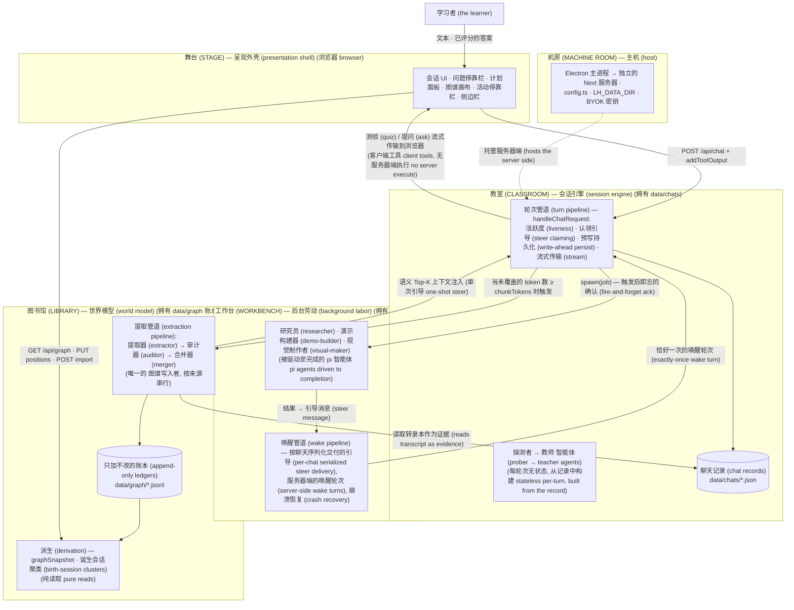

# 开发指南 (Development guide)

这篇开发者 README（于 2026-10-10 从面向用户的 README 中拆分出来）。以下内容专供参与 LearnHarness **开发** (working ON) 的人员阅读，而非它的使用者。

这是一个独立的学习应用 (web + Electron 桌面端)：包含一个 **教师智能体 (teacher agent)**（使用 Next.js；端到端使用 Vercel AI SDK 的 `UIMessage` 协议，LLM 引擎 [pi-ai](docs/pi-engine-swap.md) 通过 OpenRouter 接入），采用 探测→教学 (probe→teach) 模式的课程，并伴有带评分的 测验/提问 (quiz/ask) 互动；一棵正式的 **会话计划树 (session plan tree)**，由教师一次性编写（通过 `plan_init`），其进度通过带有标记的 quiz 调用派生而来；以及一个持久化的、跨会话的 **知识图谱 (knowledge graph)**，用于记录学习者已知的内容 — 图谱也是应用的主页。

这绝不仅是一个加上了图谱模块的聊天应用：所有的会话 (sessions) 都是 探测→教学 (probe→teach) 课程，计划树 (plan tree) 也是一个结构化、经过模式验证 (schema-validated) 的对象。各个会话的内容通过提取管道 (extraction pipeline)（即命题 propositions + 推理链 reasoning chains — 这些是存储的真相；而画布仅渲染其派生出的图像）积累到图谱中。同时，教师智能体还会根据自己的判断，通过只读的探测工具 (prober tools) 反向访问图谱，从而让探测的效果跨会话地复合增强 (compounds across sessions)。

- [`docs/architecture.md`](docs/architecture.md) 是 **规范的架构规范 (canonical architecture spec)** — 其中包含了各层 (layers)、导入法则 (import law)、五大系统 (five systems)、不变量 (invariants) 以及接缝目录 (seam directory)。（审计前的规范已存档在 `docs/archive/` 下 — 仅供历史参考。）
- 活的设计文档 (所有决策)：[`docs/vision.md`](docs/vision.md)
- 构建计划 + 阶段/门控结果：[`docs/plan.md`](docs/plan.md)

## 命令 (Commands)

```bash
npm install          # 仅需一次 (once)

npm run dev          # http://localhost:3000
npm run build        # 生产构建 (独立输出 standalone output)
npm start            # 提供生产构建服务 (serve the production build)

npm test             # 完整的测试套件 (使用 node:test 通过 tsx 运行；确定性 deterministic，无 LLM，无网络)
npm run lint         # eslint — 包含导入法则 (架构 §2)
npm run typecheck    # tsc --noEmit

npm run desktop:dev    # next dev + 指向它的 Electron 外壳
npm run desktop:dist   # 本地签名/公证 (signed/notarized) macOS arm64 构建版 (使用 LH_NOTARY 钥匙串)

# 一次性数据脚本 (仅能从主代码树运行 — 数据绝不能跨树)
npx tsx --env-file=.env.local scripts/import-notes.ts <dir>   # 批量导入笔记 → 图谱
npx tsx --env-file=.env.local scripts/backfill-graph.ts       # 清空 + 重新提取每一个聊天记录
npx tsx --env-file=.env.local scripts/replay-layout.ts        # 从账本中重新派生布局信息
npx tsx scripts/sync-pricing.ts                               # 重新生成 core/prices.ts 里的表格
```

关于 Windows/Linux 的打包方式以及三系统 CI/Release 流程，请参阅 [`desktop-release.md`](desktop-release.md)。原生渲染器 (native renderer) 二进制文件按各平台单独追踪，因此发布版只能在目标操作系统上自行构建运行，无法从 macOS 进行跨平台构建 (cross-builds)。

## 环境变量 (Environment) (`.env.local`)

仅限机密信息 (secrets) 以及因机器而异的路径配置。关于模型选择与思维预算 (thinking budgets) 的决定权在于用户，而不依赖于环境变量 — 用户的自带密钥插槽 (BYOK model slots) 配置在 **设置 (settings)**（`models` 区域内：强 strong / 廉价 cheap / 视觉 vision，包含 提供商 + 模型 id + 可选的思维等级 thinking level；各角色及特定聊天的重写配置则附加其上）。提取时的批次阈值也同样是一个可以在设置中调整的旋钮（`graph.extractionChunkTokens`，默认 4096，下限 500）。

| 变量 (Variable) | 目的 (Purpose) |
|---|---|
| `OPENROUTER_API_KEY` | 必填项 — 所有大模型 (LLM) 的调用都会通过 OpenRouter |
| `GOOGLE_SEARCH_API_KEY` + `GOOGLE_CSE_ID` | 研究员工具 (researcher's) 的网络搜索功能 (`web_search`)（需 Google Custom Search） |
| `DEEPGRAM_API_KEY` | 选填项 — 听写功能 (生成语音识别的 STT token；音频流直接从浏览器传至 Deepgram，绝不通过服务端) |
| `CHROME_PATH` | 选填项，用于演示验证时提供系统 Chrome 作为降级备选；该应用自身配备的浏览器辅助程序是首选 (绝不会在运行时额外下载任何东西) |

打包好的桌面应用会从 `userData/auth.json` 读取密钥（即自带密钥 BYOK 模式，权限为 0600，服务端通过 `LH_AUTH_FILE` 直接读写）。PDF 文件借助 pdfjs/Skia 实现原生渲染；SVG 文件使用 resvg。

## 架构 (Architecture)

分为五层 (Five layers)，依赖箭头仅指向内部，由机器通过四个 ESLint 区域强制执行（外壳层只能看到桶文件 shell → barrels only；核心层与智能体层绝不会导入自己下方的层）。两个组合根 (composition roots)，每个存储对应一个唯一的写入器 (writer)。有关层 (layers)、系统 (systems)、运行时流程 (runtime flows)、不变量 (invariants) 以及接缝 (seams) 的完整规范，详见：[`docs/architecture.md`](docs/architecture.md)。



**核心不变量 (Core invariant)：** 提取管道 (extraction pipeline)（提取器 → 审计器 → 合并器）是 **唯一的图谱写入者** (sole graph writer) — 它是无视树结构的 (tree-blind) 并事后运行的 (post-hoc)，其触发机制依赖于 token 覆盖率 (token coverage)，而不是测验的数量 (quiz counts)。各 LLM 阶段分别提出、验证并对身份进行判决 (link-or-create，基于当前图谱进行链接或创建；每个发现结果 finding 都附有原文证据并精确到具体消息级别)；确定性 (deterministic) 的合并器掌握着每个账本的追加操作（包括 ids、出处、推理链去重 — 对同一论点再次断言时，会合并在一个 `arg_` id 之下）。每一个节点都是客观、面向事实的；学习者与这些节点之间的关系仅存在于练习记录 (practice records) 中 — 它只提供反馈而绝不会写回到图谱中。教师只做教师该做的；除了账本之外，下方的一切都是派生出来的。

## 布局 (Layout)

```
app/                            Next.js App Router 路由配置 — 页面 + 16 个超薄 API 路由处理器
components/                     会话 + 主页 UI (session + home UI)、问题停靠栏、计划面板、图谱
                                画布 + 视图 (graph canvas + view)、制品渲染器 (注册表：artifacts/)、
                                听写模块 (dictation)、活动停靠栏、键盘机器 (keyboard machine)
src/
  agent/
    system-prompt.md            基础教学行为 (教学方法论)
    prompts/{prober,teacher}/   供各种角色按编号拼装的片段 (numbered fragments)
    teacher-agent.ts            探测器/教师工厂 (prober/teacher factories) (测试时允许注入引擎)
    tools.ts                    工具组合 (tool composition)；quiz / ask_user_question (客户端工具)
    tools/plan.ts               plan_init (仅编写一次的 mermaid 计划，带确定性的解析器)
    tools/probe.ts              probe_done (探测器→教师的交接缝 probe→teach handoff seam)
    tools/jobs.ts               research / demo / visual 工具表面 (tool surfaces)
    tools/web.ts                web_search (Google CSE) + web_fetch (仅供研究员使用)
    subagents/                  研究员 (researcher) · 演示构建器 (demo-builder) · 视觉制作者 (visual-maker)
                                · pdf 阅读器 (pdf-reader),
                                提取管道 (extraction pipeline) (提取器/审计器 + 合并器交接),
                                运行器 (异步协议), 原生渲染器 + 浏览器服务助手,
                                中止注册表 (abort registry)
  server/chat-handler.ts        唯一的轮次组合根 (THE turn composition root) (包括活跃度 · 引导 · 持久化 · 流式输出)
  server/turn-service.ts        轮次接缝 (turn seams)：持久化 · 触发提取操作
  server/jobs.ts                唤醒管道 (the wake pipeline)：按聊天序列化交付的 steer，
                                服务器端的唤醒轮次，崩溃恢复
  server/stores.ts              唯一的存储组合根 (THE storage composition root) — 适配器唯一接入的地方
  server/turn-liveness.ts       基于聊天的轮次注册表 (每个聊天有且仅有一个对应的正在运行的轮次)
  server/observability.ts       活动信息流 (the activity feed) (包含运行中任务 + 提取任务、中止操作)
  server/pi/                    引擎桥接 (the engine bridge)：记录适配器 (record-adapter，将记录 → pi 消息)
                                · ui 流 (ui-stream，将 pi 事件 → UIMessage SSE)
  server/index.ts               服务器层的桶文件 (the server barrel) (app/ 下的模块只允许导入此文件)
  core/contracts/{plan,graph,chat,jobs,probe,models}.ts
                                契约 (the contracts) — 每个领域对应一个文件
  core/ports.ts                 存储端口 (storage ports) — ChatStore · GraphStore · JobStore
                                (核心代码 core code 仅依赖这些类型定义)
  core/                         问题核心 (question-core)、计划树、各阶段、待处理事务、图谱
                                (包含合并/派生逻辑)、覆盖率、布局、聚类、
                                价格表、工具零部件 — 它们全都是纯逻辑：存储功能
                                以参数形式传递进来
  store/                        实现了各项端口协议的 fs 适配器： chats · graph
                                账本 · jobs (以及 render-settings, default-settings)
electron/                       桌面端启动器 + 安全守卫 (用于启动独立的 standalone
                                服务器；只提供 1 条 IPC 通道；管控 LH_DATA_DIR + BYOK 环境)
scripts/                        build-server.mjs (打包约束), import-notes,
                                backfill-graph, replay-layout, sync-pricing
data/                           chats/ · graph/ (内含 nodes/chains/sessions/coverage
                                账本 + positions/sources/render-settings 映射表) ·
                                jobs/ · settings.json — 运行时状态，被 git 忽略
```

## 关键机制 (Key mechanisms)

**客户端问题工具 (Client-side question tools)。** `quiz` 和 `ask_user_question` 不在服务器端具备 `execute` 执行逻辑：工具调用会被流式传送到浏览器，学习者在 dock 中作答，客户端通过 `question-core` 给出评判并用 `addToolOutput` 将其返还 — 随之触发 SDK 的继续流程 (continuation)，以便让教师从中断的地方恢复其教学。各个选项会被确定性地洗牌 (以 toolCallId 为种子)，所以服务器和客户端的渲染画面完全匹配。也正是因为这种已保存在聊天记录里的带有未作答测验的状态，实现了所谓的 **随时无缝恢复测验 (resume mid-question free)**。

**正式的计划树 (仅编写一次) (The formal plan tree (author-once))。** 教师利用一个受模式校验的 (schema-validated) 工具 `plan_init` 来编写会话的依赖树，其输出的 mermaid 子集会经由一个确定性的解析器解析（包含具体的出错行号）并作为有向无环图 (DAG) 接受校验。该计划树会被保存在聊天记录内；学习进度本身从不发生状态突变 (mutated) — 诸如 `current`/`visited`/upcoming 这些状态都是从记录中所带标签的测验里 **派生 (derived)** 出的，计划面板 (panel) 所展示的就是这种派生结果。

**异步子智能体协议 (确认与引导) (The async sub-agent protocol (ack-and-steer))。** `research` / `demo` / `visual` 全是服务器端执行的工具：调用触发后会在该轮的中途立即以一个即发即弃的应答 (fire-and-forget ack) 结束，好让教师可以接着往下教；在此期间，一个后台任务运行器 (background runner) 在默默并行工作 (客户端通过轮询 `/api/activity` 及 `/api/jobs` 获取最新动态)。等子任务做完，运行器会构建一条 **引导消息 (steer message)** — 它实质是一条模拟的用户发言 (user-role `UIMessage`)，文字部分是给大模型看的结果，内部的 `data-subagent-artifact` 部分则负责带着最终效果展示给客户端看 — 接下来由 **唤醒管道 (wake pipeline)** 将其交付：一个隶属该聊天的顺序化队列会等待当前轮次彻底落定，且在没有问答题处于等待状态时，强行触发一个来自服务器端的教师发言轮次 (server-side teacher turn)，从而将结果天衣无缝地编织进课里去。交付逻辑保证了 **仅仅执行一次 (exactly-once)** (拥有确定性的引导 steer ids，每个认领点都会严查 delivered 标记)；那些卡死的任务在被访问时就会恢复 (recovered on read)；被放弃的任务则会传递一条撤销引导 (abort steer)。客户端利用原本负责无缝回连 (returning mid-stream) 的那一套 `turnInFlight` 机制（比如闪烁的 shimmer 加载态、消息框门控 composer gate）直接接管该唤醒轮次，并把这些 steer 处理成视觉制品 (artifacts) 呈现 — 而绝对不会去画一个聊天气泡。各个子智能体只会 **进行核实，绝不一次性赌博 (verify, never one-shot)**：demo 构建器 (demo-builder) 在交付结果前会在应用本身自带的 Chromium 浏览器服务中运行其 HTML ；视觉构建器 (visual-maker) 会用原生引擎点阵化各个 SVG 并亲自“看”一眼 (需具有视觉能力的大模型 — 具体在设置里的 `vision` 插槽里配置)。

**知识图谱 (两条通道, 唯一的写入者) (The knowledge graph (two channels, one writer))。** 写入通道：也就是提取管道 (extraction pipeline) — 第一阶段，提取器 extractor (由大模型负责：它能看到信源，即那场会话里教师的原话或拆分的笔记块，以及该信源自身生成的摘要内容 — 所谓 **图谱的现有成果 THE GRAPH SO FAR**：即已从该信源里抽出来的命题和链条及其相应的 id 都会原样保留 — 这是于 2026-09-30 晚对“具有摘要感知”功能的重构：提取器本质上 **就是** 组装器，它不去复述，而是靠引用现成的 id，并将那些既定结论顺势作为前提；这个阶段被 100% 信任；它要交付的产物包括核心思想和推理链 (reasoning chains)：通过前提的叠加，推导出一个明确的结论，提交时它是一条条链，存入时也是链 — `chains.jsonl` 就是唯一的真理，至于边缘 (edges) 纯粹是个派生视图；这是基于负责人的重新设计 + 以链为尊 (chains-primary) 思想，2026-09-30) → 第二阶段，审计器 auditor (同样是 LLM，一个永远看不到信源的智能体循环：它通过诸如 `find` / `list_sessions` / `list_propositions` 等工具探索现有的图谱并对各个命题盖下确权判定戳 — 到底是关联向既有节点 (等价性偏好 (equivalence bias)：同义替换将会合并) 还是新建) → 最终，合并器 merger (名为 `mergeFindings`，具备确定性：落实那些判定结果、对词句/出处附加关联(link-appends)、解决并删减重名的链 (resolves and dedupes) — 对同一观点再次重申时会被合并到同一 `arg_` id 之内；紧接着一条执行链条化简的环节，负责把可验证的冗余推导统统剪掉 — 它恪守“采用更少前提” (prefer-fewest-premises) 和“利用祖先覆盖” (ancestry-cover) 法则 — 随之记录一次覆盖率校验点) → 布局的安顿 (layout settle)。单一信源的一批任务会被严加管控，必须严格按顺序运行 (每一轮接手的提取器必然继承之前每一次合并过后的摘要)。这个图谱里从来不会存放任何有关测验成果或是对理解度的测评内容 (2026-09-27 的清仓整顿)；练习模式 `/practice` 则只是去消费这张图，纯粹为了获得反馈性质的习题集，绝不会再反手向里写入什么。这套机制在检测到某场聊天里的 **未覆盖词令 (uncovered tokens)** (根据消息的各种指纹特征算出来的，放在 `coverage.jsonl` 里) 超过配置参数 `graph.extractionChunkTokens` (一个设置旋钮，默认 8192，下限 500 — 每一轮都会去读新鲜的值) 时触发；要是一旦出错，没有任何状态会被记录，下一次触发器自会再去重跑一趟。这一套管道同样也是服务于 **笔记门面 (notes front door)** 的那套机制 (`POST /api/graph/import`: 所有 `*.md`/`*.txt` 统统都能化身成信源；其借用路径特征字哈希完成了应对重复导入的冥等机制)。读取通道： `GET /api/graph` 会根据那些账本内容派生出一份快照 (snapshot) — 这纯粹是一次只读操作 (由 `deriveView` 这个函数全权负责重构一幅有折损的投影图像 (lossy image)：所有的逻辑链都会变身成带有 `⟹` 符号的“蕴含节点”(implication node) 并带着从 前提→蕴含→结论 的重重箭头，所以同一个结论上的两个独立支撑依据会被保留成两颗互不干扰的钻型图标)；首页 (home view) 提供了一套手写的基于 Canvas 2D 的渲染器 (一套专门配给 rAF 的动画循环机制、针对脏标记的处理、具备 d3-zoom 相机操控，根据缩放幅度遮掩各类标签、包覆不同聚类的外壳) 来配合原本处于底层的基于 d3-force 的布局排版逻辑，并辅以那套由服务端保存下来的渲染设定以及用户硬拖拽留下的节点定位。群集 (Clusters) 则是按 **原生诞生它的会话 (birth-session groupings)** 进行分组归类的结果：不论这个节点诞生在普通的聊天中，还是一份视为“文件”类会话的导入笔记里，它都会被塞入它诞生地对应的那个群集中，这全靠读取时直接派生而出 — 这里绝没有任何嵌合步骤 (embedding pass)，更无命名步骤。唯有凭借受限的探测工具 (`list_sessions` / `list_propositions`，以及那条开启与否的 `agent.graphTools` 设置)，教师能按它自己的节奏触达这个图谱 — 这里不会有任何由系统发起的“自动化”上下文灌入 (automatic context injection)。

**练习 (习题集) (Practice (problem sets))。** 对节点的圈选最终会根据所选结果精确解析并提炼出内部 **存好 (STORED)** 的全套推理链 (a chain rides iff every member is selected；唯有当全链的节点均被圈中时该链才会生效；零散没连成链的自然就只是一颗孤立节点)；通过 `/practice` 页面中的创建对话框，可以在一堆根据诞生会话而划分的聚类簇 (birth-session cluster)（即图谱视图上那些由聚类群所形成的分组）中挑选一个簇，并把里面的那些命题 + 推理链条统统封存进一份独立完整的 `ProblemSet`。顺带着还有三个可自定义的具名档位轴 (named-level axes) 能够掌控题目的生成调性 (比如 0–4级的阶梯进阶 (ladder rung)，0–2的线索跨度 (cue distance)，还有到底是 理论 (Theory) 还是 应用 (Application) — 唯独这轴上的数值无法凭空做插值过渡；默认档是直接练习 (Direct exercise) · 近源语境 (Adjacent context) · 理论 (Theory))，外带一段任由学习者留下的随心寄语笔记，大模型必须过目并掂量一下，虽说没义务必须照做。有两个方式能唤出创建界面：一个是位于 `/practice` 里原本就有的聚类拾取器，再就是进入图谱视图所拥有的独门兵器——链条管理列表 (chain table) — 一份通过共享的顶栏进行统一管理的无边界全幅版面 (full-bleed)，里头容纳着所有推理链的大杂烩表格，全数通过出生地所在聚类被有序地罗列了出来，供你点击各种筹码标签、连结链条、或整串聚类群；此时底部的浮动面板会立刻给出大模型最后到底会吃进啥的详尽通告 `N 个节点 (nodes) → M 条连结 (chains)` — 当你敲定主意并把随心框选的节点名单交付给这同样的对话框时 — 附带着旁边一个单独被隔开的 Delete 按钮，这使得该列表也同时变成了整张图谱最高级别的管理台面 (即使想要顺藤摸瓜一口气全灭一整个聚类，全走同一套不打折扣的处决确认机制 (full-death confirm dialog))。接下来由负责切割的大模型 (partitioner agent) 把每一个逻辑链完美分割、绝不遗漏 (covers every chain exactly once)，并为每道切割后的模块单独配备一名针对该题做专门处理的生成器，生成器的行事宗旨统统都得向负责人的核心工程思想框架看齐 (要求一次性给出：题目 + 解法 + 考核评估点 (commit-before-pose))，而在打分环节，其主旨就是 **单纯用来强化，绝不是用来当考核评估使的 (strengthening, not assessment)** — 所有题目仅供提交一次解答的机会并配备唯一的专属提交按键，只要一提交就瞬间曝光标准答案及对应考核点，随后当场给出 0–10 的具体评分并辅以一段言简意赅的原因解释；没有一个字、哪怕是个符号会被逆向反写回图谱里。这一切的运作全部都是挂在底栏 (activity dock) 里由那套背后默默跑着的任务调度注册机制来掌控 (不用引导 (no steer)，而且教师永远都不会被唤醒)；题库集合全部乖乖躺在 `data/practice` 文件夹下，等着每次崩塌重启时由初始化清理例程 (crash-swept) 把残渣带走。

**听写功能 (Dictation)。** 选配的语音转文本：服务端可以铸造一张有着有效期限制的 Deepgram token；通过 WebSocket，原生的音频流会毫无保留地从浏览器端直接输送到 Deepgram，绝不会穿过咱家自己的服务。

## 测试 (Testing)

所有测试都是完全确定性的 (All deterministic)，不包含大模型 (LLM)，也没有网络请求 (引擎全是注入的 — 比如利用为单项测试单独撰写脚本文档所做的 pi-ai 虚拟服务 (faux provider)；如果是重点传输的地方，则对 `globalThis.fetch` 打上测试桩 stubbed)：

1. **纯核心单元测试 (Pure core units)** — 合并流程（跑在一套通过备份/还原保护下来的模拟现实状态的 fs 适配器之下），推导，覆盖率检查，问题评分，生成计划的推导树，运行阶段状态，聚类运算，排版分布规划，组件构建块以及价格模块。
2. **服务器流向测试 (Server flows)** — 使用被精心注入了脚本规则的引擎，将 `handleChatRequest` 执行全链路的贯穿：包括持久性验证、活跃状态检测，引导消息确认、连带那些被唤醒通道激发的各个小分支（409 防冲突重试机制、应对等待测评结果被推迟的机制，保证绝对执行的幂等性 (idempotency) 验证），还有灾难修复测试 (crash recovery)，外带这套为挂载数据夹单独定做的接口保护屏 (data-dir seam) 测试 (专门弄出个干干净净一尘不染的全新子进程在里头瞎折腾)。
3. **子智能体循环 (Sub-agent loops)** — 研究员/演示代码开发兼视觉开发，外包着一套全用虚假 API 做出来的无头浏览器；贯穿提取管道前后的各个关键动作（模拟审核报告内容遗失，确保一旦搞砸休想留下一丝存档进度的假象 (failure-checkpoints-nothing)，保证了单飞机制，还外带一套中止处理）。
4. **渲染测试 (Render tests)** — 逐行核对脚本文字，检查名片、浮出层 (docks)、消息编辑器输入框，验证了侧滑抽屉菜单还有通过 React 服务端直出的手段验证覆盖率。
5. **黄金虚假标本库 (Golden fixtures)** (`tests/fixtures/golden-data/`) — 一套 **纯真 (REAL)** 的数据文件（这些绝不可能是手敲出来的，全是该应用程序本身生产的真实成果记录文件），将它原模原样地复刻到临时的测试文件夹下，并通过名为 `LH_DATA_DIR` 的数据夹分流屏，利用生产系统专属的验证口原封不动地全吃一遍。这种固化手法正是确保了，只要这玩意能解得开，就等于顺利被碾平成符合大模型安全格式的一套正规线缆输入、从上至下完美演绎了一把出成那张网的全貌，不放过在暗处所有带自定义记号的点，而且，确保这种所谓“看看”的操作绝不可能导致一丝往里面写入东西的举动。**虚假样本大律法 (The fixture law):** 在开发路上若是想稍微改动一下盘踞在磁盘之上的核心骨架形态时，那你就必须连带着同次提交操作，也将虚假数据库中关联着的东西顺带都更新了——还请参见 fixture 里的专门说明。

## 传承 (Lineage)

这种教学方法论起源于之前所做的基于 Obsidian 的 POC 概念验证尝试（那份当时被称为 `knowledge graph design.md` 的原始稿件曾是这套“认知论”架构思想的发源地，此后也有了进一步演进修改 — 可见于 `docs/vision.md` 下记载了各项决议修正的表单）。这套系统最初是采用 pi 智能体 SDK 打造的，随后迁移至基于 Next.js 独立构建的形式，并借以搭配 Vercel 提供的 AI SDK 工具套件。到了后期，为了能在客户端这边全盘沿袭其底下的那套 `UIMessage` 通信协定，我们保留了前端的 AI SDK 并把身后驱动对话用的 LLM 引线重新焊回了 pi-ai 上 ([`docs/pi-engine-swap.md`](docs/pi-engine-swap.md))。

## 数据 (Data)

`data/` 目录下的所有一切内容统统 **不得 (never)** 由 git 来跟踪。除了配置文件，什么聊天资料啊，图谱的台账明细，以及各个进程节点跑出的落点坐标都只是一些单纯普通的文件包 (JSON/JSONL) 而已 — 随便由你们自己爱怎么打开看就怎么打开看；它们是实打实经过规范了的内容。在打好的桌面应用版本里，这个装了重要底细的目录直接利用 `LH_DATA_DIR` 来全员乾坤大挪移。

**Schema 版本戳记 (Schema stamps) (2026-10-10):** 聊天明细文件内附带有 `version` (这是由于把手卡在文件流被存下的瓶颈关卡处而硬给生盖上去的；只要查无此印那就通通当 v1 来办 — 就是偷了个懒用着拖延流做法，死活不对底仓翻箱倒柜全涂上一遍)；这全家福的图谱文件包（台账、出处来源、连带那些在展现层面上的自定义记录）则只用了一个 `graph/format.json` 文件放在一边共享它，并且这戳印是在写入图谱全家福第一个成员时同时跟着下发的。不过那个代表落位资料的 `positions.json` 被有意排除了印记范围（这货是可以自己再生的嘛）。那些只要是被标上的戳印比正在狂奔的系统本体所配发的批号还要 **更加新鲜 (NEWER)** 的记录档案，将在调取时被强行弹回 — 专门为防降级乱吃新粮留出的最直白的闭门羹套路：这读-写-改一体的操作台规矩就是从来不去重新粉刷那些它还无法消化的内容。