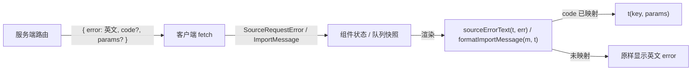

# LearnHarness 来源系统中文国际化（第一期）终版方案

> 输入：`code_artifact.md`（原方案）、`审核.md`（审核意见）、对当前仓库代码的核验、用户对 3 个设计问题的裁决（2026-11-06）。
> 状态：已批准并实施。

---

## 0. 裁决摘要

| 议题 | 原方案 | 审核意见 | **终裁** |
|---|---|---|---|
| 总体路线 | 新建 `src/i18n` + `getI18n` + 函数型字典 | 与现有体系重复冲突 | **否决原方案；复用现有 `components/i18n`（`t("a.b", {param})`）** |
| 语言字段 | 新增 `locale`（顶层/`appearance.locale`） | 已有 `general.language`（含 `auto`） | **只用 `general.language`，不改任何设置字段与存储** |
| 设置页 UI | 新建 `InterfaceLanguageRow` | 已有 `InterfaceLanguageSetting` | **不动** |
| 服务端错误 | 服务端按设置直接翻译 | 破坏 `isModelsRefusal` 等；无法处理 `auto`/后台任务 | **用户裁决：服务端保持英文 `error` 不变，追加稳定 `code`（+`params`）；客户端按 code 翻译，未知 code 回退原英文** |
| 词典内容 | 臆造文案 | 与代码不存在对应 | **从真实 UI 重新盘点；`en` 值必须与当前字面量逐字一致** |
| 新增规则（文件夹名 64 字符、重名校验、415） | 混入 i18n | 属于行为变更 | **剔除** |
| 删除文件夹文案 | 描述不存在的行为 | 真实行为是只能删空文件夹 | **剔除，以真实弹窗文案为准** |
| `<html lang>` / 首屏闪烁 | 仅 `useEffect` | 无 SSR 方案 | **用户裁决：只同步 `document.documentElement.lang`，闪烁留待后续** |
| 中文字体回退 | 改 `--font-sans/--font-ui` | 选错变量且引入回退退化 | **用户裁决：不动字体** |
| `src/i18n` ESLint zone | 口头承诺 | 无机器强制 | **不新建 `src/i18n`；共享错误码放在 `src/core`，经现有 barrel 导出，自动受现有 zone 约束** |
| Windows 下 `npm test` | 作为门禁 | POSIX 语法在 win32 不可用 | **不改 `package.json`，给出 PowerShell 等价命令** |

---

## 1. 现状

- 设置：`src/core/settings.ts` `AppLocale = "auto" | "en" | "zh-CN"`，位于 `general.language`，默认 `"auto"`。
- 客户端：`components/i18n/context.tsx` 提供 `I18nProvider` / `useI18n` / `resolveEffectiveLocale`，键有类型（`I18nKey`），`{param}` 插值；根布局已挂载。
- 无 Provider 时 `useI18n()` 回退 `"auto"`，Node 环境下解析为 `en`，因此现有 `renderToStaticMarkup` 测试仍看到英文。
- 来源 UI 真实位置：`chain-table.tsx`、`source-folder-tree.tsx`、`delete-source-dialog.tsx`、`notes-import.tsx` + `notes-import-queue.ts`，入口按钮在 `graph-view.tsx`、`minimal-home.tsx`。

---

## 2. 范围

### 本期包含
1. 上述文件中全部用户可见文案（含 `aria-label`、`placeholder`、`title`、`Hint`）。
2. 这些界面上客户端自行生成的错误。
3. 用户可经 UI 触发的服务端错误：追加 `code`，客户端翻译。
4. `document.documentElement.lang` 同步到解析后的语言。

### 本期不含
- 其它未翻译界面（图谱设置面板、`job-card.tsx` 等）。
- BYOK 拒绝文案（`models_not_configured` / `provider_key_missing`）：保持英文。
- 透传的提供商/抽取流水线错误详情。
- UI 不可触发的协议错误（非法 action/ID/路径、`"no files"`、组织请求过大、`source-organization.json` 损坏、`delete-folder` action）。
- Extractor/Auditor Prompt、抽取命题语言、首屏闪烁/SSR、字体、文件夹名新规则、CLI 输出、`package.json` 跨平台改造。

---

## 3. 设计



- 服务端永不改变英文 `error`，只追加字段。
- 客户端存储结构化数据（code + params + 英文兜底），渲染时才生成文本，切换语言即时生效。

### 3.1 i18n 基础设施（`components/i18n`）
1. `createTranslator(locale)`：抽出查找 + 英文回退 + 插值为纯函数，Provider、无 Provider 回退与测试复用。
2. 复数：`xxx_one` / `xxx_other` 成对键 + `pluralKey(count, one, other)`。
3. `I18nProvider` 新增可选 `initialLocale?: AppLocale`（默认 `"auto"`），仅作测试缝。
4. `I18nProvider` 中 `useEffect` 同步 `document.documentElement.lang`。

### 3.2 共享错误码（`src/core/source-errors.ts`）
`SOURCE_ERROR_CODES`、`SourceErrorCode`、`SourceOrganizationError`。

### 3.3 客户端错误辅助（`components/source-error-text.ts`）
`SourceRequestError`（`message` 恒为英文）、客户端专用码、`sourceErrorText(t, error)`。

---

## 4. 服务端改动（只加字段，英文不变）

| 文件 | 改动 |
|---|---|
| `src/core/source-organization.ts` | `applyOrganizationAction` 的 4 处错误改为 `SourceOrganizationError`：`parent_folder_missing`、`source_missing`、`folder_missing`、`folder_cycle` |
| `src/server/source-organization.ts` | `SourceOrganizationInputError` 增加可选 `code`；`change()` 透传；`rename-source` 分支加 `source_missing` |
| `app/api/graph/sources/route.ts` | POST 400 带 `code`；GET/POST/DELETE 500 分别带 `directory_read_failed` / `organization_save_failed` / `deletion_incomplete` |
| `app/api/graph/import/route.ts` | 路由级 `import_body_too_large` / `import_body_unreadable` / `import_too_big`；逐文件 `pdf_unreadable` / `pdf_too_long`(+`params.maxPages`) / `pdf_no_text`；PDF 成功追加 `noticeCode: "pdf_scanned"` + `noticeParams.skipped` |

## 5. 客户端改动

- 导入队列快照 `errors` / `notices` 改为 `ImportMessage[]`；`useNotesImport` 内部用 `useI18n()` 格式化后仍返回 `string[]`。
- 仅当 code 为 BYOK 拒绝时才附加机器明细行，保持现有输出。
- `postNotesImport` 非 2xx 抛 `NotesImportRequestError`（`message` 与现状逐字一致）。
- `formatImportMessage(m, t)`：英文输出与现状逐字节一致。
- 组件文案全部经 `useI18n().t` 替换。

## 6. 词典

新增 `sources` 命名空间（`entry` / `table` / `tree` / `deleteDialog` / `import` / `errors`），见 `components/i18n/locales/en.ts` 与 `zh-CN.ts`。`en` 值逐字复制原字面量。

## 7. 测试

- `tests/i18n.test.ts` 的键结构一致性测试自动覆盖 `sources.*`；新增 `createTranslator` / `pluralKey` 用例。
- 导入路由测试中对错误体的 `deepEqual` 增加 `code`；队列测试改为经 `formatImportMessage` 断言，英文期望不变。
- 新增 `tests/sources-i18n.test.tsx` 覆盖中文渲染、`sourceErrorText`、`formatImportMessage` 双语。

## 8. 质量门禁（Windows PowerShell）

```powershell
npm run typecheck
npm run lint
$env:NODE_ENV = "test"; npx tsx --test "tests/*.test.ts" "tests/*.test.tsx"
npm run build
```

## 9. 实施中的偏差（已记录）

1. **新增 `import_busy` 错误码**：方案原拟由客户端按 `outcome === "busy"` 映射，但现有测试中 busy 结果携带任意英文 error，按 outcome 映射会改变英文输出。改为路由在 `NotesImportError.outcome === "busy"` 时追加 `code: "import_busy"`，客户端按 code 翻译。
2. **无 Provider 时 `useI18n()` 固定回退 `en`**（用户裁决）：本机 Node 的 `navigator.language` 为 `zh-SG`，测试经 linkedom 设置全局 `window` 后，原 `"auto"` 回退会解析为中文，使英文 UI 测试依赖机器语言。生产始终挂载 Provider，不受影响。
3. **中文 `importRequestFailed` 标点**：内层服务端文案若是未本地化的英文且以 `.!?` 结尾，追加空格而非“。”。

## 10. 验证结果

- `npm run typecheck`：通过。
- `npm run lint`：0 错误（1 条既有 warning，与本改动无关）。
- `npm run build`：通过（Turbopack 4 条既有 warning）。
- 相关测试 14 个文件 158 条全部通过。全量测试中的既有失败（`auth-store` 0600 权限、SIGTERM、`LH_DATA_DIR`、composer `"Stop"` 标签等）与本改动无关，且全量运行存在既有的挂起用例。

## 11. 风险与遗留

- 英文逐字一致是主要回归风险。
- 未映射 code（`not_found`、`invalid_source_deletion`、BYOK、透传错误）回退英文。
- 存储零改动。
- 二期开放问题：首屏闪烁/SSR、CJK 字体、BYOK 按码匹配、中文笔记的抽取语言、其余界面翻译。
