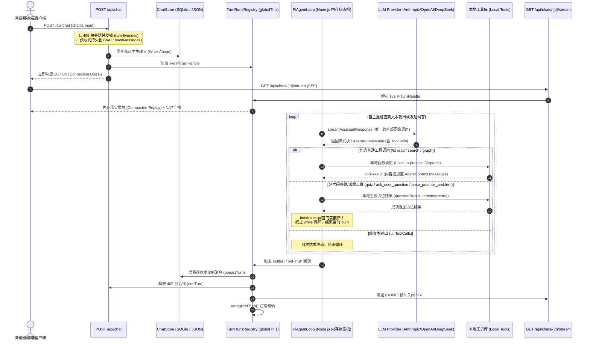

# PiEngine Agent Loop 深度架构解析与技术关键点

本文档与 [`docs/PiEngineAgentLoop.java`](file:///d:/0.default/learnharness/docs/PiEngineAgentLoop.java) 配套，系统性阐述服务端自主推理与工具调用闭环（PiEngine Agent Loop）的运行机制、生命周期流转与 5 项特殊关键技术点。

---

## 一、 系统架构与闭环执行时序

---

## 二、 关键与特殊技术点深度剖析

### 1. 连接节食 B (Connection Diet B：POST 200 与 SSE 视口解耦)
- **背景与痛点**：在浏览器标准中，针对同域名（Same Origin）的并发 HTTP/1.1 Socket 限制通常为 6 个。如果 `POST /api/chat` 一直挂起长连接直到多轮 Agent 循环彻底结束，在并发多窗口、多会话或学生频繁提交时，这 6 个连接池会迅速被耗尽死锁，导致页面其他请求完全挂起。
- **架构方案**：
  - `POST /api/chat` 只负责：**参数校验 $\to$ 409 防并发锁 $\to$ 预写落盘 $\to$ 拉起后台内存 Turn $\to$ 注册内存句柄 $\to$ 立即响应 200 OK**。
  - 智能体循环是纯粹的**服务端后台对象**，不依赖 POST 请求的生命周期。
  - 客户端收到 200 确认后，通过独立的 `GET /api/chats/{id}/stream` 单独挂载 SSE 视口（View）。即便用户中途刷新页面或关掉标签页，服务端的推理与工具调用依然在内存中可靠执行并自动落盘。

### 2. 预写式日志持久化 (Write-Ahead Persistence, WAL)
- **源码映射**：`src/server/chat-handler.ts` 中的 `stores.chatStore.saveMessages(chatId, merged)`。
- **关键规则**：在构建 Agent 和启动 `runPiTurn` 之前，学生的答题输入必须首先完成本地持久化。
- **容灾价值**：若由于模型 API 限流、进程崩溃、断网等极端异常导致循环未跑完，由于用户输入的持久化已先于执行完成，用户重新进入后依然能读取到真实会话状态，不会出现“用户输入凭空消失”或“状态回退”。

### 3. 双重防御性问答题截断 (Belt-and-suspenders Question Stopper)
- **源码映射**：`src/agent/tool-execute.ts` (`questionResult`)、`src/agent/teacher-agent.ts` (`makeQuestionStopper`)。
- **机制原理**：
  1. **第一层（工具层 Native Terminate）**：`quiz`、`ask_user_question` 与 `pose_practice_problem` 在本地执行完毕后返回 `terminate: true`。在纯出题批次中，`agent-loop` 发现本批次所有工具都请求终止，自动停止下一轮推理。
  2. **第二层（钩子层 finishTurn 复合批次兜底）**：若模型在同一条 Assistant 消息中“既调了普通检索工具，又发起了出题”，第一层机制可能让其继续往下跑。因此在 `finishTurn` 钩子中，`makeQuestionStopper` 深度检查是否有问答题调用。
  3. **原地自愈容错（Validation Self-Healing）**：若模型调用的 `quiz` 参数非法（例如少传了选项或格式错误），工具返回 `isError: true`。此时 **Stopper 绝不截断**，而是把校验错误喂回给模型，允许模型在同一个 Turn 内原地纠错重试！只有当题目成功提出（无错误）时才正式截断。

### 4. 事件日志内存压实律 (The Compaction Law & Wire Diet)
- **源码映射**：`src/server/pi/ui-stream.ts`。
- **痛点**：对于具备 Deep Thinking（超长思考链）的模型，单次回复可能产生数千甚至数万个流式 Delta Chunks。如果内存无脑保留所有 Chunk，单会话内存占用可达数百 MB，多会话并发时极易引发 OOM，且重连回放极其耗时。
- **策略**：
  - **In-flight 原地替换 (Replace-in-place)**：流式生成中的 Assistant 消息，内存日志只保留该 slot 的**最新全量快照**，旧的中间帧直接覆盖。
  - **有界回放**：重连（Reattach）客户端回放的历史事件只包含**“已完结历史帧 + 1 帧当前流式快照”**，回放复杂度从 $O(\text{chunk 数量})$ 降低为 $O(\text{消息长度})$。

### 5. 跨轮次工具 ID 去重修正 (The Lacan Fix)
- **源码映射**：`src/server/pi/call-ids.ts` (`ToolCallIdUniquifier`)。
- **问题**：部分国产大模型提供商（如 DeepSeek）在流式工具调用时存在特殊行为：每一轮新的推理输出，其生成的工具调用 ID 均重置为 `call_0`。如果多轮循环持续推进，`call_0` 会发生严重覆盖冲突。
- **对策**：在 `ui-stream.ts` 的事件总线边界处，设置 `ToolCallIdUniquifier` 拦截器，动态维护已见过的 ID 集合，将重复的 `call_0` 动态映射重铸为唯一的别名，使持久化记录、前端视口与下一轮模型上下文完全对齐。

