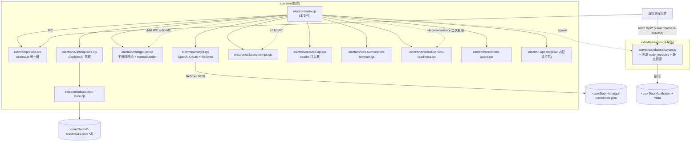
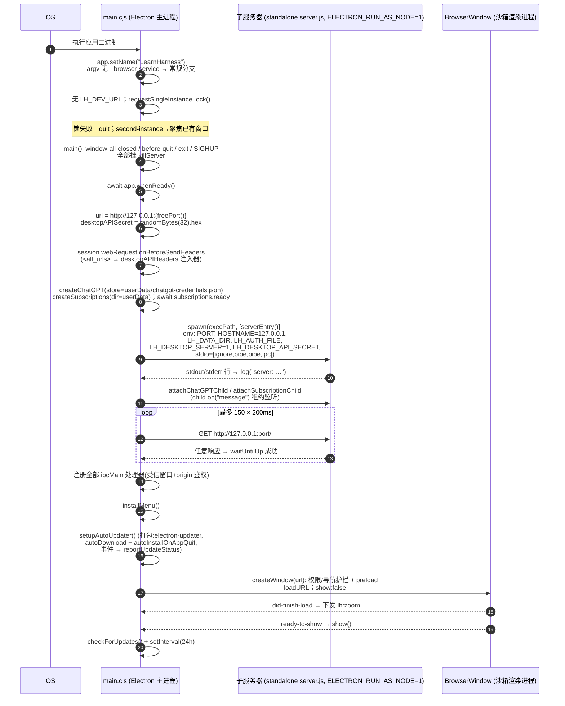
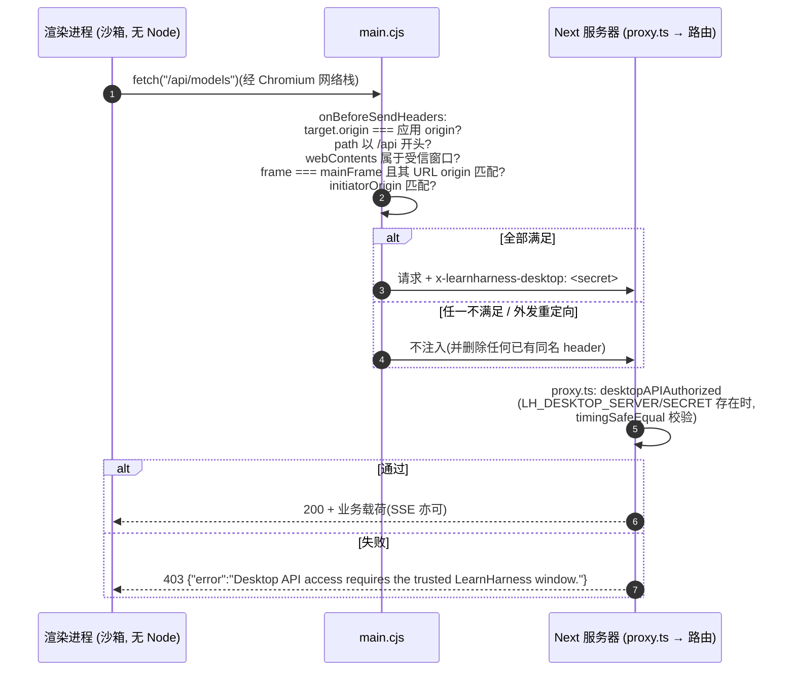
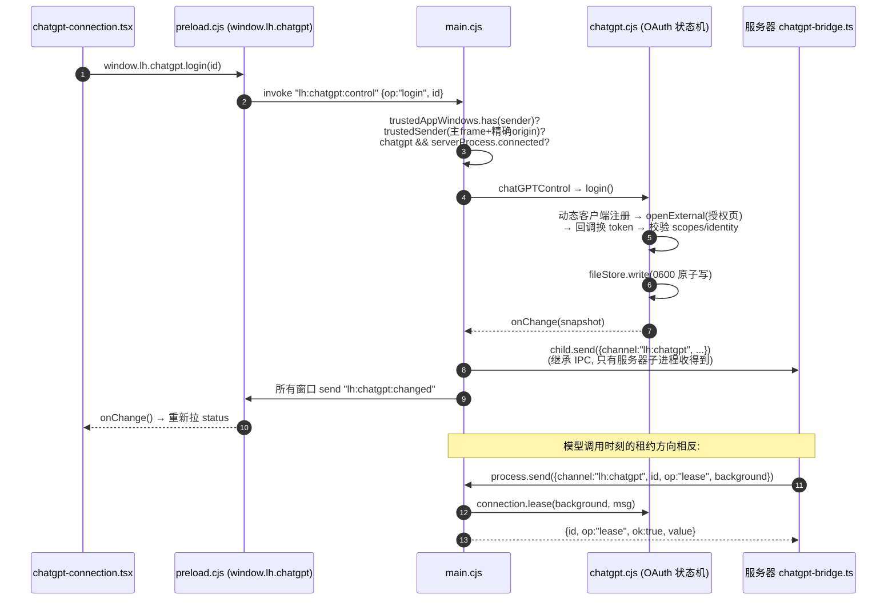
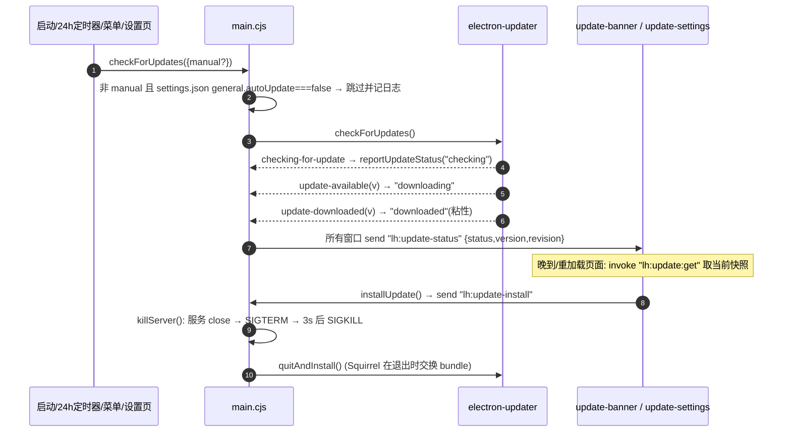
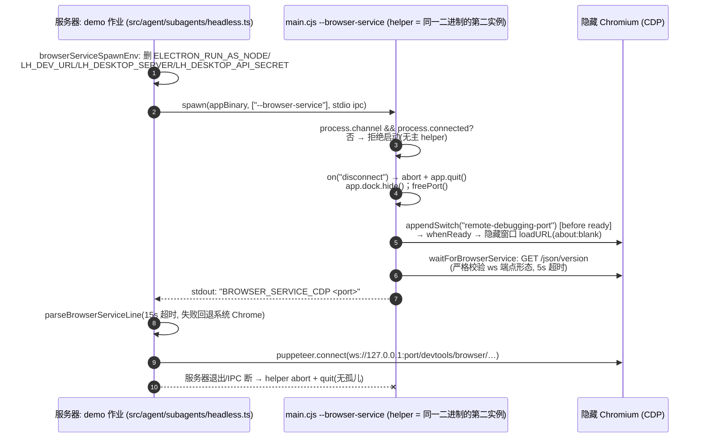

# `electron/main.cjs` 深度解读报告

> 代码库:`lh`(LearnHarness — 一个面向学习的 Agent 系统:自适应教学、练习与持久化知识图谱;Next 16 + React 19 + Electron 44,AGPL-3.0,版本 0.4.1)
> 分析对象:`electron/main.cjs`(756 行,`package.json` 的 `"main"` 入口)

---

## 1. 代码功能

### 1.1 一句话定位

`main.cjs` 是 LearnHarness 桌面版的 **Electron 主进程**,但它的自我定位非常克制(文件头注释明确写出):

- **是(IS)**:一个"薄启动器 + 安全护栏"。它真正的职责只有一件事——把 Next.js 16 `next build` 产出的 **standalone `server.js`** 作为子进程拉起(绑定 `127.0.0.1` 随机端口),并把应用全部真实逻辑(教学轮次、知识抽取、图谱)原封不动留在 Next 服务器里运行。
- **不是(NOT)**:任何应用逻辑的宿主。主进程不实现教学/图谱/会话逻辑,只做进程编排、安全边界、窗口外观、自动更新与凭据 OAuth 门面。

整个产品由此形成一个 **四进程模型**:

| 进程 | 载体 | 职责 |
|---|---|---|
| Electron Main | `electron/main.cjs`(+ asar 内各 `.cjs` 模块) | 进程编排、安全护栏、窗口/菜单/缩放/自动更新、ChatGPT 与订阅(OAuth)凭据的**主进程保管者** |
| 子服务器 | `Resources/server/standalone/server.js`,以 `process.execPath + ELECTRON_RUN_AS_NODE=1` 启动(复用 Electron 内置 Node 24) | 全部业务:Next API 路由、agent、图谱、作业渲染 |
| 渲染进程 | 打包窗口加载 `http://127.0.0.1:<port>` | React UI;沙箱化(`contextIsolation + sandbox`,无 Node),唯一出口是 `preload.cjs` 的 `window.lh` |
| 可选 helper | 同一二进制带 `--browser-service` 启动 | 无头 Chromium(CDP),供服务器端 demo 作业执行 JS 用 |

### 1.2 启动分支(模块顶层,第 78–135 行)

文件顶层是一个**三重分叉**,顺序有严格讲究(注释逐条说明原因):

1. **`--browser-service` 分支**:本二进制被服务器以 helper 方式二次启动时:
   - 强制要求 `process.channel && process.connected`——**拒绝无父进程的孤儿 helper**(Windows 上 Electron 会把 stdin 替换为合成 EOF,所以用真正的 Node IPC 通道判定归属);
   - 监听 `disconnect` → abort + `app.quit()`,保证"父死子亡,永不孤儿";
   - `app.dock?.hide()`,`freePort()` 取空闲端口,`app.commandLine.appendSwitch("remote-debugging-port", …)` **必须在 `app.whenReady()` 之前**才能让 Chromium 读到;
   - 建一个 `show:false` 的隐藏窗口加载 `about:blank`(保持各平台应用生命周期"正常"),用 `browser-service-readiness.cjs` 对 CDP 的 `/json/version` 做**严格就绪校验**(端点必须是 `ws://127.0.0.1:<port>/devtools/browser/<token>`,无用户名/查询/哈希),然后向 stdout 打印握手行 `BROWSER_SERVICE_CDP <port>`。
   - 该分支**必须在单实例锁之前**执行——helper 本就是这个二进制的"第二个实例",不能误触发锁退出。

2. **`LH_DEV_URL` 分支(开发壳)**:dev 壳与打包应用**并存而非替代**——`app.setPath("userData", …-dev)`,让 dev 壳有独立 userData,既不碰真实应用的单实例锁,也不读写真实应用的 `localStorage`/`auth.json`/日志。

3. **单实例锁**:`app.requestSingleInstanceLock()` 失败即 `app.quit()`;`second-instance` 事件则恢复并聚焦已有窗口。锁通过后才 `main()`。

其余模块级设施:
- `app.setName("LearnHarness")`:强制 userData 目录名(打包 Electron 默认会从 `package.json` 的小写 `name` 推导),dev 下变为 `LearnHarness-dev`;
- `AUTH_FILE()` / `DATA_DIR()` 均挂在 `app.getPath("userData")` 下(可写状态永不进 `.app` 包——translocated 应用只读);
- `process.on("uncaughtException")` **只记日志不崩溃**——GUI 壳绝不能因一个 EPIPE 或事件竞态带崩窗口+子服务器;
- `freePort()`(listen(0) 让内核分配)、`log()`(stdout 写入被 try/catch 保护防 EPIPE,**且**同步追加到 `userData/logs/main.log` 作为持久通道)。

### 1.3 子服务器管理(第 201–280 行)

`startServer(port)` 是核心:

```js
spawn(process.execPath,
  darwin ? ["--require", <resources>/server-title-guard.cjs, serverEntry()] : [serverEntry()],
  { cwd: <server dir>,
    env: { ...process.env,
      ELECTRON_RUN_AS_NODE: "1",   // Electron 二进制当 Node 用
      NODE_ENV: "production",
      PORT: <port>, HOSTNAME: "127.0.0.1",   // 服务器默认 0.0.0.0,这里钉死回环
      LH_DATA_DIR:    <userData>/data,        // 全部可变数据(seam)
      LH_AUTH_FILE:   <userData>/auth.json,   // BYOK 密钥库,子进程自读自写
      LH_DESKTOP_SERVER: "1",
      LH_DESKTOP_API_SECRET: <32字节随机hex,每次启动生成> },
    stdio: ["ignore", "pipe", "pipe", "ipc"] })  // 第4个fd = Node IPC 通道
```

要点:
- **`server-title-guard.cjs` 仅 macOS 注入**:Next 会给 `process.title` 赋值,Electron Node 模式下的原生 setter 会向 Launch Services 注册一个不想要的前台应用;guard 把 `process.title` 重定义为纯 JS 读写。
- **密钥不再由壳注入 env**:"auth-keys wave" 之后,`auth.json`(扁平 `{VAR: value}`,明文 0600)由**子服务器自己**读写并反射进自己的 env——设置页改一个 key,下次模型调用即生效,无需重启。壳只负责把路径 `LH_AUTH_FILE` 递过去。
- **IPC 通道(stdio[3])**:子进程凭据租约通道。`attachChatGPTChild` / `attachSubscriptionChild` 在 main 侧挂 `child.on("message")`,处理 `{channel:"lh:chatgpt"|"lh:subscriptions", id, op}` 请求(status/models/lease 或 snapshot/lease),并把 `onChange` 快照推回子进程。**渲染进程永远不接触 token/URL/code 操作**——只有这个继承 IPC 的服务器子进程才能拿到凭据租约。
- 子进程 stdout/stderr 逐行转发进壳日志(`server: …`);`exit` 时清理所有附件、关闭 chatgpt/subscriptions 服务。
- `waitUntilUp`:无"ready"事件,HTTP 轮询(≤150 次 × 200ms ≈ 30s)。
- `killServer`:`SIGTERM`,3 秒后 `SIGKILL`;挂在 `before-quit`、`process.exit`、`SIGHUP`——**子进程不能活得比壳久,覆盖所有退出路径**。

### 1.4 窗口与安全姿态(`createWindow`,第 289–394 行)

**外观(merged chrome)**:系统标题栏被移除,应用自绘 60px 头部即标题栏——
- macOS:`titleBarStyle:"hiddenInset"`,`trafficLightPosition:{x:16,y:22.5}`(注释记录了逐像素推导:让 12px 圆点圆心落在侧栏 PHASE PILL 绘制框的 29.25px 中心);
- Win/Linux:`titleBarStyle:"hidden"` + `titleBarOverlay`(右侧原生窗口按钮,颜色 `#141414`/`#e5e5e5`),`autoHideMenuBar`(Alt 才出原生菜单);
- `minWidth:640 / minHeight:600`;`backgroundColor:"#141414"` + `show:false` → `ready-to-show` 才显示,消除 resize 白闪与首帧闪烁。

**安全(全部显式声明,注释称这是"localhost 壳检查清单"的推荐项)**:
- `contextIsolation:true, sandbox:true, nodeIntegration:false`,唯一桥是 `preload.cjs`;
- **deny-by-default 权限处理器**:仅对本应用回环 origin 授予 `media`(为 STT/麦克风里程碑预留)、`clipboard-sanitized-write`(转录里复制按钮的 `navigator.clipboard.writeText` 需要它)、`local-fonts`(外观页阅读字体选择器)。Electron 默认是"自动批准一切",这里明确不采纳;
- `will-navigate`:非本 origin 一律 `preventDefault` 并 `shell.openExternal`;
- `setWindowOpenHandler`:`window.open` 全拒,外链一律进系统浏览器;
- dev 壳额外加 `additionalArguments:["--lh-web-subscriptions"]`(preload 据此暴露 web 订阅传输)。

### 1.5 IPC 表面(与 preload 一一对应)

| 通道 | 方向 | 鉴权 | 功能 |
|---|---|---|---|
| `lh:chatgpt:control` (invoke) | R→M | `trustedAppWindows` 集合 + `trustedSender`(发件方必须是受信窗口的**主 frame** 且 URL origin 精确等于应用 origin) | ChatGPT OAuth 控制:status/login/cancel/select/disconnect/logout/consent;服务器未连接时返回友好错误("需要桌面私有服务器连接") |
| `lh:subscriptions:control` (invoke) | R→M | 同上 | 订阅连接(GitHub Copilot / xAI Grok):status/login/cancel/respond/open/retry/disconnect/consent |
| `lh:subscriptions:web-browser` (invoke) | R→M | 同上 + 仅 dev 壳 | 无 tab 的 dev 壳里解析一次性登录动作:action 必须是 `/api/subscriptions/browser?id=<uuid>` 正则;对**自己的** Next 服务器 POST,期望 303→https 目标,再 `openExternal` |
| `lh:zoom:get` (invoke) / `lh:zoom` (M→R) | 双向 | 无需(仅缩放系数) | 缩放真值下发/拉取 |
| `lh:expand-window` (send) | R→M | 发件窗口自身 | 侧栏在 <928px 自动关闭后,再打开它则把窗口**向右**扩到 928px(左上角固定);`SIDEBAR_AUTOCLOSE=928` 与 `components/sidebar.tsx` 手工保持同步 |
| `lh:update-install` (send) / `lh:update:get` (invoke) / `lh:update:check` (invoke) | R→M | get/check 需受信 origin | 自动更新:立即安装、取状态快照、手动检查 |
| `lh:open-settings` (M→R) | M→R | — | 菜单导航到设置某节(preload 侧缓冲到 React 订阅为止,覆盖"所有窗口已关"的 macOS 场景) |
| `lh:chatgpt:changed` / `lh:subscriptions:changed` (M→R) | M→R | — | 凭据状态变更广播(所有窗口) |

### 1.6 缩放("OWNED ladder",第 396–411、567–580 行)

默认 `zoomIn/zoomOut` role 会静默改 `zoomLevel`,渲染进程**不知道**缩放系数,而 macOS 红绿灯是物理固定(16, 22.5)的——缩放后原生灯与 web chrome 会错位。因此缩放被"接管":
- 系数阶梯 `ZOOM_LADDER = [0.75, 0.9, 1, 1.1, 1.25, 1.5, 1.75, 2]`;
- ⌘+/⌘-/⌘0 走两条互斥路径:菜单 accelerator(菜单先声明,`before-input-event` 收不到)或 `before-input-event` 兜底(⌘=、布局变体);
- 每次应用都 `setZoomFactor` + 广播 `lh:zoom`,渲染进程把它发布为 CSS 变量 `--lh-zoom`,让红绿灯留白等**物理常量**长度可以除以它保持真物理尺寸;
- `did-finish-load` 时重发一次,防止 reload/导航后 `--lh-zoom` 过期。

### 1.7 自动更新(Wave C,第 413–565 行)

- **Feed**:GitHub Releases(electron-builder `publish` → 打包进 bundle 的 `app-update.yml`);macOS 走 ZIP(Squirrel.Mac 装不了 DMG)+ blockmap 差分下载;测试缝 `LH_UPDATE_FEED` 可换成任意本地 generic feed 做"真机更新演练"。
- **三条硬规则**(注释原文提炼):dev 永不更新(`!app.isPackaged` 直接禁用);更新器**永远不能搞挂应用**(所有事件/异常都只记日志);`downloaded` 状态粘性——后续错误/检查不得掩盖"已下载待安装"。
- `updateState = {status, version, revision}` 仅作观测快照:晚到订阅者可凭 `revision` 丢弃过期的在途 IPC 快照;状态机 `idle/checking/downloading/up-to-date/downloaded/error/disabled`。
- **自动开关读自子服务器的数据目录**:`automaticUpdatesEnabled()` 每次检查前重读 `DATA_DIR()/settings.json` 的 `general.autoUpdate`(默认开,仅显式 `false` 关闭)——存设置无需重启即生效。
- **安装次序是确定性的**:`installUpdateNow()` **先 `killServer()` 再 `quitAndInstall()`**——因为服务器就住在 `.app` 的 `extraResources` 里,即将被 Squirrel 替换;只靠 before-quit 会与文件交换竞态。
- 检查节奏:启动一次 + `setInterval` 24h(主进程自持,不依赖渲染进程订阅)。

### 1.8 菜单与 macOS 细节(第 582–632、634–647 行)

- macOS 必须有含 Edit roles 的应用菜单,否则 ⌘C/V/A 在渲染进程里无效;
- 应用菜单含 `Check for Updates…`(结果导向设置页 General:聚焦窗口、等主框架加载完再发 `lh:open-settings`);
- View 菜单的缩放项全部走"OWNED"路径(见 1.6);
- `window-all-closed`:暂停 chatgpt/subscriptions 服务;非 macOS 退出,macOS 保持常驻(Dock 重激活走 `activate` → `reopenWindow` 并恢复服务)。

---

## 2. 与其他代码的联系

### 2.1 依赖关系总览



### 2.2 对 `electron/` 同目录模块的调用

| 模块 | 在 main.cjs 中的角色 |
|---|---|
| `chatgpt.cjs` (542 行) | `createChatGPT({store, openExternal, onChange})` + `fileStore`。main 侧保管 ChatGPT 公有客户端 OAuth:state 校验、动态客户端注册、token 刷新、`publicError` 错误码表。凭据落 `userData/chatgpt-credentials.json`(原子写:tmp+rename+fsync+目录 fsync,0600) |
| `chatgpt-ipc.cjs` | `attachChatGPTChild(child, chatgpt)`:服务器子进程的 `process.send` 监听器(op: status/models/lease);`trustedSender` **是所有渲染侧 IPC 共用的鉴权原语**;`chatGPTControl` 是 op 分发器 |
| `subscriptions.cjs` | `createSubscriptions` / `loadSubscriptionSDK`。订阅 OAuth(Copilot、Grok);**SDK 从 standalone 服务器目录解析加载**(`createRequire(<serverDir>/package.json)`),保证壳与服务器用同一份 pi-ai,避免双份 OAuth 实现漂移 |
| `subscription-ipc.cjs` | 子进程 snapshot/lease 监听 + `validScope` 租约范围校验 + `subscriptionControl` |
| `desktop-api.cjs` | `desktopAPIHeaders`:**每个外发请求**都过一遍(含重定向),只在本应用 origin、受信窗口主 frame、`/api*` 路径时注入 `x-learnharness-desktop`;任何缺失/销毁/已导航的 frame **fail closed**。注释明言:此函数与 secret 永不暴露给 preload |
| `web-subscription-browser.cjs` | dev 壳的登录页解析(15s 超时、303、强制 https 无凭据) |
| `browser-service-readiness.cjs` | helper 模式下的 CDP 就绪严格校验(含 16KiB 响应上限、端点形态白名单) |
| `server-title-guard.cjs` | 打包 macOS 后端 `--require` 预加载,劫持 `process.title` 写入 |

### 2.3 与子服务器(Next)的契约——环境变量 seam

main.cjs 与"真正的应用"之间只有 env + 文件 + 回环 HTTP 三条契约:

1. **`LH_DATA_DIR` → `config.ts` 的 `DATA_ROOT`**:会话、图谱、`settings.json`(delta 形、缺键落工厂默认)、prompt override 全部在此。main 还**直接读** `<DATA_DIR>/settings.json` 的 `general.autoUpdate`(1.7),是壳与服务器共享数据目录的第二个消费者。
2. **`LH_AUTH_FILE` → `config.ts` 的 `AUTH_FILE`**(BYOK 密钥库):`src/server/keys.ts` 在启动时以 **fill-gap 优先级**反射进子进程 env(真实环境变量永远赢),且每次 API 访问**重读磁盘**——这是"设置页存 key 免重启"的实现端。
3. **`LH_DESKTOP_SERVER=1` + `LH_DESKTOP_API_SECRET`**:
   - 服务端门闸 `src/server/desktop-access.ts`:`desktopAPIAuthorized` 用 `timingSafeEqual` 校验 header;
   - 生效点是 `proxy.ts`(Next 16 proxy,`matcher:"/api/:path*"`)——**每个** API 请求(含 SSE 与花费/设置路由)在 desktop 模式下无合法 header 即 403;浏览器单跑模式(无 marker 无 secret)行为不变;
   - `src/agent/chatgpt-bridge.ts` / `subscription-bridge.ts` 用同一组 env 判定"是否处于桌面私有服务器模式",决定走 `process.send` IPC 租约;`src/agent/subscription-runtime.ts` 则用其**反面**(`!== "1"`)判定 web 运行时;
   - `src/agent/subagents/headless.ts` 在派生 demo helper 前**主动删除**这两个变量(artifact 渲染器不是授权 API 客户端)。

### 2.4 与渲染进程的契约(`window.lh`)

`preload.cjs` 是**整个渲染进程访问 Electron 的唯一出口**,main.cjs 负责其全部后端实现。渲染侧实际消费者(检索确认):

- `components/sidebar.tsx`:`SIDEBAR_AUTOCLOSE` 常数源、`window.lh.platform`(红绿灯 gutter)、`expandWindow()`、`onZoom/getZoom`(`--lh-zoom`)、`window.lh.chatgpt` 桥判定;
- `components/settings/chatgpt-connection.tsx` / `subscription-connections.tsx`:用 `bridge !== window.lh?.chatgpt/subscriptions` 区分"桌面桥 vs web 传输"(web 订阅走 `--lh-web-subscriptions` → `subscriptionTransport:"web"` + `openSubscriptionBrowser`);
- `components/settings/settings-dialog.tsx`:`onOpenSettings`(菜单导航,含缓冲);
- `components/settings/update-settings.tsx` + `components/update-banner.tsx`:更新状态订阅、手动检查、Restart(`installUpdate`);浏览器构建无 `window.lh` 直接渲染 null;
- `components/file-path-drop-zone.tsx`:`getPathForFile`(`webUtils`,只解析渲染进程提供的 OS File,**没有任何文件系统 API 泄漏**)。

类型声明在 `components/sidebar.tsx` 全局 `window.lh` 上(测试注释确认)。

### 2.5 与构建/发布链的关系

- **`package.json`**:`"main":"electron/main.cjs"`;`desktop:dev` = `concurrently "next dev" "LH_DEV_URL=http://localhost:3000 electron ."`(1.2 的 dev 壳由此而来);`desktop:dist` = 清场 → `next build` → provider 冒烟 → `build-server.mjs` → server 冒烟 → `electron-builder --mac --arm64`(签名/公证凭据内联)。
- **`next.config.ts`**:`output:"standalone"` 是 main.cjs `serverEntry()` 的存在前提;`outputFileTracingExcludes` 挡住 `data/`、`auth.json`、`*-credentials.json`、`.env*` 进包;`outputFileTracingIncludes` 补齐 tracer 看不见的动态加载件(pdfjs legacy/standard_fonts、canvas/resvg 平台二进制、Photon WASM、pi 目录等)。
- **`scripts/build-server.mjs`**:把 `public/`、`.next/static/` 补进 standalone,**拒绝**打包含 `data/`/`auth.json`/订阅凭据的产物(2026-10-08 审计曾把 dev 密钥逐字节打进 DMG),并事后清除 standalone 根的 `dist/` 与 `node_modules/electron/`。
- **`electron-builder.yml`**:asar 只装壳(`!**/*` 排序是关键技巧,566 个依赖模块贡献 0 文件,否则 asar 502MB);`extraResources` 装服务器(从 `.next` 父目录拷,绕开 electron-builder 对副本根 node_modules 的硬排除)与 `server-title-guard.cjs`;`publish: github` 是 main.cjs 更新器的 feed 来源;mac 同时出 DMG(人)+ ZIP(更新器)。
- **`docs/desktop-release.md`**:本文件的官方配套文档(平台矩阵、CI/release 流水线、更新与网站通知),明确列出 main.cjs + preload.cjs + update-settings.tsx 为更新功能源码。

### 2.6 与 `--browser-service` 客户端的关系(`src/agent/subagents/headless.ts`)

这是"同一二进制三种身份"的另一半:

- 打包态:服务器 `process.execPath` **就是应用二进制**,`spawn(execPath, ["--browser-service"])`;dev 态:裸 electron 二进制需要仓库根目录作为 app 参数;
- 服务器侧 `parseBrowserServiceLine` 解析 main.cjs 打印的 `BROWSER_SERVICE_CDP <port>`,`browserServiceSpawnEnv` 净化 env(删 `ELECTRON_RUN_AS_NODE`——helper 必须是**完整 Electron**,删 `LH_DEV_URL`/`LH_DESKTOP_*`);
- 15s 超时,失败回退系统 Chrome(`CHROME_PATH`),再失败则报错"无可用的渲染引擎——demo 必须经验证";
- 之后服务器用 `puppeteer-core` 连 CDP 渲染 demo;PDF/SVG 已改原生渲染(pdfjs+Skia、resvg),**不走**此通道。
- main.cjs 的 helper 分支(1.2)与这里的客户端严格对偶:握手行、生命周期(父 IPC 断 = 退出)、端口协议都在这两处共同定义。

---

## 3. 时序图

### 3.1 打包版启动(主路径)



### 3.2 渲染进程 API 请求(桌面能力密钥闭环)



### 3.3 ChatGPT 登录控制 + 服务器侧凭据租约



### 3.4 自动更新(检查 → 横幅 → 安装)



### 3.5 Demo 渲染引擎:`--browser-service` helper 生命周期



---

## 4. 下一步应该读哪些代码

按"先闭环契约,再读实现,最后看测试固化行为"的顺序:

**A. 壳的另一半与共享原语(最直接)**
1. `electron/preload.cjs` — 渲染进程唯一出口的完整 API 面与注释(与 main.cjs 通道"keep in sync"的对方)。
2. `electron/desktop-api.cjs` — header 注入器全文仅 25 行,但它是渲染进程→服务器安全闭环的关键(重定向剥离、fail-closed)。
3. `electron/chatgpt-ipc.cjs` + `electron/subscription-ipc.cjs` — `trustedSender` 鉴权原语与子进程租约协议(op 白名单、`validScope`)。

**B. 子服务器侧的契约端(理解"真正的应用在做什么")**
4. `config.ts`(尤其 100–147 行)— `LH_DATA_DIR`/`LH_AUTH_FILE`/`SETTINGS_FILE`/prompt override 四个 seam 的权威定义。
5. `src/server/keys.ts` — BYOK 文件的启动反射与 fill-gap 优先级、每次访问重读规则。
6. `proxy.ts` + `src/server/desktop-access.ts` — 桌面 API 403 门闸(前者仅 17 行,已读;重点是它在 Next 16 中的挂载方式)。
7. `src/agent/chatgpt-bridge.ts`、`src/agent/subscription-bridge.ts`、`src/agent/subscription-runtime.ts` — 服务器侧 IPC 租约客户端与"桌面 vs web"运行时选择(与 A3 严格对偶)。

**C. 凭据实现(若关心 OAuth 细节)**
8. `electron/chatgpt.cjs`(542 行)— 完整 OAuth 状态机:state 校验、动态客户端、刷新、错误码表;与 `src/server` 侧零共享实现(刻意"LearnHarness-owned")。
9. `electron/subscription-store.cjs` + `electron/subscriptions.cjs` — `PROVIDERS`、凭据 schema、目录快照、endpoint 白名单(xAI 仅 `https://api.x.ai/v1`,Copilot 仅 `*.githubcopilot.com` 或企业域)。

**D. 渲染进程消费者(把 `window.lh` 用起来的那一端)**
10. `components/sidebar.tsx` — `SIDEBAR_AUTOCLOSE`、`expandWindow`/zoom/`--lh-zoom`、红绿灯 gutter 的 renderer 侧实现(与 main 的 928px/trafficLightPosition 手工同步)。
11. `components/settings/update-settings.tsx`、`components/update-banner.tsx` — 更新状态机在 UI 上的消费(含浏览器构建降级为 null)。
12. `components/settings/chatgpt-connection.tsx` + `subscription-connections.tsx` — "桌面桥 vs web 传输"双轨 UI。

**E. browser-service 客户端(闭环 3.5)**
13. `src/agent/subagents/headless.ts`(100–220 行已读,通读全文)— env 净化、握手解析、Chrome 回退、puppeteer 连接与复用。

**F. 构建/发布(理解 main.cjs 为何长这样)**
14. `scripts/build-server.mjs`(已读)与 `next.config.ts`(已读)的注释——payload 溯源的"load-bearing"教训(排除模式会误杀依赖、审计抓到的密钥泄漏)。
15. `electron-builder.yml`(已读)与 `docs/desktop-release.md` — asar/extraResources 切分、GitHub Releases 更新 feed、三平台矩阵与 release runbook。
16. `docs/architecture.md` + `docs/vision.md` — 跳出桌面壳,理解整个 LearnHarness(教学 agent、图谱、作业)的全局架构。

**G. 测试(行为规格书,读懂边界最快的方式)**
17. `tests/desktop-api.test.ts`(secret 校验的边界:缺 secret、长度、恒定时间比较、helper env 剥离)。
18. `tests/server-title-guard.test.ts`(guard 仅在 darwin+Node 模式+marker 时激活;launch env 含 `LH_AUTH_FILE`)。
19. `tests/browser-service-lifetime.test.ts` + `tests/browser-service-readiness.test.ts`(helper 生命周期与 CDP 校验)。
20. `tests/automatic-updates.test.ts`(14KB,更新状态机/粘性/24h 节奏的完整规格)。
21. `tests/chatgpt-dev-ipc.test.ts`、`tests/subscription-background.test.ts`(租约协议的端到端模拟)。

---

## 5. 小结:这份代码的设计哲学

1. **壳与核分离**:main.cjs 拒绝承载任何业务逻辑,应用逻辑 100% 在 Next 服务器里——桌面版只是"把浏览器窗口、安全护栏和几个 OAuth 门面搬进一个进程"。这使得浏览器单跑模式与桌面模式共用同一套服务器代码,差异只由 4 个 env seam 表达。
2. **三层信任边界,逐层收窄**:渲染进程(沙箱,无 Node)→ 主进程(preload 白名单 + 主 frame origin 双重鉴权)→ 子服务器(回环 + 每次启动随机 32 字节能力密钥,`timingSafeEqual` 校验,重定向即剥离)。密钥**每次启动**生成、永不落盘、永不进 preload/argv。
3. **可恢复性优先于正确退出**:`uncaughtException` 只记日志;stdout EPIPE 保护;更新器任何失败都是日志行;"子进程不得活过壳"用 `before-quit/exit/SIGHUP` 三重挂钩兜底。
4. **文件即事实**:所有可变状态在 `userData`(auth.json、凭据文件、data/、logs/main.log),`.app` 包只读;安装/更新/数据迁移的边界因此清晰(Squirrel 换包不动数据)。
5. **注释即 changelog**:文件内大量"owner 2026-xx-xx / Wave X"注释记录了每个决策的实证依据(Electron 44 无红绿灯运行时 setter、electron-builder 的 asar 收集怪癖、Next tracer 的排除陷阱)——读注释本身就是在读这部产品的发布史。
