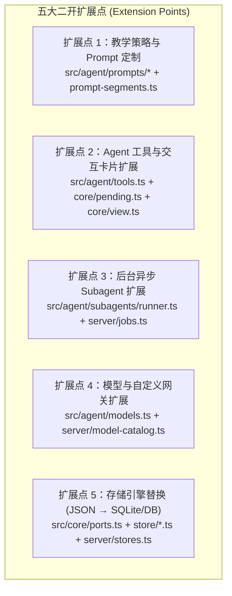

# LearnHarness 源码精读与二次开发学习计划（Java Web 开发者定制版）

> **定制画像**：
> - **技术背景**：熟悉经典 Java Web（Spring Boot、MVC 分层、数据库事务、JUC 并发锁、REST API）；TypeScript / Node.js / Next.js 特性采用**随用随讲（Just-in-Time）**模式在源码走读中即时类比点透。
> - **核心目标**：彻底看懂源码，全面掌握项目的 **核心扩展点（Extension Points）**，为后续任意方向的二次开发或定制修改打下地基。
> - **精力分配**：**80% 聚焦后端与 Agent 引擎**（领域契约、服务端回合编排、Agent 工具链、后台子智能体与知识图谱），**20% 掌握前端状态机对接**。
> - **学习产出**：每推进一个阶段，都在本目录（`d:\0.default\learnharness\学习文档`）下沉淀一篇结构化的深度解读文档与架构时序图。

---

## 一、 现有文档资产盘点（你已有的 3 篇报告 vs 待攻克深水区）

你目前在 `学习文档` 中已经拥有 3 篇高质量的宏观与外壳报告：
1. **《LearnHarness 设计分析报告》**：已讲透教学理论（Minimal Tree + 一步一查）如何映射为系统架构，以及 `eslint.config.mjs` 的四条铁律红线。
2. **《LearnHarness（lh）项目全局架构与核心模块解析》**：已建立全局目录分层、数据存储表与单回合主干概览。
3. **《`electron/main.cjs` 深度解读报告》**：已彻底拆解桌面壳的四进程模型、IPC 凭据租约与安全边界（**桌面壳层已毕功，后续无需再花精力在 `electron/` 上**）。

**接下来我们要深入的“源码深水区”**，是真正承载全部业务逻辑与二开扩展点的四大核心目录：`src/core/`、`src/server/`、`src/agent/` 以及前端状态唯一对接点 `components/session-core.ts`。

---

## 二、 Java Web ↔ LearnHarness 核心概念全景映射表（随查字典）

在阅读 TypeScript 源码时，你可以直接用熟悉的 Spring Boot / Java 架构概念做无缝切换：

| LearnHarness (TS / Next.js / Node) | Java Web (Spring Boot / JDK) 等价概念 | 核心源码位置与设计意图 |
| :--- | :--- | :--- |
| **`app/api/**/route.ts`** | **`@RestController`** | 极薄的 HTTP 传输层，例如 `app/api/chat/route.ts` 只有一行代码，直接转发给 `chat-handler.ts`。 |
| **`src/server/chat-handler.ts`** | **`@Service` + `TransactionTemplate`** | **回合组合根（Turn Composition Root）**。手动管理准入校验、抢锁、Write-Ahead 预写日志、拉起 Agent、最终 Settlement 落盘与 `finally` 释放锁。 |
| **`src/core/ports.ts`** | **领域层 `Repository` / `DAO` 接口** | 六边形架构的端口定义（`ChatStore`, `GraphStore`, `JobStore` 等）。只定义接口，不写实现。 |
| **`src/store/*.ts`** | **`RepositoryImpl`（基于本地文件）** | `ports.ts` 的具体实现类（目前用 `fs.readFileSync/writeFileSync` 读写 JSON/JSONL，未来可无缝替换为 SQLite / MySQL）。 |
| **`src/server/stores.ts`** | **Spring `@Configuration` Bean 装配类** | 全项目唯一实例化 `src/store/*` 并注入给服务层的地方。 |
| **`LhMessage` (`native-messages.ts`)** | **数据库持久化实体 `Entity / DO`** | 落盘在 `data/chats/<id>.json` 中的唯一真相。 |
| **`toLlmMessages()` (`native-messages.ts`)** | **对外 RPC 调用的 `RequestDTO` 转换器** | 把持久化的 `LhMessage[]` 洗成大模型 API 认识的格式（剥离本地 ID、拍平自定义 Marker、为中断的 Tool Call 补齐假返回值防止 LLM 报错）。 |
| **`projectView()` (`src/core/view.ts`)** | **返回给前端渲染的 `VO` 组装器** | 把多条散碎的 `assistant` + `toolResult` 消息聚合成前端页面上连续展示的文档块、答题卡片和步骤分割线。 |
| **`turn-liveness.ts` & `globalThis`** | **`ConcurrentHashMap` + `ReentrantLock.tryLock()`** | Node.js 是单线程事件循环，但异步 `await` 期间会有并发请求切入。利用挂载在 `globalThis` 上的内存 Map 实现单会话互斥锁，重入直接返回 HTTP `409 Conflict`。 |
| **`src/server/pi/ui-stream.ts`** | **Spring `SseEmitter` + 环形重放缓冲区** | 服务端运行 Agent 时通过 SSE 推送事件；支持浏览器随时刷新重连（先 Replay 已发生的事件，再接上 Live 实时流）。 |
| **`subagents/runner.ts` + `server/jobs.ts`** | **`@Async` 线程池 + 本地消息表（Outbox 模式）** | 后台异步任务（查资料、画图、写 Demo）算完后先落盘为 `pending delivery`，再通过 **Live Steer（运行中插队）** 或 **Idle Wake（空闲时唤醒）** 投递给主会话。 |
| **TS 可辨识联合类型 (`TurnInput` / `LhMessage`)** | **Java 17+ `sealed interface` + `record`** | 用字面量字段（如 `kind: "text" \| "answer" \| "steer"`）做编译期穷尽类型收窄（类似 Java 的 `switch` 模式匹配）。 |

---

## 三、 二次开发必知的 5 大核心扩展点（Extension Points）

无论你未来想怎么改这个项目，95% 的定制需求都落在这 5 个接缝（Seams）上：

1. **扩展点 1：修改教学行为、人设与分段 Prompt**
   - **入口**：`src/agent/prompts/{prober,teacher,practice,shared}/*.md` 与 `src/agent/teacher-agent.ts` 中的 `composeInstructions()`。
   - **能力**：调整探测严格度、改变规划粒度、或在运行时通过 `data/prompts/` 动态热覆盖某一段系统提示词。
2. **扩展点 2：新增/改造 Agent 工具（Tool）与前端交互挂件**
   - **入口**：`src/agent/tools.ts`（定义工具 Schema 与服务端 `execute`）、`src/core/pending.ts`（定义是否属于需要暂停等待用户作答的拦截型工具）、`src/core/view.ts`（前端视图投影）。
   - **能力**：比如给 Teacher 增加一个“代码沙箱评测题”工具或“填空题”工具。
3. **扩展点 3：新增后台异步 Worker（Subagent）**
   - **入口**：`src/agent/subagents/runner.ts` 与 `src/server/jobs.ts`。
   - **能力**：仿照 `researcher` 或 `demoBuilder`，新增一个后台异步执行的专属智能体，完成后自动唤醒主教学 Agent。
4. **扩展点 4：替换持久化存储层（例如从本地文件升级为数据库）**
   - **入口**：`src/core/ports.ts`（接口契约）→ `src/store/`（新建数据库 Adapter）→ `src/server/stores.ts`（切换注入实例）。
   - **能力**：上层 `core`、`agent`、`server` 代码一行不改，直接切换底层存储。
5. **扩展点 5：接入企业私有模型网关或新模型槽位**
   - **入口**：`config.ts`（`ModelRole`）、`src/core/settings.ts`、`src/agent/models.ts`（`piEngineForSpec`）。

---

## 四、 五阶段源码精读路线图（边学边在 `学习文档` 沉淀笔记）

我们将按 **由纯数据契约 → 服务端主链路 → Agent 与工具引擎 → 异步图谱与任务 → 前端状态对接** 的顺序，分 5 个阶段推进。每完成一个阶段，我都会在 `学习文档/` 下为你生成对应的深度解析文档：

### 阶段一：核心数据契约与“一鱼三吃”双投影机制（`src/core/`）
- **精读源码**：
  1. `src/core/contracts/chat.ts` & `src/core/ports.ts`（领域实体与六大存储接口契约）
  2. `src/core/input-events.ts`（前端请求如何被解析为严密的增量事件 `TurnInput`）
  3. `src/core/native-messages.ts`（核心！看懂 `LhMessage` 持久态与 `toLlmMessages` 模型态投影）
  4. `src/core/view.ts`（看懂 `projectView` 如何把扁平消息流折叠成前端连续教学视图）
- **随用随讲 TS 特性**：TypeScript 的 Discriminated Unions（可辨识联合类型）、Declaration Merging（声明合并扩展第三方库类型）、TypeBox Schema 校验。
- **沉淀文档产出**：`学习文档/01-核心数据契约与双投影机制解读.md`

### 阶段二：服务端回合编排、并发门禁与 SSE 流（`src/server/`）
- **精读源码**：
  1. `src/server/chat-handler.ts`（全系统最核心的 7 步回合状态机：准入 → Write-Ahead 落盘 → 锁 → 运行 → Settlement 结算）
  2. `src/server/turn-liveness.ts` & `src/server/turn-runs.ts`（基于 Node 单线程事件循环的内存并发控制与运行态注册表）
  3. `src/server/pi/ui-stream.ts`（原生 Agent 事件流合并、100ms 节流与断线重连 Replay 机制）
  4. `src/server/stores.ts` & `src/store/chats.ts`（同步文件 I/O 为什么在 Node 单事件循环下天然防交错）
- **随用随讲 TS/Node 特性**：Node.js 单线程 Event Loop 与 Java 多线程锁的本质区别、Web Streams API (`ReadableStream`) 与 SSE 协议控制。
- **沉淀文档产出**：`学习文档/02-服务端回合编排与SSE流式引擎解读.md`

### 阶段三：三大教学 Agent 构造、分段 Prompt 与“工具暂停”魔法（`src/agent/`）
- **精读源码**：
  1. `src/agent/teacher-agent.ts` & `src/agent/prompt-segments.ts`（Prober / Teacher / Practitioner 无状态按回合重建机制与 Prompt 拼装）
  2. `src/agent/tools.ts` & `src/agent/tools/practice.ts`（核心工具注册表與参数自愈 `heal.ts`）
  3. `src/core/question-core.ts` & `src/core/pending.ts`（揭秘“服务端执行工具并终止循环 → 浏览器端用户作答 → 下一回合拼接 `ToolResultMessage`”的跨回合暂停机制）
  4. `src/core/phases.ts` & `src/core/plan-tree.ts`（`probe_done` 如何切换 Agent 身份，以及 Mermaid 计划树 DAG 状态是如何从历史记录无状态推导出来的）
- **二开演练点**：如何动手新增一个自定义教学工具（Tool）并让前端渲染出来？
- **沉淀文档产出**：`学习文档/03-教学Agent构造与跨回合工具暂停机制解读.md`

### 阶段四：后台异步 Worker 投递与知识图谱三段式引擎（`src/agent/subagents/` & `graph`）
- **精读源码**：
  1. `src/agent/subagents/runner.ts` & `src/server/jobs.ts`（异步任务生命周期，以及 Live Steer 实时插队 vs Idle Wake 空闲唤醒的精确投递状态机）
  2. `src/core/coverage.ts`（基于 SHA-256 的未提取教师正文增量检测）
  3. `src/agent/subagents/extraction.ts`（`Extractor` 抽取命题与推理链 → `Auditor` 隔离式同义审计 → 信号量与 FIFO 锁控制）
  4. `src/core/graph.ts`（`mergeFindings` 确定性合并、推理链去重化简与快照派生）
- **二开演练点**：如何修改知识图谱抽取规则，或新增一个后台异步 Subagent？
- **沉淀文档产出**：`学习文档/04-后台异步Worker投递与知识图谱引擎解读.md`

### 阶段五：前后端状态对接与以测代学验证（20% 前端状态机 + 确定性测试）
- **精读源码**：
  1. `components/session-core.ts`（不依赖 React 的纯 TS 前端会话状态机：乐观更新、流式接管、409 轮询退避与断线自动重连）
  2. `src/core/events.ts` & `components/server-events.tsx`（全局 `/api/events` 轻量变更通知总线）
  3. `tests/chat-flow.test.ts`（像写 Java JUnit Mock 测试一样，看懂如何用 Scripted Fake Engine 在本地零成本验证你的二开代码）
- **沉淀文档产出**：`学习文档/05-前端会话状态机与二开测试验证指南.md`

---

## 五、 每次互动的标准学习循环（我们接下来怎么配合）

在接下来的每一个阶段（甚至每一个核心文件）中，我们按以下 **4 步循环** 高效推进：
1. **Java 视角先导建模**：我先用你熟悉的 Spring Boot / Java 概念画出该模块的职责与调用关系。
2. **核心源码逐段拆解 + TS 语法随用随讲**：定位到具体文件与行号，拆解核心函数与不变式（Invariants），顺带点透里面的 TypeScript / Node.js 技巧。
3. **苏格拉底式快问快答（1～2 题）**：抛出一个二开场景或边界异常问题（例如：*“如果我在这里加一个自定义字段，为什么大模型收不到？”*），由你结合刚看的代码给出判断。
4. **沉淀阶段笔记到 `学习文档/`**：确认你完全吃透后，我将本阶段的核心结论、架构图与二开改法写入 `学习文档/0X-xxx.md`。
