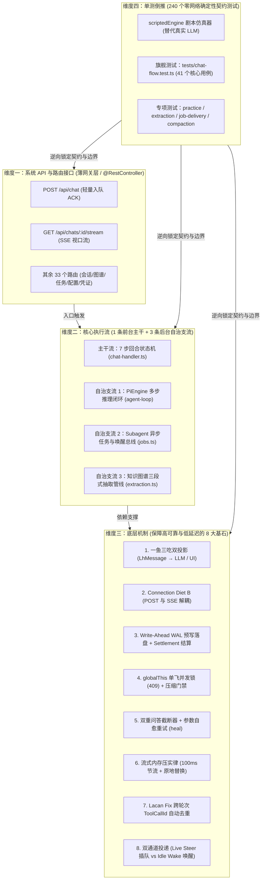
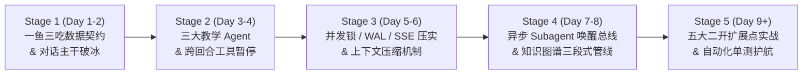

# 00 - Java 开发者专属：LearnHarness 四维综合分析与最优学习路径（二开总纲）

> **定制画像与目标**：
> - **技术背景**：Java 后端工程师（熟悉 Spring Boot、MVC 分层、DDD 领域驱动、事务与 JUC 并发控制、JUnit Mock 测试）。
> - **核心目标**：以最小认知负荷彻底吃透 LearnHarness 的后端与 Agent 内核，掌握全部核心扩展点（Extension Points），能够自信、安全地开展二次开发（且通过确定性单测 100% 验证）。
> - **方法论升级**：将系统的 **“系统 API 与路由接口”**、**“核心执行流”**、**“底层机制”** 与 **“单测倒推”** 四大维度正交融合，串联本目录下已沉淀的全部深度文档（`01` ~ `06` 及专项报告），形成一套**“单测先行 → 路由切入 → 内核穿透 → 二开验证”**的最优学习路径。

---

## 一、 四维综合分析：如何用 Java 架构师视角一眼看穿本系统？

如果把 LearnHarness 比作一套高内聚的 Java 微服务单体，你提出的四个维度恰好构成了剖析这套系统的**四维立体坐标系**：



### 1.1 维度一：系统 API 与路由接口 —— “极薄的网关，不装业务逻辑”
- **核心认知**：全系统共有 **35 个 HTTP 端点**（位于 `app/api/**/route.ts`，统一受 [`proxy.ts`](file:///d:/0.default/learnharness/proxy.ts) 桌面窗口安全门禁保护）。但与传统 CRUD 项目不同，这里的 `route.ts` 几乎都是**只有几行代码的薄转发器**（例如 [`app/api/chat/route.ts`](file:///d:/0.default/learnharness/app/api/chat/route.ts) 仅一行 `return handleChatRequest(req)`）。
- **分流边界**（详见《`03-系统API与路由接口全景参考手册`》与《`04-从路由到内核`》）：
  - **经过路由的**：用户发消息/交卷（`POST /api/chat`）、挂载 SSE 流（`GET /api/chats/[id]/stream`）、全局变更通知（`GET /api/events`）、手动触发图谱提取/导入、配置与 Key 读写。
  - **完全不经过路由、在服务端内存自治运转的**：Agent 多步工具调用循环、题目参数校验错误后的原地重试、Subagent 后台执行完成后的自动插队/唤醒、回合结束后的自动上下文压缩与知识图谱增量提取。

### 1.2 维度二：核心执行流 —— “1 条主干 + 3 条自治支流”
理解本系统的执行流，切忌把所有文件平铺阅读，必须紧紧抓住 **“1 主 3 支”**：
1. **【前台主干流】单回合生命周期（Turn Lifecycle）**：
   - 汇聚于组合根 [`src/server/chat-handler.ts`](file:///d:/0.default/learnharness/src/server/chat-handler.ts) 的 [`handleChatInput`](file:///d:/0.default/learnharness/src/server/chat-handler.ts#L166-L185)：
   - **阶段 1（准入与压缩门禁）**：校验模型与 Key → [`ensureCompacted`](file:///d:/0.default/learnharness/src/server/compaction.ts) 检查是否需要先压缩超长历史。
   - **阶段 2（抢锁与 WAL 预写）**：[`beginTurn`](file:///d:/0.default/learnharness/src/server/turn-liveness.ts) 抢占会话级内存互斥锁（冲突返 `409`）→ 解析 [`TurnInput`](file:///d:/0.default/learnharness/src/core/input-events.ts) 并**先落盘用户输入**（Write-Ahead Log）。
   - **阶段 3（无状态重建 Agent）**：根据会话记录中是否已有成功的 `probe_done`，在 [`teacher-agent.ts`](file:///d:/0.default/learnharness/src/agent/teacher-agent.ts) 中动态组装 `Prober`、`Teacher` 或 `Practitioner`（**系统绝不常驻 Agent 实例，每回合用完即焚，磁盘记录就是唯一状态**）。
   - **阶段 4（后台流式运行与即时 ACK）**：调用 [`runPiTurn`](file:///d:/0.default/learnharness/src/server/pi/ui-stream.ts) 拉起后台推理循环，`POST /api/chat` 立即返回 `200 OK`；前端通过 `GET /api/chats/[id]/stream` 消费实时 SSE 事件。
   - **阶段 5（Settlement 结算与触发后置任务）**：循环结束（自然说完或出题暂停）后，在 `onFinish` 中增量落盘新消息与 Token 账单、释放 `409` 锁、对账 Steer 队列，并异步触发上下文压缩（[`kickCompaction`](file:///d:/0.default/learnharness/src/server/compaction.ts)）与图谱抽取（[`triggerExtraction`](file:///d:/0.default/learnharness/src/server/turn-service.ts)）。
2. **【自治支流 1】`PiEngine` 内存多步推理循环**（详见 [`pi-engine-loop-analysis.md`](file:///d:/0.default/learnharness/%E5%AD%A6%E4%B9%A0%E6%96%87%E6%A1%A3/pi-engine-loop-analysis.md) 与 Java 伪代码 [`PiEngineAgentLoop.java`](file:///d:/0.default/learnharness/%E5%AD%A6%E4%B9%A0%E6%96%87%E6%A1%A3/PiEngineAgentLoop.java)）：
   - 在一轮 Turn 内部，`LLM 生成 → 本地执行普通工具 (read/grep/plan_init) → 把 ToolResult 喂回 LLM 继续生成` 全程在内存 `while` 循环中闭环，零内部 HTTP 开销。
3. **【自治支流 2】后台 Subagent 派发与反应式投递**（[`src/agent/subagents/runner.ts`](file:///d:/0.default/learnharness/src/agent/subagents/runner.ts) + [`src/server/jobs.ts`](file:///d:/0.default/learnharness/src/server/jobs.ts)）：
   - 主教学 Agent 调用 `research` / `build_demo` / `make_visual` / `read_pdf` 时，只落盘一个 `JobRecord` 并立刻拿到“已派发”回执继续讲课；后台 Worker 独立跑完后，通过 [`deliverJobResult`](file:///d:/0.default/learnharness/src/server/jobs.ts) 自动选择 **Live Steer（运行中插队）** 或 **Idle Wake（空闲时自动发起新回合）** 把结果喂回主会话。
4. **【自治支流 3】知识图谱三段式抽取管线**（[`src/agent/subagents/extraction.ts`](file:///d:/0.default/learnharness/src/agent/subagents/extraction.ts) + [`src/core/graph.ts`](file:///d:/0.default/learnharness/src/core/graph.ts)）：
   - 只扫描教师正文（[`coverage.ts`](file:///d:/0.default/learnharness/src/core/coverage.ts) SHA-256 增量指纹）→ `Extractor`（提取命题与推理链）→ `Auditor`（盲审同义命题并连接到既有节点）→ `Merger`（[`mergeFindings`](file:///d:/0.default/learnharness/src/core/graph.ts) 确定性合并、推理链去重化简与力导向布局结算）。

### 1.3 维度三：底层机制 —— “支撑工业级鲁棒性的 8 大设计精髓”
为什么 LearnHarness 既能像本地应用一样丝滑，又能在断网、刷新、模型抽风时不丢数据？核心全靠以下 8 个底层机制（这也是二开时绝对不能破坏的不变式 Invariants）：

| 序号 | 底层机制名称 | 解决什么痛点？ | 核心源码位置 | Java 等价心智模型 |
| :---: | :--- | :--- | :--- | :--- |
| **1** | **“一鱼三吃”双投影机制** | 磁盘需要存业务元数据，大模型只认标准 Message，前端需要折叠渲染卡片 | [`src/core/native-messages.ts`](file:///d:/0.default/learnharness/src/core/native-messages.ts) (`toLlmMessages`)<br/>[`src/core/view.ts`](file:///d:/0.default/learnharness/src/core/view.ts) (`projectView`) | `Entity (LhMessage)` $\to$ `RequestDTO (LLM)` + `ResponseVO (UI)` |
| **2** | **Connection Diet B（连接节食）** | 浏览器同源 HTTP/1.1 限制 6 个并发连接，长连接挂起会导致多标签页死锁，且刷新页面会掐断生成 | [`src/server/chat-handler.ts`](file:///d:/0.default/learnharness/src/server/chat-handler.ts)<br/>[`src/server/turn-runs.ts`](file:///d:/0.default/learnharness/src/server/turn-runs.ts) | 异步任务提交（立即返 `200`）+ 独立 `SseEmitter` 观察者订阅 |
| **3** | **WAL 预写落盘 + Settlement 结算** | 模型调用中途崩溃或进程重启时，防止用户输入丢失或产生半截脏状态 | [`src/server/chat-handler.ts`](file:///d:/0.default/learnharness/src/server/chat-handler.ts)<br/>[`src/server/turn-service.ts`](file:///d:/0.default/learnharness/src/server/turn-service.ts) | 数据库 Write-Ahead Log + 编程式事务 `TransactionTemplate` |
| **4** | **`globalThis` 单飞锁与压缩门禁** | Next.js 热重载会产生多模块实例，普通静态变量锁会失效；并发请求会导致账本错乱 | [`src/server/turn-liveness.ts`](file:///d:/0.default/learnharness/src/server/turn-liveness.ts)<br/>[`src/server/compaction.ts`](file:///d:/0.default/learnharness/src/server/compaction.ts) | 绑定在 JVM Bootstrap ClassLoader 上的 `ConcurrentHashMap` + `CompletableFuture` 单飞锁 |
| **5** | **双重问答截断 + 参数自愈 (`heal`)** | 出题后必须强制停下等学生作答；但若模型出题 JSON 格式写错，不能停下，必须让模型当场重写 | [`src/agent/teacher-agent.ts`](file:///d:/0.default/learnharness/src/agent/teacher-agent.ts) (`makeQuestionStopper`)<br/>[`src/agent/tools/heal.ts`](file:///d:/0.default/learnharness/src/agent/tools/heal.ts) | AOP 环绕拦截器：参数畸变自动修复 + 校验失败转 `isError` 重试 + 成功出题触发中断信号 |
| **6** | **流式事件内存压实律 (Compaction Law)** | Deep Thinking 模型单次输出上万个 chunk，全量缓存会导致内存暴涨和重连卡死 | [`src/server/pi/ui-stream.ts`](file:///d:/0.default/learnharness/src/server/pi/ui-stream.ts) | 环形快照缓冲区：已完结事件保留，生成中消息原地覆盖（Replace-in-place）+ 100ms 节流广播 |
| **7** | **Lacan Fix（工具 ID 去重映射）** | DeepSeek 等模型每轮都把工具调用 ID 重置为 `call_0`，导致多轮历史里 ToolCall 与 Result 串台 | [`src/server/pi/call-ids.ts`](file:///d:/0.default/learnharness/src/server/pi/call-ids.ts) (`ToolCallIdUniquifier`) | 网关层唯一键重铸过滤器（Stateful ID Remapper） |
| **8** | **Outbox 两阶段唤醒投递** | 后台 Subagent 算完时，主会话可能正在流式生成、可能停在题目上等学生答、也可能完全空闲 | [`src/server/jobs.ts`](file:///d:/0.default/learnharness/src/server/jobs.ts) (`deliverJobResult` / `settleSteers`) | 事务发件箱（Transactional Outbox）：运行中走 `agent.steer` 安全边界插队，未消费则退回队列等下次唤醒 |

### 1.4 维度四：单测倒推 —— “零 API 成本、毫秒级响应的活文档”
- **核心认知**：本系统有 **240 个测试文件**（`tests/*.test.ts`）。作者通过六边形端口注入与 [`scriptedEngine`](file:///d:/0.default/learnharness/tests/chat-flow.test.ts)（剧本仿真大模型），把所有复杂的异步时序、并发冲突、断线重放、自愈重试全部写成了**不需要联网、不需要配 API Key、几百毫秒就能跑完的确定性单元测试**。
- **为什么它是 Java 开发者的神兵利器？**
  - 当你看某段 TypeScript 源码觉得抽象时，直接打开对应的 `tests/xxx.test.ts`，看测试是怎么构造输入（Given）、调用了哪个函数（When）、断言了什么输出（Then），**3 分钟就能反推出这段代码的精确契约**！
  - 当你做二次开发修改了代码后，跑一遍 `npx tsx --test tests/chat-flow.test.ts`，立刻知道有没有破坏系统的既有不变式。

---

## 二、 最优学习路径：五阶段“四维联动”通关路线图

> [!IMPORTANT]
> **为什么这是最优路径？**
> 1. **彻底摒弃“按字母顺序读目录”**：不碰我们已经毕功的 `electron/` 桌面壳，初期也完全跳过 71 个前端 UI 渲染细节，**100% 聚焦后端主干与二开扩展点**。
> 2. **每一阶段严格执行“四维闭环”**：**① 先读本目录对应的中文精读文档建立全景心智 $\to$ ② 跑对应的核心单测观察真实输入输出 $\to$ ③ 顺着 API 路由深潜到 Core/Server/Agent 源码 $\to$ ④ 完成一个二开微实验验证理解**。



---

### Stage 1：破冰立柱 —— 吃透“一鱼三吃”数据契约与单回合主干流

- **阶段目标**：搞懂一条用户消息从 `POST /api/chat` 进来，是怎么变成磁盘上的 `LhMessage`、怎么洗成发给大模型的 `Message`、又是怎么变成前端看到的视图的。
- **四维联动学习清单**：
  1. **【读文档】**：
     - 先看 [`学习文档/01-系统UML建模与架构全景图.md`](file:///d:/0.default/learnharness/%E5%AD%A6%E4%B9%A0%E6%96%87%E6%A1%A3/01-%E7%B3%BB%E7%BB%9FUML%E5%BB%BA%E6%A8%A1%E4%B8%8E%E6%9E%B6%E6%9E%84%E5%85%A8%E6%99%AF%E5%9B%BE.md)（重点看第 2 节领域类图、第 5 节回合时序图）。
     - 再看 [`学习文档/02-核心执行流与底层机制深度解密.md`](file:///d:/0.default/learnharness/%E5%AD%A6%E4%B9%A0%E6%96%87%E6%A1%A3/02-%E6%A0%B8%E5%BF%83%E6%89%A7%E8%A1%8C%E6%B5%81%E4%B8%8E%E5%BA%95%E5%B1%82%E6%9C%BA%E5%88%B6%E6%B7%B1%E5%BA%A6%E8%A7%A3%E5%AF%86.md)（第 1～3 节）。
  2. **【跑单测倒推】**：
     - 对照 [`学习文档/06-旗舰单测chat-flow全用例深度拆解与断言剖析.md`](file:///d:/0.default/learnharness/%E5%AD%A6%E4%B9%A0%E6%96%87%E6%A1%A3/06-%E6%97%97%E8%88%B0%E5%8D%95%E6%B5%8Bchat-flow%E5%85%A8%E7%94%A8%E4%BE%8B%E6%B7%B1%E5%BA%A6%E6%8B%86%E8%A7%A3%E4%B8%8E%E6%96%AD%E8%A8%80%E5%89%96%E6%9E%90.md) 的**模块 1（Case 1 ~ 4）**，在终端运行：
       ```powershell
       npx tsx --test tests/chat-flow.test.ts
       ```
     - 重点观察 [`tests/chat-flow.test.ts`](file:///d:/0.default/learnharness/tests/chat-flow.test.ts) 前 150 行：看 `scriptedEngine` 如何模拟模型返回，以及 `handleChatRequest` 是如何被直接调用的。
  3. **【查 API 路由】**：
     - [`app/api/chat/route.ts`](file:///d:/0.default/learnharness/app/api/chat/route.ts) & [`app/api/chats/[id]/route.ts`](file:///d:/0.default/learnharness/app/api/chats/%5Bid%5D/route.ts)（对照 [`学习文档/03-系统API与路由接口全景参考手册.md`](file:///d:/0.default/learnharness/%E5%AD%A6%E4%B9%A0%E6%96%87%E6%A1%A3/03-%E7%B3%BB%E7%BB%9FAPI%E4%B8%8E%E8%B7%AF%E7%94%B1%E6%8E%A5%E5%8F%A3%E5%85%A8%E6%99%AF%E5%8F%82%E8%80%83%E6%89%8B%E5%86%8C.md) 3.1 节）。
  4. **【精读内核源码】**：
     - 领域契约与端口：[`src/core/contracts/chat.ts`](file:///d:/0.default/learnharness/src/core/contracts/chat.ts)、[`src/core/ports.ts`](file:///d:/0.default/learnharness/src/core/ports.ts)（6 大 Repository 接口）。
     - 输入事件化：[`src/core/input-events.ts`](file:///d:/0.default/learnharness/src/core/input-events.ts)（看懂 `parseChatInput` 与 `inputAppends` 如何把前端请求转化为追加记录）。
     - 一鱼三吃核心：[`src/core/native-messages.ts`](file:///d:/0.default/learnharness/src/core/native-messages.ts)（重点看 `LhMarkerMessage`、`LhMessage` 以及 `toLlmMessages` 的裁剪/展平逻辑）与 [`src/core/view.ts`](file:///d:/0.default/learnharness/src/core/view.ts)（`projectView` 视图折叠）。
- **通关自检（微实验）**：
  - *思考题*：如果往 `LhMarkerMessage` 的 `customType` 中新增一种自定义标记，为什么有的标记大模型看得见（变成 user message），而 `plan-block` 大模型完全看不见？去 `toLlmMessages()` 里找到决定这一行为的那行代码。

---

### Stage 2：攻克教学内核 —— 三大 Agent 构造、分段 Prompt 与“跨回合工具暂停”

- **阶段目标**：搞懂 Prober（探测员）、Teacher（教师）、Practitioner（陪练员）是如何共享同一个会话记录但拥有不同大脑与工具箱的；彻底看懂“模型出题 → 服务端强制暂停循环 → 浏览器学生作答 → 下一轮携带 `ToolResultMessage` 唤醒模型”的精妙闭环。
- **四维联动学习清单**：
  1. **【读文档】**：
     - 阅读 [`学习文档/pi-engine-loop-analysis.md`](file:///d:/0.default/learnharness/%E5%AD%A6%E4%B9%A0%E6%96%87%E6%A1%A3/pi-engine-loop-analysis.md) 与 Java 对照版 [`学习文档/PiEngineAgentLoop.java`](file:///d:/0.default/learnharness/%E5%AD%A6%E4%B9%A0%E6%96%87%E6%A1%A3/PiEngineAgentLoop.java)（用纯 Java 代码瞬间秒懂 `PiEngine` 循环与 `makeQuestionStopper`）。
     - 阅读 [`学习文档/06-旗舰单测chat-flow全用例深度拆解与断言剖析.md`](file:///d:/0.default/learnharness/%E5%AD%A6%E4%B9%A0%E6%96%87%E6%A1%A3/06-%E6%97%97%E8%88%B0%E5%8D%95%E6%B5%8Bchat-flow%E5%85%A8%E7%94%A8%E4%BE%8B%E6%B7%B1%E5%BA%A6%E6%8B%86%E8%A7%A3%E4%B8%8E%E6%96%AD%E8%A8%80%E5%89%96%E6%9E%90.md) 的**模块 4（题目自愈重试 Case 9~12）**、**模块 10（静默放弃作答 Case 33~35）**、**模块 11（并行多道题作答 Case 36~38）**。
  2. **【跑单测倒推】**：
     ```powershell
     npx tsx --test tests/probe-done.test.ts tests/practice-flow.test.ts tests/tool-heal.test.ts tests/prompt-overrides.test.ts
     ```
  3. **【查 API 路由】**：
     - [`app/api/chats/[id]/dismiss/route.ts`](file:///d:/0.default/learnharness/app/api/chats/%5Bid%5D/dismiss/route.ts)（放弃作答路由）、[`app/api/settings/prompts/route.ts`](file:///d:/0.default/learnharness/app/api/settings/prompts/route.ts)（分段提示词热覆盖路由）。
  4. **【精读内核源码】**：
     - Agent 组装工厂：[`src/agent/teacher-agent.ts`](file:///d:/0.default/learnharness/src/agent/teacher-agent.ts)（`composeInstructions`、`makeQuestionStopper`、`createProberAgent`、`createTeacherAgent`、`createPracticeAgent`）。
     - 工具注册与自愈：[`src/agent/tools.ts`](file:///d:/0.default/learnharness/src/agent/tools.ts)、[`src/agent/tools/practice.ts`](file:///d:/0.default/learnharness/src/agent/tools/practice.ts)、[`src/agent/tools/heal.ts`](file:///d:/0.default/learnharness/src/agent/tools/heal.ts)、[`src/agent/tool-execute.ts`](file:///d:/0.default/learnharness/src/agent/tool-execute.ts)。
     - 题目校验与挂起状态推导：[`src/core/question-core.ts`](file:///d:/0.default/learnharness/src/core/question-core.ts)、[`src/core/pending.ts`](file:///d:/0.default/learnharness/src/core/pending.ts)、[`src/core/phases.ts`](file:///d:/0.default/learnharness/src/core/phases.ts)、[`src/core/plan-tree.ts`](file:///d:/0.default/learnharness/src/core/plan-tree.ts)。
- **通关自检（微实验）**：
  - 尝试在 [`tests/chat-flow.test.ts`](file:///d:/0.default/learnharness/tests/chat-flow.test.ts) 中仿写一个小测试：让 `scriptedEngine` 第一步故意输出一个少写了 `options` 的非法 `quiz` 工具调用，观察系统是如何不中断回合、将错误塞回给模型并在第二步自愈成功的。

---

### Stage 3：吃透并发与流式机制 —— Diet B、WAL、压缩门禁与异常恢复

- **阶段目标**：作为 Java 后端开发者，彻底搞懂 Node.js 单线程事件循环下的并发控制（`409 Conflict`）、SSE 环形重放与 100ms 节流、断线重连恢复，以及 150k Token 上下文自动压缩门禁。
- **四维联动学习清单**：
  1. **【读文档】**：
     - 阅读 [`学习文档/02-核心执行流与底层机制深度解密.md`](file:///d:/0.default/learnharness/%E5%AD%A6%E4%B9%A0%E6%96%87%E6%A1%A3/02-%E6%A0%B8%E5%BF%83%E6%89%A7%E8%A1%8C%E6%B5%81%E4%B8%8E%E5%BA%95%E5%B1%82%E6%9C%BA%E5%88%B6%E6%B7%B1%E5%BA%A6%E8%A7%A3%E5%AF%86.md) 的**第五节（`PiEngine` 与模型槽位）**与**第六节（上下文压缩系统 Compaction 与 `inFlight` 单飞锁）**。
     - 阅读 [`学习文档/06-旗舰单测chat-flow全用例深度拆解与断言剖析.md`](file:///d:/0.default/learnharness/%E5%AD%A6%E4%B9%A0%E6%96%87%E6%A1%A3/06-%E6%97%97%E8%88%B0%E5%8D%95%E6%B5%8Bchat-flow%E5%85%A8%E7%94%A8%E4%BE%8B%E6%B7%B1%E5%BA%A6%E6%8B%86%E8%A7%A3%E4%B8%8E%E6%96%AD%E8%A8%80%E5%89%96%E6%9E%90.md) 的**模块 5~9（故障隔离、409 并发锁、WAL、Diet B 与 SSE 重放）**。
  2. **【跑单测倒推】**：
     ```powershell
     npx tsx --test tests/turn-liveness.test.ts tests/turn-recovery.test.ts tests/compaction.test.ts tests/call-ids.test.ts
     ```
  3. **【查 API 路由】**：
     - [`app/api/chats/[id]/stream/route.ts`](file:///d:/0.default/learnharness/app/api/chats/%5Bid%5D/stream/route.ts)（SSE 实时流与重连端点）、[`app/api/events/route.ts`](file:///d:/0.default/learnharness/app/api/events/route.ts)（全局轻量变更广播总线）。
  4. **【精读内核源码】**：
     - 回合编排总管：[`src/server/chat-handler.ts`](file:///d:/0.default/learnharness/src/server/chat-handler.ts)（重点精读 180~746 行的完整准入、WAL、流式挂载与 `onFinish` 结算闭环）与 [`src/server/turn-service.ts`](file:///d:/0.default/learnharness/src/server/turn-service.ts)。
     - 锁与运行表：[`src/server/turn-liveness.ts`](file:///d:/0.default/learnharness/src/server/turn-liveness.ts)、[`src/server/turn-runs.ts`](file:///d:/0.default/learnharness/src/server/turn-runs.ts)。
     - SSE 流与压实律：[`src/server/pi/ui-stream.ts`](file:///d:/0.default/learnharness/src/server/pi/ui-stream.ts)、[`src/server/pi/call-ids.ts`](file:///d:/0.default/learnharness/src/server/pi/call-ids.ts)。
     - 上下文压缩双层实现：[`src/core/compaction.ts`](file:///d:/0.default/learnharness/src/core/compaction.ts)（纯领域切分算法）与 [`src/server/compaction.ts`](file:///d:/0.default/learnharness/src/server/compaction.ts)（服务端单飞锁与 LLM 总结调度）。

---

### Stage 4：掌握异步双翼 —— 后台 Subagent 唤醒总线与知识图谱三段式管线

- **阶段目标**：攻克系统中最复杂的两个后台自治引擎——看懂后台异步任务（查资料、画图、写交互 Demo、读 PDF）是如何在不阻塞讲课的前提下把产物精准投递回主会话的；看懂知识图谱是如何从教师正文中增量提取、同义盲审并化简合并为有向无环推理图的。
- **四维联动学习清单**：
  1. **【读文档】**：
     - 阅读 [`学习文档/04-从路由到内核：复杂执行流分流解密与源码学习指南.md`](file:///d:/0.default/learnharness/%E5%AD%A6%E4%B9%A0%E6%96%87%E6%A1%A3/04-%E4%BB%8E%E8%B7%AF%E7%94%B1%E5%88%B0%E5%86%85%E6%A0%B8%EF%BC%9A%E5%A4%8D%E6%9D%82%E6%89%A7%E8%A1%8C%E6%B5%81%E5%88%86%E6%B5%81%E8%A7%A3%E5%AF%86%E4%B8%8E%E6%BA%90%E7%A0%81%E5%AD%A6%E4%B9%A0%E6%8C%87%E5%8D%97.md)（重点看第三节 6 大内核自治流与第四节阶段二、三）。
     - 阅读 [`学习文档/01-系统UML建模与架构全景图.md`](file:///d:/0.default/learnharness/%E5%AD%A6%E4%B9%A0%E6%96%87%E6%A1%A3/01-%E7%B3%BB%E7%BB%9FUML%E5%BB%BA%E6%A8%A1%E4%B8%8E%E6%9E%B6%E6%9E%84%E5%85%A8%E6%99%AF%E5%9B%BE.md)（第 6 节 Worker 调度时序图、第 7 节图谱抽取时序图）。
  2. **【跑单测倒推】**：
     ```powershell
     npx tsx --test tests/job-delivery-recovery.test.ts tests/subagent-runner.test.ts tests/extraction.test.ts tests/graph.test.ts
     ```
  3. **【查 API 路由】**：
     - [`app/api/jobs/route.ts`](file:///d:/0.default/learnharness/app/api/jobs/route.ts)、[`app/api/chats/[id]/steer/route.ts`](file:///d:/0.default/learnharness/app/api/chats/%5Bid%5D/steer/route.ts)。
     - [`app/api/graph/route.ts`](file:///d:/0.default/learnharness/app/api/graph/route.ts)、[`app/api/graph/coverage/extract/route.ts`](file:///d:/0.default/learnharness/app/api/graph/coverage/extract/route.ts)、[`app/api/graph/import/route.ts`](file:///d:/0.default/learnharness/app/api/graph/import/route.ts)。
  4. **【精读内核源码】**：
     - 异步 Worker 与投递总线：[`src/agent/subagents/runner.ts`](file:///d:/0.default/learnharness/src/agent/subagents/runner.ts)、[`src/server/jobs.ts`](file:///d:/0.default/learnharness/src/server/jobs.ts)（重点看 `deliverJobResult` 的 Live Run vs Idle Wake 分支，以及 `settleSteers` 回收未消费信标的逻辑）。
     - 图谱抽取与合并：[`src/core/coverage.ts`](file:///d:/0.default/learnharness/src/core/coverage.ts)、[`src/agent/subagents/extraction.ts`](file:///d:/0.default/learnharness/src/agent/subagents/extraction.ts)、[`src/core/graph.ts`](file:///d:/0.default/learnharness/src/core/graph.ts)（`mergeFindings` 与推理链化简）。

---

### Stage 5：二次开发实战演练 —— 五大核心扩展点（Extension Seams）改法速查

当你完成前四阶段后，任何二次开发需求都可以直接对号入座到以下 **5 个标准扩展接缝（Seams）**，并配套对应的单测进行回归验证：

| 二开场景 | 需要修改的核心文件（精准定位） | 必须遵守的架构红线 | 配套回归单测命令 |
| :--- | :--- | :--- | :--- |
| **场景 1：调整教学策略 / 提示词人设** | • 静态模板：`src/agent/prompts/{prober,teacher,practice,shared}/*.md`<br/>• 组装逻辑：[`src/agent/teacher-agent.ts`](file:///d:/0.default/learnharness/src/agent/teacher-agent.ts) (`composeInstructions`)<br/>• 热覆盖：[`src/agent/prompt-segments.ts`](file:///d:/0.default/learnharness/src/agent/prompt-segments.ts) | 新增提示词文件必须带**数字前缀**（如 `35-custom-rule.md`），否则加载器会当成普通文档忽略！ | `npx tsx --test tests/prompt-overrides.test.ts` |
| **场景 2：新增 Agent 工具（Tool）或新交互题型** | • Schema 与校验：[`src/core/question-core.ts`](file:///d:/0.default/learnharness/src/core/question-core.ts)<br/>• 工具定义：[`src/agent/tools.ts`](file:///d:/0.default/learnharness/src/agent/tools.ts) 或 `src/agent/tools/*.ts`<br/>• 暂停门禁（若是交互题）：[`src/core/pending.ts`](file:///d:/0.default/learnharness/src/core/pending.ts) (`QUESTION_TOOLS`)<br/>• 视图投影：[`src/core/view.ts`](file:///d:/0.default/learnharness/src/core/view.ts) (`projectView`) | 若工具需要暂停等待用户作答，必须在 `execute` 返回 `questionResult()`（带 `terminate: true`），且校验失败时返回 `invalidInputResult` 让模型原地重试。 | `npx tsx --test tests/chat-flow.test.ts tests/tool-parts.test.ts` |
| **场景 3：新增后台异步 Subagent（如代码评测 Worker）** | • 任务类型契约：[`src/core/contracts/jobs.ts`](file:///d:/0.default/learnharness/src/core/contracts/jobs.ts) (`JobKind`)<br/>• 派发工具：[`src/agent/tools/jobs.ts`](file:///d:/0.default/learnharness/src/agent/tools/jobs.ts)<br/>• Worker 实现：`src/agent/subagents/<new-worker>.ts` + [`runner.ts`](file:///d:/0.default/learnharness/src/agent/subagents/runner.ts) | Worker 严禁直接修改 `ChatRecord`！必须通过 `jobStore` 落盘 `delivery` 元数据并调用 `deliverJobResult` 走统一唤醒总线。 | `npx tsx --test tests/subagent-runner.test.ts tests/job-delivery-recovery.test.ts` |
| **场景 4：替换持久化存储层（JSON/JSONL → SQLite / MySQL）** | • 接口契约：[`src/core/ports.ts`](file:///d:/0.default/learnharness/src/core/ports.ts)（保持不变）<br/>• 新建 Adapter：`src/store/*.ts`<br/>• Bean 装配点：[`src/server/stores.ts`](file:///d:/0.default/learnharness/src/server/stores.ts) | 遵守 `renameChat` / `saveSettings` **不更新 `updatedAt`**、以及 `appendTurnUsage` 按 `turnId` **幂等去重**的契约。 | `npx tsx --test tests/chat-flow.test.ts tests/graph.test.ts tests/golden-fixtures.test.ts` |
| **场景 5：接入私有大模型网关或新增模型角色槽位** | • 角色定义：[`config.ts`](file:///d:/0.default/learnharness/config.ts) (`ModelRole`)<br/>• 槽位解析：[`src/core/settings.ts`](file:///d:/0.default/learnharness/src/core/settings.ts) & [`settings-resolution.ts`](file:///d:/0.default/learnharness/src/core/settings-resolution.ts)<br/>• 引擎构造：[`src/agent/models.ts`](file:///d:/0.default/learnharness/src/agent/models.ts) (`piEngineForSpec`) | 严禁写死静默 Fallback 模型；未配置或 Key 缺失时必须返回显式拒绝信封（503），保持 BYOK 诚实门禁。 | `npx tsx --test tests/byok-refusal.test.ts tests/custom-provider.test.ts` |

---

## 三、 本目录（`学习文档/`）全景知识库导航表

目前 `学习文档/` 下已为你沉淀了完整的 **12 份高密度技术资产**。在按上述五阶段学习时，可随时按此表检索查阅：

| 文档编号与名称 | 所属维度 | 解决什么核心问题？ | 推荐阅读阶段 |
| :--- | :---: | :--- | :---: |
| [`项目概述.md`](file:///d:/0.default/learnharness/%E5%AD%A6%E4%B9%A0%E6%96%87%E6%A1%A3/%E9%A1%B9%E7%9B%AE%E6%A6%82%E8%BF%B0.md) & [`设计分析报告.md`](file:///d:/0.default/learnharness/%E5%AD%A6%E4%B9%A0%E6%96%87%E6%A1%A3/%E8%AE%BE%E8%AE%A1%E5%88%86%E6%9E%90%E6%8A%A5%E5%91%8A.md) | 宏观与理念 | 教学法理论（Minimal Tree + 一步一查）如何映射为系统架构，以及 `eslint.config.mjs` 的四条单向依赖铁律。 | 先导必读 |
| [`main.cjs 深度解读报告.md`](file:///d:/0.default/learnharness/%E5%AD%A6%E4%B9%A0%E6%96%87%E6%A1%A3/main.cjs%20%E6%B7%B1%E5%BA%A6%E8%A7%A3%E8%AF%BB%E6%8A%A5%E5%91%8A.md) | 宿主外壳层 | Electron 四进程模型、Loopback Next 服务拉起与凭证隔离（桌面壳已毕功，二开不涉及桌面壳时可跳过）。 | 选读备查 |
| [`01-系统UML建模与架构全景图.md`](file:///d:/0.default/learnharness/%E5%AD%A6%E4%B9%A0%E6%96%87%E6%A1%A3/01-%E7%B3%BB%E7%BB%9FUML%E5%BB%BA%E6%A8%A1%E4%B8%8E%E6%9E%B6%E6%9E%84%E5%85%A8%E6%99%AF%E5%9B%BE.md) | 核心执行流 & 模型 | 用 Java 工程师最熟悉的 **UML 包图、领域类图、六边形端口图、3 大核心时序图与状态机** 建立全局骨架。 | **Stage 1 & 4** |
| [`02-核心执行流与底层机制深度解密.md`](file:///d:/0.default/learnharness/%E5%AD%A6%E4%B9%A0%E6%96%87%E6%A1%A3/02-%E6%A0%B8%E5%BF%83%E6%89%A7%E8%A1%8C%E6%B5%81%E4%B8%8E%E5%BA%95%E5%B1%82%E6%9C%BA%E5%88%B6%E6%B7%B1%E5%BA%A6%E8%A7%A3%E5%AF%86.md) | 核心执行流 & 底层机制 | 深度拆解 6 大执行阶段、`ChatRecord` 全量覆写原因、四大组合根、TS 核心语法模式、`PiEngine` 槽位与 `Compaction` 单飞锁。 | **Stage 1 & 3** |
| [`03-系统API与路由接口全景参考手册.md`](file:///d:/0.default/learnharness/%E5%AD%A6%E4%B9%A0%E6%96%87%E6%A1%A3/03-%E7%B3%BB%E7%BB%9FAPI%E4%B8%8E%E8%B7%AF%E7%94%B1%E6%8E%A5%E5%8F%A3%E5%85%A8%E6%99%AF%E5%8F%82%E8%80%83%E6%89%8B%E5%86%8C.md) | 系统 API 与路由接口 | 全系统 **35 个 HTTP/SSE 路由接口** 的入参、返回结构、鉴权门禁（`proxy.ts`）与底层调用链速查字典。 | **Stage 1 ~ 4 随查** |
| [`04-从路由到内核：复杂执行流分流解密与源码学习指南.md`](file:///d:/0.default/learnharness/%E5%AD%A6%E4%B9%A0%E6%96%87%E6%A1%A3/04-%E4%BB%8E%E8%B7%AF%E7%94%B1%E5%88%B0%E5%86%85%E6%A0%B8%EF%BC%9A%E5%A4%8D%E6%9D%82%E6%89%A7%E8%A1%8C%E6%B5%81%E5%88%86%E6%B5%81%E8%A7%A3%E5%AF%86%E4%B8%8E%E6%BA%90%E7%A0%81%E5%AD%A6%E4%B9%A0%E6%8C%87%E5%8D%97.md) | 路由 $\to$ 内核穿透 | 厘清“5 大经过路由的交互流”与“6 大完全不经过路由的内核自治流”，避免在 `app/api/` 里找业务逻辑。 | **Stage 1 & 4** |
| [`pi-engine-loop-analysis.md`](file:///d:/0.default/learnharness/%E5%AD%A6%E4%B9%A0%E6%96%87%E6%A1%A3/pi-engine-loop-analysis.md) & [`PiEngineAgentLoop.java`](file:///d:/0.default/learnharness/%E5%AD%A6%E4%B9%A0%E6%96%87%E6%A1%A3/PiEngineAgentLoop.java) | 底层机制（Java 还原） | 将 Node.js 内存中的 `PiEngine` 多步推理闭环、双重问答截断、100ms 压实律与 Lacan Fix **1:1 还原为 500 行可阅读的 Java 代码**。 | **Stage 2 & 3** |
| [`05-全系统自动化单测全景地图与单测反推实操指南.md`](file:///d:/0.default/learnharness/%E5%AD%A6%E4%B9%A0%E6%96%87%E6%A1%A3/05-%E5%85%A8%E7%B3%BB%E7%BB%9F%E8%87%AA%E5%8A%A8%E5%8C%96%E5%8D%95%E6%B5%8B%E5%85%A8%E6%99%AF%E5%9C%B0%E5%9B%BE%E4%B8%8E%E5%8D%95%E6%B5%8B%E5%8F%8D%E6%8E%A8%E5%AE%9E%E6%93%8D%E6%8C%87%E5%8D%97.md) | 单测倒推 | 全系统 **240 个测试文件**的 10 大领域分类地图、Top 10 必读旗舰单测与“探针注入 / 剧本逆向 / 破坏性实验”四大秘籍。 | **全阶段核心工具** |
| [`06-旗舰单测chat-flow全用例深度拆解与断言剖析.md`](file:///d:/0.default/learnharness/%E5%AD%A6%E4%B9%A0%E6%96%87%E6%A1%A3/06-%E6%97%97%E8%88%B0%E5%8D%95%E6%B5%8Bchat-flow%E5%85%A8%E7%94%A8%E4%BE%8B%E6%B7%B1%E5%BA%A6%E6%8B%86%E8%A7%A3%E4%B8%8E%E6%96%AD%E8%A8%80%E5%89%96%E6%9E%90.md) | 单测倒推（逐案拆解） | 对 1,745 行 [`tests/chat-flow.test.ts`](file:///d:/0.default/learnharness/tests/chat-flow.test.ts) 的 **41 个测试用例**逐一剖析“测什么、为什么这么断言、对应哪段源码”。 | **Stage 1 ~ 3 必读** |
| [`07-核心专题：7步回合状态机与桌面安全门禁深度解析.md`](file:///d:/0.default/learnharness/%E5%AD%A6%E4%B9%A0%E6%96%87%E6%A1%A3/07-%E6%A0%B8%E5%BF%83%E4%B8%93%E9%A2%98%EF%BC%9A7%E6%AD%A5%E5%9B%9E%E5%90%88%E7%8A%B6%E6%80%81%E6%9C%BA%E4%B8%8E%E6%A1%8C%E9%9D%A2%E5%AE%89%E5%85%A8%E9%97%A8%E7%A6%81%E6%B7%B1%E5%BA%A6%E8%A7%A3%E6%9E%90.md) | 核心执行流 & 安全机制 | 逐行拆解 `chat-handler.ts` 的 **7 步回合状态机与顺序铁律**，以及 `proxy.ts` + `desktop-api.cjs` 的 **7 层桌面窗口安全门禁**（含 `desktop-api.test.ts` 单测倒推）。 | **Stage 1 & 3 必读** |
| [`08-前端UI全景架构：93个组件分层矩阵与核心功能解析.md`](file:///d:/0.default/learnharness/%E5%AD%A6%E4%B9%A0%E6%96%87%E6%A1%A3/08-%E5%89%8D%E7%AB%AFUI%E5%85%A8%E6%99%AF%E6%9E%B6%E6%9E%84%EF%BC%9A93%E4%B8%AA%E7%BB%84%E4%BB%B6%E5%88%86%E5%B1%82%E7%9F%A9%E9%98%B5%E4%B8%8E%E6%A0%B8%E5%BF%83%E5%8A%9F%E8%83%BD%E8%A7%A3%E6%9E%90.md) | 前端表现层 & 交互架构 | 全系统 **93 个 React 组件 + 28 个状态机模块** 的 8 大子系统全景矩阵、三大架构模式（无头状态机/单向数学投影/动态码头）与卡片二开实战。 | **Stage 5 必读** |
