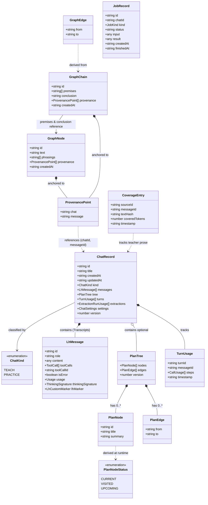
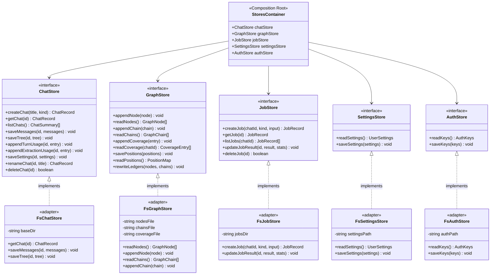
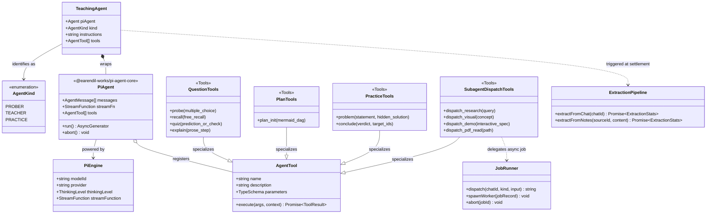
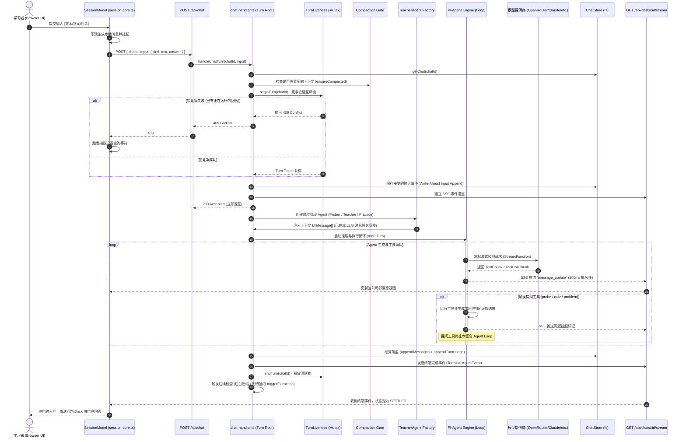
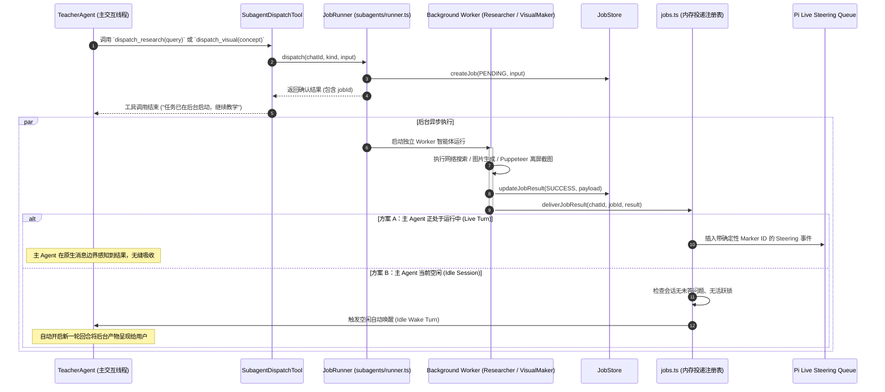
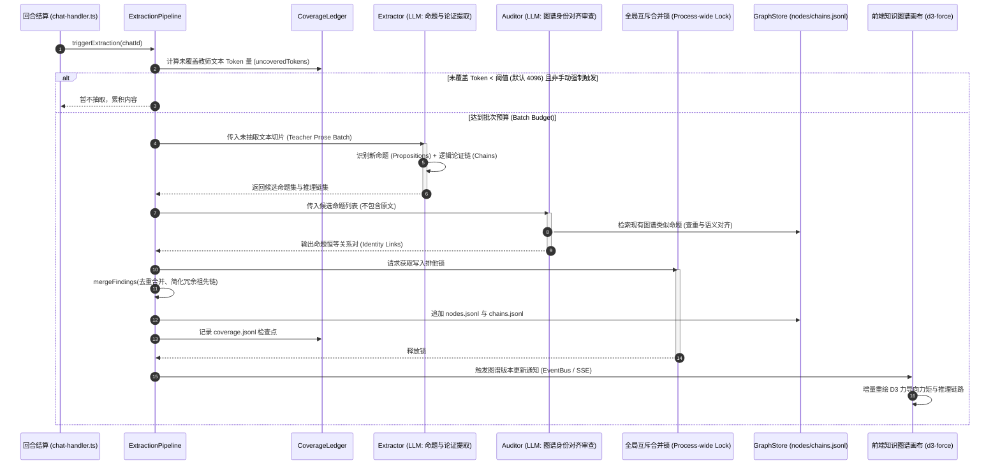
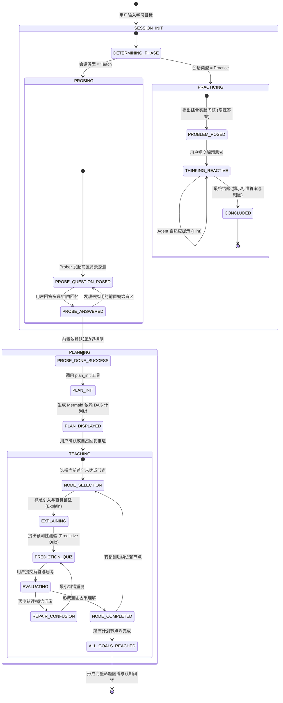
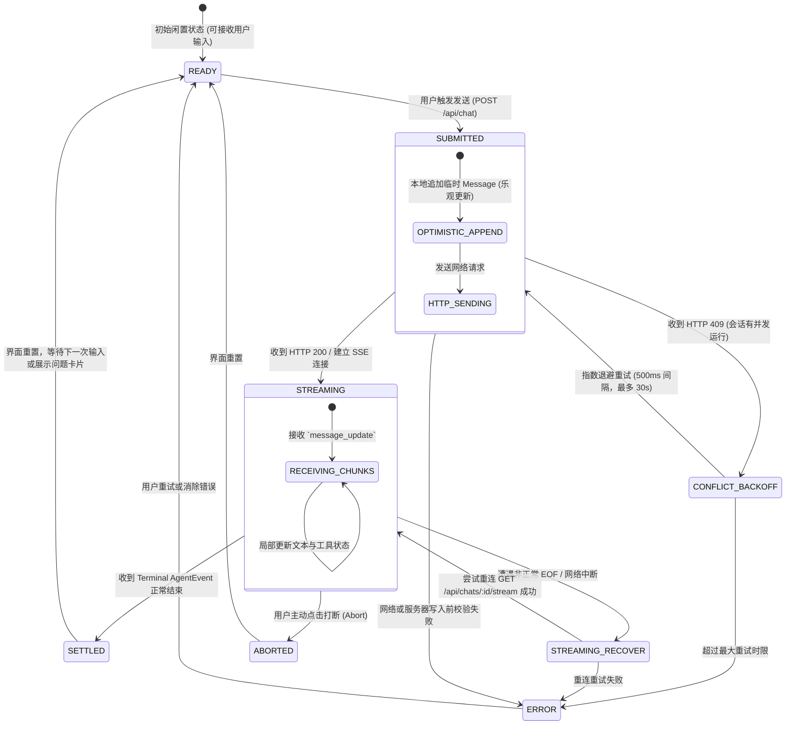

# LearnHarness 系统 UML 建模与架构全景解析

> 本文档针对更习惯阅读 UML 图的开发者（尤其是具有 Java / Spring / DDD 背景的工程师），将 LearnHarness（版本 `0.4.1`）的源代码与架构规范全景转化为标准的 UML 模型。
> 涵盖 **结构图（架构包图、领域类图、六边形端口类图、Agent 体系类图）** 与 **行为图（核心交互时序图、Worker 调度时序图、图谱抽取时序图、业务与客户端状态机）**。

---

## 目录
1. [系统组件与包结构图 (Package & Component Diagram)](#1-系统组件与包结构图)
2. [核心领域模型类图 (Core Domain Class Diagram)](#2-核心领域模型类图)
3. [六边形架构端口与适配器类图 (Ports & Adapters Class Diagram)](#3-六边形架构端口与适配器类图)
4. [Agent 与工具执行引擎类图 (Agent & Tool Hierarchy Class Diagram)](#4-agent-与工具执行引擎类图)
5. [时序图 1：一次完整交互回合的生命周期 (Turn Execution & Settlement)](#5-时序图-1一次完整交互回合的生命周期)
6. [时序图 2：后台 Worker 任务与反应式投递 (Background Job & Reactive Delivery)](#6-时序图-2后台-worker-任务与反应式投递)
7. [时序图 3：知识图谱事后抽取与合并 (Graph Extraction & Merge Flow)](#7-时序图-3知识图谱事后抽取与合并)
8. [状态机图：教学流程与客户端连接状态机 (State Machine Diagrams)](#8-状态机图教学流程与客户端连接状态机)
9. [Java / Spring / DDD 开发者心智映射对照表](#9-java--spring--ddd-开发者心智映射对照表)

---

## 1. 系统组件与包结构图

LearnHarness 采用**强制单向依赖边界的分层架构**（通过 `eslint.config.mjs` 静态守卫）。

```mermaid
flowchart TB
    subgraph Host["宿主外壳层 (Host Shell)"]
        ELECTRON["electron/ (Electron 44 主进程)<br/>• main.cjs 启动 loopback Next 服务<br/>• 桌面窗口安全策略 / 凭证中转"]
    end

    subgraph Client["表现层与客户端模型 (Presentation & Client)"]
        APP["app/ (Next.js 16 App Router)<br/>• app/chat/[id]/page.tsx<br/>• app/api/* (HTTP/SSE 路由端点)"]
        COMP["components/ (React 19 UI 组件)<br/>• chat.tsx, graph-view.tsx<br/>• question-dock.tsx, practice-dock.tsx"]
        SESSION_CORE["components/session-core.ts<br/>• 纯 TS 客户端会话状态机<br/>• 乐观更新 / SSE 重连 / 409 退避"]
    end

    subgraph Server["服务端组合根 (Server Composition Root)"]
        CHAT_HANDLER["src/server/chat-handler.ts<br/>回合组合根 (Turn Composition Root)"]
        STORES_WIRE["src/server/stores.ts<br/>存储装配组合点 (Wiring Root)"]
        TURN_LIVENESS["src/server/turn-liveness.ts<br/>会话活跃锁 (Concurrency Mutex)"]
        UI_STREAM["src/server/pi/ui-stream.ts<br/>原生 Agent 事件流与 SSE 转换"]
        JOBS_SERVER["src/server/jobs.ts<br/>后台投递与反应式唤醒注册表"]
        COMPACTION["src/server/compaction.ts<br/>上下文窗口自动压缩与截断门控"]
    end

    subgraph AgentLayer["Agent 与模型推理层 (Agent & Inference)"]
        TEACHER_AGENT["src/agent/teacher-agent.ts<br/>Prober / Teacher / Practitioner 构造工厂"]
        MODELS["src/agent/models.ts<br/>PiEngine 运行时 / 模型目录解析 (BYOK)"]
        TOOLS["src/agent/tools.ts + tools/<br/>提问/测验/规划/文件/后台工具注册"]
        SUBAGENTS["src/agent/subagents/<br/>runner.ts, extraction.ts, researcher.ts,<br/>visual-maker.ts, demo-builder.ts, pdf-reader.ts"]
        PROMPTS["src/agent/prompts/<br/>分段系统提示词体系 (Doctrine)"]
    end

    subgraph CoreDomain["领域核心层 (Core Domain - 纯逻辑无外部依赖)"]
        CONTRACTS["src/core/contracts/<br/>chat.ts, graph.ts, plan.ts, jobs.ts, models.ts"]
        PORTS["src/core/ports.ts<br/>六边形存储端口定义 (ChatStore, GraphStore 等)"]
        NATIVE_MSG["src/core/native-messages.ts<br/>LhMessage 记录 ↔ LLM 消息投影剪枝"]
        CORE_VIEW["src/core/view.ts<br/>LhMessage 记录 → UI 视图部件投影 (Fold)"]
        INPUT_EVENTS["src/core/input-events.ts<br/>输入事件规范化 (Text, Answer, Thinking)"]
        GRAPH_CORE["src/core/graph.ts + coverage.ts<br/>命题图谱推导、去重简化、覆盖率计算"]
        PLAN_CORE["src/core/plan-tree.ts<br/>计划树 DAG 校验与当前进度推导"]
    end

    subgraph StorageAdapters["持久化适配器层 (Storage Adapters)"]
        FS_CHATS["src/store/chats.ts (JSON)"]
        FS_GRAPH["src/store/graph.ts (JSONL)"]
        FS_JOBS["src/store/jobs.ts (JSON)"]
        FS_SETTINGS["src/store/settings.ts (JSON)"]
        FS_AUTH["src/store/auth.ts (JSON)"]
    end

    %% 依赖连线
    ELECTRON --> APP
    APP --> CHAT_HANDLER
    COMP --> SESSION_CORE
    SESSION_CORE -.->|依赖纯接口| CONTRACTS
    SESSION_CORE -.->|调用投影| CORE_VIEW

    CHAT_HANDLER --> TEACHER_AGENT
    CHAT_HANDLER --> TURN_LIVENESS
    CHAT_HANDLER --> COMPACTION
    CHAT_HANDLER --> UI_STREAM
    CHAT_HANDLER --> STORES_WIRE

    TEACHER_AGENT --> MODELS
    TEACHER_AGENT --> TOOLS
    TEACHER_AGENT --> PROMPTS
    TOOLS --> SUBAGENTS

    STORES_WIRE --> FS_CHATS
    STORES_WIRE --> FS_GRAPH
    STORES_WIRE --> FS_JOBS
    STORES_WIRE --> FS_SETTINGS
    STORES_WIRE --> FS_AUTH

    FS_CHATS -.->|实现| PORTS
    FS_GRAPH -.->|实现| PORTS
    FS_JOBS -.->|实现| PORTS
    FS_SETTINGS -.->|实现| PORTS
    FS_AUTH -.->|实现| PORTS

    CHAT_HANDLER --> CONTRACTS
    TEACHER_AGENT --> CONTRACTS
    SUBAGENTS --> GRAPH_CORE
    CHAT_HANDLER --> NATIVE_MSG
    CHAT_HANDLER --> INPUT_EVENTS
```

### 关键依赖隔离原则 (Boundary Rules)
- **`core/` 的绝对纯度**：不得引入 `server`、`agent` 或 `store`。
- **`components/` 的访问控制**：只能通过 `@/src/core` 这个受控 Barrel 文件访问浏览器安全的纯计算与模型定义。
- **`app/` 仅为薄外壳**：页面与 HTTP 路由只做参数解包并委托给 `server` 与 `core`。
- **控制与内容分离**：服务端独占转录历史；客户端仅作为投影视图。

---

## 2. 核心领域模型类图

本图描述系统中最核心的领域实体（Domain Entities）、值对象（Value Objects）及其关联关系。

### 核心领域模型设计亮点
1. **`ChatRecord` 即 Agent 状态源**：不存在单独的运行时 Agent 会话上下文数据库，`ChatRecord.messages` 就是底层大模型会话上下文的真值来源。
2. **纯粹无状态的 `PlanTree`**：`PlanTree` 中故意不保存 `doneNodeIds` 或 `currentNodeId`，节点的 `current`/`visited`/`upcoming` 状态全由转录中的历史工具调用事件（`derivePlanStatuses`）纯函数动态推导。
3. **推理链优先图谱（Chains-Primary Graph）**：`GraphChain` 是真正的存储核心，一个链表示一组前提（`premises`）联合蕴含一个结论（`conclusion`）；画布上展示的带方向边（`GraphEdge`）只是推理链的视图投影。

---

## 3. 六边形架构端口与适配器类图

LearnHarness 在存储层严格践行了**端口与适配器模式（Ports and Adapters / Hexagonal Architecture）**。领域层面向 `src/core/ports.ts` 的接口编程，而物理读写委托给 `src/store/` 的适配器，由 `src/server/stores.ts` 完成依赖注入组合。

---

## 4. Agent 与工具执行引擎类图

描述智能体（Prober / Teacher / Practitioner）、Pi 运行引擎、工具链注册表与后台 Worker 的静态结构。

---

## 5. 时序图 1：一次完整交互回合的生命周期

展示当用户在前端输入一个答案或问题时，系统从 HTTP 接收、锁争用、上下文剪枝、Agent 推理、工具提问拦截、落盘到 SSE 实时推流的完整交互生命周期。

---

## 6. 时序图 2：后台 Worker 任务与反应式投递

展示智能体在教学过程中分发耗时任务（如搜索、生成图示、构建交互演示应用）时的异步执行与唤醒投递机制。

---

## 7. 时序图 3：知识图谱事后抽取与合并

展示教学完成后，后台知识图谱流水线如何从教师讲解正文中抽取命题与推理链，并完成审计与合并。

---

## 8. 状态机图：教学流程与客户端连接状态机

### 8.1 业务级教学全生命周期状态机 (Pedagogical Lifecycle)

### 8.2 客户端 SessionModel 连接管理状态机 (Client Statechart)

---

## 9. Java / Spring / DDD 开发者心智映射对照表

为了帮助 Java 体系开发者无障碍理解 LearnHarness 的架构实现，下表将其核心设计映射到经典的 Java / Spring 生态技术模式：

| LearnHarness (TypeScript / Next.js) | Java / Spring 经典架构映射 | 核心职责与设计要点说明 |
| :--- | :--- | :--- |
| **`ChatRecord` / `data/chats/*.json`** | **聚合根 (Aggregate Root) + 事件存储** | 并非将消息逐条存入关系表，整个会话记录作为一个不可分割的聚合根，每次修改原子序列化落地。 |
| **`POST /api/chat` + `chat-handler.ts`** | **应用服务命令处理 (Application Command Handler)** | 充当 CQRS 中的 Command 端，严格接受 `{chatId, input}` 单一输入事件，执行写前验证并入库。 |
| **`GET /api/chats/:id/stream`** | **Spring WebFlux `Flux<ServerSentEvent>`** | 反应式 SSE 长连接，负责将服务端的推理事件与局部状态推送到前端视图。 |
| **`components/session-core.ts`** | **Redux / StateMachine 客户端状态管理器** | 脱离 React 渲染的纯状态机类，类似 Java 客户端中的 `SessionController`，封装重连与重试逻辑。 |
| **`src/core/ports.ts`** | **Domain SPI / Repository 接口** | 遵循六边形架构，核心领域只定义 `ChatStore`、`GraphStore` 接口，无任何持久化技术细节。 |
| **`src/store/chats.ts`** | **Infrastructure Repository 适配器实现** | 类似 `FsChatRepositoryImpl implements ChatRepository`，当前基于文件系统，未来可无缝平替为 SQLite / JPA。 |
| **`src/server/turn-liveness.ts`** | **分布式锁 / 进程锁 (`ReentrantLock` / Redisson)** | 保证单个 ChatId 在同一物理进程内只有一个活跃回合在运行，并发请求抛出 409。 |
| **`PiAgent` + `PiEngine`** | **Spring AI `ChatClient` / LangChain4j `AiService`** | 统一大模型抽象，封装流式输出、Function Calling（工具执行）、思考等级（Thinking Level）。 |
| **`subagents/runner.ts`** | **Spring `@Async` 异步线程池 / Worker 编排器** | 接受长时间运行的任务，将计算下放给后台 Worker，通过内存注册表与事件驱动唤醒主交互线程。 |
| **`src/core/view.ts` (`projectView`)** | **CQRS 查询模型投影器 (Query Projection / DTO Assembler)** | 将持久化的底盘原生消息 `LhMessage[]` 纯函数折叠映射为前端展示所需的 `ViewMessage[]`。 |

---

> **总结**：
> LearnHarness 展现了非常高度严谨的现代工程架构美学——它虽然基于 TypeScript 全栈开发，但核心思想深植于 **DDD 限界上下文、六边形端口适配器架构、单向数据流与 CQRS 投影、基于反应式事件的异步调度**。无论你是用 TS 还是 Java 阅读，这些 UML 图都能为你提供确定性的系统全景导航。
