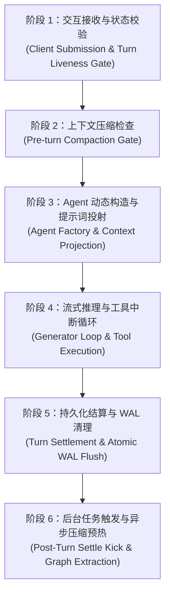
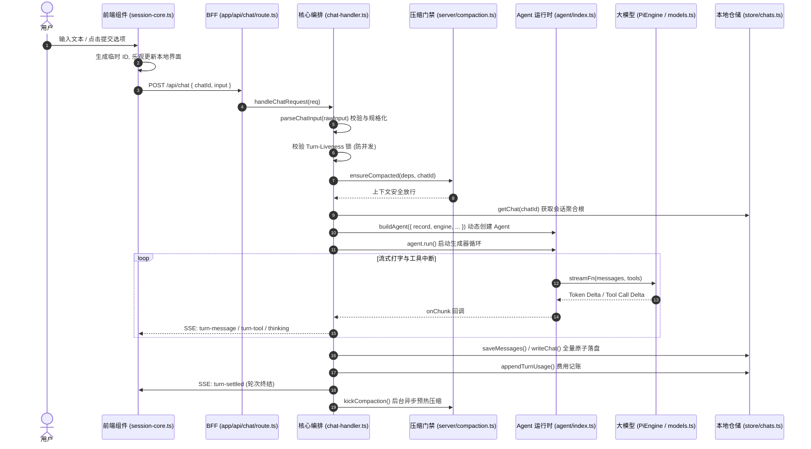
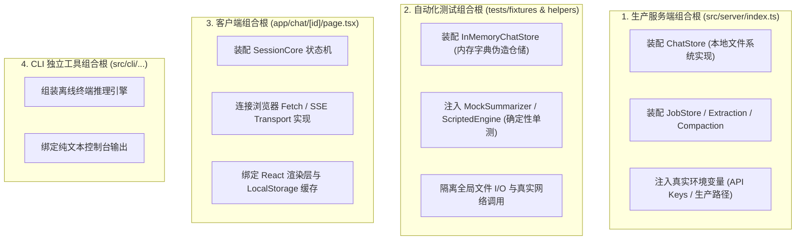
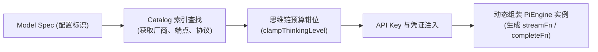
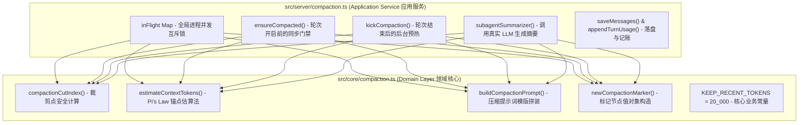

# 02 - 核心执行流与底层机制深度解密（全景技术沉淀）

> **文档定位**：本文档基于 Java / Spring / DDD 架构视角，对 `learnharness`（v0.4.1）中从“用户发起交互”到“底层系统运转”全流程中的核心架构逻辑、代码实现细节、并发控制、大模型工程以及上下文治理机制进行系统化复盘与沉淀。

---

## 目录索引

- [一、 端到端请求流与生命周期（从用户输入到系统响应）](#一-端到端请求流与生命周期从用户输入到系统响应)
  - [1.1 宏观业务粒度：六大执行阶段](#11-宏观业务粒度六大执行阶段)
  - [1.2 代码实现粒度：跨模块执行路径全景追踪](#12-代码实现粒度跨模块执行路径全景追踪)
  - [1.3 前端客户端核心：`session-core.ts` 的职责与状态机](#13-前端客户端核心session-corets-的职责与状态机)
  - [1.4 路由架构：为何工程中存在大量 `route.ts`？](#14-路由架构为何工程中存在大量-routets)
  - [1.5 异常与一致性：系统崩溃或断网时的恢复机制（WAL 与落盘边界）](#15-异常与一致性系统崩溃或断网时的恢复机制wal-与落盘边界)
- [二、 领域模型与数据持久化机制](#二-领域模型与数据持久化机制)
  - [2.1 `ChatRecord` 的本质：单条消息还是聚合根？](#21-chatrecord-的本质单条消息还是聚合根)
  - [2.2 存储架构：为什么每次追加都要全量覆写落盘（`writeChat`）？](#22-存储架构为什么每次追加都要全量覆写落盘writechat)
  - [2.3 全量历史留存哲学：前端与服务端为何长期持有全量对话？](#23-全量历史留存哲学前端与服务端为何长期持有全量对话)
  - [2.4 知识图谱与溯源：UML 中 `provenancePoint` 锚定 `GraphNode` 的含义](#24-知识图谱与溯源uml-中-provenancepoint-锚定-graphnode-的含义)
- [三、 系统架构、组合根与依赖注入](#三-系统架构组合根与依赖注入)
  - [3.1 什么是“组合根”（Composition Root）？](#31-什么是组合根composition-root)
  - [3.2 系统的四大组合根分布矩阵](#32-系统的四大组合根分布矩阵)
  - [3.3 六边形架构（Hexagonal Architecture）端口与适配器](#33-六边形架构hexagonal-architecture端口与适配器)
- [四、 TypeScript 核心语法与关键代码模式解构](#四-typescript-核心语法与关键代码模式解构)
  - [4.1 类型安全守卫：`let body: { chatId?: unknown; input?: unknown };` 为什么不用 `any`？](#41-类型安全守卫let-body--chatid-unknown-input-unknown--为什么不用-any)
  - [4.2 异步编程基石：`await` 与 JavaScript 事件循环机制](#42-异步编程基石await-与-javascript-事件循环机制)
  - [4.3 输入事件总线：`input-events.ts` 的深层功能与类型断言（`as`）](#43-输入事件总线input-eventsts-的深层功能与类型断言as)
  - [4.4 联合类型：`type TurnInput = ChatInput | SteerInput` 业务含义](#44-联合类型type-turninput--chatinput--steerinput-业务含义)
  - [4.5 交叉类型技巧：`AgentBuildOptions & { teaching: boolean }`](#45-交叉类型技巧agentbuildoptions--teaching-boolean)
  - [4.6 运行期策略判断代码精析：`callPurpose.background` 与意图重构](#46-运行期策略判断代码精析callpurposebackground-与意图重构)
  - [4.7 函数式扩展：`permitImages` 不可变对象修饰](#47-函数式扩展permitimages-不可变对象修饰)
- [五、 大模型运行时与 PiEngine 核心架构](#五-大模型运行时与-piengine-核心架构)
  - [5.1 系统是如何组装出 `PiEngine` 的？](#51-系统是如何组装出-piengine-的)
  - [5.2 角色槽位映射：`effective.models.strong` 是做什么的？](#52-角色槽位映射effectivemodelsstrong-是做什么的)
  - [5.3 提示词缓存与保留策略：`cacheRetention` 是从哪里取得的？](#53-提示词缓存与保留策略cacheretention-是从哪里取得的)
  - [5.4 极端边界测试：`piEngineForSpec` 传入 `lifecycle: undefined` 会发生什么？](#54-极端边界测试piengineforspec-传入-lifecycle-undefined-会发生什么)
- [六、 上下文压缩系统（Compaction）与内存治理](#六-上下文压缩系统compaction与内存治理)
  - [6.1 压缩触发时机：每次会话都调用 `ensureCompacted`，是每次都压缩吗？](#61-压缩触发时机每次会话都调用-ensurecompacted是每次都压缩吗)
  - [6.2 状态看门狗：`if (deps.canStart?.() === false) return;` 含义](#62-状态看门狗if-depscanstart--false-return-含义)
  - [6.3 权威读取玄机：压缩函数后为什么重新 `getChat(chatId)`？](#63-权威读取玄机压缩函数后为什么重新-getchatchatid)
  - [6.4 追根溯源：`deps.chatStore.saveMessages` 究竟调用了哪里？](#64-追根溯源depschatstoresavemessages-究竟调用了哪里)
  - [6.5 响应式解耦：`emit("record-changed", { chatId })` 起到了什么作用？](#65-响应式解耦emitrecord-changed--chatid--起到了什么作用)
  - [6.6 领域与服务分层：`core` 与 `server` 包的 `compaction.ts` 有何本质区别？](#66-领域与服务分层core-与-server-包的-compactionts-有何本质区别)
  - [6.7 并发治理神技：`src/server/compaction.ts` 的内存单飞锁（`inFlight Map`）详解](#67-并发治理神技srcservercompactionts-的内存单飞锁inflight-map详解)
- [七、 总结与架构启示录](#七-总结与架构启示录)

---

## 一、 端到端请求流与生命周期（从用户输入到系统响应）

### 1.1 宏观业务粒度：六大执行阶段

当用户在前端输入一个问题、提交一个测试选择题答案，或者点击继续时，系统并不会像普通 CRUD 那样立刻返回数据库结果，而是经历了一套严密的 **AI Agent 多轮对话与协同运转生命周期**：



1. **交互接收与状态校验（Interaction & Liveness Gate）**：
   * 前端客户端（`session-core.ts`）捕获用户输入，生成本地临时 ID，通过乐观更新（Optimistic Update）先在屏幕上把用户输入渲染出来。
   * 发起 HTTP POST 请求到 `/api/chat`。服务端校验是否存在并发对话冲突（Turn-Liveness 锁）。若发现上一轮对话尚未结算，则直接拦截。
2. **上下文压缩门禁（Pre-turn Compaction Gate）**：
   * 检查是否已有后台压缩在运行；如果运行中则等待其落地；
   * 预估包含本次新输入后的总 Token 占用。若已逼近大模型上下文极限（默认 150k），则立即阻塞启动上下文压缩，把旧消息压缩为带记忆标记的总结（Compaction Marker）。
3. **Agent 动态构造与上下文投射（Agent Factory & Context Projection）**：
   * 系统**绝不长期常驻一个存活的 Agent 对象**。每个轮次（Turn）开始时，根据会话类型（Tutor / Practice / Probe）动态创建全新的 Agent。
   * 过滤历史消息（`toLlmMessages`），仅将压缩截断点（Cut Point）之后的消息与系统提示词（System Prompt）、知识树（Plan Tree）拼接投射给模型。
4. **流式推理与工具循环（Streaming & Tool Execution）**：
   * Agent 驱动底层大模型（`PiEngine`）执行生成循环。大模型输出的文本 token 和思考过程（Thinking Tokens）通过 SSE（Server-Sent Events）毫秒级实时流式打字机式推送给前端。
   * 若模型决定调用普通工具（如检索学习进度、搜索文档），由服务端本地执行后将结果反馈给模型继续思考；
   * **若模型调用了提问工具（如 `problem_pose`）**，系统判定本轮必须将发言权归还给人类，流式循环在此主动挂起并中断（Breakpoint）。
5. **持久化结算与记账（Settlement & Cost Accounting）**：
   * 收集模型本轮生成的所有消息、思考过程、工具调用与结果。
   * 原子性全量落盘覆写到本地磁盘的 `chat.json`。
   * 记录本轮实际消耗的 Token 与花费账单（Usage & Cost）。
   * 释放会话并发锁，通知前端该轮次正式完成（Turn Completed）。
6. **后置后台任务与异步预热（Post-Turn Settle Kick & Graph Extraction）**：
   * **Settle Kick**：在用户阅读和答题的间隙，如果发现 Token 已越过阈值，立刻在后台无感启动异步压缩。
   * **Graph Extraction**：异步拉起知识图谱提取 Agent，分析本轮对话中用户的认知变化与薄弱点。

---

### 1.2 代码实现粒度：跨模块执行路径全景追踪

从代码调用链来看，整个请求流跨越了前端视图、BFF 路由、应用服务编排、AI Agent 引擎与基础设施仓储层：



*   **入口点**：`app/api/chat/route.ts` 仅暴露 Next.js App Router 约定的 `POST` 处理函数，将原生 `Request` 直接委托给 `src/server/chat-handler.ts` 的 `handleChatRequest(req)`。
*   **输入标准化**：`parseChatInput()` 负责校验客户端 payload，将其转换为带强类型标签的 `TurnInput`。
*   **状态与门禁**：通过 `ensureCompacted()` 确保在将消息送往大模型之前，历史消息长度处于上下文安全阈值之内。
*   **执行循环**：`agent.run()` 内部为异步生成器循环（Generator Loop），通过订阅 `streamFn` 获取 Token 流，不断通过 Next.js 的 `TransformStream` 向客户端下发 SSE 事件。
*   **终结结算**：在 `onFinish` 回调中将本次 Turn 产生的所有 Assistant 消息和工具调用结果全量同步至聚合根并调用 `writeChat` 落盘。

---

### 1.3 前端客户端核心：`session-core.ts` 的职责与状态机

在很多前后端分离框架中，前端往往只是把输入 `fetch` 发给后端并显示返回结果。但在 `learnharness` 中，`components/session-core.ts` 是一个极其复杂的**纯 TypeScript 客户端状态机**。

#### 核心职责：
1. **视图解耦与跨平台复用**：
   * `session-core.ts` 内部**零 React 依赖**（没有 `useState`，没有 `useEffect`，没有 JSX）。它纯粹依靠回调函数和内部闭包管理状态。这使得同一个状态机既可以跑在 React 组件里，也可以在测试中无头（Headless）运行，或移植到移动端。
2. **乐观更新与吸收算法（Absorption Algorithm）**：
   * 用户提交问题后，前端不用等后端 HTTP 200，立刻调用 `appendOptimisticMessage()` 将用户的发言展示在聊天列表中（防止界面顿挫）。
   * 当后端流式返回正式分配了服务端 UUID 的消息流时，前端通过“吸收算法”无缝将临时的乐观消息替换为服务端的权威消息，用户无感知。
3. **连接节食策略（Connection Diet B）**：
   * 前端不建立长期无限制常开的 WebSocket，而是按需建立 SSE 流式连接。
   * 如果网络抖动连接中断，前端状态机能够自动根据消息的 `messageId` 进行精确对齐与断点续接。
4. **409 并发冲突的退避重试（Backoff & Retry）**：
   * 如果用户在前一轮未完全落盘时点击了提交，后端会返回 HTTP `409 Conflict`。
   * 前端状态机捕获 409 后，绝不弹窗报错，而是将其放入重试队列，采用指数退避（Exponential Backoff）策略自动静默重试，直到后端的上一轮落盘完成。

---

### 1.4 路由架构：为何工程中存在大量 `route.ts`？

如果在项目中全局搜索，会发现 `app/api/...` 目录下分布着许多结构极其相似的 `route.ts`：

```
app/
 ├── api/
 │    ├── chat/route.ts
 │    ├── chats/route.ts
 │    ├── settings/route.ts
 │    └── ...
```

#### 架构原因：
1. **Next.js App Router 的约定式路由规范**：
   * Next.js 13+ 引入了 App Router 机制，**只有命名为 `route.ts` 的文件才会被框架自动识别为 HTTP API 端点**。文件夹的层级结构直接对应 URL 路由（如 `app/api/chat/route.ts` 对应 `/api/chat`）。
2. **极薄的适配层（BFF Controller）**：
   * 这些 `route.ts` 类似于 Spring Boot 中的 `@RestController`。为了保证架构的整洁度，所有 `route.ts` 文件内部通常**只有 3~5 行代码**：
     ```typescript
     import { handleChatRequest } from "@/src/server";
     export async function POST(req: Request) {
         return handleChatRequest(req);
     }
     ```
   * 所有的业务逻辑、领域验证全部委托给 `src/server/` 中的纯领域服务或应用服务，路由层仅负责 HTTP 协议协议转换（如读取 Cookies、组装 Response 头）。

---

### 1.5 异常与一致性：系统崩溃或断网时的恢复机制（WAL 与落盘边界）

> **关键问题**：如果在大模型吐字期间，用户突然拔掉电源或网络强行中断，会发生什么？下次打开会丢消息吗？

*   **落盘边界（Settlement Boundary）**：
    系统的设计哲学是：**只有完成“结算（Settlement）”的轮次，才是权威有效的状态**。
*   **崩溃表现**：
    如果在大模型吐字中途进程崩溃或断电，由于尚未执行最后的 `writeChat` 原子覆写，本次中断轮次中模型生成的半截文字**绝不会残留在主会话记录中**。
*   **下次恢复（Recovery）**：
    当用户重新打开应用时，系统重新从 `chat.json` 加载聚合根。历史记录停留在**用户最后一次有效输入**的状态。此时前端 `session-core.ts` 会发现最后一个状态是“等待模型回应”，并提供自动恢复按钮或无缝重新唤醒 Agent 继续生成，实现了天然的幂等性与崩溃一致性。

---

## 二、 领域模型与数据持久化机制

### 2.1 `ChatRecord` 的本质：单条消息还是聚合根？

在 Java 领域驱动设计（DDD）中，`ChatRecord` **不是一条单独的消息（Message）**，而是整个会话的**聚合根（Aggregate Root）**。

```typescript
export interface ChatRecord {
    id: string;               // 会话唯一ID (UUID)
    title: string;            // 会话标题
    kind: "teach" | "practice" | "probe"; // 会话业务模式
    messages: LhMessage[];    // 历史所有消息数组 (包含 User, Assistant, Marker)
    tree: PlanTree;           // 伴随会话演化的教学大纲知识树
    activeProblem?: Problem;  // 当前正在考核用户的未决题目
    createdAt: string;
    updatedAt: string;
}
```

*   **单条消息只是聚合根内部的实体（Entity）或值对象（Value Object）**。
*   任何针对对话的变更（追加消息、题目状态流转、教学树进度打标），都必须由 `ChatRecord` 统一保护其不变性约束（Invariants）。

---

### 2.2 存储架构：为什么每次追加都要全量覆写落盘（`writeChat`）？

在 `src/store/chats.ts` 中，每当新增一条消息，代码并不是像数据库 `INSERT INTO message` 那样做局部增量插入，而是调用 `writeChat` 将整个包含几十条消息的 `ChatRecord` **完整全量覆写**为 JSON 文件：

```typescript
// src/store/chats.ts
export function writeChat(record: ChatRecord): void {
    const filePath = path.join(DATA_DIR, `${record.id}.json`);
    const tempPath = `${filePath}.tmp.${Date.now()}`;
    fs.writeFileSync(tempPath, JSON.stringify(record, null, 2), "utf-8");
    fs.renameSync(tempPath, filePath); // POSIX 原子重命名保障一致性
}
```

#### 为什么做全量覆写而不是追加日志（Append-only log）？
1. **单机桌面端轻量化约束**：
   * `learnharness` 是一个可以打包运行在 Electron 桌面端的单机优先软件，避免引入重量级的外部数据库（如 PostgreSQL / MySQL）。
2. **POSIX 原子重命名保障（Atomic File Rename）**：
   * 采用“先写入临时文件，再通过 `fs.renameSync` 原子覆写”的模式，彻底杜绝了写入中途断电导致 JSON 文件损坏成半截乱码的可能。
3. **聚合根完整性视图**：
   * 会话中不仅有消息，还有伴随会话演变的 `PlanTree`（教学树结构）和考核状态。整份快照全量落盘保证了消息与教学树状态的绝对版本一致性，消除了分布式事务和状态缝合的复杂度。

---

### 2.3 全量历史留存哲学：前端与服务端为何长期持有全量对话？

很多工程师的第一直觉是：“既然做了上下文压缩（Compaction），旧消息大模型反正看不到了，为什么不直接把旧消息从内存和磁盘中删掉，只留摘要？”

系统之所以必须在磁盘和前端**保留 100% 的全量原始对话**，有以下核心架构考量：

1. **人类交互回溯与零闪烁恢复（User Transcript & SSR）**：
   * 压缩是为了**迁就大模型的上下文窗口限制与 Token 成本**，而人类用户需要随时往上滑动翻阅几周前自己的原始提问、老师的详细讲解与代码片段。
2. **多视角分离（Multi-projection Architecture）**：
   * 完整历史是系统的**单一可信事实源（Single Source of Truth）**；
   * 面向大模型时，通过 `toLlmMessages()` 函数**动态投射**出裁剪后的 `[Summary Marker] + [Recent Tail]`；
   * 面向用户界面时，通过前端组件渲染全量消息，并在压缩点处渲染一条优雅的“历史折叠线”组件。
3. **离线知识抽取与复习评估（Downstream Analytics）**：
   * 后台异步运行的评估 Agent、知识图谱提取器需要随时调阅全量历史记录，重新分析学员的学习轨迹。

---

### 2.4 知识图谱与溯源：UML 中 `provenancePoint` 锚定 `GraphNode` 的含义

在系统全景 UML 建模中，存在如下实体关联：
```
ProvenancePoint (溯源点) -----> [anchored to] -----> GraphNode (知识节点)
```

#### 架构内涵：
* **知识图谱节点（GraphNode）**：代表一个纯粹的抽象知识概念（例如“B+树索引”、“MySQL MVCC 原理”）。
* **溯源点（ProvenancePoint）**：记录了该概念**是在哪一轮对话、通过哪一条具体的问答或题目交互被学员所掌握或暴露出误解的**。
* **业务价值**：当学员在后面的综合测试中做错题目时，系统可以通过 `ProvenancePoint` 秒级反向定位到第几轮对话：“*你在第 3 轮曾说‘聚集索引叶子节点存的是指针’，这是你在第 8 轮推导失败的根本原因*”。实现了精准的教学回溯与证据链支撑。

---

## 三、 系统架构、组合根与依赖注入

### 3.1 什么是“组合根”（Composition Root）？

“组合根”（Composition Root）是 Mark Seemann 在《Dependency Injection in .NET》中提出的核心设计原则：
> **组合根是应用程序中唯一一个统一创建对象图（Object Graph）、解析依赖关系并将各层组件装配绑定的物理位置，通常位于应用程序的最外层入口。**

在典型的 Spring 项目中，Spring 容器（`ApplicationContext`）充当了隐式组合根。而在没有重型 DI 框架的 TypeScript 工程中，必须显式定义组合根。

---

### 3.2 系统的四大组合根分布矩阵

`learnharness` 拥有严格的架构边界，并针对不同的运行宿主设计了四大独立的组合根：



---

### 3.3 六边形架构（Hexagonal Architecture）端口与适配器

系统在 `src/core/ports.ts` 中定义了纯粹的业务端口接口，底层实现完全可插拔：

```typescript
// 端口定义 (Port)：纯接口，属于领域外围契约
export interface ChatStore {
    getChat(id: string): ChatRecord | undefined;
    saveMessages(id: string, messages: LhMessage[]): void;
    appendTurnUsage(id: string, usage: TurnUsage): void;
}
```

*   **生产适配器（Adapter）**：`src/store/chats.ts`，基于 Node.js `fs` 模块，操作真实磁盘文件。
*   **测试适配器（Adapter）**：`tests/fakes/in-memory-chat-store.ts`，基于 JavaScript `Map`，毫秒级运行单元测试。

---

## 四、 TypeScript 核心语法与关键代码模式解构

### 4.1 类型安全守卫：`let body: { chatId?: unknown; input?: unknown };` 为什么不用 `any`？

在 `chat-handler.ts` 的入口处，开发者经常会看到这样的代码：
```typescript
let body: { chatId?: unknown; input?: unknown };
```

#### 对比 Java 视角：
* `any` 等价于彻底关闭类型检查，相当于直接把编译器当成透明人，极易引发类似 Java `ClassCastException` 的运行时崩溃（如在 undefined 上读取属性）。
* **`unknown` 等价于 Java 的顶层父类 `Object`**：
  * 它表示“我知道这里有一个值，但因为是从网络请求体 JSON 反序列化出来的，在未经代码显式检查类型之前，我不信任它的结构”。
  * TypeScript 规定：**在对 `unknown` 类型的变量进行类型守卫（Type Guard，如 `typeof === "string"`）之前，严禁直接调用其方法或读取字段**。这迫使开发者必须在代码中显式编写验证分支，构建了最严密的类型防线。

---

### 4.2 异步编程基石：`await` 与 JavaScript 事件循环机制

与 Java 的多线程模型（一个请求分配一个 OS 线程 / 虚拟线程并发阻塞）不同，Node.js 是**单线程基于事件循环（Event Loop）架构**：

*   **`await` 的本质**：
    `await` 不是 Java 里的 `thread.join()` 或 `CountDownLatch.await()` 那种阻塞操作系统线程的操作。
*   **运行原理**：
    当代码执行到 `await someAsyncCall()` 时，当前函数会立刻挂起并让出 CPU 执行权，Node.js 主线程立刻去处理其他网络连接或 SSE 数据块。等到该异步操作完成后，事件循环通过微任务队列（Microtask Queue）唤醒后续代码继续向下执行。这保证了单个 Node.js 进程可以轻松扛起数千个并发流式推送连接而不需要消耗几千个系统线程。

---

### 4.3 输入事件总线：`input-events.ts` 的深层功能与类型断言（`as`）

`src/core/input-events.ts` 远远不止是参数校验器，它是交互事件向领域消息转化的**状态构造器**。

#### 1. 类型断言 `as QuestionAnswerData` 的真相
```typescript
answer: i.answer as QuestionAnswerData
```
* **注意**：这不是 Java 里的隐式类型转换（Implicit Cast）或对象转换，而是 TypeScript 的**类型断言（Type Assertion）**。
* 它在编译后的原生 JavaScript 中**不会产生任何字节码或运行期开销**。它的作用是告诉编译器：“*前面已经通过严格的 if 逻辑检查过合法性了，请将它的静态类型断定为强类型的 `QuestionAnswerData`*”。

#### 2. `input-events.ts` 的四大深层能力：
* **`inputAppends()`**：将结构化的用户输入（如选择题点击了选项 B）转化为标准的 `LhMessage` 实体；
* **`retryDrops()`**：识别重试场景，精准计算需要丢弃的历史回滚切片；
* **`questionRecoveryAppends()`**：当系统异常退出后，负责构建恢复当前提问会话所需的补偿消息。

---

### 4.4 联合类型：`type TurnInput = ChatInput | SteerInput` 业务含义

```typescript
export type TurnInput = ChatInput | SteerInput;
```

#### 业务内涵：
* **`ChatInput`（学员前台输入）**：包含学员发送的问题、针对题目的答卷、或者点击“继续学习”。
* **`SteerInput`（教学干预/方向操纵指令）**：通常来源于教师端控制台或系统自动化注入。例如强制让 Agent 暂停讲解立刻进入考试，或者强制切换到下一个知识节点。两者合并为一个联合类型，由底层的状态机通过 `input.type` 进行标签分发（Discriminated Union）。

---

### 4.5 交叉类型技巧：`AgentBuildOptions & { teaching: boolean }`

在工厂函数签名中经常看到 `&` 符号：
```typescript
buildAgent?: (opts: AgentBuildOptions & { teaching: boolean }) => TeachingAgent;
```

#### 语法解析：
* 这是 TypeScript 的**交叉类型（Intersection Type）**。
* 它表示将两个接口的所有属性合并为一个全新的匿名类型。
* 既包含了基础构建参数（模型、知识库、历史消息），又额外要求调用方必须显式传入一个布尔标记 `{ teaching: boolean }`，用以区分当前拉起的 Agent 究竟是教学老师模式还是考核考官模式。

---

### 4.6 运行期策略判断代码精析：`callPurpose.background` 与意图重构

在 `chat-handler.ts` 中有一行非常精妙的代码：
```typescript
const callPurpose = {
    background: input.type === "steers" || 
        (input.type === "continue" && reconstructRequestCause(record.messages) !== "foreground")
};
```

#### 业务意图：
* 系统需要区分本次大模型调用是**前台用户的实时互动**还是**系统的后台自主运转**。
* 如果本次输入是操纵指令（`steers`），或者用户点击了继续但在消息历史深处重构出的根本原因并不是等待前台交互（例如后台任务尚未收尾），则将本次调用标记为 `background`。
* 这一标记会直接指导底层模型调度器：**对于后台静默任务，关闭流式 SSE 推送，并采用更低成本或更大推理预算的模型配置**。

---

### 4.7 函数式扩展：`permitImages` 不可变对象修饰

```typescript
const permitImages = (value: Model<Api>): Model<Api> => ({ 
    ...value, 
    input: ["text", "image"] 
});
```

#### 函数式编程范式：
* 典型的纯函数与不可变数据模式。
* 坚决避免直接原地修改原始模型对象（如 `value.input.push("image")`），而是使用对象展开运算符（Object Spread）创建一份具有图像识别能力的全新副本。这彻底消除了多线程或跨会话共享模型实例时引发的数据篡改隐患。

---

## 五、 大模型运行时与 PiEngine 核心架构

### 5.1 系统是如何组装出 `PiEngine` 的？

`PiEngine` 是系统对接大语言模型底层的驱动执行引擎。它的组装过程是一条典型的**函数式管道（Pipeline）**：



在 `src/agent/models.ts` 中，`piEngineForSpec` 根据配置中心的模型标识（如 `google:gemini-2.5-pro`），通过模型目录字典解析其真正的通信协议（OpenAI 兼容协议、Anthropic 协议或 Google GenAI 协议），并组装出标准化的流式调用接口。

---

### 5.2 角色槽位映射：`effective.models.strong` 是做什么的？

系统实行**分层模型槽位体系**，在配置中分配了不同的职责角色：

*   **`strong`（主力强模型，如 Claude 3.5 Sonnet / Gemini 1.5 Pro）**：
    负责承担高难度的苏格拉底式教学、复杂代码 Debug 诊断、以及规划教学大纲知识树。
*   **`weak` / `fast`（快速轻量模型，如 Gemini Flash）**：
    负责承担简单的会话起名、元数据提取、知识点简单归纳，以极低的成本和毫秒级延迟运行。
*   `effective.models.strong` 就是当前会话所绑定的主力教学引擎。

---

### 5.3 提示词缓存与保留策略：`cacheRetention` 是从哪里取得的？

大模型服务商（如 Anthropic、Google Cloud）普遍支持**Prompt 缓存（Prompt Caching）**，对复用的前缀提示词提供大幅价格优惠。

*   **取值来源**：`cacheRetention` 并不是写死的常量，而是从用户的设置中心（`settings.cacheRetention`）结合服务商目录动态计算得出的生命周期参数（如 `short`、`long` 或具体分钟数）。
*   **`retentionForSlot("strong")`**：专门读取主力强模型槽位所对应的缓存保鲜策略。在请求模型时，引擎会在 System Prompt 和大纲树结尾处自动注入缓存断点（Cache Breakpoint），使连续多轮对话的成本下降 70% 以上。

---

### 5.4 极端边界测试：`piEngineForSpec` 传入 `lifecycle: undefined` 会发生什么？

在某些内部服务调用中，代码会写为：
```typescript
piEngineForSpec(conversation, true, undefined, retentionForSlot("strong"));
```

#### 运行期影响：
* `lifecycle` 参数定义了模型调用的生命周期钩子（例如打字机 Token 回调、请求开始通知、流异常监听）。
* 当传入 `undefined` 时，底层引擎会**安全降级**为默认的空生命周期处理器（No-op Handler）。
* **结果**：大模型依然会正常完整地执行推理并返回最终文本，但**系统不会触发任何全局事件广播，也不会向前端推送打字机流**。这非常适合一次性的后台总结任务（如历史压缩或知识提取）。

---

## 六、 上下文压缩系统（Compaction）与内存治理

### 6.1 压缩触发时机：每次会话都调用 `ensureCompacted`，是每次都压缩吗？

**绝不是每次都压缩！**

`ensureCompacted` 扮演的是一个**严格的门禁（Gate Keeper）**角色：
```typescript
export async function ensureCompacted(deps: CompactionDeps, chatId: string): Promise<void> {
    await awaitCompaction(chatId); // 等待其他后台压缩
    const record = deps.chatStore.getChat(chatId);
    if (!record) return;

    // 核心门禁检查：预估 Token 是否小于阈值（例如 150,000）
    if (projectedContextTokens(record.messages, deps.systemPromptTokens) <= deps.thresholdTokens) {
        return; // 未超标，秒级直接放行，什么都不做！
    }

    // 真正超标，才开始执行紧缩操作
    const run = compact(deps, chatId);
    ...
}
```
只有当历史对话不断累积，预估 Token 真实逼近设定阈值时，才会真正触发一次历史截断与 LLM 总结。

---

### 6.2 状态看门狗：`if (deps.canStart?.() === false) return;` 含义

在 `ensureCompacted` 和 `kickCompaction` 中，都有这样一行看门狗代码：
```typescript
if (deps.canStart?.() === false) return;
```

#### 设计哲学：
* 该函数是一个**动态运行条件探测钩子**。
* **使用场景**：在服务准备开始压缩前，探针会去检查：
  1. 当前会话是否已经被用户在另一个标签页强制关闭？
  2. 当前服务进程是否正在接收重启/关机信号？
  3. 会话是否已经被完全归档（Archive）？
* 如果条件不再满足，即使历史记录已经严重超标，也立即放弃本次压缩，防止为已废弃的会话白白浪费昂贵的 LLM API 账单。

---

### 6.3 权威读取玄机：压缩函数后为什么重新 `getChat(chatId)`？

在触发压缩的代码段中，常常看到紧接着又去执行了一次：
```typescript
const compactedRecord = stores.chatStore.getChat(chatId);
```

#### 为什么不直接复用内存中已有的 `record` 变量？
* **防止读写竞争与脏数据（Stale State Avoidance）**：
  压缩过程是一个耗时数秒的异步操作。在此期间，底层 `saveMessages` 已经向文件系统写入了新的 `LhMarkerMessage`。
* 重新从权威仓储 `getChat` 读取，能够保证后续的 Agent 构建逻辑拿到的是**绝对权威、包含了最新压缩 Marker 和更新后教学树的最新状态**，彻底杜绝了并发环境下的内存脏读问题。

---

### 6.4 追根溯源：`deps.chatStore.saveMessages` 究竟调用了哪里？

```typescript
deps.chatStore.saveMessages(chatId, [...messages, marker]);
```

#### 调用路径全量穿透：
1. **接口层**：`deps.chatStore` 声明为 `src/core/ports.ts` 的 `ChatStore` 接口。
2. **实例绑定**：在服务端启动时，由组合根 `src/server/stores.ts` 实例化并传入。
3. **真实落地**：跳转至 `src/store/chats.ts` 中的 `saveMessages`：
   ```typescript
   export function saveMessages(chatId: string, messages: LhMessage[]): void {
       const record = getChat(chatId);
       if (!record) throw new Error("Chat not found");
       record.messages = messages;
       record.updatedAt = new Date().toISOString();
       writeChat(record); // 触发原子全量落盘！
   }
   ```
4. **最终结果**：通过 `writeChat` 将包含最新压缩总结标记（Compaction Marker）的全量数据刷入磁盘。

---

### 6.5 响应式解耦：`emit("record-changed", { chatId })` 起到了什么作用？

在压缩完成或消息追加完成后，服务端会触发事件广播：
```typescript
emit("record-changed", { chatId });
```

#### 架构作用：
1. **Notify-then-Fetch 架构范式**：
   * 遵循“只通知有变化，不直接在事件中塞大体积 Payload”的原则。事件体非常轻量（仅携带 `chatId`）。
2. **打碎循环依赖（Decoupling Circular Dependencies）**：
   * 压缩服务不需要关心谁关心会话更新。
   * 前端 SSE 监听器收到该广播后，主动向服务端发起拉取或更新视图；
   * 后台知识图谱提取器收到该广播后，自动触发对新消息的分析。发布者与订阅者在代码层面零耦合。

---

### 6.6 领域与服务分层：`core` 与 `server` 包的 `compaction.ts` 有何本质区别？

这是系统中最精彩的架构分层案例之一：



*   **`src/core/compaction.ts`**：
    * **纯数学与纯领域规则**。零外部依赖、无 I/O、无网络、无并发状态。可在浏览器、Node.js、单测中同构复用。
*   **`src/server/compaction.ts`**：
    * **具有外部副作用的流程编排**。负责网络 RPC、管理并发互斥锁、操作数据库落盘、发送广播事件，属于典型的应用服务层。

---

### 6.7 并发治理神技：`src/server/compaction.ts` 的内存单飞锁（`inFlight Map`）详解

在服务端的压缩实现中，包含了一个经典的**单飞锁（Single Flight Pattern）**设计：

```typescript
interface CompactionState {
    inFlight: Map<string, Promise<void>>;
}
const g = globalThis as typeof globalThis & { __lhCompaction?: CompactionState };
function state(): CompactionState {
    return (g.__lhCompaction ??= { inFlight: new Map() });
}
```

#### 1. 为什么叫“单飞”（Single Flight）？
* 该术语源自 Go 语言著名的 `singleflight` 扩展包，其核心思想是：**“一人起飞，众人搭车”**。
* 历史压缩需要让大模型通读数万字对话，耗时 5~15 秒且产生实际资金消耗。如果上一轮后台预热尚未完成，用户急躁地发送了下一条消息，系统必须坚决杜绝同时跑两个压缩任务。
* 当第一个请求启动压缩时，将返回的 `Promise` 存入 `inFlight Map`。后续到来的请求直接 `await` 这个现成的 `Promise`，任务完成后大家同时得到结果并解除阻塞。

#### 2. 为什么挂载在 `globalThis` 上？
* **抵御 Next.js 开发环境热重载（HMR / Hot Module Reloading）**。
* 如果写成文件顶层的普通局部变量 `const inFlight = new Map()`，每次前端代码改动导致模块被 Next.js 重新编译加载时，Map 都会被清空，导致先前的互斥锁彻底失效。挂在 `globalThis` 上能够跨越模块热重载保持进程级单例。

#### 3. 与 Java 实现的对比：
在 Java 中，由于涉及多线程并发抢占，必须使用并发容器或 CAS 操作：
```java
// Java 等价实现
ConcurrentHashMap<String, CompletableFuture<Void>> inFlight = new ConcurrentHashMap<>();

public CompletableFuture<Void> ensureCompacted(String chatId) {
    return inFlight.computeIfAbsent(chatId, k -> executeAsyncCompaction(k))
                   .whenComplete((res, err) -> inFlight.remove(chatId));
}
```
而在 Node.js 中，由于 JavaScript 主线程代码执行基于**单线程事件循环（Event Loop）**，Map 的 `has`、`set`、`delete` 操作具备天然的原生原子性，无需加锁即可达到极其健壮的并发控制效果。

---

## 七、 总结与架构启示录

通过对 `learnharness` 端到端交互全流程与深层代码的全面剖析，我们可以提炼出以下适用于现代生产级 AI Agent 系统的核心架构范式：

1. **Agent 的无状态生命周期（Ephemeral Agent Pattern）**：
   * 绝不要试图维护长生命周期的内存 Agent 对象。将 Agent 视为无状态的算子，每次 Turn 启动时从权威持久化聚合根中“按需构造”，Turn 结束后立即结算并销毁。
2. **纯计算与工程编排的彻底分离（Core vs Server Separation）**：
   * 将高风险的上下文切片、Token 估算、Prompt 模板收敛为 100% 纯函数的 Core 领域包；将 I/O、锁、LLM 远端调用交给 Server 应用服务包。这是 AI 项目能够从玩具走向企业级工程质量的分水岭。
3. **分层上下文治理与双门禁哲学（Dual Compaction Gates）**：
   * **前台 Turn-start Gate**：负责安全兜底，宁可让用户等 2 秒，也绝不带着超限上下文撞死在大模型接口上；
   * **后台 Settle Kick**：负责用户体验，利用人类阅读思考的空窗期在后台静默预热压缩，实现性能与体验的双赢。
4. **单飞互斥机制保障资金安全（Single Flight Mutex）**：
   * 在涉及高延迟、大计费的 LLM 总结任务中，在进程内设置基于 Promise 的 In-Flight 互斥锁，是抵御重复计费与数据踩踏的必备工程护栏。
