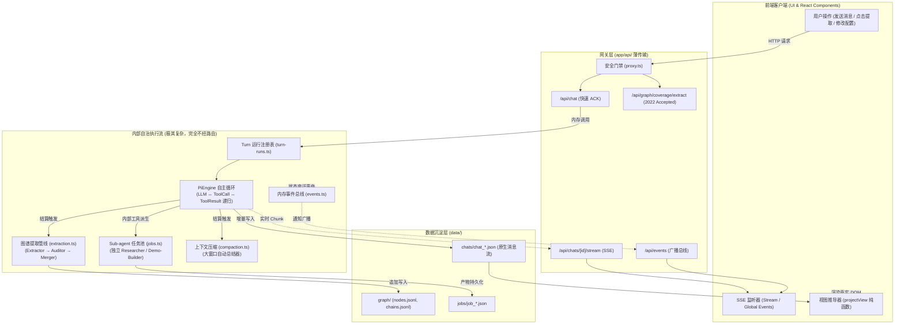

# 04 - 从路由到内核：复杂执行流分流解密与源码学习指南

> **文档定位**：本文档旨在帮助开发者建立起一套**“以路由接口为切入点，穿透理解 LearnHarness 深层复杂架构”**的方法论。通过厘清“哪些流程经过 HTTP 路由、哪些高度复杂的流程完全在内核自治运转”，并提供一份由浅入深的四阶段源码研读路径，助你迅速掌握系统全貌。

---

## 目录索引

- [一、 宏观分流哲学：薄网关与深内核](#一-宏观分流哲学薄网关与深内核)
  - [1.1 架构分流全景图](#11-架构分流全景图)
  - [1.2 经过路由 vs 不经过路由的本质区别](#12-经过路由-vs-不经过路由的本质区别)
- [二、 经过 `app/api/` 的五大交互流（入口与观测层）](#二-经过-appapi-的五大交互流入口与观测层)
- [三、 极度复杂但“完全不经过 `app/api/`”的六大内核执行流](#三-极度复杂但完全不经过-appapi-的六大内核执行流)
  - [3.1 智能体多步自主推理闭环（PiEngine Agent Loop）](#31-智能体多步自主推理闭环piengine-agent-loop)
  - [3.2 异步子智能体（Sub-agent Jobs）派发与唤醒总线](#32-异步子智能体sub-agent-jobs派发与唤醒总线)
  - [3.3 知识图谱三级清洗与拓扑合入管线（Extraction Pipeline）](#33-知识图谱三级清洗与拓扑合入管线extraction-pipeline)
  - [3.4 智能上下文压缩与滑动窗口治理（Compaction Engine）](#34-智能上下文压缩与滑动窗口治理compaction-engine)
  - [3.5 原生消息向 UI 视图的纯数学投影（View Derivation）](#35-原生消息向-ui-视图的纯数学投影view-derivation)
  - [3.6 图谱力导向物理布局模拟算法（Physics Layout Engine）](#36-图谱力导向物理布局模拟算法physics-layout-engine)
- [四、 循序渐进：以路由为针的四阶段源码研读法](#四-循序渐进以路由为针的四阶段源码研读法)
  - [阶段一：从 `POST /api/chat` 追踪一次教学对话生命周期（骨架流程）](#阶段一从-post-apichat-追踪一次教学对话生命周期骨架流程)
  - [阶段二：借由 `GET /api/jobs` 破解子智能体（Sub-agent）的异步并发](#阶段二借由-get-apijobs-破解子智能体sub-agent的异步并发)
  - [阶段三：通过 `POST /api/graph/coverage/extract` 攻克图谱提取与沉淀](#阶段三通过-post-apigraphcoverageextract-攻克图谱提取与沉淀)
  - [阶段四：从 `GET /api/chats/[id]` 与 `GET /api/events` 领会全站响应式与数据治理](#阶段四从-get-apichatsid-与-get-apievents-领会全站响应式与数据治理)
- [五、 常见认知误区与二开避坑指南](#五-常见认知误区与二开避坑指南)

---

## 一、 宏观分流哲学：薄网关与深内核

在 LearnHarness 的架构设计中，清晰地划分了**网关层（Transport Gateway）**与**自治内核（Autonomous Core）**：

> **核心隐喻**：
> - **`app/api/` 路由**就像一家现代化医院的**挂号处、分诊台与化验单打印机**：入口极轻、职责专一、即时响应；
> - **内部自治引擎**则是**化验室、手术室与多学科会诊中心**：长周期自转、跨角色协同、精密计算。

### 1.1 架构分流全景图



### 1.2 经过路由 vs 不经过路由的本质区别

| 维度 | 经过 `app/api/` 路由的执行流 | 不经过 `app/api/` 路由的内部执行流 |
| :--- | :--- | :--- |
| **触发主体** | 人类用户、前端 UI 交互动作、外部设备 | 系统内核调度器、智能体内部工具调用、阈值自动触发 |
| **通信机制** | HTTP Request / Response（或长轮询 / SSE） | 内存对象引用、函数调用、异步 Promise、内存发布订阅（Pub/Sub） |
| **执行耗时** | 极短（通常数十毫秒内返回 ACK / 状态） | 极长（持续几十秒到几分钟，长周期自治流转） |
| **断网容忍** | 强相关（断网会造成 HTTP 连接断开） | **完全免疫**（前端关闭或网络断开，后台照常执行并落盘） |
| **主要定位** | 状态观测窗、意图接入点、生命周期起停开关 | 大模型复杂推理、多智能体协同、拓扑图谱演化、上下文治理 |

---

## 二、 经过 `app/api/` 的五大交互流（入口与观测层）

系统的 35 个 HTTP 路由归纳为以下 5 种形态，它们构成了我们探查系统的“外部手柄”：

1. **生命周期起停（点火与刹车）**：
   - `POST /api/chat`：为新一轮对话点火。
   - `POST /api/activity/abort`：针对运行中的 Turn、Sub-agent Job 或图谱提取执行刹车中断。
   - `POST /api/chats/[id]/steer`：在智能体生成途中插入纸条指令，动态干预后续生成。
   - `POST /api/chats/[id]/dismiss`：静默丢弃未答题目（ESC 跳过），不触发模型轮次。
2. **实时数据泵与事件通道（流式管道）**：
   - `GET /api/chats/[id]/stream`：基于 SSE 将服务端生成的内容实时推给聊天界面，重连自动补齐历史日志。
   - `GET /api/events`：全应用统一的 SSE 广播总线，告知前端会话、图谱、任务发生了状态变迁。
3. **离散任务手动触发（单次调度）**：
   - `POST /api/graph/coverage/extract`：手动请求对未提取对话内容启动后台图谱提取。
   - `POST /api/graph/import`：上传个人笔记/PDF 文件，直接送入提取流水线。
4. **状态快照与指标读取（只读观测）**：
   - `GET /api/chats/[id]`、`GET /api/activity`、`GET /api/jobs`、`GET /api/graph`、`GET /api/models`。
   - 纯粹读取当前磁盘与内存状态，不发生任何业务副作用。
5. **配置与元数据覆写（落盘持久化）**：
   - `PUT /api/settings/[section]`、`PUT /api/keys/[id]`、`PUT /api/graph/positions`。
   - 负责参数合法性校验并原子写入 `data/settings.json`、`auth.json` 或 `positions.json`。

---

## 三、 极度复杂但“完全不经过 `app/api/`”的六大内核执行流

### 3.1 智能体多步自主推理闭环（PiEngine Agent Loop）
- **核心文件**：[src/server/turn-runs.ts](file:///d:/0.default/learnharness/src/server/turn-runs.ts)、[src/agent/teacher.ts](file:///d:/0.default/learnharness/src/agent/teacher.ts)
- **底层逻辑**：
  当 `POST /api/chat` 在校验入参后，会调用 `handleChatInput`，随后在内存中构造一个 `TeachingAgent` 实例。
  智能体基于 `@earendil-works/pi-ai` 启动执行循环：
  1. 将系统 Prompt、历史消息和工具声明喂给大模型；
  2. 大模型返回工具调用指令（如发起测验 `quiz`、提问 `ask_question` 或检索文件）；
  3. 执行器在本地执行对应工具逻辑，并将工具执行结果（Tool Result）追加到临时上下文中；
  4. 再次呼叫大模型，直到大模型给出自然语言正文并显式结束本轮轮次。
- **为什么不走路由**：这一循环通常包含多次 LLM 调用和多步本地计算，全部通过内部 Promise 链递归推进。

### 3.2 异步子智能体（Sub-agent Jobs）派发与唤醒总线
- **核心文件**：[src/server/jobs.ts](file:///d:/0.default/learnharness/src/server/jobs.ts)、[src/agent/subagents/researcher.ts](file:///d:/0.default/learnharness/src/agent/subagents/researcher.ts)
- **底层逻辑**：
  主教学智能体在讲解过程中如果觉得需要深入调研外部知识，会直接调用内部工具 `dispatch_researcher`。
  - **任务派生**：内部调用 `createJob(chatId, "researcher", ...)`，生成一个独立的 `JobRecord` 并写入 `data/jobs/`；
  - **隔离执行**：启动一个完全脱离主线程上下文的独立子智能体，配置专属的轻量模型和搜索工具集进行多轮研究；
  - **唤醒管道（Wake Pipeline）**：子智能体运行结束产出报告后，将成果放入 `steerLiveChat` 或写入未读队列；当主对话进入下一轮生成时，该成果被自动注入给主智能体。
- **为什么不走路由**：主子智能体间的协作完全依赖领域服务 `jobs.ts` 和内存事件唤醒，前端 `GET /api/jobs` 只是事后拉取展示状态卡片。

### 3.3 知识图谱三级清洗与拓扑合入管线（Extraction Pipeline）
- **核心文件**：[src/agent/subagents/extraction.ts](file:///d:/0.default/learnharness/src/agent/subagents/extraction.ts)、[src/core/graph-merger.ts](file:///d:/0.default/learnharness/src/core/graph-merger.ts)
- **底层逻辑**：
  图谱提取是一套严密的离线批处理机制，其核心执行流如下：
  1. **正文筛选**：`messageViewLines` 自动剔除学生的闲聊和工具中间态，只保留老师的高价值讲解文本；
  2. **提取器（Extractor）**：调用专用模型，从文本中提炼出原子命题（Propositions）和前提依赖链条（Chains）；
  3. **审计器（Auditor）**：将新提炼的概念与现有图谱全量节点比对，防止概念割裂，合并同义命题；
  4. **拓扑合并器（Merger）**：通过纯确定性 DAG 算法，解决环路依赖并原子追加写入 `nodes.jsonl` 与 `chains.jsonl`。
- **为什么不走路由**：即使通过手动按钮点击触发，路由也仅仅发出一声“点火信号”（`runExtraction`），随后由后端后台线程池（内置 3 宽度的信号量防打爆速率）执行数十秒甚至数分钟。

### 3.4 智能上下文压缩与滑动窗口治理（Compaction Engine）
- **核心文件**：[src/server/compaction.ts](file:///d:/0.default/learnharness/src/server/compaction.ts)
- **底层逻辑**：
  长教学对话必然面临大模型 Token 上限挑战。
  - 当会话消息 Token 逼近设定阈值时，服务端在每轮结算时静默调用 `summarizeSession`；
  - 启动独立的 Summarizer 模型，将历史前半段对话精炼成语义高度浓缩的结构化摘要；
  - 在底层数据结构中切下老消息并锚定摘要节点，只保留最新几轮的活跃对话消息；
  - 下次对话启动时，模型接收到的上下文自动带有历史摘要。
- **为什么不走路由**：这是一项纯后台的内存治理与存储维护动作，无须人类决策，因此没有提供任何 HTTP 接口。

### 3.5 原生消息向 UI 视图的纯数学投影（View Derivation）
- **核心文件**：[src/core/view.ts](file:///d:/0.default/learnharness/src/core/view.ts)
- **底层逻辑**：
  客户端从 `GET /api/chats/[id]` 获取到的是完全原生的 AI SDK 消息结构（包含隐藏的解题模型标准答案、工具调用原生字段、思考过程标签）。
  - 前端运行的 `projectView` 纯函数是一个庞大的状态机；
  - 它动态过滤内部支架，根据消息类型、答题卡状态、反色标记（`inverted`），衍生推导出最终用于渲染的各种 React UI 卡片（`ThinkingCard`、`ProblemCard` 等）。
- **为什么不走路由**：数据与展现完全解耦，服务端只负责原样落盘真实日志，保证了数据协议的绝对稳定。

### 3.6 图谱力导向物理布局模拟算法（Physics Layout Engine）
- **核心文件**：[src/core/layout.ts](file:///d:/0.default/learnharness/src/core/layout.ts)
- **底层逻辑**：
  知识图谱中的成百上千个节点并不是人工排布的，也不是调用大模型生成的，而是内部物理算法结算的结果：
  - 基于库仑引力（连接边产生拉力）与斥力模型，进行增量物理迭代退火计算；
  - 计算各节点的最佳 2D 坐标，避免节点相互遮挡重叠，并保护用户手动拖拽固定的节点位置。
- **为什么不走路由**：属于纯数学计算逻辑，计算完成后直接写入 `data/graph/positions.json`。

---

## 四、 循序渐进：以路由为针的四阶段源码研读法

利用具体的路由作为切入点，按照以下 4 个阶段研读源码，可以最高效地由外而内吃透系统：

---

### 阶段一：从 `POST /api/chat` 追踪一次教学对话生命周期（骨架流程）

> **目标**：搞清楚从你在输入框敲下回车，到界面开始实时打字，底层代码是如何流转的。

```
[app/api/chat/route.ts]
   │
   ▼
[src/server/chat-handler.ts: handleChatRequest]
   │  • 校验 chatId 与 input 类型 (text / answer / retry)
   │  • 调用 handleChatInput
   ▼
[src/server/turn-runs.ts]
   │  • 创建 TurnHandle，将轮次登记到全局正在运行表
   │  • 返回 HTTP 200 即时 ACK
   ▼
[src/agent/teacher.ts & @earendil-works/pi-ai]
   │  • 启动后台自主循环
   │  • 产生增量事件推入 turn.events 管道
   ▼
[app/api/chats/[id]/stream/route.ts]
   │  • 订阅对应 TurnHandle 的事件流
   ▼
[客户端界面渲染]
```

- **关键研读文件**：
  1. [app/api/chat/route.ts](file:///d:/0.default/learnharness/app/api/chat/route.ts)
  2. [src/server/chat-handler.ts](file:///d:/0.default/learnharness/src/server/chat-handler.ts)（重点看 `handleChatInput`）
  3. [app/api/chats/[id]/stream/route.ts](file:///d:/0.default/learnharness/app/api/chats/[id]/stream/route.ts)（理解 Connection Diet B 架构）

---

### 阶段二：借由 `GET /api/jobs` 破解子智能体（Sub-agent）的异步并发

> **目标**：搞懂主智能体是如何在后台派发“研究员”去查资料，查完后又是怎么自动把结果拼回对话的。

```
[src/agent/teacher.ts]
   │  • 教师智能体生成过程中，发现需要深入材料，调用内部工具：dispatch_researcher
   ▼
[src/server/jobs.ts: createJob & runJob]
   │  • 创建后台异步任务，分配子智能体系统 Prompt 与搜索工具集
   │  • 在独立沙箱中自治运行，将研究报告写入 data/jobs/
   ▼
[src/server/turn-service.ts: steerLiveChat]
   │  • 任务结束，通过 Wake Pipeline 唤醒正在运行或挂起的主教学轮次
   ▼
[app/api/jobs/route.ts] (前端此时仅仅作为状态看板拉取当前进度)
```

- **关键研读文件**：
  1. [app/api/jobs/route.ts](file:///d:/0.default/learnharness/app/api/jobs/route.ts)
  2. [src/agent/teacher.ts](file:///d:/0.default/learnharness/src/agent/teacher.ts)（搜索 `dispatch_researcher` 工具定义）
  3. [src/server/jobs.ts](file:///d:/0.default/learnharness/src/server/jobs.ts)（阅读 `runJob` 和子任务结果分发逻辑）

---

### 阶段三：通过 `POST /api/graph/coverage/extract` 攻克图谱提取与沉淀

> **目标**：搞懂零散的师生问答，是如何被转化为结构化、可复习的知识图谱节点（Nodes）的。

```
[app/api/graph/coverage/extract/route.ts] (或由 chat-handler 在 4096 Tokens 时自动调用)
   │
   ▼
[src/agent/subagents/extraction.ts: runExtraction]
   │
   ├──▶ 1. Chunker：提取未处理的教师正文 (messageViewLines)
   ├──▶ 2. Extractor Agent：提炼命题与依赖链
   ├──▶ 3. Auditor Agent：比对已有全量图谱，对齐去重
   │
   ▼
[src/core/graph-merger.ts]
   │  • 拓扑排序校验、消解循环依赖
   ▼
[data/graph/]
   │  • 原子追加写入 nodes.jsonl, chains.jsonl, coverage.jsonl
```

- **关键研读文件**：
  1. [app/api/graph/coverage/extract/route.ts](file:///d:/0.default/learnharness/app/api/graph/coverage/extract/route.ts)
  2. [src/agent/subagents/extraction.ts](file:///d:/0.default/learnharness/src/agent/subagents/extraction.ts)（核心提取流水线）
  3. [src/core/graph-merger.ts](file:///d:/0.default/learnharness/src/core/graph-merger.ts)（确定性 DAG 合并代码）

---

### 阶段四：从 `GET /api/chats/[id]` 与 `GET /api/events` 领会全站响应式与数据治理

> **目标**：理解系统为什么具备极高的健壮性，多窗口数据为什么能实时同步而不产生脏写。

```
[服务端状态变迁]
(如：对话落盘、图谱生成、任务结算)
   │
   ▼
[src/core/events.ts: emit]
   │  • 发布事件：chats-changed / sources-changed / jobs-changed
   ▼
[app/api/events/route.ts]
   │  • 全局 SSE 管道广播给所有打开的桌面窗口
   ▼
[前端 React 组件触发 SWR/静默刷新]
   │
   ▼
[app/api/chats/[id]/route.ts] (拉取最新原生 transcript)
   │
   ▼
[src/core/view.ts: projectView] (本地状态机瞬间完成 UI 视图投影渲染)
```

- **关键研读文件**：
  1. [app/api/events/route.ts](file:///d:/0.default/learnharness/app/api/events/route.ts) 与 [src/server/events-stream.ts](file:///d:/0.default/learnharness/src/server/events-stream.ts)
  2. [app/api/chats/[id]/route.ts](file:///d:/0.default/learnharness/app/api/chats/[id]/route.ts)
  3. [src/core/view.ts](file:///d:/0.default/learnharness/src/core/view.ts)（重点看原生数据是如何被映射成答题卡、思考折叠区的）

---

## 五、 常见认知误区与二开避坑指南

1. **误区一：试图在 `app/api/chat` 中加阻塞业务逻辑或等待大模型返回**
   - **避坑**：`app/api/chat` 必须遵循 **即时 ACK 原则**。所有大模型交互都必须挂在后台的 `TurnHandle` 中，通过 SSE 异步回传。如果你试图在 `POST /api/chat` 中 `await` 大模型整段生成，会彻底破坏前端的重连补发机制和防抖设计。
2. **误区二：以为知识图谱节点（Nodes）是在对话时“实时产生”的**
   - **避坑**：图谱提取是一项**重计算、高 Token 消耗**的批处理操作。系统刻意设计了 4096 Token 的攒批阈值或手动按钮提取机制。不要试图在每句话生成的瞬间去调用 Extractor，这会极大增加延迟并迅速耗尽模型 API 速率。
3. **误区三：以为修改前端 UI 就需要修改服务端返回的接口格式**
   - **避坑**：服务端的 `GET /api/chats/[id]` 永远只返回纯粹的原生消息历史，绝不为了前端某个新卡片而在服务端接口中注入定制 HTML。新增任何交互卡片，都应在 `src/core/view.ts` 的 `projectView` 投影函数中增加映射规则。
4. **误区四：把系统中的 `409 Conflict` 当作 Bug**
   - **避坑**：系统多处严厉返回 409（如轮次已在运行、提取正在进行、任务已被取消）。这是 LearnHarness 的状态机防护哲学——**宁可明确拒绝并发冲突，也绝不进行非法的脏写与重叠调用**。二次开发时必须尊重 409 返回，并在前端引导用户重新刷新状态。
