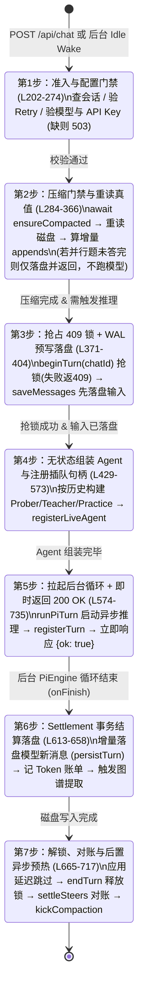
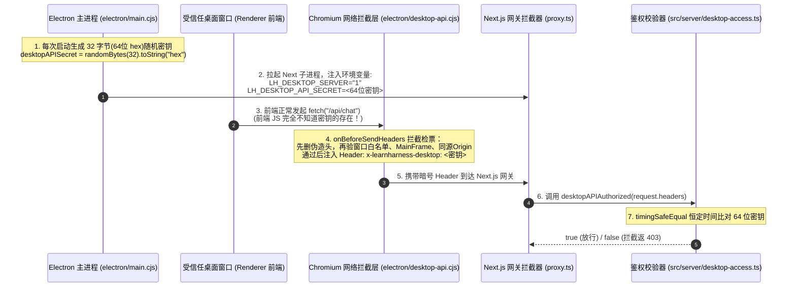

# 07 - 核心专题：7 步回合状态机（`chat-handler.ts`）与桌面安全门禁（`proxy.ts`）深度解析

> **文档定位**：本文档针对 LearnHarness 服务端最核心的两个“守门与编排”枢纽进行源码级拆解：
> 1. **回合组合根 [`src/server/chat-handler.ts`](file:///d:/0.default/learnharness/src/server/chat-handler.ts)**：为什么每一次用户交互都必须严格走完 **7 步回合状态机**？哪一步的顺序一旦写反就会引发脏读或死锁？
> 2. **桌面 API 安全门禁 [`proxy.ts`](file:///d:/0.default/learnharness/proxy.ts)**：本地回环服务（`127.0.0.1`）如何通过 **7 层纵深防御** 阻止外部网页嗅探、子 iframe 越权与无头浏览器泄密？以及如何通过 [`tests/desktop-api.test.ts`](file:///d:/0.default/learnharness/tests/desktop-api.test.ts) 单测倒推其完整契约。

---

## 目录索引

- [第一部分：7 步回合状态机（`chat-handler.ts`）深度拆解](#第一部分7-步回合状态机chat-handlerts深度拆解)
  - [1.1 Java 架构师视角：什么是“7 步回合状态机”？](#11-java-架构师视角什么是7-步回合状态机)
  - [1.2 7 步回合状态机全景图](#12-7-步回合状态机全景图)
  - [1.3 逐歩源码级精读（含行号定位与不可颠倒的顺序铁律）](#13-逐歩源码级精读含行号定位与不可颠倒的顺序铁律)
  - [1.4 常见二开反模式：如果颠倒顺序会发生什么灾难？](#14-常见二开反模式如果颠倒顺序会发生什么灾难)
- [第二部分：`proxy.ts` 桌面窗口安全门禁保护机制](#第二部分proxyts-桌面窗口安全门禁保护机制)
  - [2.1 为什么要保护本地 `127.0.0.1` 的服务？（威胁建模）](#21-为什么要保护本地-127001-的服务威胁建模)
  - [2.2 端到端工作原理：4 个文件组成的“地下接头暗号”](#22-端到端工作原理4-个文件组成的地下接头暗号)
  - [2.3 源码级拆解：7 层纵深安全防护清单](#23-源码级拆解7-层纵深安全防护清单)
  - [2.4 开发调试与单测倒推：对照 `tests/desktop-api.test.ts` 验证门禁](#24-开发调试与单测倒推对照-testsdesktop-apitestts-验证门禁)

---

## 第一部分：7 步回合状态机（`chat-handler.ts`）深度拆解

### 1.1 Java 架构师视角：什么是“7 步回合状态机”？

在 [`src/server/chat-handler.ts`](file:///d:/0.default/learnharness/src/server/chat-handler.ts) 的核心函数 [`handleChatInput`](file:///d:/0.default/learnharness/src/server/chat-handler.ts#L196-L746) 中，服务端处理**每一次用户发消息、答题、重试或后台 Subagent 空闲唤醒（统称为一个 Application Turn / 应用回合）**时，严格按顺序执行的 **7 个不可颠倒的阶段**（对应官方架构规范 [`docs/architecture.md`](file:///d:/0.default/learnharness/docs/architecture.md#L60-L71) 的 Turn Composition 7 步定义）。

如果用 **Java / Spring Boot** 的概念来类比，[`handleChatInput`](file:///d:/0.default/learnharness/src/server/chat-handler.ts#L196-L746) 就是一个融合了以下三大机制的总编排器：
1. **前置准入拦截器（Admission Interceptor）**
2. **会话级非阻塞互斥锁（`ReentrantLock.tryLock()` $\to$ 失败返回 `409 Conflict`）**
3. **编程式事务 + 异步任务提交（`TransactionTemplate` + `CompletableFuture` + `SseEmitter`）**

---

### 1.2 7 步回合状态机全景图



---

### 1.3 逐歩源码级精读（含行号定位与不可颠倒的顺序铁律）

#### 第 1 步：准入与配置门禁（Admission & Readiness Gate）
- **源码位置**：[`src/server/chat-handler.ts` L202-L274](file:///d:/0.default/learnharness/src/server/chat-handler.ts#L202-L274)
- **核心动作**：
  1. **读取记录**：调用 `stores.chatStore.getChat(chatId)` 读取磁盘 JSON，不存在则直接返回 `404`。
  2. **重试资格预检**：若 `input.type === "retry"` 或 `"retry-question"`，调用 [`retryDrops`](file:///d:/0.default/learnharness/src/server/chat-handler.ts#L223) / [`questionRecoveryAppends`](file:///d:/0.default/learnharness/src/server/chat-handler.ts#L231) 校验历史记录末尾是否存在可重试的失败消息（不满足则返回 `400`）。
  3. **模型与 API Key 诚实门禁（BYOK Gate）**：
     - 调用 [`resolveConversationSpec(record.settings, effective.models.strong)`](file:///d:/0.default/learnharness/src/server/chat-handler.ts#L247) 解析本次对话使用的模型槽位；
     - 调用 [`providerKeyPresent(conversation.provider)`](file:///d:/0.default/learnharness/src/server/chat-handler.ts#L269) 检查环境变量或 `auth.json` 中是否配置了对应厂商的 API Key；
     - **系统绝不偷偷 Fallback 到其他模型**：一旦未配模型或缺少 Key，立即返回结构化的 `HTTP 503` 错误信封（`modelsNotConfigured` / `providerKeyMissing`）。
- **顺序铁律**：所有无副作用的只读检查必须在第 1 步完成——**绝不能在没配 Key 的情况下去抢占会话锁或把用户的输入写进磁盘**。

---

#### 第 2 步：等待上下文压缩门禁 + 重新读取最新真值（Compaction Gate & Re-read）
- **源码位置**：[`src/server/chat-handler.ts` L284-L366](file:///d:/0.default/learnharness/src/server/chat-handler.ts#L284-L366)
- **核心动作**：
  1. **等待或执行压缩**：调用 [`await ensureCompacted(...)`](file:///d:/0.default/learnharness/src/server/chat-handler.ts#L295-L309)。如果上一轮结束时触发的后台压缩正在运行，这里会挂起等待其完成；如果当前会话 Token 总量已超过阈值（默认 150k），这里会同步启动压缩。
  2. **重读权威真值（極易忽略的关键点）**：
     ```typescript
     const compactedRecord = stores.chatStore.getChat(chatId);
     if (!compactedRecord) return Response.json({ error: "Unknown chat" }, { status: 404 });
     record = compactedRecord;
     ```
     因为在 `await ensureCompacted` 异步等待期间，压缩器可能已经向磁盘追加了一条 `compaction` 标记消息，所以**必须丢弃第 1 步读出的旧 `record`，重新从磁盘读取最新记录**，并重新校验一次 `retryDrops`。
  3. **计算增量消息（`appends`）**：调用 [`inputAppends(record, input)`](file:///d:/0.default/learnharness/src/server/chat-handler.ts#L338)，将本次输入（文本、选择题答案、思考内容或唤醒信标）转换为标准的 `LhMessage[]` 增量数组。
  4. **并行多道题延迟唤醒门禁（Parallel-Question Gate，[`L356-L366`](file:///d:/0.default/learnharness/src/server/chat-handler.ts#L356-L366)）**：
     - 如果模型在同一回合里并列出了 2 道题，学生刚提交第 1 道题的答案（此时 `hasUnresolvedQuestion([...record.messages, ...appends])` 仍为 `true`）：
     - 系统**只把第 1 道题的答案持久化落盘**，广播 `record-changed` 事件，并直接返回 `settledTurnResponse()`，**不加锁、不唤醒大模型**；直到学生答完最后一道题，才把所有答案紧挨着原题一次性喂给大模型（遵守大模型 API 要求 `toolResult` 必须紧邻 `assistant` `toolCall` 的协议铁律）。

---

#### 第 3 步：抢占会话互斥锁（`409`）+ 预写日志落盘（Lock & Write-Ahead Log）
- **源码位置**：[`src/server/chat-handler.ts` L371-L404](file:///d:/0.default/learnharness/src/server/chat-handler.ts#L371-L404)
- **核心动作**：
  1. **单会话互斥抢锁**：
     ```typescript
     if (!beginTurn(chatId)) {
         return Response.json({ error: "A turn is already running for this session" }, { status: 409 });
     }
     ```
     [`beginTurn`](file:///d:/0.default/learnharness/src/server/turn-liveness.ts) 检查 `globalThis` 上的活跃会话集合。同一个 `chatId` 同一时刻只允许一个 Turn 运行，并发重入直接返回 `409 Conflict`。
  2. **Write-Ahead Persistence（WAL 预写式落盘）**：
     ```typescript
     const merged = [...record.messages, ...appends];
     stores.chatStore.saveMessages(chatId, merged);
     ```
     在真正调用大模型之前，**先把用户的提问或答案写进磁盘文件**。
- **顺序铁律**：
  - 必须**先 `beginTurn` 抢锁，再 `saveMessages` 写磁盘**，防止两个并发请求同时基于旧记录做 `merged` 导致互相覆盖（Lost Update）；
  - 如果 `saveMessages` 写盘失败（如磁盘满），在 `catch` 块中必须立即调用 [`endTurn(chatId)`](file:///d:/0.default/learnharness/src/server/chat-handler.ts#L395) 释放锁并返回 `500`，绝不带着未保存的输入启动推理。

---

#### 第 4 步：无状态组装 Agent + 注册实时插队句柄（Agent Construction & Live Seam）
- **源码位置**：[`src/server/chat-handler.ts` L429-L573](file:///d:/0.default/learnharness/src/server/chat-handler.ts#L429-L573)
- **核心动作**：
  1. **无状态按需重建 Agent**：根据会话类型与历史消息中是否存在已完成的 `probe_done`（[`hasProbeDone(agentMessages)`](file:///d:/0.default/learnharness/src/server/chat-handler.ts#L429)），三选一构造全新的 Agent 实例：
     - 练习会话（`record.kind === "practice"`）$\to$ [`createPracticeAgent`](file:///d:/0.default/learnharness/src/server/chat-handler.ts#L496)
     - 已完成探测的教学会话（`teaching === true`）$\to$ [`createTeacherAgent`](file:///d:/0.default/learnharness/src/server/chat-handler.ts#L520)
     - 尚在探测阶段的教学会话（`teaching === false`）$\to$ [`createProberAgent`](file:///d:/0.default/learnharness/src/server/chat-handler.ts#L532)
  2. **注册 Live Steer 插队句柄**：
     ```typescript
     registerLiveAgent(chatId, constructed, ...);
     ```
     **必须在调用 `runPiTurn` 之前调用 `registerLiveAgent`**！因为 `runPiTurn` 启动的第一拍就会同步轮询一次 Agent 的插队队列（Steering Queue），提前注册才能让答题期间刚刚完成的后台 Subagent 成果搭上本回合的第一班大模型请求。

---

#### 第 5 步：拉起后台推理循环 + 立即返回 `200 OK`（Background Run & Connection Diet B）
- **源码位置**：[`src/server/chat-handler.ts` L574-L735](file:///d:/0.default/learnharness/src/server/chat-handler.ts#L574-L735)
- **核心动作**：
  1. 调用 [`const handle = runPiTurn({...})`](file:///d:/0.default/learnharness/src/server/chat-handler.ts#L574)：在服务端内存中拉起 Agent 的多步自主循环，并传入已使用的工具 ID 集合（`usedToolCallIds`）用于 **Lacan Fix 去重**。
  2. 调用 [`registerTurn(chatId, handle)`](file:///d:/0.default/learnharness/src/server/chat-handler.ts#L724)：将运行中的 Turn 句柄注册到内存表（[`turn-runs.ts`](file:///d:/0.default/learnharness/src/server/turn-runs.ts)），供后续 SSE 流端点挂载。
  3. **连接节食（Connection Diet B）**：不等大模型生成完毕，第 735 行立即返回 [`Response.json({ ok: true })`](file:///d:/0.default/learnharness/src/server/chat-handler.ts#L735)。前端收到 `200 OK` 后立即释放 POST 连接，转而通过 `GET /api/chats/[id]/stream` 订阅 `handle` 的 SSE 事件流。

---

#### 第 6 步：Settlement 事务结算落盘（Turn Settlement，在 `onFinish` 中触发）
- **源码位置**：[`src/server/chat-handler.ts` L613-L658](file:///d:/0.default/learnharness/src/server/chat-handler.ts#L613-L658)
- **核心动作**：
  当后台 `PiEngine` 循环结束时（无论是自然回答完毕、调用 `quiz` 出题触发暂停门禁、还是被用户手动 Abort），都会进入 `onFinish(turnMessages, isAborted)` 回调：
  1. **增量落盘模型输出**：调用 [`persistTurn(stores.chatStore, chatId, persistBaseCount, turnMessages, isAborted)`](file:///d:/0.default/learnharness/src/server/chat-handler.ts#L616)，把本回合新生成的 `assistant` 消息、工具调用结果和计划树快照写入磁盘（同时剔除内存专用的 `"Question posed"` 占位符）。
  2. **记录 Token 账单**：调用 [`stores.chatStore.appendTurnUsage(...)`](file:///d:/0.default/learnharness/src/server/chat-handler.ts#L640) 将本轮每次模型调用的输入/输出/缓存/思考 Token 数写入账本（按 `turnUsageId` 幂等）。
  3. **触发知识图谱增量抽取**：若为教学会话且开启了图谱，调用 [`triggerExtraction(...)`](file:///d:/0.default/learnharness/src/server/chat-handler.ts#L657) 异步检查未覆盖教师正文是否达到阈值（默认 4096 Tokens）。

---

#### 第 7 步：清理现场、释放锁与后置异步预热（Cleanup, Unlock & Settle Kick）
- **源码位置**：[`src/server/chat-handler.ts` L665-L717](file:///d:/0.default/learnharness/src/server/chat-handler.ts#L665-L717)
- **核心动作**：
  1. **应用延迟跳过（Parked Dismissal）**：[`applyParkedDismissal(stores.chatStore, chatId)`](file:///d:/0.default/learnharness/src/server/chat-handler.ts#L665) 将运行期间收到的跳过指令落盘。
  2. **释放 `409` 锁与运行句柄**：依次调用 [`endTurn(chatId)`](file:///d:/0.default/learnharness/src/server/chat-handler.ts#L668) 和 [`unregisterTurn(chatId)`](file:///d:/0.default/learnharness/src/server/chat-handler.ts#L673)。
  3. **对账并回收未消费的 Steer 信标**：调用 [`unregisterLiveAgent(chatId)`](file:///d:/0.default/learnharness/src/server/chat-handler.ts#L679)、[`settleSteers(...)`](file:///d:/0.default/learnharness/src/server/chat-handler.ts#L680) 和 [`reconcileUserSteers(...)`](file:///d:/0.default/learnharness/src/server/chat-handler.ts#L684)。如果某个后台 Subagent 结果刚刚交给 Agent 就碰上了出题暂停而没来得及注入，这里会把它安全退回 `pending` 队列，等待下一轮唤醒。
  4. **异步预热下一轮上下文压缩（The Settle Kick）**：调用 [`kickCompaction(...)`](file:///d:/0.default/learnharness/src/server/chat-handler.ts#L695)，趁着学生接下来读题作答的空闲窗口，在后台提前把超长上下文压缩好。

---

### 1.4 常见二开反模式：如果颠倒顺序会发生什么灾难？

| 错误改法（反模式） | 引发的线上故障 | 守护该铁律的单测 |
| :--- | :--- | :--- |
| 把 `endTurn(chatId)` 写在 `persistTurn(...)` 之前 | **脏读（Read Uncommitted）**：前端收到回合结束信号立刻请求 `GET /api/chats/[id]`，结果读到的是还没写入模型回复的旧文件！ | [`tests/chat-flow.test.ts`](file:///d:/0.default/learnharness/tests/chat-flow.test.ts) |
| 在 `await ensureCompacted` 之后没有重新调用 `getChat(chatId)` | **压缩丢失（Lost Update）**：后续 `saveMessages` 会用压缩前的旧消息列表把刚刚生成的压缩标记覆盖掉！ | [`tests/compaction.test.ts`](file:///d:/0.default/learnharness/tests/compaction.test.ts) |
| 把 `registerLiveAgent` 写在 `runPiTurn` 之后 | **插队漏拍**：`runPiTurn` 启动瞬间的第一次同步轮询读不到已排队的 Subagent 结果，导致后台任务结果被迫延后一整轮！ | [`tests/job-delivery-recovery.test.ts`](file:///d:/0.default/learnharness/tests/job-delivery-recovery.test.ts) |

---

## 第二部分：`proxy.ts` 桌面窗口安全门禁保护机制

### 2.1 为什么要保护本地 `127.0.0.1` 的服务？（威胁建模）

在桌面版（Electron）运行时，主进程会在本机回环地址 `http://127.0.0.1:<随机端口>` 上启动 Next.js 服务端。虽然外部局域网访问不到 `127.0.0.1`，但如果不加鉴权门禁，仍面临三大本地威胁：
1. **恶意网页跨站请求 / DNS Rebinding**：用户在系统浏览器（Chrome/Edge）中打开任意网页，网页中的恶意 JS 脚本可以通过端口扫描向 `http://127.0.0.1:<端口>/api/chat` 或 `/api/keys` 发起请求，盗刷用户的大模型额度或篡改配置。
2. **教学 Demo 子 `<iframe>` 越权**：LearnHarness 的 `demoBuilder` 子智能体会在聊天界面内渲染并执行动态生成的交互式 HTML/JS Demo。如果 Demo 运行在子 Frame 中且能直接调 `/api/**`，就可能越权访问宿主的本地 API。
3. **无头浏览器（Headless Browser Service）环境变量泄露**：服务端在后台使用 Chromium 渲染和验证 Demo 时，如果将桌面密钥带入了子进程环境变量，Demo 脚本就可能偷走密钥。

为此，系统设计了**“桌面窗口安全门禁（Desktop API Gate）”**：**确保只有 LearnHarness 官方受信任桌面窗口的主框架（Main Frame）发起的同源 `/api/**` 请求才能通过，其余一切请求一律返回 `403 Forbidden`**。

---

### 2.2 端到端工作原理：4 个文件组成的“地下接头暗号”

整套门禁由 4 个文件协同完成，核心思想是 **“主进程生成一次性 64 位随机密钥 $\to$ Chromium 网络层底层自动盖章 $\to$ Next 网关常量时间验章”**：



| 序号 | 源码文件 | 扮演角色 | 核心职责 |
| :---: | :--- | :--- | :--- |
| **1** | [`electron/main.cjs`](file:///d:/0.default/learnharness/electron/main.cjs#L655-L660) | **发证机关** | 启动时通过 `randomBytes(32).toString("hex")` 生成 64 位随机密钥；一边通过环境变量传给 Next 子进程（[`L223-L224`](file:///d:/0.default/learnharness/electron/main.cjs#L223-L224)），一边注册 Chromium `onBeforeSendHeaders` 钩子。 |
| **2** | [`electron/desktop-api.cjs`](file:///d:/0.default/learnharness/electron/desktop-api.cjs) | **出关盖章员** | 在每个 HTTP 请求离开 Chromium 网络栈前检查发起窗口与 Frame 身份，合格则写入 `x-learnharness-desktop` 请求头。 |
| **3** | [`proxy.ts`](file:///d:/0.default/learnharness/proxy.ts) | **入关哨卡** | Next.js 全局代理中间件（等价于 Spring `OncePerRequestFilter`），通过 `matcher: "/api/:path*"` 拦截所有 API 请求。 |
| **4** | [`src/server/desktop-access.ts`](file:///d:/0.default/learnharness/src/server/desktop-access.ts) | **验钞机** | 执行 [`desktopAPIAuthorized`](file:///d:/0.default/learnharness/src/server/desktop-access.ts#L5-L17)，使用 `timingSafeEqual` 比对请求头与环境变量密钥。 |

---

### 2.3 源码级拆解：7 层纵深安全防护清单

结合 [`electron/desktop-api.cjs`](file:///d:/0.default/learnharness/electron/desktop-api.cjs) 与 [`src/server/desktop-access.ts`](file:///d:/0.default/learnharness/src/server/desktop-access.ts) 的源码，该门禁共包含 **7 层具体保护**：

#### 保护 1：全量 API 与全 HTTP 方法无死角拦截
- **源码**：[`proxy.ts` L7-L17](file:///d:/0.default/learnharness/proxy.ts#L7-L17)
```typescript
export function proxy(request: NextRequest) {
	if (!desktopAPIAuthorized(request.headers)) {
		return NextResponse.json(
			{ error: "Desktop API access requires the trusted LearnHarness window." },
			{ status: 403, headers: { "Cache-Control": "no-store" } },
		);
	}
	return NextResponse.next();
}
export const config = { matcher: "/api/:path*" };
```
- **保护效果**：无论是 `GET`、`POST`、`PUT`、`DELETE`、`OPTIONS`，还是 SSE 实时流（`/api/chats/[id]/stream`、`/api/events`），全部经过此关卡，没有任何公开白名单绕过路径；拒绝时强制加上 `Cache-Control: no-store` 防止缓存污染。

#### 保护 2：前端 JS 零接触密钥（防 XSS 窃取 Token）
- **源码**：[`electron/desktop-api.cjs` L5-L6](file:///d:/0.default/learnharness/electron/desktop-api.cjs#L5-L6)
- **保护效果**：`desktopAPISecret` 只存在于 Electron 主进程内存与 Next 服务端进程内存中，**绝不通过 `preload.cjs` 或全局变量暴露给前端浏览器渲染进程（Renderer）**。前端代码发请求时根本不需要传 Token，就算前端页面发生 XSS 脚本注入，攻击脚本也无法在 JS 环境里读出密钥。

#### 保护 3：先无条件剥离伪造头，再拦截 `<all_urls>` 防重定向泄密
- **源码**：[`electron/main.cjs` L658](file:///d:/0.default/learnharness/electron/main.cjs#L658) & [`electron/desktop-api.cjs` L8-L13](file:///d:/0.default/learnharness/electron/desktop-api.cjs#L8-L13)
```typescript
const headers = { ...details.requestHeaders };
for (const name of Object.keys(headers)) if (name.toLowerCase() === HEADER) delete headers[name];
if (!secret) return headers;
const target = new URL(details.url);
if (target.origin !== origin || target.username || target.password || !(target.pathname === "/api" || target.pathname.startsWith("/api/"))) return headers;
```
- **保护效果**：
  1. 钩子监听的是 `<all_urls>`（所有 URL 请求）；
  2. 每次先无条件删除请求中任何大小写形式的 `x-learnharness-desktop` 头；
  3. 只有当目标 URL 的 `origin` 严格等于本地服务 Origin、不含 URL 用户名/密码凭证、且路径严格为 `/api` 或 `/api/...` 时才注入密钥。一旦请求发生跨域 302 重定向，再次经过该钩子时密钥会被立即剥离，绝不外泄。

#### 保护 4：窗口白名单与主框架（Main Frame）严苛绑定（防子 iframe 越权）
- **源码**：[`electron/desktop-api.cjs` L14-L20](file:///d:/0.default/learnharness/electron/desktop-api.cjs#L14-L20)
```typescript
const win = windows.find((candidate) => !candidate.isDestroyed() && candidate.webContents.id === details.webContentsId);
if (!win || win.webContents.isDestroyed()) return headers;
const contents = win.webContents;
if (details.webContents && details.webContents !== contents) return headers;
if (!details.frame || details.frame !== contents.mainFrame) return headers;
if (new URL(contents.mainFrame.url).origin !== origin) return headers;
if (details.initiatorOrigin !== undefined && details.initiatorOrigin !== origin) return headers;
```
- **保护效果**：
  - 请求必须来自主进程登记在 `trustedAppWindows` 集合中的未销毁窗口；
  - **必须由该窗口的顶层主框架（`details.frame === contents.mainFrame`）发起**——页面内嵌的任何子 `<iframe>`（如 `about:srcdoc` 沙箱 Demo）发起的请求一律不予盖章；
  - 主框架当前 URL 的 Origin 以及请求的 `initiatorOrigin` 必须严格等于本地服务 Origin（防止窗口导航到外部页面后残余脚本发请求）。

#### 保护 5：Fail-Closed（故障关闭）与 64 位密钥长度底线
- **源码**：[`src/server/desktop-access.ts` L10-L12](file:///d:/0.default/learnharness/src/server/desktop-access.ts#L10-L12)
```typescript
const expected = env.LH_DESKTOP_API_SECRET;
if (env.LH_DESKTOP_SERVER !== "1" && !expected) return true;
if (!expected || expected.length < 64) return false;
```
- **保护效果**：只要处于桌面服务端模式（`LH_DESKTOP_SERVER === "1"`），如果密钥缺失或长度小于 64 个字符，服务端直接判定鉴权失败（Fail-Closed），绝不因为配置缺失而裸奔。

#### 保护 6：恒定时间比较（`timingSafeEqual`）防时序侧信道攻击
- **源码**：[`src/server/desktop-access.ts` L14-L16](file:///d:/0.default/learnharness/src/server/desktop-access.ts#L14-L16)
```typescript
const actual = Buffer.from(supplied);
const wanted = Buffer.from(expected);
return actual.length === wanted.length && timingSafeEqual(actual, wanted);
```
- **保护效果**：使用 Node.js `node:crypto` 的 `timingSafeEqual`（等价于 Java `MessageDigest.isEqual`）进行字节级恒定时间比对，杜绝通过测量响应耗时差异逐字符爆破密钥的可能。

#### 保护 7：派生的无头浏览器子进程（Browser Service）自动剥离密钥
- **源码**：[`src/agent/subagents/headless.ts`](file:///d:/0.default/learnharness/src/agent/subagents/headless.ts)（见 [`tests/desktop-api.test.ts` L93](file:///d:/0.default/learnharness/tests/desktop-api.test.ts#L93)）
- **保护效果**：当服务端为 `demoBuilder` 派生 `--browser-service` 子进程去执行 AI 生成的前端代码时，`browserServiceSpawnEnv` 会显式剔除 `LH_DESKTOP_API_SECRET` 环境变量，确保无头浏览器子进程完全拿不到桌面 API 密钥。

---

### 2.4 开发调试与单测倒推：对照 `tests/desktop-api.test.ts` 验证门禁

#### 1. 为什么平时跑 `npm run dev` 或 `npm test` 时不会被拦截？
看 [`src/server/desktop-access.ts` L10](file:///d:/0.default/learnharness/src/server/desktop-access.ts#L10)：
- 当 `env.LH_DESKTOP_SERVER !== "1" && !expected` 时，函数直接返回 `true`。
- 因此在本地纯 Web 开发模式（`npm run dev`）和普通单元测试中，门禁默认处于透明放行状态，不影响开发效率。

#### 2. 单测倒推：运行 [`tests/desktop-api.test.ts`](file:///d:/0.default/learnharness/tests/desktop-api.test.ts)
你可以在终端直接运行这组专门验证桌面门禁的单测（耗时不到 1 秒）：
```powershell
npx tsx --test tests/desktop-api.test.ts
```
打开 [`tests/desktop-api.test.ts`](file:///d:/0.default/learnharness/tests/desktop-api.test.ts)，你会看到它用 **4 个测试用例（L24-L94）** 把上面讲的所有保护点全部用代码断言锁死了：
- **用例 1（[`L24-L46`](file:///d:/0.default/learnharness/tests/desktop-api.test.ts#L24-L46)）**：验证只有受信任窗口的主框架访问同源 `/api/*` 时才注入 Header；接着用 10 组破坏性突变（跨端口、访问非 `/api` 路径、伪造 Frame、子 `about:srcdoc` iframe、`initiatorOrigin: "null"`、导航到第三方网站后）逐一断言伪造的 `X-LearnHarness-Desktop` 头会被彻底剥离！
- **用例 2（[`L48-L70`](file:///d:/0.default/learnharness/tests/desktop-api.test.ts#L48-L70)）**：验证浏览器模式默认放行，而一旦开启 `LH_DESKTOP_SERVER="1"`，缺密钥、空密钥、错密钥、重复拼接密钥在所有 HTTP 方法（`GET`/`POST`/`PUT`/`PATCH`/`DELETE`/`HEAD`/`OPTIONS`）下一律返回 `403`。
- **用例 3 & 4（[`L72-L94`](file:///d:/0.default/learnharness/tests/desktop-api.test.ts#L72-L94)）**：验证 IPC 控制通道同样校验 `trustedSender`（主窗口 + 主框架 + 同源），且 `browserServiceSpawnEnv` 派生子进程时自动清空 `LH_DESKTOP_API_SECRET`。
