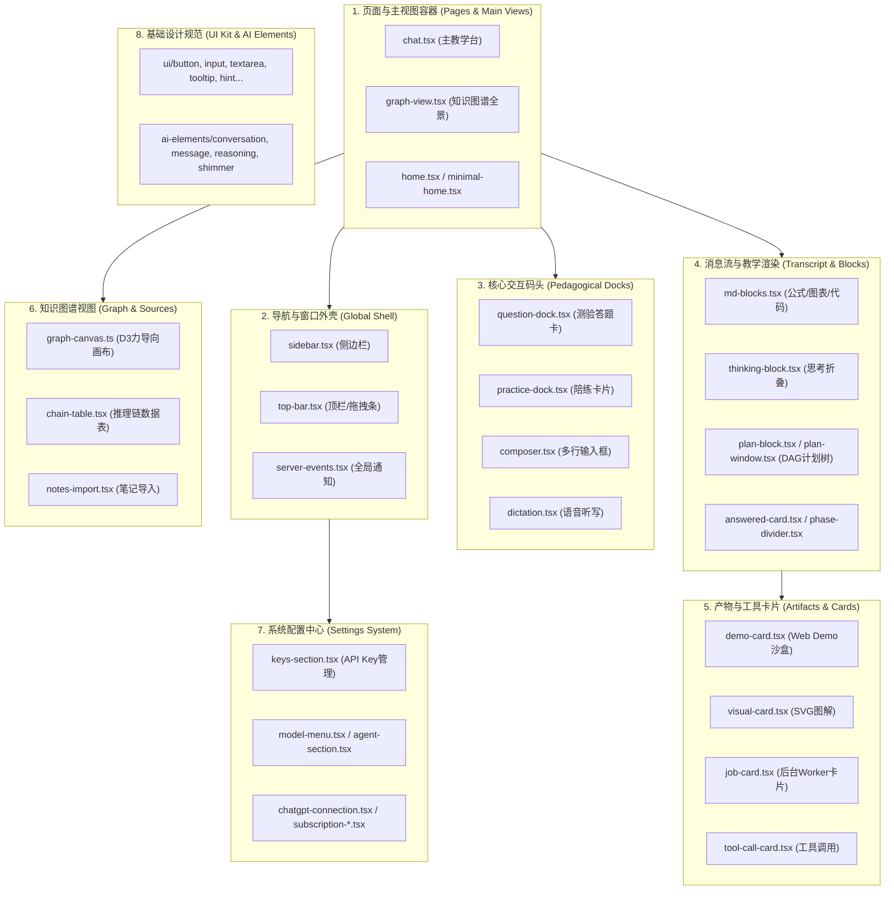
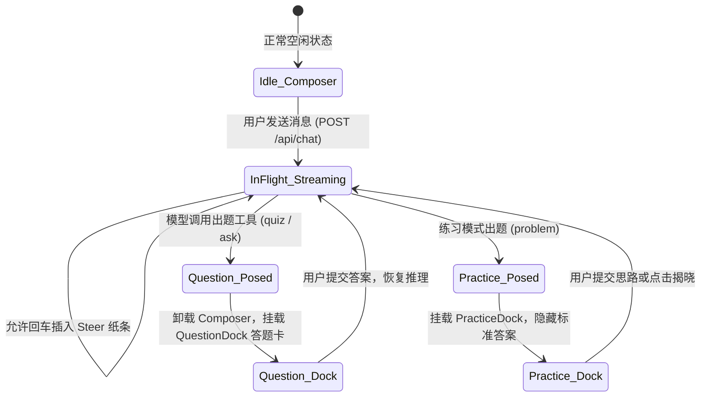

# 08 - 前端 UI 全景架构：93 个组件分层矩阵与核心功能解析

> **文档定位**：本文档针对 LearnHarness 的前端表现层（Presentation Layer），系统性梳理工程内全部 **93 个 React 组件（`.tsx`）** 与 **28 个辅助状态机/Hook 模块（`.ts`）** 的架构分层、职责边界与交互协同机制。帮助开发者（尤其是 Java / 后端背景工程师）建立起清晰的前端组件心智模型，掌握从“服务端推流”到“前端卡片渲染”的完整链路。

---

## 目录索引

- [一、 前端架构全景概览与量化数据](#一-前端架构全景概览与量化数据)
  - [1.1 技术选型与设计哲学](#11-技术选型与设计哲学)
  - [1.2 全系统前端组件量化统计](#12-全系统前端组件量化统计)
  - [1.3 前端八大子系统架构全景图](#13-前端八大子系统架构全景图)
- [二、 八大子系统组件清单与功能深度剖析](#二-八大子系统组件清单与功能深度剖析)
  - [2.1 核心视图与页面容器 (Views & Pages) - 5 个](#21-核心视图与页面容器-views--pages---5-个)
  - [2.2 全局导航与窗口外壳 (Global Shell) - 6 个](#22-全局导航与窗口外壳-global-shell---6-个)
  - [2.3 核心交互码头系统 (Pedagogical Docks) - 8 个](#23-核心交互码头系统-pedagogical-docks---8-个)
  - [2.4 消息流与教学渲染引擎 (Transcript & Blocks) - 10 个](#24-消息流与教学渲染引擎-transcript--blocks---10-个)
  - [2.5 子智能体产物与工具卡片 (Artifacts & Cards) - 10 个](#25-子智能体产物与工具卡片-artifacts--cards---10-个)
  - [2.6 交互式知识图谱可视化 (Knowledge Graph) - 7 个](#26-交互式知识图谱可视化-knowledge-graph---7-个)
  - [2.7 全功能设置中心 (Settings System) - 16 个](#27-全功能设置中心-settings-system---16-个)
  - [2.8 基础设计系统与通用挂件 (UI Kit & AI Elements) - 27 个](#28-基础设计系统与通用挂件-ui-kit--ai-elements---27-个)
- [三、 面向 Java 工程师的前端三大核心架构模式](#三-面向-java-工程师的前端三大核心架构模式)
  - [3.1 模式一：无头状态机驱动 (Headless State Machine in `session-core.ts`)](#31-模式一无头状态机驱动-headless-state-machine-in-session-corets)
  - [3.2 模式二：单向纯函数数学投影 (Pure View Projection in `view.ts`)](#32-模式二单向纯函数数学投影-pure-view-projection-in-viewts)
  - [3.3 模式三：动态码头替换模式 (Dynamic Dock Pattern)](#33-模式三动态码头替换模式-dynamic-dock-pattern)
- [四、 二开实战：如何新增一个自定义交互卡片？](#四-二开实战如何新增一个自定义交互卡片)

---

## 一、 前端架构全景概览与量化数据

### 1.1 技术选型与设计哲学
LearnHarness 前端并非普通的 Web 聊天界面，而是一个**专为高专注度教学打造的重交互客户端**：
* **核心框架**：Next.js 16 (App Router) + React 19。
* **样式系统**：Tailwind CSS v4 + `clsx` / `tailwind-merge`。
* **图表与可视化**：KaTeX（LaTeX 渲染）、Mermaid（流程图与计划树）、D3.js（力导向图谱画布）、MediaChrome（多媒体播放）。
* **通信协议**：Server-Sent Events（SSE 单向流式传输）+ WebSocket（Deepgram 原生音频直连）。
* **设计哲学**：
  1. **状态与视图彻底解耦**：核心状态管理完全由独立的纯 TS 状态机（`session-core.ts`）承载，React 组件只充当纯粹的展示层；
  2. **键盘优先（Keyboard-first）**：支持快捷键选答案（`1~4`）、随时按回车继续、`Ctrl+F` 全文检索、`Tab` 键在输入框与答题区无缝跳转；
  3. **防疲劳与高可读性**：默认深色暗黑背景（`#141414`），思维链（Thinking）默认自动折叠，SVG 图表支持暗黑反色。

### 1.2 全系统前端组件量化统计
前端代码集中在 `components/` 与 `app/` 目录下，共计包含：
* **React 组件文件（`.tsx`）**：**93 个**
* **前端状态机 / Hook / 辅助模块（`.ts`）**：**28 个**
* **全局总计**：**121 个前端源码文件**

### 1.3 前端八大子系统架构全景图

---

## 二、 八大子系统组件清单与功能深度剖析

---

### 2.1 核心视图与页面容器 (Views & Pages) - 5 个

| 组件名称 | 源码文件 | 核心职责与业务功能 |
| :--- | :--- | :--- |
| **`Chat`** | [`components/chat.tsx`](file:///d:/0.default/learnharness/components/chat.tsx) | **全系统的教学核心控制台（2,486 行）**。负责渲染流式消息区、滚动定位（自动贴底）、动态挂载交互码头、协调后台任务刷新与计费数据对账。 |
| **`ChatPage`** | [`app/chat/[id]/page.tsx`](file:///d:/0.default/learnharness/app/chat/%5Bid%5D/page.tsx) | Next.js 动态路由页面，提取 URL 中的 `chatId` 并注入主教学容器。 |
| **`NewChatPage`** | [`app/chat/new/page.tsx`](file:///d:/0.default/learnharness/app/chat/new/page.tsx) | 新会话草稿页，提供空状态引导、模型预选以及发送首条消息建会话。 |
| **`GraphView`** | [`components/graph-view.tsx`](file:///d:/0.default/learnharness/components/graph-view.tsx) | 全屏知识图谱主视图，无缝平替对话界面，提供物理拓扑图与推理链表格切换。 |
| **`Home / MinimalHome`**| [`components/home.tsx`](file:///d:/0.default/learnharness/components/home.tsx) | 未选中任何会话时的空白落地页，展示常用指令、快捷键提示与创建按钮。 |

---

### 2.2 全局导航与窗口外壳 (Global Shell) - 6 个

| 组件名称 | 源码文件 | 核心职责与业务功能 |
| :--- | :--- | :--- |
| **`Sidebar`** | [`components/sidebar.tsx`](file:///d:/0.default/learnharness/components/sidebar.tsx) | 左侧会话抽屉（1,000+ 行）。展示历史会话列表（按创建时间排序，改名不跳序）、全站模糊搜索、右键删除会话（支持级联清除图谱命题）。 |
| **`TopBar`** | [`components/top-bar.tsx`](file:///d:/0.default/learnharness/components/top-bar.tsx) | 顶栏兼桌面窗口标题栏。带 `.lh-drag` 拖拽区域、会话标题点击内联重命名、模型选择胶囊与图谱覆盖率圆环。 |
| **`ModelPicker`** | [`components/model-picker.tsx`](file:///d:/0.default/learnharness/components/model-picker.tsx) | 顶栏上的模型选择胶囊（Pill）。支持单会话热切换强力模型、经济模型与思考深度档位（Low / Medium / High）。 |
| **`ServerEvents`** | [`components/server-events.tsx`](file:///d:/0.default/learnharness/components/server-events.tsx) | 全局事件监听器，通过单个 `/api/events` 连接接收后端广播，驱动界面热刷新。 |
| **`SessionNavigation`**| [`components/session-navigation.tsx`](file:///d:/0.default/learnharness/components/session-navigation.tsx) | 多会话快速切换控制条。 |
| **`UpdateBanner`** | [`components/update-banner.tsx`](file:///d:/0.default/learnharness/components/update-banner.tsx) | 桌面端版本升级通知横幅，提示“新版本已就绪，点击重启即可更新”。 |

---

### 2.3 核心交互码头系统 (Pedagogical Docks) - 8 个

> **架构亮点**：输入区不是死板的单一文本框，而是根据当前轮次状态在 **Composer**（打字）、**QuestionDock**（测验答题）和 **PracticeDock**（陪练做题）之间无缝替换。

| 组件名称 | 源码文件 | 核心职责与业务功能 |
| :--- | :--- | :--- |
| **`Composer`** | [`components/composer.tsx`](file:///d:/0.default/learnharness/components/composer.tsx) | **自由输入码头**。高度自适应文本框、文件拖拽自动转绝对路径、支持输入中按回车触发 Steer 纸条插队。 |
| **`ComposerActions`** | [`components/composer-actions.tsx`](file:///d:/0.default/learnharness/components/composer-actions.tsx) | 输入框右下角操作区（麦克风听写按钮、发送/纸条插队按钮、Token 预估状态）。 |
| **`QuestionDock`** | [`components/question-dock.tsx`](file:///d:/0.default/learnharness/components/question-dock.tsx) | **测验答题码头**。当 Agent 调用 `quiz` 时浮出，负责渲染选项卡片、确定性乱序打乱、支持数字键 `1~4` 快捷单选。 |
| **`ConfidenceRail`** | [`components/confidence-rail.tsx`](file:///d:/0.default/learnharness/components/confidence-rail.tsx) | **置信度标尺**。学生提交选择题前滑动选择把握程度（1~5 档），供探测智能体分析认知真伪。 |
| **`PracticeDock`** | [`components/practice-dock.tsx`](file:///d:/0.default/learnharness/components/practice-dock.tsx) | **陪练做题码头**。锁定当前练习题目、严格隐藏标准答案、提供输入解题思路的专用文本域。 |
| **`PracticeCards`** | [`components/practice-cards.tsx`](file:///d:/0.default/learnharness/components/practice-cards.tsx) | 练习题目与答案提示切换卡片，负责点击“揭晓答案”后的比对展示。 |
| **`ActivityDock`** | [`components/activity-dock.tsx`](file:///d:/0.default/learnharness/components/activity-dock.tsx) | 后台 Subagent 任务进度条。当有 Worker 在查论文或写 Demo 时，在界面底部展示微光脉冲与当前阶段。 |
| **`Dictation`** | [`components/dictation.tsx`](file:///d:/0.default/learnharness/components/dictation.tsx) | 语音听写浮层，直连 Deepgram WebSocket，实时将语音转录为文字塞入输入框。 |

---

### 2.4 消息流与教学渲染引擎 (Transcript & Blocks) - 10 个

| 组件名称 | 源码文件 | 核心职责与业务功能 |
| :--- | :--- | :--- |
| **`MdBlocks`** | [`components/md-blocks.tsx`](file:///d:/0.default/learnharness/components/md-blocks.tsx) | **富文本渲染引擎（1,100 行）**。支持 GFM Markdown、KaTeX 数学公式、代码高亮、Mermaid 图表与一键复制代码。 |
| **`ThinkingBlock`** | [`components/thinking-block.tsx`](file:///d:/0.default/learnharness/components/thinking-block.tsx) | **思考过程折叠条**。专门解析大模型的 `<think>` 思维链，实时展示用时秒数，默认自动折叠保持正文清爽。 |
| **`PlanBlock`** | [`components/plan-block.tsx`](file:///d:/0.default/learnharness/components/plan-block.tsx) | 消息流中的知识计划树卡片。展示由 Mermaid 渲染的有向无环图（DAG），高亮已学与当前进度。 |
| **`PlanWindow`** | [`components/plan-window.tsx`](file:///d:/0.default/learnharness/components/plan-window.tsx) | 计划树全景模态弹窗，支持全屏平移、缩放与节点详情查看。 |
| **`AnsweredCard`** | [`components/answered-card.tsx`](file:///d:/0.default/learnharness/components/answered-card.tsx) | 历史答题卡片。在消息历史中固定展示学生曾经的选择、置信度以及批改解析。 |
| **`PhaseDivider`** | [`components/phase-divider.tsx`](file:///d:/0.default/learnharness/components/phase-divider.tsx) | **阶段交接分割线**。当 `probe_done` 触发、系统从摸底转向正式教学时，在流中渲染里程碑标牌。 |
| **`CompactionDivider`**| [`components/compaction-divider.tsx`](file:///d:/0.default/learnharness/components/compaction-divider.tsx) | 上下文压缩分割线。标示该位置以上的旧历史已被模型总结折叠。 |
| **`ReadingThinking`**| [`components/reading-thinking.tsx`](file:///d:/0.default/learnharness/components/reading-thinking.tsx) | 实时推流过程中的思考文本打字机展示器。 |
| **`QueuedSteers`** | [`components/queued-steers.tsx`](file:///d:/0.default/learnharness/components/queued-steers.tsx) | 悬浮气泡，展示用户在生成中途敲下回车注入的插队纸条。 |
| **`GraphContextCard`** | [`components/graph-context-card.tsx`](file:///d:/0.default/learnharness/components/graph-context-card.tsx) | 会话顶部先验概念卡片，标示本次学习针对的图谱选定命题。 |

---

### 2.5 子智能体产物与工具卡片 (`components/artifacts/` - 10 个)

| 组件名称 | 源码文件 | 核心职责与业务功能 |
| :--- | :--- | :--- |
| **`DemoCard`** | [`components/artifacts/demo-card.tsx`](file:///d:/0.default/learnharness/components/artifacts/demo-card.tsx) | **Web Demo 沙盒卡片**。在聊天气泡中以沙箱 `<iframe>` 运行 AI 编写的前端 HTML/JS/CSS，支持全屏运行。 |
| **`VisualCard`** | [`components/artifacts/visual-card.tsx`](file:///d:/0.default/learnharness/components/artifacts/visual-card.tsx) | AI 绘制的 SVG 矢量图解卡片，内置暗黑反色滤镜（`InvertDisc`）。 |
| **`JobCard`** | [`components/artifacts/job-card.tsx`](file:///d:/0.default/learnharness/components/artifacts/job-card.tsx) | 后台异步 Worker（Researcher、PDF Reader）的落地结果展示卡片。 |
| **`DispatchCard`** | [`components/artifacts/dispatch-card.tsx`](file:///d:/0.default/learnharness/components/artifacts/dispatch-card.tsx) | 任务派发中途的进度骨架卡片。 |
| **`LiveToolCard`** | [`components/artifacts/live-tool-card.tsx`](file:///d:/0.default/learnharness/components/artifacts/live-tool-card.tsx) | 正在执行中的工具动画卡片。 |
| **`ToolCallCard`** | [`components/artifacts/tool-call-card.tsx`](file:///d:/0.default/learnharness/components/artifacts/tool-call-card.tsx) | 折叠展示普通本地工具（如 `read`、`grep`、`list_sessions`）的详细入参与出参。 |
| **`ProbeDoneCard`**| [`components/artifacts/probe-done-card.tsx`](file:///d:/0.default/learnharness/components/artifacts/probe-done-card.tsx) | 摸底测验完成后的综合评估报告卡片（展示已知下界与盲区上界）。 |
| **`SteerCard`** | [`components/artifacts/steer-card.tsx`](file:///d:/0.default/learnharness/components/artifacts/steer-card.tsx) | 记录已被成功注入到推理流中的纸条消息。 |
| **`SvgImage`** | [`components/artifacts/svg-image.tsx`](file:///d:/0.default/learnharness/components/artifacts/svg-image.tsx) | 具备缩放、拖拽与高对比度渲染特性的独立 SVG 视口。 |
| **`InvertDisc`** | [`components/artifacts/invert-disc.tsx`](file:///d:/0.default/learnharness/components/artifacts/invert-disc.tsx) | 浮动按钮，用于快速反转图表颜色以适配深色/浅色模式。 |

---

### 2.6 交互式知识图谱可视化 (Knowledge Graph - 7 个)

| 组件名称 | 源码文件 | 核心职责与业务功能 |
| :--- | :--- | :--- |
| **`GraphView`** | [`components/graph-view.tsx`](file:///d:/0.default/learnharness/components/graph-view.tsx) | **知识图谱视口总控（1,400+ 行）**。基于 Canvas 2D + D3.js 实现力导向布局模拟、滚轮缩放、节点聚焦。 |
| **`ChainTable`** | [`components/chain-table.tsx`](file:///d:/0.default/learnharness/components/chain-table.tsx) | **推理链结构化数据表**。用表格列出全部客观命题（Premises $\to$ Conclusion），支持按来源和节点检索。 |
| **`SourceFolderTree`** | [`components/source-folder-tree.tsx`](file:///d:/0.default/learnharness/components/source-folder-tree.tsx) | 左侧知识来源树状目录（归类各会话以及导入的外部笔记文件夹）。 |
| **`NotesImport`** | [`components/notes-import.tsx`](file:///d:/0.default/learnharness/components/notes-import.tsx) | 外部笔记批量导入弹窗（支持多文件拖拽 Markdown / TXT / PDF 批量上传并触发提取）。 |
| **`ExtractionCoverage`**| [`components/extraction-coverage.tsx`](file:///d:/0.default/learnharness/components/extraction-coverage.tsx) | 顶栏环形进度条，直观展示未覆盖教师正文距离触发下一次自动提取（4096 Tokens）的百分比。 |
| **`DeleteNodeDialog`**| [`components/delete-node-dialog.tsx`](file:///d:/0.default/learnharness/components/delete-node-dialog.tsx) | 删除单个图谱节点及其级联关联推理链的确认对话框。 |
| **`DeleteSourceDialog`**| [`components/delete-source-dialog.tsx`](file:///d:/0.default/learnharness/components/delete-source-dialog.tsx)| 删除外部笔记数据源及其衍生节点的数据清理对话框。 |

---

### 2.7 全功能设置中心 (`components/settings/` - 16 个)

| 组件名称 | 源码文件 | 核心职责与业务功能 |
| :--- | :--- | :--- |
| **`SettingsDialog`** | [`components/settings/settings-dialog.tsx`](file:///d:/0.default/learnharness/components/settings/settings-dialog.tsx) | 综合设置弹窗，聚合 6 大配置标签页。 |
| **`KeysSection`** | [`components/settings/keys-section.tsx`](file:///d:/0.default/learnharness/components/settings/keys-section.tsx) | **API 密钥管理面板**。直连配置 OpenAI、Anthropic、DeepSeek、OpenRouter、Tavily 搜索等 Key。 |
| **`AgentSection`** | [`components/settings/agent-section.tsx`](file:///d:/0.default/learnharness/components/settings/agent-section.tsx) | 智能体工具开关（可单独禁用搜索、画图）与分段系统提示词（Prompt Segments）热覆盖开关。 |
| **`ModelMenu`** | [`components/settings/model-menu.tsx`](file:///d:/0.default/learnharness/components/settings/model-menu.tsx) | 强力槽（Strong）、经济槽（Cheap）、视觉槽（Vision）的全局模型绑定菜单。 |
| **`CacheRetentionMenu`**| [`components/settings/cache-retention-menu.tsx`](file:///d:/0.default/learnharness/components/settings/cache-retention-menu.tsx) | 大模型 Prompt Caching 前缀缓存保留时长配置（Pi Default / 1h / 24h）。 |
| **`ChatGPTConnection`**| [`components/settings/chatgpt-connection.tsx`](file:///d:/0.default/learnharness/components/settings/chatgpt-connection.tsx) | ChatGPT 网页订阅版 OAuth 授权登录与状态维护。 |
| **`SubscriptionConnections`**| [`components/settings/subscription-connections.tsx`](file:///d:/0.default/learnharness/components/settings/subscription-connections.tsx) | 原生订阅桥接面板（GitHub Copilot、xAI 等）。 |
| **`ClaudeCodeStatus`** | [`components/settings/claude-code-status.tsx`](file:///d:/0.default/learnharness/components/settings/claude-code-status.tsx) | 本地 Claude Code CLI 的可执行文件自动发现、版本检查与启用开关。 |
| **`AppearanceSection`**| [`components/settings/appearance-section.tsx`](file:///d:/0.default/learnharness/components/settings/appearance-section.tsx) | 外观偏好设置（明亮 / 暗黑 / 跟随系统、界面字号与缩放比例）。 |
| **`KeyboardSection`** | [`components/settings/keyboard-section.tsx`](file:///d:/0.default/learnharness/components/settings/keyboard-section.tsx) | 键盘快捷键一览表与自定义键位。 |
| **`InterfaceLanguage`**| [`components/settings/interface-language.tsx`](file:///d:/0.default/learnharness/components/settings/interface-language.tsx) | 界面交互语言切换（简体中文 `zh-CN` / 英文 `en`）。 |
| **`SearchMenuList`** | [`components/settings/search-menu-list.tsx`](file:///d:/0.default/learnharness/components/settings/search-menu-list.tsx) | 联网搜索提供商切换（Tavily / Brave Search）。 |
| **`UpdateSettings`** | [`components/settings/update-settings.tsx`](file:///d:/0.default/learnharness/components/settings/update-settings.tsx) | 自动更新策略与频道配置。 |

---

### 2.8 基础设计系统与通用挂件 (UI Kit & AI Elements - 27 个)

* **UI Kit 原语组件（`components/ui/` 9 个）**：
  * `button.tsx`：统一样式按钮（包含 primary / ghost / outline 等多变体）；
  * `button-group.tsx`：互斥按钮组；
  * `input.tsx`：基础单行输入框；
  * `textarea.tsx`：自动根据内容撑高的高度自适应多行文本域；
  * `tooltip.tsx`：基于 Radix UI 的无延迟悬浮提示气泡；
  * `collapsible.tsx`：平滑展开/折叠容器；
  * `separator.tsx`：横向与纵向分割线；
  * `hint.tsx`：灰色弱提示文本；
  * `glyph-mark.tsx`：SVG 矢量图标集合。
* **AI Elements 动效原语（`components/ai-elements/` 4 个）**：
  * `conversation.tsx`：虚拟平滑滚动对话视口；
  * `message.tsx`：标准消息气泡框（负责角色对齐与内边距）；
  * `reasoning.tsx`：思考链推流微光动效；
  * `shimmer.tsx`：等待大模型吐字时的流光骨架屏效果。
* **实用辅助挂件（14 个）**：
  * **`StatsBar`** ([`components/stats-bar.tsx`](file:///d:/0.default/learnharness/components/stats-bar.tsx))：底部实时 Token 消耗与计费折算显示条；
  * **`SessionFind`** ([`components/session-find.tsx`](file:///d:/0.default/learnharness/components/session-find.tsx))：页面内局部文本检索悬浮框（`Ctrl + F`）；
  * **`SetupDialog / SetupCTA`** ([`components/setup-dialog.tsx`](file:///d:/0.default/learnharness/components/setup-dialog.tsx))：初次使用无 Key 时的指引配置向导；
  * **`AbortTurnDialog`** ([`components/abort-turn-dialog.tsx`](file:///d:/0.default/learnharness/components/abort-turn-dialog.tsx))：中断当前生成的二次确认对话框；
  * **`BrailleSpinner`** ([`components/braille-spinner.tsx`](file:///d:/0.default/learnharness/components/braille-spinner.tsx))：极客风格的盲文点阵旋转等待动效（`⠋ ⠙ ⠹ ...`）；
  * **`KeyboardShortcuts`** ([`components/keyboard-shortcuts.tsx`](file:///d:/0.default/learnharness/components/keyboard-shortcuts.tsx))：全局键盘事件总线。

---

## 三、 面向 Java 工程师的前端三大核心架构模式

如果你有深厚的 Java / Spring 后端背景，理解 LearnHarness 前端时可以直接套用以下三大设计模式：

### 3.1 模式一：无头状态机驱动（Headless State Machine in `session-core.ts`）
在很多糟糕的前端工程中，网络断线重连、Token 刷新、消息拼接会分散在几十个 React 组件的 `useEffect` 中，极易引发竞态与内存泄漏。  
LearnHarness 采用了 **“无头状态机（Headless Architecture）”**：
* 整个会话的核心生命周期由纯 TypeScript 编写的 [`components/session-core.ts`](file:///d:/0.default/learnharness/components/session-core.ts) 全权托管；
* 它**不包含一行 JSX，不依赖任何 React 钩子**；
* 它是一个纯粹的面向对象状态机：拥有内部 `status` 状态枚举、`409` 冲突退避重试算法、SSE 断线重连缓冲区与乐观更新队列；
* React 组件（`chat.tsx`）只是它的一个观察者（Observer），仅负责监听其状态变化并刷新屏幕。

---

### 3.2 模式二：单向纯函数数学投影（Pure View Projection in `view.ts`）
在传统聊天系统中，前端通常直接把服务端返回的 Message 存入列表并在界面上循环输出。  
但在教学系统中，如果模型输出了 5 条消息：
1. 思考（`<think>`）；
2. 讲了一段话；
3. 发起工具调用（`quiz`）；
4. 工具返回题目数据；
5. 学生提交答案。

如果直接渲染会把界面撕得四分五裂。  
LearnHarness 在 [`src/core/view.ts`](file:///d:/0.default/learnharness/src/core/view.ts) 中实现了一个纯函数 **`projectView(messages: LhMessage[]): SessionView`**：
* 类似于 Java 后端把数据库的 DO 集合组装成给前端渲染的 `ResponseVO`；
* 它像流式归约器（Stream Reducer）一样，将多条连续的原生消息聚合折叠成结构化的卡片对象（`FoldedTurn`、`ArtifactPart`、`AnsweredCard`）；
* **只读不变式**：前端任何组件都**禁止直接篡改消息**，保证了从服务端磁盘到前端屏幕的数据一致性。

---

### 3.3 模式三：动态码头替换模式 (Dynamic Dock Pattern)
教学系统的输入区域必须随着教学阶段灵活变脸。前端采用了“码头挂载（Dock）”设计：

* **互斥与安全**：同一时刻，屏幕底部只能存在一个激活的 Dock，从机制上防止了“学生一边做题一边向大模型发新消息”导致的并发状态碰撞。

---

## 四、 二开实战：如何新增一个自定义交互卡片？

如果你想在二次开发中新增一个交互题型（例如“代码填空题”或“可运行代码卡片”）：

1. **Step 1：定义卡片渲染组件**
   在 `components/artifacts/` 下新建 `code-sandbox-card.tsx`，负责代码的高亮显示与运行按钮交互。
2. **Step 2：在投影层注册映射**
   在 [`src/core/view.ts`](file:///d:/0.default/learnharness/src/core/view.ts) 的 `projectView` 函数中，识别你新增的工具名称（例如 `code_eval`），将其投射为专属的卡片视图对象。
3. **Step 3：在消息流中渲染**
   在 [`components/chat.tsx`](file:///d:/0.default/learnharness/components/chat.tsx) 或 [`components/md-blocks.tsx`](file:///d:/0.default/learnharness/components/md-blocks.tsx) 中引入该组件，当匹配到对应卡片类型时渲染出来。
4. **Step 4：挂载提交事件**
   在卡片中的运行/提交按钮回调中，调用 `session-core.ts` 暴露的 `send({ type: "answer", ... })`，将结果作为下一次 HTTP 请求的回执喂回给服务端状态机。
