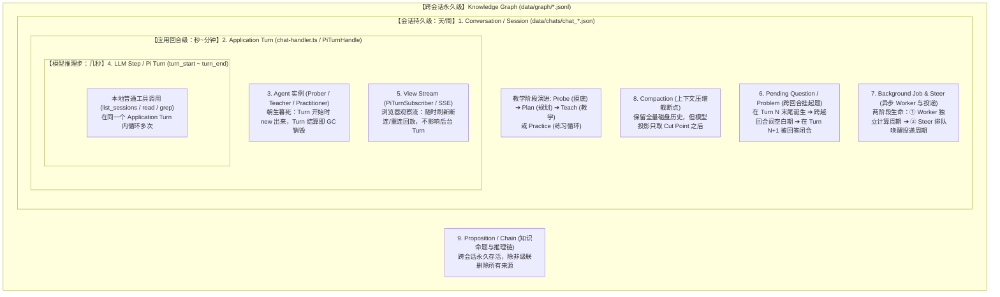
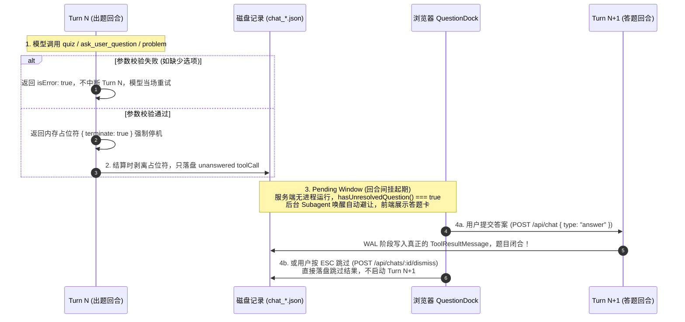
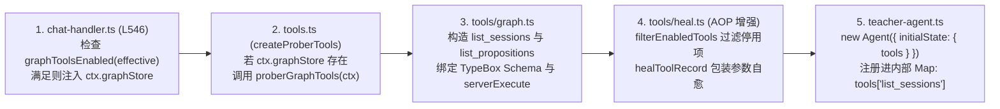

# 09 - 核心概念与生命周期全景：从 LLM 单步到跨会话图谱的 9 大 Lifecycle 解析

> **文档定位**：在官方架构规范 [`docs/architecture.md` (§2 Conversation, engine, agent and turn — These are different lifetimes)](file:///d:/0.default/learnharness/docs/architecture.md#L25-L34) 中，作者明确指出：**混淆不同层级概念的生命周期（Lifecycle）是理解与二次开发本系统最大的认知陷阱**。
> 本文档以 Java 架构师视角，按**存活时间跨度从短到长（毫秒级 $\to$ 秒级 $\to$ 跨回合级 $\to$ 会话级 $\to$ 永久级）**，全景剖析 LearnHarness 中的 **9 大核心概念及其完整生命周期**，并附带工具注入（`ctx`）、工具调用闭环（如 `list_sessions`）与双层 `spawn` 原语的深度拆解。

---

## 目录索引

- [一、 九大核心概念的生命周期嵌套全景图](#一-九大核心概念的生命周期嵌套全景图)
- [二、 九大核心概念 Lifecycle 逐一深度拆解](#二-九大核心概念-lifecycle-逐一深度拆解)
  - [2.1 `Conversation / Session`（会话记录 / `ChatRecord`）—— 持久级生命周期](#21-conversation--session会话记录--chatrecord-持久级生命周期)
  - [2.2 `Application Turn`（应用回合 / `PiTurnHandle`）—— 单次交互编排生命周期](#22-application-turn应用回合--piturnhandle-单次交互编排生命周期)
  - [2.3 `Agent` 实例（`Prober` / `Teacher` / `Practitioner`）—— 朝生暮死的无状态生命周期](#23-agent-实例prober--teacher--practitioner-朝生暮死的无状态生命周期)
  - [2.4 `LLM Generation Step`（底层日志中的 `pi turn`）—— 单次模型往返与工具调用生命周期](#24-llm-generation-step底层日志中的-pi-turn-单次模型往返与工具调用生命周期)
  - [2.5 `View Stream / Subscriber`（客户端流式观察视口）—— 随时可断的观察者生命周期](#25-view-stream--subscriber客户端流式观察视口-随时可断的观察者生命周期)
  - [2.6 `Pending Question / Problem`（挂起题目）—— 跨越两个 Turn 之间的暂停生命周期](#26-pending-question--problem挂起题目-跨越两个-turn-之间的暂停生命周期)
  - [2.7 `Background Job` & `Steer Delivery`（后台异步任务）—— 计算与投递解耦的双段生命周期](#27-background-job--steer-delivery后台异步任务-计算与投递解耦的双段生命周期)
  - [2.8 `Compaction`（上下文滑动窗口压缩）—— 回合间预热与投影截断生命周期](#28-compaction上下文滑动窗口压缩-回合间预热与投影截断生命周期)
  - [2.9 `Extraction Batch` & `Graph Proposition`（图谱抽取与知识命题）—— 从瞬态批次到跨会话永久资产](#29-extraction-batch--graph-proposition图谱抽取与知识命题-从瞬态批次到跨会话永久资产)
- [三、 专题补充：Agent 工具装配（`ctx`）、调用闭环与双层 `spawn` 机制](#三-专题补充agent-工具装配ctx调用闭环与双层-spawn-机制)
  - [3.1 什么是 `ctx`？工具注册表 `tools["list_sessions"]` 是如何条件装配的？](#31-什么是-ctx工具注册表-toolslist_sessions-是如何条件装配的)
  - [3.2 Agent 调用工具（以 `list_sessions` 为例）的 4 阶段 ReAct 闭环](#32-agent-调用工具以-list_sessions-为例的-4-阶段-react-闭环)
  - [3.3 业务层的 `ctx.spawn` vs Node.js 操作系统原语 `child_process.spawn`](#33-业务层的-ctxspawn-vs-nodejs-操作系统原语-child_processspawn)
- [四、 九大概念生命周期速查对照表（Java 架构师随手查）](#四-九大概念生命周期速查对照表java-架构师随手查)

---

## 一、 九大核心概念的生命周期嵌套全景图



---

## 二、 九大核心概念 Lifecycle 逐一深度拆解

### 2.1 `Conversation / Session`（会话记录 / `ChatRecord`）—— 持久级生命周期
* **源码载体**：[`src/core/contracts/chat.ts`](file:///d:/0.default/learnharness/src/core/contracts/chat.ts) + `data/chats/<id>.json` + [`src/core/phases.ts`](file:///d:/0.default/learnharness/src/core/phases.ts)
* **Java 类比**：数据库中的持久化聚合根实体（Aggregate Root Entity）。
* **生命周期状态机**：
  ```mermaid
  stateDiagram-v2
      [*] --> Created: POST /api/chats
      Created --> Probing: 默认教学会话 (kind 缺省)
      Created --> Practicing: 练习会话 (kind === "practice")
      Probing --> Planning: probe_done 工具调用成功落盘
      Planning --> Teaching: 首次出现带 nodeId 的 quiz / explain 调用
      Teaching --> Deleted: DELETE /api/chats/:id
      Practicing --> Deleted: DELETE /api/chats/:id
      Deleted --> [*]
  ```
* **关键设计铁律**：
  1. **阶段是纯函数推导的，不是存储字段**：`ChatRecord` JSON 文件里根本没有 `currentPhase` 字段！当前会话处于 `probe`、`plan` 还是 `teach`，完全由 [`src/core/phases.ts`](file:///d:/0.default/learnharness/src/core/phases.ts) 扫描 `record.messages` 实时推导出来。
  2. **创建时间锚定排序**：会话列表按首次创建的诞生时间排序，重命名会话标题（`renameChat`）或修改会话级模型配置（`saveSettings`）**绝不更新 `updatedAt`**，防止侧边栏列表乱跳。

---

### 2.2 `Application Turn`（应用回合 / `PiTurnHandle`）—— 单次交互编排生命周期
* **源码载体**：[`src/server/chat-handler.ts`](file:///d:/0.default/learnharness/src/server/chat-handler.ts) + [`src/server/turn-liveness.ts`](file:///d:/0.default/learnharness/src/server/turn-liveness.ts) + [`src/server/turn-runs.ts`](file:///d:/0.default/learnharness/src/server/turn-runs.ts)
* **Java 类比**：一次受分布式互斥锁保护的编程式事务 + 后台异步任务句柄（`CompletableFuture`）。
* **生命周期流转**：
  $$\text{Admitted (准入与压缩门禁)} \longrightarrow \text{Locked \& WAL (抢409锁+预写落盘)} \longrightarrow \text{Running (后台内存自转)} \longrightarrow \text{Settling (落盘新消息与账单)} \longrightarrow \text{Settled (释放锁与句柄)}$$
* **关键设计铁律**：
  * **Application Turn $\neq$ HTTP 请求连接**：`POST /api/chat` 在拉起后台 Turn 后几毫秒内即返回 `200 OK`（Connection Diet B），Turn 在服务端后台内存中独立运行。
  * **Application Turn $\neq$ 单次大模型调用**：一个 Turn 内部可以连续发起多次大模型请求和多次工具调用，直到模型自然把话说完，或者调用了提问工具（`quiz`/`ask_user_question`/`problem`）触发暂停门禁为止。

---

### 2.3 `Agent` 实例（`Prober` / `Teacher` / `Practitioner`）—— 朝生暮死的无状态生命周期
* **源码载体**：[`src/agent/teacher-agent.ts`](file:///d:/0.default/learnharness/src/agent/teacher-agent.ts)（[`createProberAgent`](file:///d:/0.default/learnharness/src/agent/teacher-agent.ts#L297)、[`createTeacherAgent`](file:///d:/0.default/learnharness/src/agent/teacher-agent.ts#L307)、[`createPracticeAgent`](file:///d:/0.default/learnharness/src/agent/teacher-agent.ts#L357)）
* **Java 类比**：Spring 中 `@Scope("prototype")` 的无状态命令处理器，用完即焚。
* **生命周期流转**：
  $$\text{Constructed (Turn 第 4 步现场 new)} \longrightarrow \text{Active Loop (驱动本轮推理)} \longrightarrow \text{Unregistered \& GC (Turn 第 7 步注销后直接销毁)}$$
* **为什么绝不跨 Turn 常驻 `Agent` 对象？**
  * 在 LearnHarness 中，**磁盘上的 `ChatRecord.messages` 就是唯一的 Agent 状态**（`initialState.messages = asAgentMessages(agentMessages)`）。
  * 每个 Turn 开始时重新 `new Agent(...)`，意味着用户在设置中心修改了分段 Prompt、关闭了某个工具开关、切换了模型，或者上一轮刚刚执行了 `probe_done` 需要从探测员切换为教师时，**下一轮 Turn 天然 100% 拿到最新配置，永远不存在内存缓存不一致的 Bug**！

---

### 2.4 `LLM Generation Step`（底层日志中的 `pi turn`）—— 单次模型往返与工具调用生命周期
* **源码载体**：`@earendil-works/pi-agent-core` 内部循环 + [`TurnUsage.steps`](file:///d:/0.default/learnharness/src/core/contracts/chat.ts)
* **破解控制台日志中的命名重叠迷雾**：
  当你查看服务端控制台日志时，会同时看到 `[TURN]`、`[AGENT] agent_start` 和 `[AGENT] turn_start`。它们的真实包含关系如下：

| 控制台日志标签 | 所属代码层 | 真实生命周期含义 |
| :--- | :--- | :--- |
| `[TURN] ▶ handleChatInput` ... `✔ turn settled` | LearnHarness 服务层 (`chat-handler.ts`) | **1 个外层应用回合（Application Turn）** 的完整生命周期 |
| `[AGENT] agent_start` ... `agent_end` | 底层 `pi-agent-core` 框架 | 对应 **1 个外层应用回合**（包裹整个 `while` 循环） |
| `[AGENT] turn_start` ... `turn_end` | 底层 `pi-agent-core` 框架 | 其实是 `while` 循环里的 **1 次单步大模型请求（LLM Step）**！ |

* **典型多步轨迹示例**（以发送 `"hi"` 触发 `list_sessions` 为例）：
  1. `agent_start`（进入外层循环）
  2. `turn_start`（**Step 1**）：向大模型发请求 $\to$ 模型返回 `toolCall: list_sessions` $\to$ 本地执行 `list_sessions` 生成 `ToolResultMessage` $\to$ `turn_end`（产生 `steps[0]` 计费记录）。
  3. `turn_start`（**Step 2**）：带着 `list_sessions` 的结果再次向大模型发请求 $\to$ 模型输出问候文本并调用 `ask_user_question` $\to$ 触发停止器 $\to$ `turn_end`（产生 `steps[1]` 计费记录）。
  4. `agent_end`（跳出外层循环，进入 Turn 第 6 步 Settlement 结算）。

---

### 2.5 `View Stream / Subscriber`（客户端流式观察视口）—— 随时可断的观察者生命周期
* **源码载体**：[`src/server/pi/ui-stream.ts` (`PiTurnSubscriber`)](file:///d:/0.default/learnharness/src/server/pi/ui-stream.ts#L103-L108) + [`components/session-core.ts`](file:///d:/0.default/learnharness/components/session-core.ts)
* **Java 类比**：注册在后台任务上的 `SseEmitter` 观察者句柄。
* **生命周期流转**：
  $$\text{Subscribe (GET /api/chats/:id/stream)} \longrightarrow \text{Compacted Replay (同步重放已压实历史帧)} \longrightarrow \text{Live Fan-out (100ms 节流实时推送)} \longrightarrow \text{Detach (页面刷新/断网) 或 Done ([DONE])}$$
* **关键设计铁律**：
  * **取消 View 绝不等于取消 Turn**：当浏览器关闭标签页、按 F5 刷新或切换会话时，ReadableStream 的 `cancel()` 只会把当前 `subscriber` 从 `Set` 中移除，后台的 `Agent` 循环继续跑完并正常落盘。

---

### 2.6 `Pending Question / Problem`（挂起题目）—— 跨越两个 Turn 之间的暂停生命周期
* **源码载体**：[`src/core/pending.ts`](file:///d:/0.default/learnharness/src/core/pending.ts) + [`src/core/question-core.ts`](file:///d:/0.default/learnharness/src/core/question-core.ts) + [`src/agent/tools/practice.ts`](file:///d:/0.default/learnharness/src/agent/tools/practice.ts)
* **为什么它的生命周期最独特？** 因为它**诞生于 Turn $N$ 的末尾，存活于两个 Turn 之间的静态磁盘上，消亡于 Turn $N+1$ 的开头**！



---

### 2.7 `Background Job` & `Steer Delivery`（后台异步任务）—— 计算与投递解耦的双段生命周期
* **源码载体**：[`src/agent/subagents/runner.ts`](file:///d:/0.default/learnharness/src/agent/subagents/runner.ts) + [`src/server/jobs.ts`](file:///d:/0.default/learnharness/src/server/jobs.ts) + `data/jobs/<id>.json`
* **核心铁律（[`docs/architecture.md` §5](file:///d:/0.default/learnharness/docs/architecture.md#L118)）**：**“Worker 计算完成 $\neq$ 结果已投递进会话”**（Worker completion is not session delivery）。因此每个后台任务（`research` / `pdf` / `demo` / `visual`）都严格划分为**两段独立生命周期**：
  1. **第一段：Worker 计算生命周期（Computation Lifecycle）**
     - 主 Agent 调用工具 $\to$ `jobStore.createJob` 落盘 `status: "running"` $\to$ `ctx.spawn` 拉起后台子智能体独立运算（此阶段可通过 `/api/activity/abort` 取消）$\to$ 运算结束，落盘 `status: "done" | "error" | "aborted"` 并同时写入待投递信标 `delivery: { status: "pending", steer: ... }`。**至此 Worker 计算资源彻底释放**。
  2. **第二段：Steer 投递生命周期（Delivery Lifecycle，事务发件箱模式）**
     - 信标进入 [`jobs.ts`](file:///d:/0.default/learnharness/src/server/jobs.ts) 的内存队列，根据主会话当前状态选择投递载具：
       - **载具 A（Live Steer 实时插队）**：若主会话正在跑 Turn，信标塞入 `agent.steer()` 队列，在两个 Step 之间的安全边界注入上下文；若恰逢主会话出题停机导致信标未被消费，在 Turn 第 7 步 `settleSteers` 时**自动退回 `pending` 队列**，绝不丢失！
       - **载具 B（Idle Wake 空闲唤醒）**：若主会话空闲且没有挂起题目，[`jobs.ts`](file:///d:/0.default/learnharness/src/server/jobs.ts) 自动调用 `turnRunner` 发起一个服务端自驱动的 Turn。
     - **终态确认**：只有当该 `subagent-steer` 标记真正写入 `data/chats/<id>.json` 磁盘文件（`steerDelivered` 为 `true`）时，`JobRecord.delivery` 才被清空，投递生命周期正式终结。

---

### 2.8 `Compaction`（上下文滑动窗口压缩）—— 回合间预热与投影截断生命周期
* **源码载体**：[`src/server/compaction.ts`](file:///d:/0.default/learnharness/src/server/compaction.ts) + [`src/core/compaction.ts`](file:///d:/0.default/learnharness/src/core/compaction.ts)
* **生命周期流转**：
  1. **Settle Kick（回合末预热）**：Turn $N$ 结算后，若预估 Token 超过阈值（默认 150k），趁学生读题作答的空闲期在后台启动单飞压缩（`inFlight` Map 防重入）；
  2. **Pre-Turn Gate（回合前门禁）**：Turn $N+1$ 准入时（第 2 步），调用 `await ensureCompacted` 等待在途压缩完成（或同步兜底压缩），随后重读磁盘；
  3. **Active Cut Point（投影截断生效）**：压缩器向 `ChatRecord.messages` 追加一条 `customType: "compaction"` 的总结消息。**磁盘上的旧消息永远不删**（供前端 UI 向上滚动查阅），但在 [`toLlmMessages`](file:///d:/0.default/learnharness/src/core/native-messages.ts) 向大模型投影时，只截取**最新一条 `compaction` 消息及其之后的新消息**发送给大模型。

---

### 2.9 `Extraction Batch` & `Graph Proposition`（图谱抽取与知识命题）—— 从瞬态批次到跨会话永久资产
* **源码载体**：[`src/core/coverage.ts`](file:///d:/0.default/learnharness/src/core/coverage.ts) + [`src/agent/subagents/extraction.ts`](file:///d:/0.default/learnharness/src/agent/subagents/extraction.ts) + [`src/core/graph.ts`](file:///d:/0.default/learnharness/src/core/graph.ts)
* **双层生命周期**：
  1. **瞬态层：`Extraction Batch`（图谱抽取批次）**
     - 教学 Turn 结算后，[`coverage.ts`](file:///d:/0.default/learnharness/src/core/coverage.ts) 计算教师正文（不含学生回答和思考块）的 SHA-256 指纹，对比 `coverage.jsonl` 推导出 `Uncovered Prose（未覆盖正文）`；
     - 当未覆盖正文累计满 **4096 Tokens**（或用户手动点击提取 / 导入外部笔记）时，拉起单飞抽取批次：依次执行 `Extractor（提命题与链）` $\to$ `Auditor（查重链接）` $\to$ `Merger（确定性合并与链化简）` $\to$ 写入 `coverage.jsonl` 盖章完结。
  2. **永久层：`GraphNode / GraphChain`（知识命题与推理链）**
     - 一旦写入 `data/graph/nodes.jsonl` 与 `chains.jsonl`，该知识节点的生命周期就**超越了单个会话（Cross-Session Eternal）**；
     - 后续开启任何新会话时，`Prober` 都会在第一拍通过 `list_sessions` / `list_propositions` 读取这些沉淀下来的命题，真正实现“跨会话记忆传承”。

---

## 三、 专题补充：Agent 工具装配（`ctx`）、调用闭环与双层 `spawn` 机制

### 3.1 什么是 `ctx`？工具注册表 `tools["list_sessions"]` 是如何条件装配的？

在源码中，**`ctx`（Context）是手工依赖注入容器（Dependency Context DTO）**。因为 `eslint.config.mjs` 严禁 `src/agent/` 直接 `import` 持久化实现层 `src/store/`，所有工具所需的外部资源（`chatStore`、`jobStore`、`graphStore`、`spawn` 派发器）都必须由组合根 [`chat-handler.ts`](file:///d:/0.default/learnharness/src/server/chat-handler.ts) 打包成 `ctx` 逐层注入：



---

### 3.2 Agent 调用工具（以 `list_sessions` 为例）的 4 阶段 ReAct 闭环

当你在新会话发送 `"hi"` 时，Prober 智能体调用 `list_sessions` 经历了标准的 **4 阶段 Function Calling 闭环**：
1. **阶段 1（Schema 下发）**：Agent 启动时将 `list_sessions` 的 TypeBox Schema 转译为标准 JSON Schema，随 HTTP 请求的 `tools: [...]` 字段发给大模型。
2. **阶段 2（Prompt 驱动决策）**：大模型阅读 [`10-probe-doctrine.md`](file:///d:/0.default/learnharness/src/agent/prompts/prober/10-probe-doctrine.md#L7-L9)（*"1. Read his persistent map: `list_sessions` and `list_propositions` show what he already holds"*），决定不直接闲聊，而是返回 `finish_reason: "tool_calls"`，指明调用 `name: "list_sessions", arguments: "{}"`。
3. **阶段 3（本地熔断保护执行）**：服务端在内部 `tools` 表中命中 `list_sessions`，通过 [`serverExecute`](file:///d:/0.default/learnharness/src/agent/tool-execute.ts#L198-L220)（带 30 秒超时与 Abort 信号守卫 `runWithAbortGuard`）调用 `graphSessionIndex(deps)` 扫描本地图谱账本，返回格式化文本（如 `"The knowledge graph is empty..."`）。
4. **阶段 4（结果回喂与继续循环）**：因为 `list_sessions` 是普通内部工具（`terminate` 不为 `true`），系统将返回值包装为 `ToolResultMessage` 追加进内存消息列表，**不中断当前 Turn**，立即向大模型发起第 2 个 Step 请求，让大模型基于图谱查询结果正式向你提问。

---

### 3.3 业务层的 `ctx.spawn` vs Node.js 操作系统原语 `child_process.spawn`

在阅读源码时，你会遇到两个同名但处于不同层级的 `spawn`：

| 对比维度 | 业务架构层的 `ctx.spawn` | Node.js 运行时底层的 `child_process.spawn` |
| :--- | :--- | :--- |
| **源码位置** | [`src/server/chat-handler.ts` (L525)](file:///d:/0.default/learnharness/src/server/chat-handler.ts#L525)<br/>[`src/agent/tools/jobs.ts` (L82)](file:///d:/0.default/learnharness/src/agent/tools/jobs.ts#L82) | [`electron/main.cjs` (L203)](file:///d:/0.default/learnharness/electron/main.cjs#L203)<br/>[`src/agent/claude-code/launch.ts`](file:///d:/0.default/learnharness/src/agent/claude-code/launch.ts)<br/>[`src/agent/subagents/headless.ts` (L183)](file:///d:/0.default/learnharness/src/agent/subagents/headless.ts#L183) |
| **本质定位** | **应用内异步任务派发回调**：`(job, input) => void jobRunner.runJob(job.id, input)` | **Node.js 最底层的操作系统进程派生原语**（`exec`/`execFile`/`fork` 全部基于它封装） |
| **底层实现** | 在当前 Node 进程的事件循环中异步拉起一个 Subagent 协程 | 调用 C++ `libuv` 的 `uv_spawn()` $\to$ Linux `posix_spawn` / Windows `CreateProcessW` |
| **Java 等价物** | Spring `@Async` / `ThreadPoolTaskExecutor.execute()` | `new ProcessBuilder(cmd).start()` |
| **核心用途** | 让主教学 Agent 瞬间派发耗时的查资料（`research`）、写 Demo（`demo`）、读 PDF 任务而不阻塞讲课 | 1. Electron 主进程拉起 Next.js 服务端；<br/>2. 拉起外部 `claude.exe` CLI；<br/>3. 拉起无头 Chromium 渲染验证 Demo |

> **安全边界提示**：LearnHarness 中的 `grep`、`find`、`ls`、`read` 工具虽然名字像 Linux 命令，但它们**全部是用纯 TypeScript/Node.js 文件 API 重写的只读扫描器**（见 [`src/agent/tools/grep.ts`](file:///d:/0.default/learnharness/src/agent/tools/grep.ts#L20-L28)），**绝不会调用 `child_process.spawn` 去执行系统 Shell 命令**，从而在根源上杜绝了 Prompt 注入导致的恶意命令执行风险。

---

## 四、 九大概念生命周期速查对照表（Java 架构师随手查）

| 序号 | 概念名称 | 存活时间跨度 | 状态存储位置 | 诞生时机 (Birth) | 终结时机 (Death / Settlement) |
| :---: | :--- | :---: | :--- | :--- | :--- |
| **1** | **`Conversation`** | 天 / 月 / 永久 | `data/chats/<id>.json` | `POST /api/chats` | 用户手动调用 `DELETE /api/chats/:id` |
| **2** | **`Application Turn`** | 几秒 ～ 几分钟 | `turn-liveness` + `turn-runs` (`globalThis`) | `POST /api/chat` 或后台 `Idle Wake` | `onFinish` 完成磁盘结算并调用 `endTurn` |
| **3** | **`Agent` 实例** | 同 Application Turn | 仅在 Turn 局部变量栈内存中 | Turn 第 4 步按历史记录动态 `new` | Turn 结束瞬间随函数闭包释放 (GC) |
| **4** | **`LLM Step` (`pi turn`)**| 1 ～ 10 秒 | `pi-agent-core` 循环帧 + `TurnUsage.steps` | Agent 循环内每次向大模型发请求前 | 单次模型流式响应结束 + 本批工具执行完毕 |
| **5** | **`View Stream`** | 几秒（可随时断） | `PiTurnHandle.subscribers` 集合 | 浏览器请求 `GET /api/chats/:id/stream` | 收到 `[DONE]` 帧，或用户刷新/关闭页面 |
| **6** | **`Pending Question`** | 跨 Turn（几秒～几天）| 磁盘末尾无 Result 的 `toolCall` | 模型调 `quiz`/`ask`/`problem` 校验通过并停机时 | 学生提交答案、按 ESC `/dismiss` 跳过或中断补齐 |
| **7** | **`Background Job`** | 计算几十秒 + 投递不限时 | `data/jobs/<id>.json` + `jobs.ts` 队列 | 主 Agent 调用 `research`/`demo`/`pdf`/`visual` | **两段终结**：① Worker 算完落盘；② Steer 写入会话磁盘 |
| **8** | **`Compaction`** | 跨多轮对话持续生效 | `ChatRecord.messages` 中的 `compaction` 标记 | `kickCompaction` 预热或 `ensureCompacted` 门禁 | 下一次生成更新的 `compaction` 标记时被取代 |
| **9** | **`Graph Proposition`** | **跨会话永久** | `data/graph/{nodes,chains}.jsonl` | `extraction.ts` 三段式管线 Merge 成功时 | 永不自动销毁（除非手动删节点或删光所有来源会话） |
