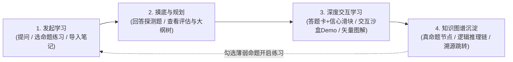
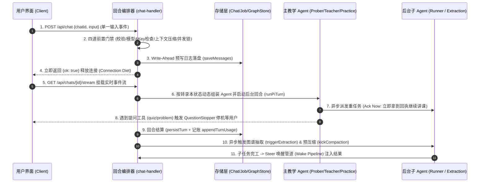
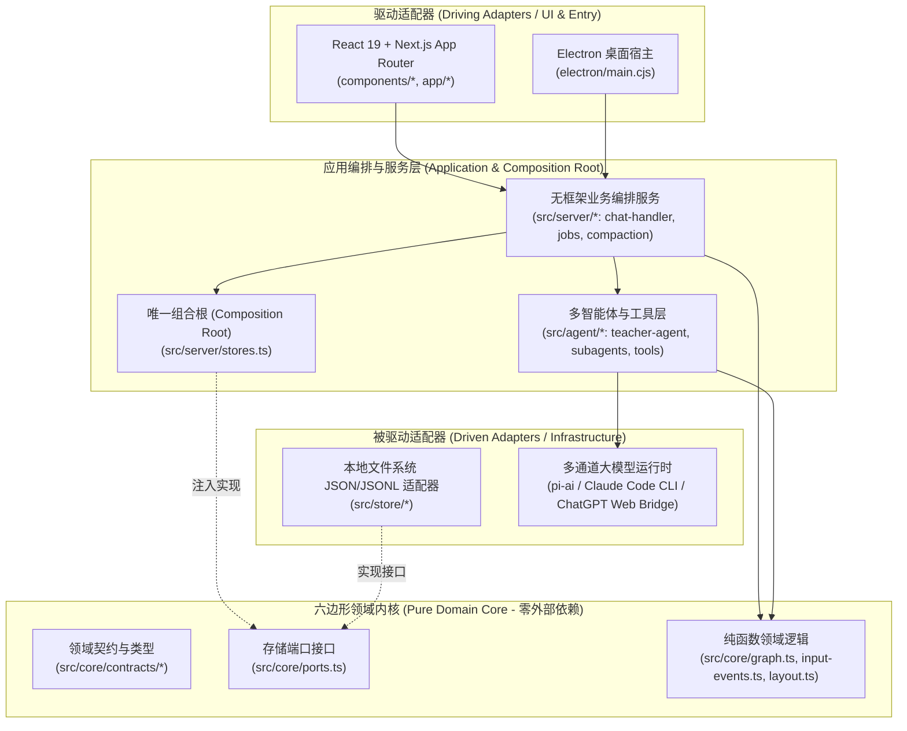

# LearnHarness 三维全景透视：用户视角 · 系统视角 · 技术视角

本文档从 **用户视角（User Perspective）**、**系统视角（System Perspective）** 与 **技术视角（Technical Perspective）** 三个维度，结合源码结构与核心模块，对 **LearnHarness** 进行全方位、立体化的透视与解构。

---

## 1. 用户视角（User Perspective）：学习者体验到的交互全貌

从学习者（Learner）打开应用到完成知识沉淀，用户感知到的是一套 **“探测边界 → 规划大纲 → 启发教学/专项练习 → 图谱生长”** 的完整学习闭环：

### 1.1 向系统发出问题与开启学习（Initiate & Ask）
* **开启新会话（Teach / Practice 双模式）**：
  * **教学模式（Teach）**：在首页（`components/home.tsx` / `components/new-session.tsx`）输入想学的主题开启全新的启发式教学会话。
  * **专项练习模式（Practice）**：在知识图谱上勾选若干个已学知识命题（Propositions），开启针对性的刷题与解题训练会话。
* **多模态与富交互输入**：在底部输入栏（`components/composer.tsx`）除了打字提问，还支持：
  * **本地文件/PDF 引用**：通过拖拽或 `@` 路径选择器（`components/path-input.tsx`、`components/file-path-drop-zone.tsx`）把本地笔记、代码或 PDF 教材喂给系统。
  * **语音听写（Dictation）**：点击麦克风（`components/dictation.tsx`）直接用语音口述解题思路或提问。
* **中途插话（Mid-Turn Steer）**：当 AI 正在长篇推理或执行工具时，用户无需干等，可以直接在输入框发送补充说明，消息会进入排队栏（`components/queued-steers.tsx`），在当前步骤间隙立刻被老师读取并动态调整教学方向。

### 1.2 回答系统的问题（Answer & Practice）
系统不是单向灌输的聊天机器人，而是高频通过底部停靠栏（Dock）向用户发问：
* **结构化测验卡片（`components/question-dock.tsx`）**：
  * **选择题（Quiz / Multiple Choice）** 与 **自由回忆简答题（Explain / Free Recall）**。
  * **信心滑块（`components/confidence-rail.tsx`）**：回答时不仅选答案，还要标记自己的确定程度（“猜的 / 有点印象 / 非常确定”），帮助老师识别“蒙对的盲区”或“过度自信的谬误”。
  * **澄清问卷（`ask_user_question`）**：老师用来了解你的技术背景、学习目标或节奏偏好。
* **练习模式解题台（`components/practice-dock.tsx`）**：在练习模式下，系统抛出综合应用题（`problem`），用户在专属解题框中分步提交自己的思考推导过程（`thinking`），直到攻克题目或点击下一题（`next`）。
* **跳过/忽略问题（Dismiss）**：不想答或觉得已经掌握的题目可以一键跳过，不阻塞对话推进。

### 1.3 看到系统的提示、大纲与教学过程（Prompts, Plan & Feedback）
* **思维链与实时工具状态**：实时看到 AI 正在思考（`components/thinking-block.tsx` / `components/reading-thinking.tsx`）、正在查阅文件或调用工具（`components/artifacts/live-tool-card.tsx`）。
* **探测完成与阶段分割线**：当摸底结束，界面出现阶段分割卡片（`components/artifacts/probe-done-card.tsx` & `components/phase-divider.tsx`），展示老师对你的先验知识评估报告，并无缝切换到正式教学阶段。
* **动态课程大纲树（`components/plan-block.tsx` / `components/plan-window.tsx`）**：在对话流和右上角悬浮窗中，实时看到当前课程的知识树（哪些章节已完成、当前正在攻克哪个概念节点、后续还有哪些分支）。

### 1.4 看到并操控系统生成的富媒体教学工件（Interactive Artifacts）
老师在讲课过程中会召唤后台帮手制作可视化教具，直接嵌入在对话流中：
* **可交互沙盒演示（`components/artifacts/demo-card.tsx`）**：例如讲物理引擎、算法排序或数学函数时，直接生成一个带滑块、按钮的 HTML/JS/Canvas 交互实验台，用户可以边调参数边观察规律。
* **高清矢量插图（`components/artifacts/visual-card.tsx`）**：定制生成的 SVG 架构图、几何图解（支持深浅色主题一键反色 `components/artifacts/invert-disc.tsx`）。
* **深度资料检索与 PDF 研读简报（`components/artifacts/job-card.tsx`）**：带有网页来源链接或精确到 PDF 页码引用（`pagesRead` / `pagesConsulted`）的结构化调研卡片。

### 1.5 看到系统构建的知识图谱（Knowledge Graph）
* **全局命题与推理链画布（`components/graph-view.tsx` & `components/graph-canvas.ts`）**：
  * 图谱上的每一个节点不是笼统的“名词”，而是一个**精确、自包含的真命题（Proposition）**（如 *"先序遍历的第一个节点必定是根节点"*）。
  * 节点之间通过**逻辑推理链（Reasoning Chains）**连接（前提 $P_1, P_2 \rightarrow$ 蕴含汇合点 $\rightarrow$ 结论 $C$），还会按诞生会话自动聚类生成群落边界（Cluster Hulls）。
* **溯源下钻与外部笔记导入**：
  * 点击图谱上的任意命题（`components/graph-context-card.tsx`）或打开推理链表（`components/chain-table.tsx`），可以直接看到它是在哪次会话、哪条消息里学到的，点击即可**深链接跳转（Deep-link）**回当时的对话现场。
  * 支持将外部本地 Markdown/文本笔记批量导入图谱（`components/notes-import.tsx`），与对话学到的知识自动融合。

### 1.6 其他用户侧感知（Observability & Control）
* **后台任务监控与紧急中止（`components/activity-dock.tsx` / `components/abort-turn-dialog.tsx`）**：随时查看后台正在跑的制图、写 Demo、图谱抽取任务，支持随时单独掐断某个慢任务。
* **Token 账单与上下文水位线（`components/stats-bar.tsx` / `components/extraction-coverage.tsx`）**：透明展示每次对话、每个后台子任务的 Token 消耗、缓存命中率、精确美元花费（Money Channel）以及哪些消息已被抽取入图。
* **高度可定制工作台（`components/settings/settings-dialog.tsx`）**：配置多档位模型槽位（Strong / Fast）、自带密钥（BYOK）、绑定本地 Claude Code 或网页版 ChatGPT 订阅，甚至直接在线改写和开关系统内置的每一段教学 Prompt 片段。

---

## 2. 系统视角（System Perspective）：端到端业务流转与编排机制

站在系统运行时（Server & Application Service 层，核心位于 `src/server/chat-handler.ts`）的角度，每一次交互都是一场严密的状态机流转：

### 2.1 接收消息与前置门禁（Receive & Gatekeeping）
1. **单事件输入契约（`src/core/input-events.ts` -> `parseChatInput`）**：服务端绝不信任或接收客户端传来的完整历史列表，只接收当前发生的**单一语义事件**（`text` | `answer` | `thinking` | `next` | `continue` | `retry` | `steers`）。
2. **孤儿校验与并行问题门禁（Parallel-Question Gate）**：如果老师一次性出了 2 道题，用户刚答完第 1 道，系统会先落盘该答案并立即静默返回，**推迟唤醒 AI**，直到最后一道兄弟问题也答完，保证所有 `toolResult` 紧贴在对应的 `assistant` 消息之后，满足大模型 API 严格的协议顺序要求。
3. **BYOK 模型与密钥门禁（Universal Turn Gate & Key-Presence Gate）**：检查当前会话绑定的模型槽位与 API Key（或订阅连接状态），缺失时在产生任何状态副作用前诚实返回结构化的 `503` 错误包，绝不在流式输出中途崩溃。
4. **上下文压缩门禁（`src/server/compaction.ts` -> `ensureCompacted`）**：若当前会话 Token 超过阈值，在进入回合前同步等待正在进行的压缩或立即执行历史摘要压缩。
5. **单会话互斥锁（`src/server/turn-liveness.ts` -> `beginTurn`）**：同一 `chatId` 严禁并发运行两个回合（冲突直接拒绝并返回 `409`）。

### 2.2 保存会话与预写持久化（Write-Ahead & Settlement Persistence）
* **Write-Ahead Persistence（预写落盘）**：在真正调用大模型之前，系统先将用户的输入事件转化为原生消息追加到记录中，调用 `stores.chatStore.saveMessages` 写入磁盘。哪怕下一秒断电或刷新浏览器，用户的回答也绝不会丢失。
* **连接瘦身策略（Connection Diet）**：`POST /api/chat` 确认回合启动后立即返回 `{ ok: true }` 并关闭 HTTP 连接（不占用浏览器同源 6 个连接的宝贵配额）；前端统一通过复用的 `GET /api/chats/[id]/stream` 订阅流式输出，且支持刷新页面后无缝重连（Reattach）。
* **回合结算落盘（`src/server/turn-service.ts` -> `persistTurn`）**：回合结束时，将本轮产生的新消息、耗时与 Token 明细（`appendTurnUsage`）、中途暂存的忽略指令（`applyParkedDismissal`）一并原子化写入会话文件，最后才释放 `endTurn` 锁。

### 2.3 动态构建并调用 Agent（Stateless Per-Turn Agent Construction）
系统采用 **“转录本即状态（The Record IS the Agent State）”** 的无状态设计。每次请求都会根据当前会话记录动态实例化以下三种主 Agent 之一（`src/agent/teacher-agent.ts`）：
1. **Prober（摸底探测员）**：新教学会话默认启动。只配备提问工具（`quiz`, `ask_user_question`）和可选的读图工具，职责是通过追问摸清学习者的知识边界，最后调用 `probe_done` 出具评估报告。
2. **Teacher（主讲教师）**：一旦系统在历史消息中检测到 `probe_done` 标记（`hasProbeDone`），立刻切换为 Teacher。拥有完整的课程规划工具（`plan_init`, `plan_update`）、带知识点 ID 校验的测验工具以及派发后台子任务的能力。
3. **Practitioner（专项教练）**：当会话类型为 `kind: "practice"` 时从第一回合起全程接管，无需摸底与规划，只配备出题（`problem`）与结题（`conclude`）工具。

### 2.4 异步派发子 Agent 与唤醒管道（Sub-agents & "Ack Now, Steer Later"）
当老师需要查资料（`research`）、写交互代码（`demo`）、画 SVG 图（`visual`）或读大块 PDF（`pdf`）时，系统**绝不阻塞主对话**：
* **立即回执（Ack Now）**：工具在毫秒级内创建 `JobRecord` 并拉起后台工作流（`src/agent/subagents/runner.ts`），同时立即向主 Agent 返回 `"dispatched — continue your turn"`。老师可以继续往下讲课或并行派发其他任务。
* **自验证闭环（Verify-Never-One-Shot）**：后台子 Agent 在独立上下文中运行：
  * `demo-builder`（`src/agent/subagents/demo-builder.ts`）会启动无头浏览器（Puppeteer）实际运行生成的 HTML/JS 并捕获控制台异常或渲染错误；
  * `visual-maker`（`src/agent/subagents/visual-maker.ts`）会把 SVG 光栅化成 PNG 图片亲自“看一眼”排版是否有重叠，验证无误后才交付。
* **稍后唤醒（Steer Later）**：子任务完工后，调用 `deliverJobResult`（`src/server/jobs.ts`）生成幂等的 `subagent-steer` 消息。若主 Agent 仍在运行，直接通过 `agent.steer()` 注入当前循环；若主 Agent 已空闲（且没有悬而未决的提问），则由唤醒泵（Wake Pump）自动触发一轮后台跟进回合，把做好的 Demo/图表自然地讲解给用户。

### 2.5 提问即停机与后台知识沉淀（Question-Stop, Extraction & Compaction）
* **提问停机钩子（`makeQuestionStopper`）**：只要 AI 成功发出了测验（`quiz`）或练习题（`problem`），且参数通过校验，系统立刻通过 `finishTurn` 钩子终止当前回合，把控制权交还给用户作答；若题目格式校验失败，则允许大模型在当前回合内自动重试修正。
* **后置知识图谱抽取流水线（`src/agent/subagents/extraction.ts`）**：
  * 每当对话积累了足够的新内容（达到 `extractionChunkTokens`），回合结束时会自动触发 **Extractor（提取器） → Auditor（审计员） → Merger（合并器）** 三段式流水线。
  * **Extractor** 从对话视图中提取出独立的真命题（`ExtractedProposition`）与推理链（`ExtractedChain`），并标注来源 `messageId`。
  * **Auditor** 借助图检索工具（`find`, `list_propositions`）比对现有图谱，做出**等价合并裁决（`IdentityLink`：Link-or-Create）**，防止同一个知识点因为换了种表述而重复建节点。
  * **Merger**（`src/core/graph.ts`）执行确定性合并，追加写入账本，并运行增量力导向布局（`src/core/layout.ts` -> `settleGraphLayout`）计算节点静态坐标。
* **间隙静默压缩（The Settle Kick）**：在用户阅读和思考答题的停顿间隙，后台静默启动 `kickCompaction`，将早期长对话浓缩为高保真教学摘要，确保下一轮用户提交答案时无需等待压缩。

---

## 3. 技术视角（Technical Perspective）：软件工程与架构设计哲学

从代码组织与底层技术选型来看，LearnHarness 是一个极度克制、高内聚低耦合、为可测试性而生的现代全栈系统：

### 3.1 六边形架构（Hexagonal Architecture）：端口与适配器
系统严格遵循**单向依赖法则（Dependencies point inward）**，将架构划分为清晰的四层：
1. **纯净领域内核（`src/core/`）**：
   * 包含所有领域契约（`src/core/contracts/*`）、纯函数状态机与业务规则（如图谱推导、消息转换、输入事件校验、价格计算）。
   * **架构铁律**：`core` 层**绝不导入**任何文件系统、数据库、HTTP 框架或具体适配器代码。
2. **领域存储端口（`src/core/ports.ts`）**：
   * 按领域实体定义细粒度接口，拒绝笼统的泛型 Key-Value 接口：
     * `ChatStore`（会话生命周期、消息持久化、大纲树、计费日志）
     * `GraphStore`（命题节点、推理链、覆盖率账本、坐标账本、原子重写接口 `rewriteLedgers`）
     * `JobStore`（后台子任务创建、更新、按 `toolCallId` 去重查询）
     * `SettingsStore`、`PromptOverrideStore`、`AuthStore`、`SourceOrganizationStore`
3. **存储适配器实现（`src/store/`）**：
   * 目前基于本地文件系统（JSON 与 Append-only JSONL）实现了上述所有 Port，利用临时文件原子重命名（Atomic temp-file rename）保障崩溃安全性（Crash-safe），且密钥文件权限严格控制在 `0600`。
4. **唯一组合根（`src/server/stores.ts`）**：
   * 全系统**唯一**将 `src/store/*` 具体适配器绑入 `src/core/ports.ts` 接口的地方，并通过 `traceObject` 自动挂载可观测性日志切面。未来若要将文件系统替换为 SQLite，只需修改 `src/store/` 和 `stores.ts` 这一个装配点，上层业务与核心代码一行不用改。

### 3.2 事件溯源与推导视图（Append-Only Ledgers & Derived State）
在知识图谱与计费系统的设计上，系统采用了典型的 **Event Sourcing（存事件，算状态）** 思想：
* **只追加账本（JSONL Ledgers）**：`nodes.jsonl`、`chains.jsonl`、`coverage.jsonl`、`sessions.jsonl` 全部采用单行追加写入。
* **推理链优先，边是派生视图（Chains-Primary, Edges Derived）**：磁盘上只存储命题节点（`GraphNode`）和推理链断言（`GraphChain`：一组前提共同推出一个结论）。前端画布渲染所需的有向边（`GraphEdge`）、逻辑深度（`logicalEdges`）、多前提汇合虚节点（Implication Nodes）以及按会话派生的群落聚类（`src/core/session-clusters.ts`），全都是在读取时由 `src/core/graph.ts` **纯函数实时折叠推导**出来的。
* **指纹驱动的增量覆盖率（Fingerprint Coverage）**：系统不维护复杂的“未抽取消息状态机”，而是对每条已抽取的消息计算 SHA-256 内容指纹记入 `coverage.jsonl`（`src/core/coverage.ts`）。用当前会话转录本的指纹集与账本做一次集合差集（Diff），就能绝对精确地算出哪些消息需要抽取（甚至当某道测验题被用户回答后，该消息指纹自动变化，精准触发单条重抽）。

### 3.3 原生消息模型与边界降维（Native Transcript & `toLlmMessages` Seam）
* **单一事实源转录本（`src/core/native-messages.ts`）**：会话记录中的 `LhMessage[]` 同时承载了标准 LLM 对话消息和系统级自定义标记（`role: "custom"`，如 `subagent-steer`、`plan-block`、`compaction`、`problem-dismissed`）。
* **模型边界转换器（`toLlmMessages`）**：在发往大模型的一瞬间，通过 `convertToLlm: toLlmMessages` 将自定义标记优雅降维成标准的 User/Assistant/Tool 消息：
  * 自动过滤掉纯 UI 展示的 `plan-block`；
  * 把后台子任务产物的 `details` 大对象（如完整 HTML/SVG 源码）剥离，只留 `content` 文本摘要喂给主讲老师，节约大量上下文窗口；
  * 为被用户强行中断的悬空提问自动补齐 `INTERRUPTED` 工具结果，防止大模型 API 报协议错误。
* **工具参数自愈与 ID 唯一化（Self-Healing & Uniquifier）**：
  * `withArgumentHeal`（`src/agent/tools/heal.ts`）自动修复大模型常见的 JSON 序列化畸变（如多套了一层 `options` 字符串或布尔值转义错误）。
  * `collectToolCallIds`（`src/server/pi/call-ids.ts`）针对部分模型（如 DeepSeek）在多轮对话中重置 `tool_call_id` 导致 ID 冲突的问题，在协议边界自动重写并保持会话内全局唯一。

### 3.4 多通道大模型运行时桥接（Multi-Provider Runtime & Bridges）
系统底层基于 `@earendil-works/pi-agent-core` 与 `pi-ai` 构建，但向上封装了极其灵活的三大执行通道：
1. **标准 BYOK API 通道（`src/agent/models.ts`）**：支持 Anthropic、OpenAI、Google Gemini、OpenRouter 以及任意兼容 OpenAI/Anthropic 协议的自定义端点（`src/server/custom-provider.ts`）。
2. **本地 Claude Code CLI 进程桥接（`src/agent/claude-code/`）**：能够直接复用用户机器上已登录的 `claude` CLI 二进制进程，通过进程池（`live-processes.ts`）、上下文复用（`reuse-context.ts`）和工具桥接（`tool-bridge.ts`）将本地 CLI 伪装成标准的流式模型引擎。
3. **Web 订阅会话桥接（`src/agent/subscription-bridge.ts` & `src/agent/chatgpt-bridge.ts`）**：支持通过内置浏览器授权复用网页版订阅额度，并专门设计了 `SubscriptionRequestCycle`（`src/agent/subscription-request-cycle.ts`）来严控后台任务（如自动唤醒、后台压缩）对用户订阅配额的消耗。

### 3.5 无框架服务端内核与确定性测试体系（Framework-Free Server & Deterministic Testing）
* **Web 标准 Request/Response 解耦**：Next.js 的 `app/api/**/route.ts` 几乎全都是只有 1~3 行代码的薄包装，真正的业务逻辑全在 `src/server/*` 中使用原生 Web 标准 `Request` / `Response` 编写。
* **Faux Engine 剧本式端到端单测**：因为服务端无框架耦合、Agent 按回合无状态构建且支持依赖注入 `PiEngine`，测试套件（`tests/*.test.ts`）无需启动 HTTP 服务器或消耗真实 Token，直接注入脚本化的假引擎（Scripted Faux Engine），就能在毫秒级内对多轮探测、并发答题、中途插话、崩溃恢复、图谱抽取进行 100% 确定性的全链路回归验证。

---

## 4. 三维视角对照速查表

| 核心场景 | 用户视角 (What Learner Sees) | 系统视角 (How System Orchestrates) | 技术视角 (How Code is Engineered) |
| :--- | :--- | :--- | :--- |
| **提问与对话** | 发消息、拖拽本地文件、语音听写、中途插话 | 单事件契约 → 四道门禁 → 预写落盘 → 后台运行回合 | `ChatInput` 判别联合类型 + Connection Diet + SSE Reattach |
| **互动测验** | 底部答题卡、选信心指数、解题推导框、跳过题目 | 并行问题门禁 + QuestionStopper 停机 + 静默 Dismiss 路由 | `finishTurn` 钩子 + `danglingQuestionOf` + 原生 `toolResult` 映射 |
| **角色切换** | 先摸底提问 → 出评估卡片 → 展现课程大纲树正式讲课 | 检测转录本中的 `probe_done` 工具调用自动切换 Agent 工厂 | 无状态 Per-Turn Agent 重建（`Prober` / `Teacher` / `Practice`） |
| **富媒体教具** | 边听课边玩 HTML 交互沙盒、看定制 SVG 图与文献简报 | "Ack Now, Steer Later" 异步派发 + 子 Agent 无头验证 + 唤醒管道 | `JobStore` 端口 + Puppeteer/Resvg 自检循环 + `agent.steer()` 注入 |
| **知识图谱** | 命题节点、推理链画布、群落边界、点击跳回原对话消息 | 回合后置触发 `Extractor → Auditor → Merger` 三阶段流水线 | JSONL 只追加账本 + 推理链派生有向边 + 指纹差集覆盖率 (`sha256`) |
| **数据与模型** | 自由切换模型槽位、查看每一步美元账单、修改系统 Prompt | 按角色解析模型链 (`resolveRoleSpec`) + 间隙静默压缩 (`kickCompaction`) | 六边形架构（`ports.ts` + `stores.ts` 组合根）+ 多通道 Bridge |
