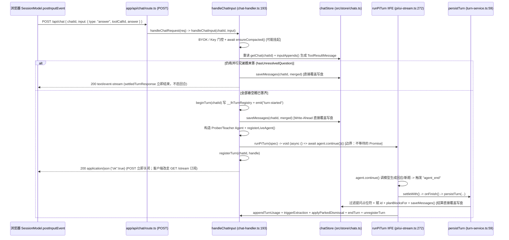

# 用户答题 `POST /api/chat` 完整物理执行流追踪（`route.ts` → `persistTurn` 落盘）

**总览**：客户端提交 `{ chatId, input: { type: "answer", toolCallId, answer } }` 后，HTTP 请求在服务端同步完成门控校验、上下文压缩等待、悬空题匹配、抢占 `beginTurn` 存活锁、**Write-Ahead 先行落盘答题 `ToolResultMessage`**，随后启动不等待的后台 Agent 循环并**立即关闭 POST 连接返回 `{ ok: true }`**（Connection Diet B）；后台 Agent 循环独立驱动模型反馈，并在 `agent_end`（或循环异常）处同步调用 `settleWith → onFinish → persistTurn` 将本轮生成消息覆盖写盘，最后按序释放锁与注册表。



---

## 物理生命周期切分总表

根据异步脱离边界（不等待的 IIFE `void (async () => { ... })()` 与流事件结算回调），从 `route.ts` 到 `persistTurn` 严格切分为 **3 条物理链路**：

| 链路编号 | 物理阶段名称 | 起点 → 终点 (`path:line`) | 跨链路边界类型 |
|---|---|---|---|
| **链路 A** | **HTTP 接收、前置门控、Write-Ahead 写盘与后台回合点火** | `POST`（`app/api/chat/route.ts:3`）→ `return Response.json({ ok: true })`（`src/server/chat-handler.ts:735`） | `runPiTurn` 内启动 `void (async () => { await agent.continue(); ... })()`（`src/server/pi/ui-stream.ts:272`）—— **不等待的 Promise**；POST 连接在 `:735` 立即返回关闭 |
| **链路 B** | **后台 Agent 循环执行、事件折叠缓冲与问题停止器截断** | `void (async () => { ... })()`（`src/server/pi/ui-stream.ts:272`）→ `handle` 收到 `event.type === "agent_end"`（`src/server/pi/ui-stream.ts:259`）或 `catch`（`:285`） | `@earendil-works/pi-agent-core` 的 `agent.subscribe` 同步事件回调触发 `settleWith()`（`:261`） |
| **链路 C** | **回合结算、`persistTurn` 权威落盘与尾声状态清算** | `settleWith()`（`src/server/pi/ui-stream.ts:231`）→ `onFinish`（`src/server/chat-handler.ts:613`）→ `persistTurn`（`src/server/turn-service.ts:59`）及后续注册表释放（`chat-handler.ts:665-720`） | 纯同步写盘与内存注册表清理（其中 `triggerExtraction` 与 `kickCompaction` 以 fire-and-forget 派发后续独立后台任务，超出本文终点） |

---

## 链路 A：HTTP 接收、Write-Ahead 落盘与后台回合点火

### 阶段一：触发入口与输入

1. **Next.js App Router 路由入口**（`app/api/chat/route.ts:3-5`）：
   ```ts
   export async function POST(req: Request) {
   	return handleChatRequest(req);
   }
   ```
   - 触发方：客户端 `SessionModel.postInputEvent()`（`components/session-core.ts:348-368`）发起 `POST /api/chat`，请求头 `Content-Type: application/json`，请求体 JSON 字符串 `{ chatId: string, input: { type: "answer", toolCallId: string, answer: QuestionAnswerData } }`（注：客户端在发请求前已在 `:714-718` 向内存 `this.tail` 推入了一条 `c_` 前缀本地 ID 的乐观 `ToolResultMessage`）。
2. **框架无关请求解析入口**（`src/server/chat-handler.ts:164-187`）：
   ```ts
   export async function handleChatRequest(
   	req: Request,
   	buildAgent?: (opts: AgentBuildOptions & { teaching: boolean }) => TeachingAgent,
   ): Promise<Response>
   ```
3. **回合编排主函数**（`src/server/chat-handler.ts:193-198`）：
   ```ts
   export async function handleChatInput(
   	chatId: string,
   	input: TurnInput,
   	buildAgent?: (opts: AgentBuildOptions & { teaching: boolean }) => TeachingAgent,
   	clientLanguageHint?: string,
   ): Promise<Response>
   ```
   - 答题路径下 `input` 经 `parseChatInput(body.input)`（`src/core/input-events.ts:163`）收窄为：`{ type: "answer"; toolCallId: string; answer: QuestionAnswerData }`（`src/core/input-events.ts:50`）。

### 阶段二：前置守卫与内存状态

#### 1. 涉及的内存锁与注册表（按获取顺序）

| 注册表 / 锁 | 数据结构 | 存放位置 (`path:line`) | 作用域 | 本链路获取 / 写入点 (`path:line`) |
|---|---|---|---|---|
| **压缩单飞表** | `{ inFlight: Map<string, Promise<void>> }` | `globalThis.__lhCompaction`（`src/server/compaction.ts:124-126`） | 单进程 RAM，跨 Next dev 路由模块共享，重启清空 | `ensureCompacted`（`src/server/chat-handler.ts:295` → `src/server/compaction.ts:285,292`）：若同 `chatId` 有压缩在跑则 `await` 等待；若仍超阈值则置入新 `Promise` 并在 `:296` `finally` 删除 |
| **回合存活互斥锁** | `Map<string, number>` (`chatId → Date.now()`) | `globalThis.__lhTurnRegistry`（`src/server/turn-liveness.ts:27-32`） | 单进程 RAM，跨路由模块共享，带 `MAX_TURN_MS = 30 * 60_000` 惰性过期（`:36,71`） | `beginTurn(chatId)`（`src/server/chat-handler.ts:371`）原子检查并写入；若后续启动前报错，在 `:395` 或 `:739` 调用 `endTurn(chatId)` 释放 |
| **活跃 Agent 转向表** | `WakeState.liveAgents: Map<string, Agent>` 与 `queues` / `userSteers` | `globalThis.__lhWakePipeline`（`src/server/jobs.ts:132-137`） | 单进程 RAM，跨路由模块共享 | `registerLiveAgent(chatId, constructed, true, undefined)`（`src/server/chat-handler.ts:568`）；启动异常时在 `:742` `unregisterLiveAgent(chatId)` |
| **运行中回合句柄表** | `Map<string, PiTurnHandle>` | `globalThis.__lhTurnRuns`（`src/server/turn-runs.ts:34-40`） | 单进程 RAM，供 `GET /api/chats/[id]/stream` 重连与远程 Abort 查找 | `registerTurn(chatId, handle)`（`src/server/chat-handler.ts:724`） |

#### 2. 进入主逻辑前的每个早退 / 拒绝分支（按源码严格顺序）

1. `await req.json()` 解析抛异常 → 返回 HTTP `400` `Response.json({ error: "Invalid JSON body" })`（`src/server/chat-handler.ts:169-173`）。
2. `!chatId`（非字符串或空串）→ 返回 HTTP `404` `{ error: "Unknown chat" }`（`:175`）。
3. `parseChatInput(body.input)`（`src/core/input-events.ts:163-181`）：
   - `typeof input !== "object" || input === null` → `throw new ChatInputError("input must be an object")`；
   - `typeof i.toolCallId !== "string" || i.toolCallId.length === 0` → `throw new ChatInputError("answer input requires toolCallId")`；
   - `typeof i.answer !== "object" || i.answer === null` → `throw new ChatInputError("answer input requires the graded answer object")`；
   - 被 `handleChatRequest` 捕获 `err instanceof ChatInputError` → 返回 HTTP `400` `{ error: err.message }`（`chat-handler.ts:179-183`）。
4. `let record = stores.chatStore.getChat(chatId)` 为 `null`（文件不存在、JSON 损坏、或 `version > CURRENT_CHAT_VERSION`，`src/store/chats.ts:61-76`）→ 返回 HTTP `404` `{ error: "Unknown chat" }`（`chat-handler.ts:199-203`）。
5. `input.type === "retry"` / `"retry-question"` 分支（`:218-233`）：当前为 `"answer"`，不命中。
6. **BYOK 模型槽位门控**：`const conversation = resolveConversationSpec(record.settings, effective.models.strong)` 为空 → 返回 HTTP `503` `modelsNotConfigured(["strong"])`（`:245-250`）。
7. **Provider 密钥门控**：
   - 若 `isSubscriptionProvider(conversation.provider)` 为真，先 `await refreshConnectionCatalog(conversation.provider)`（`:261-262`）；
   - `!providerKeyPresent(conversation.provider)` → 返回 HTTP `503` `providerKeyMissingEnvelope(conversation.provider, ["strong"])`（`:267-271`）。
8. **引擎构造失败门控**：`piEngineForSpec(...)` 抛异常 → 返回 HTTP `503` 错误 JSON（`:292-293`）。
9. **压缩后会话消失守卫**：`await ensureCompacted(...)`（`:295-309`）返回后，重读 `const compactedRecord = stores.chatStore.getChat(chatId)`；若在等待压缩期间会话被删（返回 `null`）→ 返回 HTTP `404` `{ error: "Unknown chat" }`（`:310-311`）。
10. **悬空问题匹配守卫（Orphan-400 Discipline）**：调用 `inputAppends(record, input)`（`:336` → `src/core/input-events.ts:215-220`）：
    - 内部执行 `const pending = danglingQuestionOf(record.messages)`（`src/core/native-messages.ts:672`）；
    - 条件 `!pending || pending.toolCallId !== input.toolCallId`（例如该题已被回答过、题号拼错、或所属助手消息是 `error`/`aborted`/畸形题）→ `throw new ChatInputError("answer input targets no pending question call")`；
    - 被 `chat-handler.ts:337-342` 捕获 → 返回 HTTP `400` `{ error: err.message }`（**此时尚未调 `beginTurn`，不产生任何存活锁副作用**）。
11. **并行多问题延迟唤醒门控（Parallel-Question Gate）**（`src/server/chat-handler.ts:356-366`）：
    - 条件：`input.type === "answer" && hasUnresolvedQuestion([...record.messages, ...appends])`（即同一条助手消息同时问了 `quiz` + `ask_user_question` 两道题，当前只答了第一道，第二道仍处于未决状态）。
    - 动作：同步调用 `stores.chatStore.saveMessages(chatId, merged)` 把刚答的这一题结果落盘（写盘失败回 HTTP `500`），发射 `emit("record-changed", { chatId })`，然后**直接返回 `settledTurnResponse()`**（HTTP `200`，SSE 内容为 `data: {"type":"turn-settled"}\n\ndata: [DONE]\n\n`），**不调用 `beginTurn`、不启动大模型回合**，留待最后一道兄弟题作答时一并唤醒模型（验证见 `tests/chat-flow.test.ts:1498-1530`）。
12. **单会话并发互斥门控**：`if (!beginTurn(chatId))` → 返回 HTTP `409` `{ error: "A turn is already running for this session" }`（`chat-handler.ts:371-375`）。

### 阶段三：调用链与数据变换

按实际执行顺序列出（此时已通过上述所有早退门控，`input.type === "answer"`）：

1. **`await req.json()`**（`chat-handler.ts:170`）→ **`parseChatInput(body.input)`**（`:178` → `src/core/input-events.ts:163`）
   - `unknown` → `ChatInput` 分支 `{ type: "answer", toolCallId: string, answer: QuestionAnswerData }`。
2. **`stores.chatStore.getChat(chatId)`**（`chat-handler.ts:199` → `src/store/chats.ts:61`）
   - 同步 `fs.readFileSync` 解析 `data/chats/<chatId>.json` → `ChatRecord`。
3. **`effectiveSettings()`**（`chat-handler.ts:244` → `src/server/stores.ts:46`）→ **`resolveConversationSpec(record.settings, effective.models.strong)`**（`src/core/settings-resolution.ts`）→ **`piEngineForSpec(...)`**（`chat-handler.ts:292`）
   - 解析出 `{ model, streamFn, level }` 结构的 `conversationEngine: PiEngine`；对于 `"answer"` 输入，`callPurpose.background` 为 `false`（`:283`）。
4. **`await ensureCompacted(deps, chatId)`**（`chat-handler.ts:295-309` → `src/server/compaction.ts:280`）—— **异步 `await` 点**
   - 若 `process.env.NODE_ENV === "test" && !deps.summarize` 则立即早退（`compaction.ts:284`）；
   - 否则 `await awaitCompaction(chatId)` 等待上一轮结算 `kickCompaction` 可能遗留的压缩 Promise，若仍超阈值则同步跑完一次摘要压缩并追加 `compaction` Marker。
5. **重读权威记录**：`record = stores.chatStore.getChat(chatId)!`（`chat-handler.ts:310-312`）。
6. **折叠生成原生工具结果 `inputAppends(record, input)`**（`chat-handler.ts:336` → `src/core/input-events.ts:215-220` → `newAnswerResult` `src/core/native-messages.ts:206-223`）
   - **关键数据形变**：`{ type: "answer", toolCallId, answer: QuestionAnswerData }` → 单元素数组 `[LhMessage & ToolResultMessage]`：
     ```ts
     {
       id: `msg_${Date.now().toString(36)}_${crypto.randomUUID().slice(0, 8)}`, // newMessageId()
       role: "toolResult",
       toolCallId: input.toolCallId,
       toolName: pending.tool, // 如 "quiz" | "probe" | "ask_user_question" | "explain" | "recall"
       content: [{ type: "text", text: JSON.stringify(compactAnswerForModel(answer)) }], // 模型只读精简版
       details: answer, // UI 与持久层保留完整 QuestionAnswerData
       isError: false,
       timestamp: Date.now(),
     }
     ```
7. **加存活锁 `beginTurn(chatId)`**（`chat-handler.ts:371` → `src/server/turn-liveness.ts:45-51`）
   - 同步清除旧错误通知 `clearTurnFailure(chatId)`，写入 `inFlight.set(chatId, Date.now())`，同步广播 `emit("turn-started", { chatId })`。
8. **构造合并消息数组与 Write-Ahead 写盘**（`chat-handler.ts:383-398`）
   - `const merged: LhMessage[] = [...record.messages, ...appends]`；
   - 因 `input.type === "answer"`，`stagedAutomatic` 为 `false`（`:389`），`persistBaseCount = agentMessages.length`（即包含刚追加的答题 `ToolResultMessage` 在内的已有消息总数，`:390`）；
   - 调用 `stores.chatStore.saveMessages(chatId, merged)`（`:392`）先行落盘；
   - 调用 `noteSteersDurable(chatId, merged)`（`:399` → `src/server/jobs.ts:182`）。
9. **无状态重建当轮对话 Agent**（`chat-handler.ts:424-548`）
   - `const teaching = hasProbeDone(agentMessages)`（`:424` → `src/core/native-messages.ts:766`）：扫描记录中是否已有成功的 `probe_done` 工具结果；
   - `asAgentMessages(agentMessages)`（`:448` → `native-messages.ts:118`）将 `LhMessage[]` 原样作为 `initialState.messages` 传入：
     - 若 `record.kind === "practice"` → `createPracticeAgent(...)`（`:481`）（注：练习模式无 `quiz` 答题工具，通常不走 `"answer"`）；
     - 若 `teaching === true` → `createTeacherAgent(ctx, agentOpts)`（`:505`，装载 `teachQuizToolFor`/`teachExplainToolFor`、`plan_init`、文件读取与后台子任务工具）；
     - 若 `teaching === false` → `createProberAgent(ctx, agentOpts)`（`:517`，装载 `probe`/`recall`、`ask_user_question`、`probe_done` 等）；
   - 在 `baseAgentOptions`（`src/agent/teacher-agent.ts:194-292`）中 `new Agent({ ... })` 挂载：
     - `convertToLlm: toLlmMessages`（`:259`）；
     - `finishTurn: (turn) => (stopper(turn) ? { action: "end" } : undefined)`（`:243`）；
     - `steeringMode: "all"`（`:251`）；
     - `agent.subscribe` 用量收集器 `collectUsage`（`:279-289`）。
10. **注册活跃 Agent 并排空滞留 Steer**：`registerLiveAgent(chatId, constructed, true, undefined)`（`chat-handler.ts:568` → `src/server/jobs.ts:295-303`）
    - **物理时序关键点**：必须在 `runPiTurn` **之前**同步调用！若在用户思考答题期间，后台 `research`/`demo`/`visual` 子任务恰好完成了（因提问期间禁止唤醒而滞留在 `__lhWakePipeline.queues` 中），`registerLiveAgent` 内部的 `handOffEligible`（`jobs.ts:266-288`）会立即调用 `constructed.steer(entry.steer)` 将这些结果塞入新 Agent 的 steering 队列，使其搭上本轮答题反馈的**第一次 LLM 请求**。
11. **启动后台流运行器**：`const handle = runPiTurn({ chatId, agent: constructed, requestCycle, usedToolCallIds: new Set(collectToolCallIds(merged)), onError, onSettleError, onSettleFailure, onFinish })`（`chat-handler.ts:574-720` → `src/server/pi/ui-stream.ts:127`）
    - 同步创建 `ToolCallIdUniquifier`（`src/server/pi/call-ids.ts:62`，用已有记录中的所有 `toolCallId` 初始化防撞集合）、内存状态日志 `log: TurnWireEvent[]`、订阅者集合 `subscribers`；
    - 在 `:272` 触发 `void (async () => { ... })()` —— **跨链路异步边界（进入链路 B）**，同步返回 `PiTurnHandle { subscribe, abort }`。
12. **注册可重连句柄**：`registerTurn(chatId, handle)`（`chat-handler.ts:724` → `src/server/turn-runs.ts:64`）。

### 阶段四：写盘与副作用（按严格执行顺序）

| 顺序 | 动作 / 函数 (`path:line`) | 目标文件 / 内存目标 | 物理方式与类型 | 崩溃语义 |
|---|---|---|---|---|
| 1 | `ensureCompacted` 内的 `saveMessages` + `appendTurnUsage`（**仅当超阈值触发同步压缩时发生**，`src/server/compaction.ts:242,245`） | `PATHS.chats`（`config.ts:27`）下的 `data/chats/<chatId>.json` | `fs.writeFileSync`（`src/store/chats.ts:58`）— **直接覆盖** | 非原子写；若写盘途中进程被强杀，文件可能截断（`getChat` 下次读返回 `null`） |
| 2 | `beginTurn(chatId)`（`src/server/turn-liveness.ts:45-51`） | 内存 `globalThis.__lhTurnRegistry` + `globalThis.__lhEventBus` | `Map.set` + 同步调用所有 SSE 监听器推送 `"turn-started"` | 内存态，进程崩溃即清零 |
| 3 | **Write-Ahead 答题结果写盘**：`stores.chatStore.saveMessages(chatId, merged)`（`src/server/chat-handler.ts:392` → `src/store/chats.ts:126-132` → `writeChat` `:57-59`） | `data/chats/<chatId>.json`（由 `chatFile(id)` `src/store/chats.ts:23` 解析） | `fs.writeFileSync(file, JSON.stringify({ ...record, version: 1 }, null, "\t"))` — **直接覆盖** | 若写盘抛异常，`chat-handler.ts:393-397` 捕获后立即调 `endTurn(chatId)` 释放锁并返回 HTTP `500`；一旦写盘成功而进程随后在模型流式生成中途崩溃，**用户的答案已永久保存在磁盘记录末尾**（`needsContinuation(messages)` 为 `true`，下次打开页面自动发 `{ type: "continue" }` 补跑教师反馈，无需重答） |
| 4 | `registerLiveAgent`（`chat-handler.ts:568`）+ `providerEventNote`（`:573`，仅当 `process.env.LH_PROVIDER_EVENTS === "1"` 时 `fs.appendFileSync` 写 `data/debug/provider-events/<chatId>.jsonl`）+ `registerTurn`（`:724`） | `globalThis.__lhWakePipeline.liveAgents` / `globalThis.__lhTurnRuns` | 内存 `Map.set` | 进程重启即清空 |

### 阶段五：返回与资源释放

- **返回值**：`Response.json({ ok: true })`（HTTP `200`，`src/server/chat-handler.ts:735`）。
- **异常兜底释放**：若从 `registerLiveAgent` 到 `registerTurn` 之间同步抛错，`chat-handler.ts:736-745` 的 `catch (err)` 执行 `endTurn(chatId)` + `unregisterLiveAgent(chatId)`，返回 HTTP `500` `{ error: "Failed to start the turn" }`。
- **衔接机制（链路 A → 客户端视图重连 & 链路 B）**：
  1. **客户端衔接（Connection Diet B）**：客户端 `SessionModel` 在收到 `POST /api/chat` 的 `200 {"ok":true}` 后调用 `await res.text()` 释放连接（`components/session-core.ts:766`），紧接着在 `:771` 调用 `await this.resumeStream(true)`：先 `GET /api/chats/<chatId>` 拉取刚 Write-Ahead 落盘的权威记录原子替换 `this.base` 并清空乐观 `this.tail`（`:605-614`），再连接 `GET /api/chats/<chatId>/stream`（`app/api/chats/[id]/stream/route.ts:18`）调用 `runningTurn(id).subscribe()` 实时回放并监听后续 SSE 帧。
  2. **服务端内部衔接（链路 A → 链路 B）**：`runPiTurn` 内的异步自执行函数 `void (async () => { ... })()`（`src/server/pi/ui-stream.ts:272`）已被挂入微任务队列，它的返回值 `Promise<void>` 被 `void` 显式丢弃，内部自带顶层 `try / catch`（`:273-299`）全权兜底所有未捕获异常，绝不产生 `unhandledRejection`。

---

## 链路 B：后台 Agent 循环执行、流式折叠与停止器判定

### 阶段一：触发入口与输入

- **入口**：`runPiTurn`（`src/server/pi/ui-stream.ts:127`）内部的异步 IIFE（`:272-299`）：
  ```ts
  void (async () => {
  	try {
  		do {
  			await agent.continue();
  			...
  ```
- **输入状态**：`agent: Agent`（`@earendil-works/pi-agent-core` 实例），其 `agent.state.messages` 初始值为 `[...record.messages, newAnswerResult(...)]`（以及 `Agent` 内部在下标 `[0]` 合成的当轮 `SystemMessage`）。

### 阶段二：前置守卫与内存状态

- **内存状态（`runPiTurn` 闭包私有变量，`src/server/pi/ui-stream.ts:131-155`）**：
  - `settled: boolean = false`（防止重复结算与事件溢出）；
  - `sawAbort: boolean = false`（记录是否有消息 `stopReason === "aborted"` 或外部调用了 `handle.abort()`）；
  - `log: TurnWireEvent[] = []`（按状态压缩的内存重放日志）；
  - `updateSlots: Map<string, number>` 与 `pending: Map<string, TurnWireEvent>`（将高频 `message_update` / `tool_execution_update` 原地替换并以默认 `updateFlushMs = 100` ms 定时器合并推送给 `subscribers: Set<PiTurnSubscriber>`）。
- **前置守卫**：N/A — 进入该 IIFE 前链路 A 已完成全部许可校验与 `beginTurn` 加锁。

### 阶段三：调用链与数据变换

1. **驱动底层循环 `await agent.continue()`**（`src/server/pi/ui-stream.ts:275`）—— **第三方包异步边界（`@earendil-works/pi-agent-core`）**：
   - **LLM 调用契约（单步模型请求）**：
     | 项 | 内容 |
     |---|---|
     | **输入** | 1) 系统提示词：由 `composeInstructions(kind, opts.promptSwitches)`（`src/agent/teacher-agent.ts:76`）拼接 `system-prompt.md` + 角色片段 + `LANGUAGE_PROMPT_DIRECTIVES[opts.language]`（`:139,206`）；<br/>2) 消息上下文：`agent.state.messages` 经 `convertToLlm: toLlmMessages`（`src/core/native-messages.ts:583`）剥离 `id`/`cliContextWindow`、按需执行 Compaction 截断，模型在尾部读到刚由 Write-Ahead 写入的原生 `ToolResultMessage`（`content` 为 `compactAnswerForModel` 精简 JSON，如 `{"kind":"quiz","answers":[{"index":2,"label":"Mercury"}],"correct":true}`）；<br/>3) 工具集：Teacher 为 `createTeacherTools`（`src/agent/tools.ts:436`），Prober 为 `createProberTools`（`:290`），若为 Claude 模型额外附加 `send_to_user`（`teacher-agent.ts:228-230`） |
     | **输出** | `AssistantMessage`（含 `{ type: "thinking" }`、`{ type: "text" }` 或 `{ type: "toolCall", id, name, arguments }` 内容块，以及提供商打标的 `usage`、`stopReason`） |
     | **校验** | 若模型在回应答题后继续调用工具（如提出下一道 `quiz`）：先经 TypeBox 参数结构校验，再运行工具 `execute` 内的业务校验（如 `teachQuizToolFor` 的 `quizInputProblems(input)` + `nodeIdProblem(ctx, input.nodeId)`，`src/agent/tools.ts:384-388`） |
     | **失败处理** | 若工具业务校验发现问题，返回 `invalidInputResult("quiz", problems)`（`isError: true` 的 `AgentToolResult`）；`makeQuestionStopper`（`src/agent/teacher-agent.ts:169-192`）检测到 `result.isError === true` 时返回 `false`（**不中断回合**），让模型在同一回合内自我修正重发；若模型流本身中断或报错，在消息上标记 `stopReason: "error" \| "aborted"` |
2. **流式事件拦截、ID 去重与用量采集（`agent.subscribe` 同步回调链）**：
   - 每当 `agent.continue()` 内部发出 `AgentEvent`：
     1) **用量旁路订阅**（`src/agent/teacher-agent.ts:279-289`）：当 `event.type === "message_end" && event.message.role === "assistant"` 且 `stopReason !== "aborted"` 且通过 `usageWasAdmitted` 时，调用 `collectUsage(event.message.usage)`（`src/server/chat-handler.ts:408-418`），向请求局部数组 `steps: CallUsage[]` 追加一步计费记录。
     2) **ID 唯一化与瘦身广播 `handle(event)`**（`src/server/pi/ui-stream.ts:245-265`）：
        - `uniquifier.event(event)`（`src/server/pi/call-ids.ts`）：若提供商（如 DeepSeek）复用了历史已有的 `call_0`，将其重写为 `call_0~2` 并登记在基于对象引用的 `WeakMap` 表中；
        - Wire Diet 瘦身：当 `uniqued.type === "message_update"` 时，丢弃冗余字段 `assistantMessageEvent`，构造 `{ type: "message_update", message: uniqued.message }`（`ui-stream.ts:251-253`）；
        - `send(wire)`（`:165-190`）：更新 `log` 并推送/合并至所有活跃 SSE `subscribers`。
3. **回合终止判定**：
   - **情况 1（模型纯文本回应结束）**：模型只输出点评正文（或 `send_to_user`），无后续未决工具调用，`agent.continue()` 自然结束并发出 `{ type: "agent_end", messages }`。
   - **情况 2（模型点评后紧接着提出下一道 `quiz`）**：`teachQuizToolFor.execute` 返回内存占位符 `questionResult()`（`{ content: [{ type: "text", text: "Question posed..." }], details: null, terminate: true }`，`src/agent/tool-execute.ts:238-249`），同时 `finishTurn` 钩子运行 `makeQuestionStopper`（`src/agent/teacher-agent.ts:169,243`）返回 `{ action: "end" }`，立即终止循环并发出 `{ type: "agent_end", messages }`。
   - **情况 3（循环级未捕获异常）**：`await agent.continue()` 抛出异常进入 `catch (err)`（`ui-stream.ts:285-298`）→ 若 `!settled`，映射错误文本 `reportedErrorText = onError?.(err) ?? "An error occurred."`，推送 `{ type: "error", errorText }` 帧，随后同样调用 `settleWith()` 与 `closeAll()`。

### 阶段四：写盘与副作用

- **主会话记录写盘**：N/A — 流式运行期间**绝不写 `data/chats/<chatId>.json`**（只在结束瞬间写一次）。
- **工具副作用写盘（按需条件触发）**：若模型在本轮回应中顺带调用了 `plan_init`，其工具 `execute` 会调用 `chatStore.saveTree` 写盘；若调用了后台任务工具（`research`/`demo`/`visual`/`pdf`），会调用 `jobStore` 创建任务记录并启动子任务。
- **定时器副作用**：`armFlush()`（`src/server/pi/ui-stream.ts:204-212`）按需启动 `100ms`（或 `Number(process.env.LH_UPDATE_FLUSH_MS)`）的 `setTimeout` 并调用 `.unref?.()`，在边界事件或 `closeAll()` 中的 `flushPending()`（`:193-203`）处 `clearTimeout` 清理。

### 阶段五：返回与资源释放

- 当 `handle` 收到 `event.type === "agent_end"`（`ui-stream.ts:259-264`）或落入 `catch`（`:295-296`）时：
  1. 先同步调用 **`settleWith()`**（**进入链路 C**）；
  2. 再同步调用 **`closeAll()`**（`:213-220`）：冲刷最后一批 `pending` 帧，置 `settled = true`，对每个订阅者调用 `sub.done()` 发送 `data: [DONE]\n\n` 并关闭 `ReadableStream`，最后 `subscribers.clear()`。

---

## 链路 C：回合结算、`persistTurn` 落盘与尾声清算

### 阶段一：触发入口与输入

1. **结算包装器 `settleWith()`**（`src/server/pi/ui-stream.ts:231-243`）：
   - 同步拷贝 `agent.state.messages` 并过滤掉 `role === "system"` 的首条合成系统消息（`:233`）；
   - 通过 `uniquifier?.remapSettled(settled_)`（`src/server/pi/call-ids.ts:187-212`）将本轮新增消息上的 `toolCall.id` 与 `toolResult.toolCallId` 重写为与 SSE 流一致的唯一 ID；
   - 调用 `onFinish(remappedMessages, sawAbort)`（`src/server/chat-handler.ts:613`）。
2. **核心落盘函数 `persistTurn` 签名**（`src/server/turn-service.ts:59-65`）：
   ```ts
   export function persistTurn(
   	chatStore: ChatStore,
   	chatId: string,
   	baseCount: number,
   	turnMessages: readonly AgentMessage[],
   	isAborted: boolean,
   ): LhMessage[]
   ```
   - 调用实参（`chat-handler.ts:616`）：`persistTurn(stores.chatStore, chatId, persistBaseCount, turnMessages, isAborted)`，其中 `persistBaseCount` 等于链路 A Write-Ahead 落盘后的消息数组长度（`record.messages.length + 1`）。

### 阶段二：前置守卫与内存状态

- **`persistTurn` 内部前置守卫**（`src/server/turn-service.ts:67-68`）：
  - `const record = chatStore.getChat(chatId)`；若返回 `null`（例如会话在流式生成期间被删除）→ `throw new Error(\`Chat not found: ${chatId}\`)`，被 `:87-90` 的 `catch` 包装为 **`throw new TurnPersistenceError(err)`**（`message: "The reply could not be saved."`）。

### 阶段三：调用链与数据变换（`persistTurn` 逐行解剖 + `onFinish` 后继步骤）

1. **切片提取本轮新增消息**：`turnMessages.slice(baseCount)`（`src/server/turn-service.ts:70`）
   - 跳过前 `baseCount` 条（即历史记录 + 链路 A 已 Write-Ahead 落盘的用户答题 `ToolResultMessage`），只处理本轮 Agent 运行期间新追加的消息（包括运行中可能通过 `agent.steer` 注入的用户插话或后台任务 `SteerMessage`、模型生成的 `AssistantMessage`、以及工具执行的 `ToolResultMessage`）。
2. **过滤提问占位符与赋予记录 `id`**（`turn-service.ts:70-82`）：
   - **占位符丢弃（Fork 1 核心规则）**：
     ```ts
     if (
     	(message as { role?: string }).role === "toolResult" &&
     	(QUESTION_TOOLS as readonly string[]).includes((message as ToolResultMessage).toolName) &&
     	!(message as ToolResultMessage).isError
     ) {
     	continue;
     }
     ```
     若模型在本轮回应末尾又提出了一道新 `quiz` / `ask_user_question`，内存中用于触发 `terminate: true` 的 `"Question posed"` 干净占位 `ToolResultMessage` 在此被**彻底丢弃**，使磁盘记录停在悬空的 `AssistantMessage` 提问调用上；但若提问参数校验失败（`isError === true`），则**保留**该错误结果作为历史重试上下文。
   - **ID 打标**：`pi` 原生生成的 `AssistantMessage` / `ToolResultMessage` 没有 `id` 字段，此处执行 `message.id ? message : ({ ...message, id: newMessageId() } as LhMessage)`（`:81`，已有确定性 ID 的 `steer_*` 消息保留原 ID，无 ID 消息生成 `msg_<ts36>_<uuid8>`），收集为 `stamped: LhMessage[]`。
3. **计算规划树快照块 `planBlocksFor`**（`turn-service.ts:84-87` → `src/core/plan-blocks.ts:76-95`）：
   - 扫描 `stamped` 中是否存在 `toolName === "plan_init"` 且 `details.ok === true` 且尚未在 `record.messages` 中发射过 `plan-block` 的调用；若有，取最后一个调用 `newPlanBlockMessage(last.toolCallId, snapshot(tree, [...record.messages, ...stamped]))` 生成单元素数组 `blocks`，否则 `blocks = []`。
4. **合成完整权威列表并写盘**：
   - 调用 `chatStore.saveMessages(chatId, [...record.messages, ...stamped, ...blocks])`（`turn-service.ts:88`），返回 `stamped`。
5. **`persistTurn` 返回后，`onFinish` 的严格同步后继链**（`src/server/chat-handler.ts:635-720`）：
   1) `noteSteersDurable(chatId, stores.chatStore.getChat(chatId)?.messages ?? stamped)`（`:635` → `src/server/jobs.ts:182`）：将已落盘的后台子任务 `SteerMessage` 标记为 `delivery.status = "delivered"` 并 `resolve` 投递 Promise；
   2) **计费日志写盘**：找到 `stamped` 中第一条 `role === "assistant"` 消息 `response`，若 `response && steps.length > 0`，调用 `stores.chatStore.appendTurnUsage(chatId, { id: turnUsageId, messageId: response.id, at, model: modelId, steps })`（`:639-648`）；
   3) **按需触发知识图谱后台抽取**：若非练习模式且开启抽取，调用 `triggerExtraction(stores, extraction, chatId, effective.graph.extractionChunkTokens)`（`:653-658`，`NODE_ENV === "test"` 时早退）；
   4) **应用回合中暂存的 ESC 丢弃意图**：`applyParkedDismissal(stores.chatStore, chatId)`（`:665` → `src/server/dismissal-park.ts:67`，必须在 `endTurn` 之前执行）；
   5) **释放回合存活锁并广播结算**：`endTurn(chatId)`（`:668` → `src/server/turn-liveness.ts:60`）；
   6) **注销运行句柄与活跃 Agent，对账滞留 Steer**：`unregisterTurn(chatId)`（`:673`）→ `unregisterLiveAgent(chatId)`（`:679`）→ `settleSteers(chatId, stamped, false, constructed)`（`:680`）→ `reconcileUserSteers(chatId, stamped)`（`:684`）；
   7) **按需后台启动下一轮上下文压缩**：非测试环境下调用 `kickCompaction(..., chatId)`（`:694-719`）。

### 阶段四：写盘与副作用（按严格执行顺序）

| 顺序 | 调用点 (`path:line`) | 目标文件 / 注册表 | fs 方法与写盘类型 | 崩溃与可见性语义 |
|---|---|---|---|---|
| 1 | `persistTurn` → `chatStore.saveMessages`（`src/server/turn-service.ts:88` → `src/store/chats.ts:126,58`） | `data/chats/<chatId>.json`（`PATHS.chats`，`config.ts:27`） | `fs.writeFileSync` — **直接覆盖**（更新 `messages`、`updatedAt`、`version: 1`；遵循 Silence Law 不发 `chats-changed`） | 若此处失败抛 `TurnPersistenceError`，跳入 `settleWith` 的 `catch`（见阶段五），不会发出正常的无错 `"turn-settled"` |
| 2 | `noteSteersDurable` → `finalizeJob` → `jobStore.updateJob`（仅当本轮消费了后台子任务 Steer 时，`src/server/jobs.ts:654`） | `data/jobs/<jobId>.json`【未验证：本次未展开 `src/store/jobs.ts` 内部 fs 方法】 | 【未验证】 | 内部 `try/catch` 吞掉记账异常（`jobs.ts:655-659`），绝不因作业状态更新失败回滚已落盘的对话消息 |
| 3 | `stores.chatStore.appendTurnUsage`（`src/server/chat-handler.ts:640` → `src/store/chats.ts:138,58`） | `data/chats/<chatId>.json` | 先同步 `readFileSync` 再 `fs.writeFileSync` — **直接覆盖**（以 `turnUsageId` 幂等追加至 `record.turns`） | 【推断】若进程在第 1 步写盘成功后、第 3 步写盘前崩溃，模型回复消息已完整落盘，仅丢失本轮 Token 费用统计条目 |
| 4 | `applyParkedDismissal` → `chatStore.saveMessages`（仅当回合运行期间用户按了 ESC 暂存丢弃时，`src/server/dismissal-park.ts:74`） | `data/chats/<chatId>.json` | `fs.writeFileSync` — **直接覆盖** + `emit("record-changed", { chatId })` | 位于 `endTurn` 之前，确保监听 `"turn-settled"` 的客户端拉取记录时已包含该丢弃结果 |
| 5 | `endTurn(chatId)`（`src/server/chat-handler.ts:668` → `src/server/turn-liveness.ts:60`） | `globalThis.__lhTurnRegistry` + `globalThis.__lhEventBus` | `inFlight.delete(chatId)` 为真时同步 `emit("turn-settled", { chatId })` | **Notify-After-Write 铁律**：删除锁与发事件严格排在所有 `ChatRecord` 写盘之后，收到 `"turn-settled"` 的任何客户端立即 `GET /api/chats/[id]` 必然读到最终持久化真相 |

### 阶段五：返回与资源释放（含结算异常恢复分支）

1. **正常路径释放顺序**（`src/server/chat-handler.ts:668-684` + `src/server/pi/ui-stream.ts:262`）：
   - `endTurn(chatId)`（清 `__lhTurnRegistry`）→ `unregisterTurn(chatId)`（清 `__lhTurnRuns`）→ `unregisterLiveAgent(chatId)`（清 `__lhWakePipeline.liveAgents`）→ `settleSteers` / `reconcileUserSteers`（将未赶上本轮注入的 Steer 退回待发态并重泵 `void pump(chatId)`）→ 返回到 `handle` 调用 `closeAll()` 向所有 SSE 视图发送 `data: [DONE]\n\n` 并关闭流。
2. **结算失败异常分支（`persistTurn` 或后续记账抛错）**（`src/server/pi/ui-stream.ts:235-242` → `src/server/chat-handler.ts:600-612`）：
   - `settleWith()` 的 `catch (err)` 捕获异常后，调用 `onSettleFailure(err, reportedErrorText)`：
     1) `rememberTurnFailure(chatId, reportedErrorText ?? settlementErrorText(error))`（`src/server/turn-runs.ts:50`）：将 `"The reply could not be saved."`（当 `err instanceof TurnPersistenceError` 时）或 `"An error occurred."` 存入 `globalThis.__lhTurnFailures`，使稍后才连上 `GET /api/chats/[id]/stream` 的客户端也能收到该错误帧（验证见 `tests/chat-flow.test.ts:900-919`）；
     2) **无条件释放全部运行态锁**：依次执行 `endTurn(chatId)`、`unregisterTurn(chatId)`、`unregisterLiveAgent(chatId)`（`:603-605`），防止会话卡死至 30 分钟 TTL；
     3) 重读磁盘实际存活的消息 `persisted = stores.chatStore.getChat(chatId)?.messages ?? []`，调用 `reconcileUserSteers` 与 `settleSteers(chatId, persisted, true, constructed)`（`:609-611`）：若第 1 步 `persistTurn` 其实已写盘成功、只是第 3 步 `appendTurnUsage` 抛错，已落盘的用户插话与子任务 Steer 仍被正确认领，绝不重复投递（验证见 `tests/chat-flow.test.ts:921-946`）；
   - 随后 `settleWith` 通过 `send({ type: "error", errorText: reportedErrorText })` 向所有尚在连接的 SSE 订阅者补发错误事件，再由外层 `closeAll()` 发送 `[DONE]` 关闭流。

---

## 测试佐证索引

- **完整两轮闭环（提问悬空落盘 → 客户端判分 `POST /api/chat` `{ type: "answer" }` → 模型收到原生 `toolResult` 并回复 → `persistTurn` 追加落盘）**：`tests/chat-flow.test.ts:315-356`。
- **Write-Ahead 先行落盘验证（后台流尚未结束时，`midTurn.messages` 已包含答题 `toolResult`，结束时追加为 4 条）**：`tests/chat-flow.test.ts:970-1000`。
- **孤儿题号 / 无悬空题时返回 `400` 且零 `turn-liveness` 副作用**：`tests/chat-flow.test.ts:363-379`。
- **同会话并发请求返回 `409`，结算 `endTurn` 后恢复可接单**：`tests/chat-flow.test.ts:949-968`。
- **并行多题（`quiz` + `ask_user_question`）首答仅写盘不唤醒、末答统一唤醒**：`tests/chat-flow.test.ts:1490-1539`。
- **`persistTurn` 写盘失败留存 `turnFailure` 通知及记账失败防重发**：`tests/chat-flow.test.ts:890-946`。
