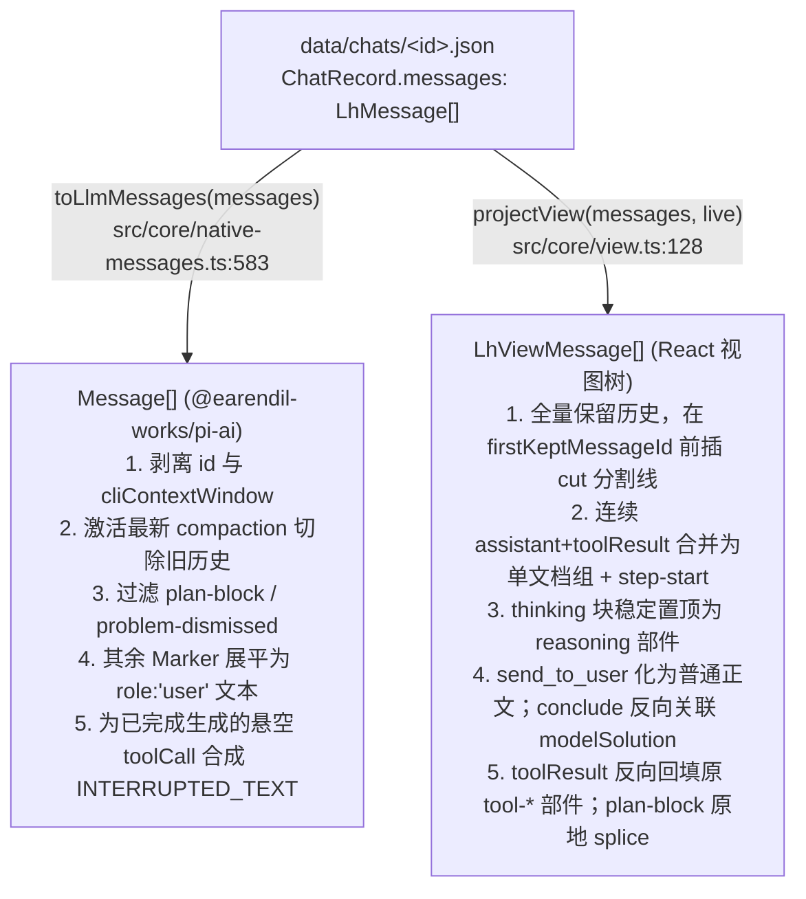

# `ChatRecord` 与 `LhMessage` 联合类型（含 9 种 `LhMarkerMessage`）全量拆解

**总览**：本文覆盖数据域 **D1（会话权威记录与输入事件折叠）+ D2（同源双端纯函数投影）**。在 `learnharness` 中，`data/chats/<id>.json` 中的 `ChatRecord` 是会话的**唯一持久化真相（Stored Truth）**；其 `messages: LhMessage[]` 直接存储原生 `@earendil-works/pi-ai` 消息与 9 种 `LhMarkerMessage` 扩展标记，读取时通过纯函数 `toLlmMessages()`（`src/core/native-messages.ts:583`）与 `projectView()`（`src/core/view.ts:128`）分别向模型线协议 `Message[]` 与浏览器渲染树 `LhViewMessage[]` 做无状态双向投影。

---

## 阶段一：持久层契约与物理落盘形状（Stored Truth）

### 1.1 会话权威记录 `ChatRecord` 与平行账本类型（`src/core/contracts/chat.ts`）

物理文件路径由 `PATHS.chats`（`config.ts:27`，默认 `<repo>/data/chats` 或 `${LH_DATA_DIR}/chats`）与 `chatFile(id)`（`src/store/chats.ts:21-24`，文件名校验正则 `/^[A-Za-z0-9_-]+$/`，落地为 `data/chats/<id>.json`）定位。每次写入通过 `writeChat(record)`（`src/store/chats.ts:57-59`）以 `\t` 缩进的 **JSON 全量覆写** 落盘，并自动打上当前版本戳 `CURRENT_CHAT_VERSION = 1`（`src/core/contracts/chat.ts:68`）。

```ts
// src/core/contracts/chat.ts:29-65
export type ChatKind = "teach" | "practice";

export interface ChatRecord {
	id: string;
	title: string;
	createdAt: string;
	updatedAt: string;
	messages: LhMessage[];
	/** The session's kind — absent = teach (pre-practice records). */
	kind?: ChatKind;
	/** The session's plan tree (vision §2) — written by plan tools via saveTree. */
	tree?: PlanTree;
	/** Append-only usage log (observability, 2026-09): one entry per model
	 * turn. DELIBERATELY a parallel log, not per-message metadata... */
	turns?: TurnUsage[];
	/** Append-only background-extraction usage log (2026-09 observability)... */
	extractions?: ExtractionRunUsage[];
	/** Per-chat model/thinking overrides for the conversation agents. */
	settings?: ChatSettings;
	/** SCHEMA STAMP (schema-versioning wave, owner 2026-10-10): LAZY v1... */
	version?: number;
}
```

配套内嵌子结构定义（逐字摘自 `src/core/contracts/chat.ts` 与 `src/core/contracts/plan.ts`）：

```ts
// src/core/contracts/chat.ts:76-84
export interface ChatSettings {
	model?: { provider: string; id: string };
	thinkingLevel?: ThinkingLevel;
}

// src/core/contracts/chat.ts:124-160
export interface CallUsage {
	inputTokens: number | undefined;
	outputTokens: number | undefined;
	cacheReadTokens: number | undefined;
	cacheWriteTokens: number | undefined;
	cacheWrite1hTokens?: number;
	reasoningTokens: number | undefined;
}

export interface TurnUsage {
	id: string;
	messageId: string;
	at: string;
	model: string;
	steps: CallUsage[];
}

// src/core/contracts/chat.ts:91-117
export interface ExtractionStageUsage {
	model: string;
	steps: CallUsage[];
}

export interface ExtractionRunUsage {
	startedAt: number;
	at: string;
	durationMs: number;
	stats?: EmissionStats;
	stages: {
		extractor: ExtractionStageUsage;
		auditor: ExtractionStageUsage;
	};
}

// src/core/contracts/plan.ts:13-33
export interface PlanNode {
	id: string;
	title: string;
	summary?: string;
}

export interface PlanEdge {
	from: string;
	to: string;
}

export interface PlanTree {
	nodes: PlanNode[];
	edges: PlanEdge[];
	version: number;
}
```

### 1.2 消息联合类型 `LhMessage` 与 9 种 `LhMarkerMessage`（`src/core/native-messages.ts`）

通过 TypeScript `declare module "@earendil-works/pi-agent-core"`（`src/core/native-messages.ts:88-92`）将 `LhMarkerMessage` 声明合并进 `CustomAgentMessages`，再与 `@earendil-works/pi-ai` 的三种原生消息求并集并附加记录 `id` 与可选 `cliContextWindow`：

```ts
// src/core/native-messages.ts:66-100
export interface LhMarkerMessage {
	/** Record identity (pi messages carry no id — see the file header). */
	id: string;
	role: "custom";
	customType:
		| "graph-context"
		| "probe-handoff"
		| "subagent-steer"
		| "subagent-abort"
		| "plan-block"
		| "practice-thinking"
		| "practice-next"
		| "problem-dismissed"
		| "compaction";
	/** The model-facing text ("" for plan blocks — UI-only). */
	content: string;
	display: boolean;
	/** The UI payload — per-customType, never model-visible. */
	details: unknown;
	timestamp: number;
}

declare module "@earendil-works/pi-agent-core" {
	interface CustomAgentMessages {
		lhMarker: LhMarkerMessage;
	}
}

/** A record message: a native pi message (or our marker) plus the record id. */
export type LhMessage = (UserMessage | AssistantMessage | ToolResultMessage | LhMarkerMessage) & {
	id: string;
	/** CLI-reported effective context budget, not a catalog model maximum.
	 * App-only metadata: never transmitted as provider/model message content. */
	cliContextWindow?: number;
};
```

### 1.3 真相边界声明（Stored Truth vs. Never Persisted）

- **落盘真相（Stored Truth）**：
  1. `ChatRecord` 顶层标量（`id`、`title`、`createdAt`、`updatedAt`、`kind`、`version`）、`settings`、纯拓扑结构的 `tree`（仅 `nodes`、`edges`、`version`）、平行计费日志 `turns` / `extractions`。
  2. `messages: LhMessage[]` 中的 4 种判别 `role`：`"user"` | `"assistant"` | `"toolResult"` | `"custom"`（9 种 `customType`）。
- **绝不落盘、100% 读取/运行时派生的状态（Never Persisted）**：
  1. **会话阶段 `Phase3`（`"probe" | "plan" | "teach"`）**：不存字段，由 `phaseAt3Lh(messages)`（`src/core/phases.ts:154`）或 `phaseAt3(viewMessages)`（`src/core/phases.ts:66`）从 `probe_done` 成功结果与首个带 `nodeId` 的 `quiz` 调用实时折叠派生。
  2. **计划树节点进度 `PlanNodeStatus`（`"current" | "visited" | "upcoming"`）**：`PlanTree` 绝不保存 `currentNodeId` 或 `doneNodeIds`（注释见 `src/core/contracts/plan.ts:35-40`），完全由 `derivePlanStatusesLh(tree, messages)`（`src/core/contracts/plan.ts:116`）扫描历史 `quiz` 工具调用参数实时派生（注：`plan-block` Marker 的 `details.block` 存的是创建那一刻的冻结历史快照，而非常驻可变状态）。
  3. **待答问题 / 活跃练习题 / 是否欠续跑**：`pendingQuestion`（`danglingQuestionOf`，`src/core/native-messages.ts:672`）、活跃题 `activeProblemOf`（`src/core/native-messages.ts:481`）、搁置暂停 `endsInDismissal`（`:830`）、续跑判定 `needsContinuation`（`:890`）全部从 `messages` 尾部实时计算。
  4. **提问回合的内存占位结果与中断补全结果**：提问工具触发停止器时生成的 `"Question posed"` 占位 `ToolResultMessage` 在 `persistTurn()`（`src/server/turn-service.ts:74-80`）落盘时被显式过滤丢弃；模型端针对中断悬空调用的 `INTERRUPTED_TEXT`（`src/core/native-messages.ts:53`）仅在 `toLlmMessages()`（`:655-662`）内存中临时合成。
  5. **会话繁忙与压缩运行态**：`ChatListItem.busy` 与 `ChatListItem.compacting`（`src/core/contracts/chat.ts:289-296`）在 `GET /api/chats`（`app/api/chats/route.ts:14-18`）中从服务端 `globalThis` 内存注册表实时合并。
  6. **UI 分组与题卡状态**：连续助手消息合并成的 `LhViewMessage`、`{ type: "step-start" }` 分割部件、以及工具部件状态（`"input-streaming" | "input-available" | "output-available" | "output-error"`）均在 `projectView()` 中实时生成。

---

## 阶段二：构造工厂、写入源与幂等不变式（Write Origins & Invariants）

### 2.1 `ChatRecord` 级写入方法与幂等/排序不变式（`src/store/chats.ts`）

| 存储端口方法 (`ChatStore`, `src/core/ports.ts:34`) | 实现位置 (`path:line`) | ID / 幂等键规则 | `updatedAt` 与事件广播不变式 |
|---|---|---|---|
| `createChat(title, kind?)` | `src/store/chats.ts:35` | `` `chat_${Date.now().toString(36)}_${crypto.randomUUID().slice(0, 8)}` ``（`:38`） | `kind === "practice"` 时才写入 `kind` 字段，默认 `"teach"` **缺省不落盘**（`:45`）；发射 `emit("chats-changed", {})` |
| `saveMessages(id, messages)` | `src/store/chats.ts:126` | 消息自身 `m.id` | **唯一更新 `updatedAt` 的写入器**（`:130`）；遵循 Silence Law **静默不发 `chats-changed`**（由回合 `turn-started`/`turn-settled` 或静默路由 `record-changed` 驱动刷新） |
| `appendTurnUsage(id, entry)` | `src/store/chats.ts:138` | **`entry.id`**（每次请求生成的 `crypto.randomUUID()`，`src/server/chat-handler.ts:406`） | `record.turns?.some((t) => t.id === entry.id)` 幂等去重（`:141`）；不改 `updatedAt`；不用 `messageId` 去重是因为续跑回合共享同一个响应 `messageId` |
| `appendExtractionUsage(id, entry)` | `src/store/chats.ts:150` | **`entry.startedAt`**（单调递增毫秒戳，`src/agent/subagents/extraction.ts:851`） | `record.extractions?.some((r) => r.startedAt === entry.startedAt)` 幂等去重（`:153`）；失败或中止的抽取也会记账（此时 `entry.stats` 为 `undefined`） |
| `saveTree(id, tree)` | `src/store/chats.ts:199` | 整棵替换，`tree.version` 递增 | **刻意不更新 `updatedAt`**（`:204`），防止规划树修改打乱侧边栏会话时间序 |
| `saveSettings(id, settings)` | `src/store/chats.ts:161` | 整对象覆写 | **刻意不更新 `updatedAt`**（`:166`），静默 |
| `renameChat(id, title)` | `src/store/chats.ts:175` | 按会话 `id` | **不更新 `updatedAt`**，但发射 `emit("chats-changed", {})`（`:180`）通知侧边栏改名 |

### 2.2 原生消息（`user` / `assistant` / `toolResult`）构造工厂与不变式

| 分支 (`role`) | 构造工厂 / 写入入口 (`path:line`) | ID 铸造规则 | 幂等键与核心数据不变式 |
|---|---|---|---|
| `role: "user"`（常规输入） | `newUserMessage(text: string)`（`src/core/native-messages.ts:182`） | `newMessageId()` → `` `msg_${Date.now().toString(36)}_${crypto.randomUUID().slice(0, 8)}` ``（`:174-175`） | 由 `inputAppends`（`src/core/input-events.ts:214`）在 `beginTurn` 后 write-ahead 落盘；`content` 为纯字符串 `text` |
| `role: "user"`（回合中插话） | `newUserSteer(text: string, id: string)`（`src/core/native-messages.ts:196`） | **客户端铸造的确定性 ID**（如 `steer_<localId>`，`src/core/input-events.ts:119`） | 同一个 `id` 贯穿客户端乐观排队提示、`agent.steer()` 实时流事件与最终结算落盘，实现单身份原地合并 |
| `role: "assistant"`（模型生成） | `pi-agent-core` 运行时生成 → `persistTurn()`（`src/server/turn-service.ts:81`）打标 | 若流阶段尚未赋 `id`，在 `persistTurn` 用 `newMessageId()` 补齐 | 保留原生 `provider`/`model`/`usage`/`stopReason`/`thinkingSignature`；当 `provider === "claude-code"` 时额外携带 `cliContextWindow?: number`（`src/core/native-messages.ts:98,104-114`） |
| `role: "toolResult"`（学习者答题/跳过） | `newAnswerResult(toolCallId, toolName, answer)`（`src/core/native-messages.ts:206`） | `newMessageId()` | **幂等锚点为 `toolCallId`**：`danglingQuestionOf`（`src/core/input-events.ts:216,150`）保证同一悬空问题最多被回答或 `dismiss` 一次（重答抛 `ChatInputError` 400）。**双受众分离**：`content` 存 `JSON.stringify(compactAnswerForModel(answer))`，`details` 存完整 `QuestionAnswerData` |
| `role: "toolResult"`（畸形题重发请求） | `questionRecoveryAppends(messages, input)`（`src/core/input-events.ts:261`） | `newMessageId()` | 校验 `(messageId, contentIndex, toolCallId)` 精确命中 `status === "malformed"` 的调用后，为本批所有畸形调用生成 `isError: true`、`details: { questionRecovery: true }` 的错误结果 |
| 合成对 `[AssistantMessage, ToolResultMessage]`（延迟结算被弃练习题） | `concludedByDismissalPair(problemCallId)`（`src/core/native-messages.ts:392`） | 消息 `id` 用 `newMessageId()`；内部工具调用 ID 为确定性 `` `call_conc_${problemCallId}` ``（`:395`） | 当记录尾部存在未结算的 `problem-dismissed` Marker 时，由 `dismissalConclusion`（`src/core/input-events.ts:337`）在学习者**下一次输入**（`text`/`continue`/`thinking`/`next`）前自动前置注入，保证每个 `problem-dismissed` 最多合成一次 `conclude(outcome: "dismissed")` |

### 2.3 九种 `LhMarkerMessage`（`role: "custom"`）构造工厂与幂等键全景表

| # | `customType` 字面量 | 构造工厂签名 (`path:line`) | 触发写入源 (`path:line`) | 记录 `id` 格式与幂等键机制 | `content`（模型面向文本） | `details`（UI 专属载荷形状） |
|---|---|---|---|---|---|---|
| **1** | `"graph-context"` | `newGraphContextMessage(picks: readonly GraphContextPick[], chains: readonly string[]): LhMarkerMessage`（`src/core/native-messages.ts:279`） | `POST /api/chats` 创建会话时若选了图谱节点，作为 `messages[0]` 写入（`app/api/chats/route.ts:68`） | `newMessageId()`；仅在创建会话单次写入 `messages[0]` | `"[Session context] — picked from the learner's knowledge map..."` + `[id] name: statement` 列表 + 推理链列表（`:290-297`） | `{ propositions: GraphContextPick[], chains: string[] }`（其中 `GraphContextPick = { id, name, statement }`，`:265-269`） |
| **2** | `"probe-handoff"` | `newHandoffMessage(chatId: string): LhMarkerMessage`（`src/core/native-messages.ts:227`），别名包装 `buildProbeHandoffSteer`（`src/core/contracts/jobs.ts:428`） | Prober 执行 `probe_done` 工具成功后投递至唤醒管线（`src/agent/tools/probe.ts:15` → `src/server/jobs.ts:223`） | **确定性幂等 ID**：`` `steer_probe_${chatId}` ``（`:229`）；由 `steerDelivered(messages, steerId)`（`src/core/contracts/jobs.ts:435`）按 `m.id === steerId` 保证每会话全局唯一、绝不二次投递 | 常量 `HANDOFF_TEXT`（`src/core/contracts/chat.ts:189`） | `{ chatId: string }` |
| **3** | `"subagent-steer"` | `buildSubagentSteer(job: Pick<JobRecord, "id" \| "kind" \| "toolCallId">, result): SteerMessage`（`src/core/contracts/jobs.ts:368`） | 后台子 Agent（`research`/`demo`/`visual`/`pdf`）运行结束时投递（`src/agent/subagents/runner.ts:334`） | **确定性幂等 ID**：`` `steer_${job.id}` ``（`src/core/contracts/jobs.ts:373`）；与 `subagent-abort` **共享同一 ID 命名空间**，经 `steerDelivered` 与 `queueSteer`（`src/server/jobs.ts:233`）确保同一 `job.id` 在完成与中止之间互斥且仅落盘一次 | `steerText(job.kind, result)`（各子任务类型的完成简报与引用指引） | `{ jobId: string, kind: JobKind, toolCallId: string, result: ResearchResult \| DemoResult \| VisualResult \| PdfResult }` |
| **4** | `"subagent-abort"` | `buildAbortSteer(job: Pick<JobRecord, "id" \| "kind" \| "toolCallId">): SteerMessage`（`src/core/contracts/jobs.ts:391`） | 用户点击 Activity Dock 中止子任务时由 `abortJob` 投递（`src/server/jobs.ts:450`） | **确定性幂等 ID**：`` `steer_${job.id}` ``（`src/core/contracts/jobs.ts:396`，与 `subagent-steer` 共用幂等键） | `abortText(job.kind)`（告知教师该后台任务已被学习者中止、勿再等待结果，`:406-414`） | `{ jobId: string, kind: JobKind, toolCallId: string, aborted: true }` |
| **5** | `"plan-block"` | `newPlanBlockMessage(planCallId: string, block: unknown): LhMarkerMessage`（`src/core/native-messages.ts:242`） | 回合结算 `persistTurn` 调用 `planBlocksFor(...)`（`src/core/plan-blocks.ts:76-95`、`src/server/turn-service.ts:84`） | ID 为 `` `pb_${Date.now().toString(36)}_${crypto.randomUUID().slice(0, 8)}` ``（`:247`）；**业务幂等键为 `details.planCallId`**：`emittedPlanBlockCalls(record)`（`src/core/plan-blocks.ts:55`）收集已有 `planCallId`，且每回合仅对**最后一个成功（`details.ok === true`）的 `plan_init`** 发射一次 | `""`（空字符串，模型不可见） | `{ planCallId: string, block: PlanBlockData }`（`PlanBlockData` 含 `kind: "full"`, `at`, `current`, `nodes`, `edges`，`src/core/contracts/chat.ts:232`） |
| **6** | `"practice-thinking"` | `newThinkingMessage(problemCallId: string, text: string): LhMarkerMessage`（`src/core/native-messages.ts:314`） | 练习模式下提交思考 `{ type: "thinking", problemCallId, text }`（`src/core/input-events.ts:236-241`） | `newMessageId()`；前置门控 `activeProblemOf(record.messages)?.toolCallId === input.problemCallId` 校验当前活跃题匹配（同一道题允许提交多次思考） | `` `${THINKING_LABEL}:\n${text}` ``（即 `"Your thinking:\n..."`，`src/core/contracts/chat.ts:205`） | `{ problemCallId: string, text: string }` |
| **7** | `"practice-next"` | `newNextMessage(): LhMarkerMessage`（`src/core/native-messages.ts:332`） | 练习模式两题间隙发送 `{ type: "next" }`（`src/core/input-events.ts:242-255`） | `newMessageId()`；门控要求 `record.kind === "practice"` 且 `!activeProblemOf(record.messages)`（有活跃题时禁止发送，返回 400） | 常量 `NEXT_PROBLEM_TEXT`（`"[NEXT PROBLEM] — the learner's explicit go-ahead..."`，`src/core/contracts/chat.ts:220`） | `{}` |
| **8** | `"problem-dismissed"` | `newProblemDismissedMarker(problemCallId: string): LhMarkerMessage`（`src/core/native-messages.ts:349`） | 静默丢弃路由发送 `{ type: "dismiss-problem", problemCallId }` 经 `dismissAppends` 追加（`src/core/input-events.ts:142-148`） | `newMessageId()`；**幂等性由 `activeProblemOf` 保证**：一旦追加该 Marker，`activeProblemOf` 立即返回 `null`（`src/core/native-messages.ts:491`），重复丢弃同一题将因无活跃题而 400 拒绝 | `""`（空字符串，模型不可见；模型侧延迟到下次输入通过 `concludedByDismissalPair` 感知） | `{ problemCallId: string }` |
| **9** | `"compaction"` | `newCompactionMarker(summary: string, details: CompactionDetails): LhMarkerMessage`（`src/core/compaction.ts:263`） | 上下文超阈值时由 `compact()` 生成摘要并追加到 `messages` 尾部（`src/server/compaction.ts:240-242`） | `newMessageId()`；并发互斥由 `globalThis.__lhCompaction.inFlight` 保证，且防抖守卫 `if (previous && prevKept !== -1 && cut <= prevKept) return`（`src/server/compaction.ts:195`）阻止在同一保留边界上重复压缩 | `` `${COMPACTED_HISTORY_HEADER}\n\n${summary.trim()}` ``（`src/core/contracts/chat.ts:229`） | `CompactionDetails`：`{ firstKeptMessageId: string, tokensBefore: number, model?: string, at: string }`（`src/core/compaction.ts:244-257`） |

---

## 阶段三：双端投影变换对比矩阵（Dual-Projection Matrix）

同一份 `ChatRecord.messages`（`LhMessage[]`）在服务端模型调用前流入 `toLlmMessages()`（`src/core/native-messages.ts:583`），在客户端渲染时流入 `projectView()`（`src/core/view.ts:128`）：



| 持久化记录项 (`LhMessage` 分支) | 构造入口 (`path:line`) | 模型向投影 `toLlmMessages()` (`native-messages.ts:583`) | 浏览器向投影 `projectView()` (`view.ts:128`) | 双端差异的设计原因 |
|---|---|---|---|---|
| `role: "user"` (`UserMessage & { id }`) | `newUserMessage` (`native-messages.ts:182`) / `newUserSteer` (`:196`) | `:640-641`：解构剥离 `id` 与 `cliContextWindow`，原样输出原生 `UserMessage` | `:184-191`：提取字符串或 `{ type: "text" }` 块，输出独立 `{ id: m.id, role: "user", parts: [{ type: "text", text, state: "done" }] }`，同时打断连续 assistant 分组 | 模型协议严禁携带应用层私有字段 `id`；UI 需保留 `m.id` 作为稳定 React Key 与消息气泡边界 |
| `role: "assistant"` 普通文本 + `thinking` 块 | `pi-agent-core` + `persistTurn` (`turn-service.ts:81`) | `:640-641`：剥离 `id` 与 `cliContextWindow`，保留 `content` 原始块顺序及 `thinkingSignature`/`usage` | `:204-289`：稳定分区重排——所有 `thinking` 块转为 `type: "reasoning"` **置顶于正文和工具之上**（`:264`）；若前一条视图消息也是 `assistant`，合并进同一 `LhViewMessage.parts` 并前置 `{ type: "step-start" }`（`:280-286`）；已结算空消息跳过，流式空消息生成单条空 `reasoning` 占位（`:272-277`） | GLM 等模型会在回答末尾追加尾随推理块，原序展示会导致思考过程掉到正文下方；多步工具循环在 UI 上应呈现为一篇连贯讲义而非零碎气泡 |
| `role: "assistant"` 含 `send_to_user` `toolCall` | 模型调用 `send_to_user` 工具 | `:640-641`：保留原生 `toolCall` 块（及后续 `toolResult`） | `:236-252`：若所属消息为 `error`/`aborted` 则跳过；若有错误结果（`outputErrors.get(block.id)`）则渲染 `output-error` 卡片；**正常情况调用 `sendToUserText(block)` 转为普通 `{ type: "text", state: "done" }` 正文部件**，隐藏工具外壳（含流式输出期间） | 叙述守卫要求模型通过显式工具向学生发话，但对学生而言它就是普通讲义正文，绝不能暴露内部工具框 |
| `role: "assistant"` 含未答提问 `toolCall`（`quiz` / `ask_user_question`） | 模型调用提问工具触发停止器 | `:644-664`：若 `stopReason` 非 `"error"`/`"aborted"` 且后续无匹配 `toolResult`，**自动合成追加一条 `content: [{ type: "text", text: INTERRUPTED_TEXT }]` 的 `toolResult`**（`:655-662`）；若生成本身 `error`/`aborted` 则不合成（防止 pi 过滤失败消息后留下孤儿结果） | `:231,311-348`：生成 `type: "tool-<name>"`，打上 `sourceMessageId` 与 `sourceContentIndex`（`:233-234`）；仅当 `live?.streamingIds.has(m.id) === true` 时置 `state: "input-streaming"`，已结算悬空调用置 `state: "input-available"`（`:345`），驱动底部答题 Dock 挂载 | **Pose → Answer 非对称窗口**：磁盘无 `toolResult`；UI 靠悬空 `input-available` 挂载答题器；若中途被打断跨入新回合，模型 API 必须看到配对 `toolResult` 否则报协议错误 |
| `role: "assistant"` 含 `conclude` `toolCall`（练习结题） | 练习 Agent 调用 `conclude` 或 `concludedByDismissalPair` (`native-messages.ts:392`) | `:640-641`：剥离 `id` 后保留原生 `conclude` `toolCall` | `:257-260`：生成 `type: "tool-conclude"` 部件，并现场调用 `modelSolutionForConclude` 与 `problemInputForConclude` 向前反查最近一次成功 `problem` 调用，将 `modelSolution` 与完整题面参数挂载到 `part.reveal` 和 `part.problemInput` | 模型结题时无需重复默写整道题的标准解答（省 Token 且防篡改）；UI 结题揭晓卡片在投影层自动关联出题时锁定的 `modelSolution` |
| `role: "toolResult"`（学习者答题结果 / 普通工具结果 / `problem` 占位） | `newAnswerResult` (`native-messages.ts:206`) / 工具执行器 | `:640-641`：剥离 `id`，向模型发送 `content`（对答题而言是 `compactAnswerForModel` 生成的精简 JSON，不含题干、解释与选项列表） | `:199-201,350-372`：不产生新视图消息，通过 `findToolPart(toolCallId)`（`:143-158`）从后往前定位原 `tool-*` 部件：若为 `problem`/提问工具的空占位确认（`!isError && details == null`）保持 `"input-available"`（`:366`）；否则置 `"output-available"` 并设 `part.output = result.details`（错误则置 `"output-error"`） | **双受众（Two Audiences）**：模型上下文已有题干，只需精简作答表现；UI 需要完整的判分详情 `details` 原地把几轮前的提问卡刷新为已答卡 |
| `customType: "graph-context"` | `newGraphContextMessage` (`native-messages.ts:279`) | `:634-638`：展平为 `{ role: "user", content: [{ type: "text", text: marker.content }], timestamp }`（带 `[Session context]` 方括号前缀声明） | `:377-389`：映射为 `{ id: marker.id, role: "user", parts: [{ type: "data-graph-context", id: "gc_" + marker.id, data: marker.details }] }` | 模型需阅读完整命题 ID、陈述与推理链文本；UI 在首条消息上方渲染紧凑可折叠的知识地图上下文卡片，而非长篇用户聊天气泡 |
| `customType: "probe-handoff"` | `newHandoffMessage` (`native-messages.ts:227`) | `:634-638`：展平为 `{ role: "user", content: [{ type: "text", text: HANDOFF_TEXT }], timestamp }` | `:391-398`：映射为 `{ id: marker.id, role: "user", parts: [{ type: "data-probe-handoff", id: "ph_" + marker.id, data: marker.details }] }` | 模型需要读取详尽的教学规划启动指令 `HANDOFF_TEXT`；学习者界面只需渲染一条安静的探测完成过渡分割线 |
| `customType: "subagent-steer"` | `buildSubagentSteer` (`contracts/jobs.ts:368`) | `:634-638`：展平为 `{ role: "user", content: [{ type: "text", text: marker.content }], timestamp }` | `:399-419`：映射为带 `metadata: { subagentResult: meta }` 的 `user` 视图消息，含 `[textPart(marker.content), { type: "data-subagent-artifact", id: "sa_" + marker.id, data: ... }]` | 模型读取研究简报/工件摘要以融入讲义；UI 除文本外还需挂载交互式 Demo iframe / SVG 图形等富媒体工件卡片 |
| `customType: "subagent-abort"` | `buildAbortSteer` (`contracts/jobs.ts:391`) | `:634-638`：展平为 `{ role: "user", content: [{ type: "text", text: marker.content }], timestamp }` | `:421-429`：映射为带 `metadata: { subagentResult: meta }` 的 `user` 视图消息，含 `[textPart(marker.content), { type: "data-subagent-aborted", id: "sa_" + marker.id, data: meta }]` | 模型获知后台任务已取消以免空等；UI 渲染后台任务已中止状态条 |
| `customType: "plan-block"` | `newPlanBlockMessage` (`native-messages.ts:242`) | `:629`：命中 `marker.customType === "plan-block"`，直接 `continue` **完全丢弃** | `:478-488`：不新建视图消息，定位 `out` 末尾 `assistant` 组内 `lastSuccessfulPlanInit(group.parts)`（`:116-124`），调用 `group.parts.splice(idx + 1, 0, { type: "data-plan-block", id: marker.id, data: block })` 原地嵌入 | 规划树结构已在 `plan_init` 工具参数中对模型可见；UI 需要把规划完成瞬间的全图快照紧跟在 `plan_init` 步骤后面内联展示 |
| `customType: "practice-thinking"` | `newThinkingMessage` (`native-messages.ts:314`) | `:634-638`：展平为 `{ role: "user", content: [{ type: "text", text: "Your thinking:\n..." }], timestamp }` | `:431-442`：映射为 `{ id: marker.id, role: "user", parts: [{ type: "data-practice-thinking", id: "pt_" + marker.id, data: marker.details }] }` | 模型通过 `"Your thinking:"` 标签识别解题思路提交；UI 直接读取结构化 `details`（`{ problemCallId, text }`）渲染专用解题思考卡片，无需反向解析字符串前缀 |
| `customType: "practice-next"` | `newNextMessage` (`native-messages.ts:332`) | `:634-638`：展平为 `{ role: "user", content: [{ type: "text", text: NEXT_PROBLEM_TEXT }], timestamp }` | `:444-455`：映射为 `{ id: marker.id, role: "user", parts: [{ type: "data-practice-next", id: "pn_" + marker.id, data: null }] }` | 模型接收明确的出下一题指令 `NEXT_PROBLEM_TEXT`；UI 只展示居中的小型系统提示行，隐藏内部指令措辞 |
| `customType: "problem-dismissed"` | `newProblemDismissedMarker` (`native-messages.ts:349`) | `:629`：命中 `marker.customType === "problem-dismissed"`，直接 `continue` **完全丢弃** | `:456-458`：直接 `return` **不生成任何视图部件** | 纯状态折叠锚点：静默丢弃当下用于让 `activeProblemOf` 立即归零关闭答题栏；真正的模型可见结题与 UI 结题卡均由下次输入前置合成的 `concludedByDismissalPair` 承担 |
| `customType: "compaction"` | `newCompactionMarker` (`compaction.ts:263`) | `:591-605,616-622,633`：取最新激活压缩点 `active`，保留 `[0]` 号 `system` 消息，注入一条 `head`（`role: "user"`, `text: active.content`），**直接从 `kept`（`firstKeptMessageId`）下标开始遍历（此前历史全部切除）**，并跳过尾部所有残留的 `compaction` Marker | `:165-182,459-476`：**完整保留全部历史消息**；在 `m.id === compaction.details.firstKeptMessageId` 之前插入 `id: "cut_" + compaction.id` 的 `data-compaction-cut` 截断分割线，并在 Marker 尾部原位渲染 `data-compaction` 摘要入口 | 模型侧必须切除旧历史以释放上下文窗口并保证只出现一份最新摘要；学习者向上翻阅讲义时绝不能丢失任何历史对话，且能清晰看到压缩切口位置与压缩发生时刻 |

---

## 阶段四：核心纯函数派生算法（Record-Derived Folds）

`ChatRecord` 坚持“只存事件，不存派生状态标记”，以下纯函数均以 `readonly LhMessage[]` 为唯一权威输入（时间复杂度均为 $O(N)$，确定性无副作用）：

| 派生维度 | 纯函数签名 (`path:line`) | 折叠 / 扫描规则 | 输出类型与用途 |
|---|---|---|---|
| **会话列表摘要** | `listChats(): ChatSummary[]`（`src/store/chats.ts:79`） | 读取 `data/chats/*.json`，剥离大字段 `messages`/`tree`/`turns`/`extractions`，将缺省 `kind` 归一化为 `"teach"`，计算 `messageCount: messages.length`、`phase: phaseAt3Lh(messages)`、`pendingQuestion: danglingQuestionOf(messages) !== null`（注：`ChatSummary` 接口在 `src/core/contracts/chat.ts:273` 还声明了 `pendingProblem: boolean`，但当前 `src/store/chats.ts:93-110` 返回对象字面量中未赋该字段，因外层 `.filter((s): s is ChatSummary => s !== null)` 类型谓词收窄而通过了 `tsc` 编译） | `ChatSummary[]`（按 `updatedAt` 降序排列），供侧边栏列表使用 |
| **三阶段状态机** | `phaseAt3Lh(messages: readonly LhMessage[]): Phase3`（`src/core/phases.ts:154`） | 从头顺序折叠：初始 `"probe"` → 遇到匹配的成功 `probe_done` `toolResult`（`probeDoneResultIds`，`native-messages.ts:744`）跃迁至 `"plan"` → 遇到首个参数含非空字符串 `nodeId` 的 `quiz` `toolCall` 跃迁至 `"teach"`（严格单向递进） | `"probe" \| "plan" \| "teach"`，决定顶部阶段徽章与构建 Prober 还是 Teacher（注：Agent 构造分支直接调 `hasProbeDone`，`native-messages.ts:766`） |
| **待答问题权威扫描** | `questionCallsOf(messages)`（`src/core/native-messages.ts:706`）→ `danglingQuestionOf`（`:672`）/ `pendingQuestionOf`（`:682`） | 从后往前只找**最新一条 `role === "assistant"` 消息**（绝不跨消息复活旧题，`tests/pending-authority.test.ts:79`）：过滤掉后续已有 `toolResult` 的调用；若 `stopReason` 为 `"error"`/`"aborted"` 标 `"failed"`，`"pending"` 标 `"streaming"`，`"length"` 或 `argumentsError` 或 `!parseQuestionInput` 标 `"malformed"`，其余标 `"answerable"` | 服务端 `inputAppends` 用 `danglingQuestionOf` 校验答题合法性；客户端用 `pendingQuestionOf`（过滤掉 `c_` 前缀临时占位结果，并为重复 `toolCallId` 生成 `[messageId, contentIndex, toolCallId]` 复合 `key`）挂载答题栏 |
| **活跃练习题门控** | `activeProblemOf(messages)`（`src/core/native-messages.ts:481`） | **Honest Activation 准则**：先收集所有 `!isError` 的 `toolResult.toolCallId` 集合 `cleanCallIds`（`:428`）；从后往前扫描：遇 `problem-dismissed` Marker 返回 `null`；遇 `cleanCallIds` 内的 `conclude` 调用返回 `null`；遇 `cleanCallIds` 内的 `problem` 调用返回 `{ toolCallId, input }`（失败或悬空的调用一律视为未发生而跳过） | `{ toolCallId: string; input: unknown } \| null`，同时控制服务端练习工具互斥门与客户端解题面板 |
| **自动续跑门控** | `needsContinuation(messages)`（`src/core/native-messages.ts:890`） | 检查尾部连续 `toolResult` 批次：若最后一条是用户跳过（`isDismissedResult`）或畸形题恢复请求（`endsInQuestionRecovery`）则返回 `false`；若批次含干净的 `problem` 出题确认（`details == null`）则返回 `false`；否则当且仅当所属 `assistant` 消息的所有 `toolCall` 均已有结果时返回 `true` | `boolean`，决定页面挂载或重同步时是否自动发送 `{ type: "continue" }` |
| **请求成因溯源** | `reconstructRequestCause(messages)`（`src/core/native-messages.ts:862`） | 遍历全量历史（含压缩切口之前），用 `nativeInputCause`（`:844`）将每条消息归类为 `"learner"`（普通 `user`、`practice-thinking`、`practice-next`、真实答题结果、畸形题重试）、`"automatic"`（`probe-handoff`、`subagent-steer`、`subagent-abort`）、`"neutral"` 或 `"unrecognizable"`（同 ID 内容篡改等），按最后触发源判定当前回合属于前台学习者触发还是后台自动唤醒 | `"foreground" \| "background" \| "ambiguous"`，供订阅制模型连接器执行后台配额许可门控（`src/server/chat-handler.ts:283`） |

---

## 阶段五：异常、中断与历史压缩（Compaction）边界语义

### 5.1 回合中途 Abort / 失败生成与畸形问题恢复
1. **失败或中止生成的提问绝不挂载答题栏，也绝不合成孤儿 `toolResult`**：
   - 当 `AssistantMessage.stopReason` 为 `"error"` 或 `"aborted"` 时，即使模型在断流前吐出了看似合法的 `quiz` 参数，`questionCallsOf`（`src/core/native-messages.ts:714`）也会将其标记为 `status: "failed"`，从而被 `danglingQuestionOf` 与 `pendingQuestionOf`（只取 `"answerable"`）双双排除，答题栏绝不挂载（验证见 `tests/malformed-question-recovery.test.ts:59-75`）。
   - 同时，`hasUnresolvedQuestion`（`:728`，只要 `questionCallsOf(messages).length > 0` 即为真）此时返回 `true`，阻止后台子任务唤醒管线（`waitForIdle`，`src/server/jobs.ts:703`）在错误状态下擅自自动续跑。
   - 在 `toLlmMessages`（`src/core/native-messages.ts:646`）中，显式跳过 `stopReason === "error" || stopReason === "aborted"` 的助手消息，**不为其中的未执行 `toolCall` 合成 `INTERRUPTED_TEXT`**，因为底层 `pi` 转换器会丢弃错误助手消息本身，若此处合成 `toolResult` 反而在电线上制造没有前置 `toolCall` 的孤儿结果。
2. **失败回合重试（`retry`）不删改磁盘历史**：
   - `retryDrops(messages)`（`src/core/input-events.ts:299-329`）从尾部向前回溯连续 `stopReason === "error"` 的助手消息（允许跨过 UI 专属的 `plan-block`，但**严禁跨过 `compaction` 边界**）。这些失败消息的 `id` **保留在磁盘 `ChatRecord.messages` 中**，仅在 `chat-handler.ts:388` 构造当轮内存 `agentMessages` 时临时剔除，以便 `pi` 能从前一条用户消息或工具结果重新 `continue()`。

### 5.2 Compaction（上下文压缩）链式演进与降级容错
1. **多次链式压缩（Chained Compactions）**：
   - 历史压缩从不删除或覆写磁盘旧消息，每次压缩只在 `ChatRecord.messages` 末尾追加新的 `compaction` Marker（验证见 `tests/compaction-service.test.ts:173-209` 十轮连续压缩测试）。
   - `activeCompactionOf(messages)`（`src/core/compaction.ts:279`）从末尾倒序查找**最新一条**携带合法字符串 `details.firstKeptMessageId` 的 `compaction` Marker 作为唯一激活切点；`toLlmMessages`（`src/core/native-messages.ts:633`）注入该最新 `head` 后，会将保留尾部中残留的更早期的 `compaction` Marker 全部跳过，确保发往模型的上下文中永远最多只有一份压缩摘要。
2. **`[0]` 号 `system` 声明头保护与缺失锚点诚实降级**：
   - 当 `pi-agent-core` 在运行态将包含系统提示词与工具声明的 `role: "system"` 消息放在 `messages[0]` 时，`toLlmMessages`（`src/core/native-messages.ts:616-622`）确保 `leading` 系统消息排在压缩摘要 `head` **之前**，循环从 `Math.max(start, 1)` 开始，避免切掉模型的工具定义。
   - 若 `active.details.firstKeptMessageId` 在消息数组中找不到（`keptIndexFor` 返回 `-1`，`src/core/compaction.ts:296`），`head` 保持 `null`、`start` 保持 `0`，`toLlmMessages` 自动回退为全量历史无损直通，绝不抛异常中断对话循环。

### 5.3 流式进行中 vs. 已结算重读（Positive Evidence Gate）
- 在 `projectView(messages, live)`（`src/core/view.ts:224,311-348`）中，未收到执行结果的 `toolCall` 是否显示闪烁加载态（`"input-streaming"`），严格取决于正向证据 `const streamingMessage = live?.streamingIds.has(m.id) === true`。
- 只要某条助手消息 `m.id` 已经结算落盘（不在当前 SSE 流的 `streamingIds` 集合内），哪怕当前会话因为提交了新的 `practice-thinking` 而处于 `live.inFlight === true`，上一轮遗留的 `problem` 或 `quiz` 部件也稳定保持 `"input-available"`，绝不退化回加载骨架屏。

### 5.4 损坏文件与高版本记录防御（Schema Stamp Guard）
- **单文件隔离容错**：`getChat(id)`（`src/store/chats.ts:61-67`）对文件不存在或 JSON 语法损坏返回 `null`；`listChats()`（`:92-114`）对单条记录投影异常单独 `try/catch` 跳过，绝不因单个脏文件导致整个侧边栏白屏。
- **降级拒读保护（Lazy v1 Stamp）**：旧文件无 `version` 字段时按 `v1` 正常读取，下次调用 `writeChat` 时自动补打 `version: 1`（`:58`）；若用户降级运行旧版客户端遇到 `version > CURRENT_CHAT_VERSION` 的高版本记录，`getChat`（`:71-75`）打印错误并返回 `null` 拒绝读取，防止 `read-modify-write` 流程抹掉当前版本不认识的新字段。

---

## 测试佐证索引

- **9 种 `LhMarkerMessage` 全覆盖与模型线协议合法性回归**：`tests/golden-fixtures.test.ts:89-144`（使用真实生产会话快照验证全部 9 种 `customType`、工具面与 `toLlmMessages` 无悬空调用不变式）。
- **`ChatRecord.kind` 缺省即 `"teach"` 与摘要归一化**：`tests/chat-kind.test.ts:29-46`。
- **平行账本 `turns` / `extractions` 幂等去重与列表剥离**：`tests/usage.test.ts:61-95`。
- **待答问题最新助手权威性与重复 `toolCallId` 就近配对**：`tests/pending-authority.test.ts:19-95`。
- **失败/中止生成与畸形问题恢复边界**：`tests/malformed-question-recovery.test.ts:59-90`。
- **练习模式 `activeProblemOf`、`problem-dismissed` 延迟合成与 `conclude` 答案反查**：`tests/practice-record.test.ts:107-135,375-430`。
- **链式 Compaction 截断与全量历史保留**：`tests/compaction-service.test.ts:151-209`。
