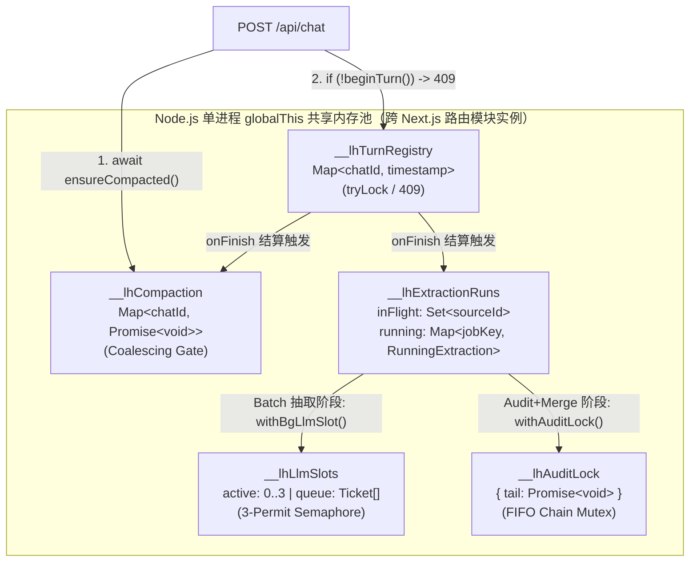
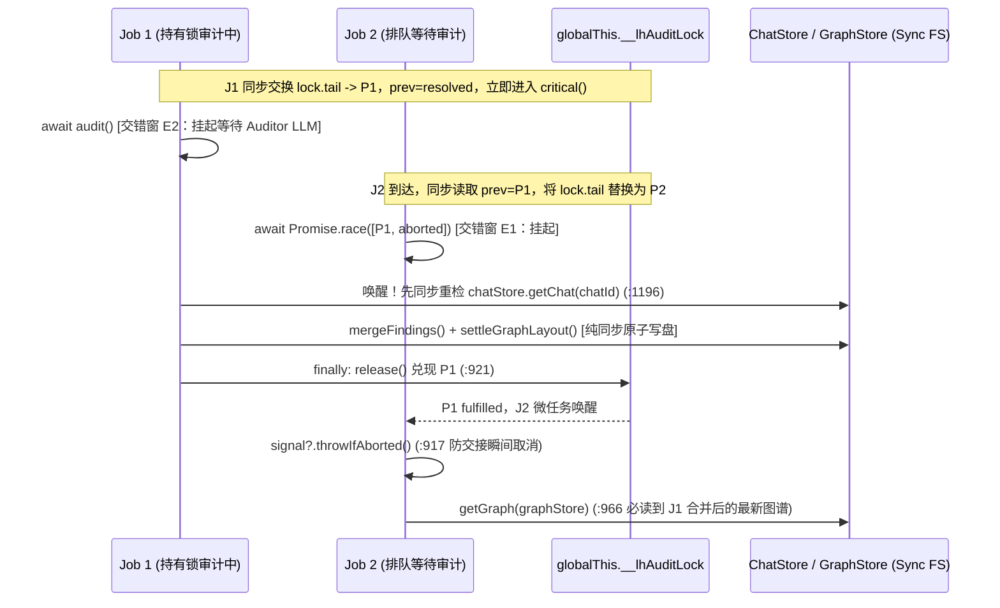

# LearnHarness `globalThis` 并发控制原语全景盘点与交错边界分析

**总览**：本报告归属 **M3（事件循环并发与内存协调）** 映射域，同时触及 **M2（六边形 DI 与模块红线）** 与 **M4（Next.js 16 路由模块实例隔离）**。在 Node.js 单线程事件循环下，本仓库无需 OS 级自旋/互斥指令，而是利用 **同步代码段天然原子性** 实现无锁 `Check-Then-Act`，利用 **`globalThis` 挂载** 跨越 Next.js `next dev` 按路由入口分裂的模块实例，并围绕每一个 `await` 交错窗构建二次重读、许可直接移交（Handoff）与取消传播保护。

---

## 0. 全局盘点：本仓库 `globalThis` 挂载全集分类图谱

通过检索全仓 `globalThis`，服务端共有 **16 处** 进程级状态槽位，可分为「并发控制与生命周期协调原语（9 处）」与「非锁类基础设施/连接单例（7 处）」两大类：

### A. 并发控制与协调原语（9 处）

| 序号 | `globalThis` 键名 | 所属文件 (`path:line`) | 物理数据结构 | 并发语义类别（Java 对标） | 粒度 |
|---|---|---|---|---|---|
| **1** | `__lhTurnRegistry` | `src/server/turn-liveness.ts:27` | `Map<string, number>` (`chatId → startedAtMs`) | 非阻塞 `tryLock`（409 快速失败 + 30min 惰性 TTL） | 按 `chatId` |
| **2** | `__lhCompaction` | `src/server/compaction.ts:124` | `{ inFlight: Map<string, Promise<void>> }` | Promise 搭便车门闩 / SingleFlight 屏障（`CountDownLatch` / Guava `SingleFlight`） | 按 `chatId` |
| **3** | `__lhLlmSlots` | `src/agent/subagents/bg-llm-semaphore.ts:38` | `{ active: number; queue: { resolve: () => void; dead: boolean }[] }` | 3 许可公平异步信号量（`Semaphore(3, true)` + 许可直接移交） | 进程全局 |
| **4** | `__lhExtractionRuns` | `src/agent/subagents/extraction.ts:665` | `{ running: Map<string, RunningExtraction>; inFlight: Set<string>; lastStartedAt: number }` | 非阻塞单飞守卫 `inFlight`（`Set.add`）+ 运行时任务句柄/取消表 `running` | `inFlight` 按源（`chatId`/`src_...`）；`running` 按批次 `jobKey` |
| **5** | `__lhAuditLock` | `src/agent/subagents/extraction.ts:678` | `{ tail: Promise<void> }` | 公平不可重入 FIFO Promise 链互斥锁（`ReentrantLock(true)` 不可重入版） | 进程全局 |
| **6** | `__lhTurnRuns` & `__lhTurnFailures` | `src/server/turn-runs.ts:34-35` | `Map<string, PiTurnHandle>` / `Map<string, string>` | 活跃流重连与远程 Abort 注册表 + 延迟挂载错误槽 | 按 `chatId` |
| **7** | `__lhWakePipeline` | `src/server/jobs.ts:132` | `WakeState`（含 `queues`、`userSteers`、`liveAgents`、`pumping: Set<string>` 等） | 单泵协程串行化守卫（`pumping`）+ 双轨（Live Steer / Idle Wake）投递队列 | 按 `chatId` |
| **8** | `__lhParkedDismissals` | `src/server/dismissal-park.ts:37` | `Map<string, ParkedDismissal>` | 回合进行中 ESC 丢弃意图暂存槽（结算前 `persistTurn → apply → endTurn` 原子窗口消费） | 按 `chatId` |
| **9** | `__lhJobAborts` | `src/agent/subagents/aborts.ts:22` | `Map<string, AbortController>` | 后台子 Agent 存活探针（防僵尸重跑）与真实取消句柄表 | 按 `jobId` |

### B. 非锁类进程级共享状态（7 处，盘点备查）
- `__lhEventBus`（`src/core/events.ts:84`）：`Set<ServerEventListener>`，进程内跨模块 SSE 广播总线（写时快照 `[...listeners()]` 防迭代中增删）。
- `__lhBackgroundCaptureContext`（`src/agent/background-capture.ts:144`）：`AsyncLocalStorage<BackgroundCapture>`（Java `InheritableThreadLocal` 的异步协程等价物），隔离并发后台 Worker 的调试抓包上下文。
- `Symbol.for("lh.chatgpt.bridge")`（`src/agent/chatgpt-bridge.ts:16`）与 `Symbol.for("lh.subscriptions.bridge")`（`src/agent/subscription-bridge.ts:15`）：桌面端进程间 IPC 请求挂起表（`pending: Map`）与控制器表。
- `Symbol.for("lh.webSubscriptionRuntime")`（`src/agent/subscription-runtime.ts:9`）与 `Symbol.for("lh.webSubscriptions")`（`src/server/web-subscriptions.ts:18`）：Web 订阅运行时桥接单例。
- `Symbol.for("lh.subscription.unadmittedUsage")`（`src/agent/subscription-request-cycle.ts:7`）：`WeakSet<object>`，标记未获准派发的订阅用量对象。
- `Symbol.for("lh.authBoot")`（`src/core/auth-env.ts:8`）与 `Symbol.for("learnharness.custom-provider-revision")`（`src/server/custom-provider-http.ts:15`）：启动环境变量来源集合与自定义 Provider ETag HMAC 随机密钥 `Buffer`。

---

## 1. 核心五原语横向机制总表（焦点对比）

聚焦五大核心并发控制原语（`turn-liveness`、`compaction`、`bg-llm-semaphore`、`extraction.inFlight`、`__lhAuditLock`）：

| 原语 | 竞争时行为 | 等待队列结构 | 取消（Abort）支持 | 超时 / 崩溃自愈机制 |
|---|---|---|---|---|
| **`turn-liveness`** (`turn-liveness.ts:45`) | **立即拒绝**（返回 `false`，上层回 HTTP `409`） | 无队列 | N/A（无等待阶段；运行中取消走 `turn-runs.ts:80` `abortTurn`） | `MAX_TURN_MS = 30 * 60_000`（`:36`），`isTurnRunning` 读取时惰性驱逐超期项（`:71-74`） |
| **`compaction`** (`compaction.ts:124`) | **搭便车共享等待（Coalescing）**：后续调用 `await` 同一个 `Promise<void>`，不重复触发 LLM 摘要 | 隐式挂在同一 Promise 的微任务回调表上 | 无 Abort（设计上位于两轮对话间隙，请求门控主动等待其自然结束） | `compact()` 内部 `try/catch` 吞掉异常只打日志（`:264-271`），外层 `finally` 必删 `inFlight`（`:296,317`） |
| **`bg-llm-semaphore`** (`bg-llm-semaphore.ts:52`) | **有界排队阻塞**（上限 `PERMIT_COUNT = 3`，超出者 FIFO 挂起） | 显式数组 `queue: { resolve, dead }[]` | 排队中监听 `signal`：置 `ticket.dead = true` 并 `reject(AbortError)`；释放方循环跳过死票据 | `try / finally` 保证即使 `critical()` 抛错，也必移交许可或 `slots.active--`（`:77-91`） |
| **`extraction.inFlight`** (`extraction.ts:669`) | **立即跳过或报忙**：聊天抽取静默返回 `{ nodes: 0, chains: 0 }`（`:1112`）；笔记导入抛 `NotesImportError("busy", ...)`（`:1433`） | 无队列 | 运行期通过同源 `running` 表的 `AbortController` 批量中止（`abortExtraction`，`:708`） | `runExtraction`（`:1245`）与 `importNotes`（`:1442`）各自的 `finally` 块无条件 `inFlight.delete` |
| **`__lhAuditLock`** (`extraction.ts:678`) | **无界严格串行排队**（全进程同一时刻仅 1 个 `audit + merge` 临界区） | 隐式单向链表：指针交换 `prev = lock.tail; lock.tail = new Promise(...)` | `Promise.race([prev, aborted])`（`:916`）+ 唤醒瞬间 `signal?.throwIfAborted()`（`:917`） | `finally` 无条件调用 `release()`（`:921`），即使当前节点因 Abort 提前退出也不断链 |



---

## 2. 五维深度拆解

### 维度一：源码定位与签名原貌

1. **会话回合存活互斥表 `turn-liveness`**（`src/server/turn-liveness.ts`，`server` 传输编排层）：
   ```ts
   // src/server/turn-liveness.ts:26-32
   interface LhGlobal {
   	__lhTurnRegistry?: Map<string, number>;
   }

   function registry(): Map<string, number> {
   	const g = globalThis as typeof globalThis & LhGlobal;
   	return (g.__lhTurnRegistry ??= new Map<string, number>());
   }
   ```
   ```ts
   // src/server/turn-liveness.ts:45, 60, 68
   export function beginTurn(chatId: string): boolean
   export function endTurn(chatId: string): void
   export function isTurnRunning(chatId: string): boolean
   ```

2. **上下文压缩单飞屏障 `compaction`**（`src/server/compaction.ts`，`server` 层）：
   ```ts
   // src/server/compaction.ts:121-127
   interface CompactionState {
   	inFlight: Map<string, Promise<void>>;
   }
   const g = globalThis as typeof globalThis & { __lhCompaction?: CompactionState };
   function state(): CompactionState {
   	return (g.__lhCompaction ??= { inFlight: new Map() });
   }
   ```
   ```ts
   // src/server/compaction.ts:131, 137, 280, 308
   export function compactionInFlight(chatId: string): boolean
   export async function awaitCompaction(chatId: string): Promise<void>
   export async function ensureCompacted(deps: CompactionDeps, chatId: string): Promise<void>
   export function kickCompaction(buildDeps: () => CompactionDeps | null, chatId: string): void
   ```

3. **后台 LLM 3 许可共享异步信号量 `bg-llm-semaphore`**（`src/agent/subagents/bg-llm-semaphore.ts`，`agent` 层）：
   ```ts
   // src/agent/subagents/bg-llm-semaphore.ts:30-39, 52-55
   const PERMIT_COUNT = 3;

   export interface LlmSlots {
   	active: number;
   	queue: { resolve: () => void; dead: boolean }[];
   }

   interface LhLlmSemaphoreGlobal {
   	__lhLlmSlots?: LlmSlots;
   }

   export async function withBgLlmSlot<T>(
   	signal: AbortSignal | undefined,
   	critical: () => Promise<T>,
   ): Promise<T>
   ```

4. **知识图谱抽取单飞集合 `inFlight` 与全局审计 FIFO 互斥锁 `__lhAuditLock`**（`src/agent/subagents/extraction.ts`，`agent` 层 `createExtractionPipeline` 工厂内）：
   ```ts
   // src/agent/subagents/extraction.ts:664-679
   interface LhExtractionGlobal {
   	__lhExtractionRuns?: {
   		running: Map<string, RunningExtraction>;
   		inFlight: Set<string>;
   		lastStartedAt: number;
   	};
   	__lhAuditLock?: { tail: Promise<void> };
   }
   ```
   ```ts
   // src/agent/subagents/extraction.ts:896, 1111, 1430
   async function withAuditLock<T>(jobKey: string, kind: "chat" | "notes", label: string | undefined, critical: () => Promise<T>): Promise<T>
   async function runExtraction(chatId: string): Promise<EmissionStats>
   async function importNotes(input: NotesImportInput): Promise<EmissionStats>
   ```

5. **辅助协调原语签名**（补全完整拼图）：
   - `src/server/turn-runs.ts:64,69,80`：`registerTurn(chatId: string, handle: PiTurnHandle): void`、`unregisterTurn(chatId: string): void`、`abortTurn(chatId: string): { ok: true } | { ok: false; reason: "not_running" }`。
   - `src/server/jobs.ts:223,295,317,348,381,468`：`deliverJobResult(steer: SteerMessage): Promise<void>`、`registerLiveAgent(...)`、`steerLiveChat(chatId: string, message: LhMessage): boolean`、`unregisterLiveAgent(chatId: string): void`、`settleSteers(...)`、`async function pump(chatId: string): Promise<void>`（受 `s.pumping: Set<string>` 保护）。
   - `src/server/dismissal-park.ts:47,67`：`parkDismissal(chatId: string, input: ParkedDismissal): void`、`applyParkedDismissal(chatStore: ChatStore, chatId: string): void`。
   - `src/agent/subagents/aborts.ts:31,46,53`：`registerJobAbort(jobId: string, controller: AbortController): void`、`isJobLive(jobId: string): boolean`、`fireJobAbort(jobId: string): boolean`。

---

### 维度二：Java Web 对标参照（同构点 vs. 异构点）

| 对比维度 | Java Web 机制（参照系） | 本仓库 TS/Node/Next.js 实现（带 `path:line`） | 核心差异与迁移陷阱 |
|---|---|---|---|
| **编译期 vs. 运行时存在性** | `ConcurrentHashMap`、`Semaphore`、`ReentrantLock` 为 JVM 标准库类，带对象头 Monitor 与 AQS（AbstractQueuedSynchronizer）状态字 | TS 接口（`LlmSlots`、`CompactionState`、`LhExtractionGlobal`）编译后完全擦除；运行期仅剩普通 V8 `Map`、`Set`、数组与原生 `Promise` 对象 | JS 运行时不存在线程 ID（`Thread.currentThread()`），因此 Promise 互斥锁默认**完全不支持锁重入**，重入即永久死锁 |
| **内存作用域与生命周期** | Spring 容器内 `@Service` 单例持有的 `private final` 成员字段，全 `ApplicationContext` 唯一；或 `static final` 类变量（同 `ClassLoader` 唯一） | 统一通过 `(globalThis as ...).__lh* ??= ...` 惰性挂载在 V8 进程全局对象上（如 `turn-liveness.ts:32`、`extraction.ts:695,899`） | Next.js `next dev` 按路由入口按需独立编译模块（仿佛 Java 每个 Controller 用独立 `ClassLoader` 加载了一遍 Service 类）——模块顶层 `const map = new Map()` 会分裂成多个隔离副本，唯有 `globalThis` 全进程唯一；进程退出即清空，无跨重启脏锁 |
| **调度与并发交错边界** | OS 内核在任意字节码指令间抢占线程，`if (!set.contains(k)) set.add(k)` 非原子，必须用 `set.add(k)` 返回值或 `synchronized` / CAS | V8 单线程事件循环：两个 `await` 之间的所有同步语句**绝对原子执行**；唯有 `await` 表达式挂起协程、向微任务/宏任务队列让出执行权 | 同步 `has() + set()/add()` 绝无竞态；但**凡跨过 `await`，此前读出的局部变量（如 `ChatRecord`）立即存在过期风险**，必须在唤醒后重读磁盘/内存权威状态 |
| **异常与取消传播** | `Future.cancel(true)` 发送 `Thread.interrupt()`，阻塞在 AQS `acquireInterruptibly()` 的线程抛 `InterruptedException` 并由 AQS 自动摘除节点 | 传入 `AbortController.signal`：监听 `"abort"` 事件主动 `reject(AbortError)`，配合死票据标记 `ticket.dead = true`（`bg-llm-semaphore.ts:64`）或 `Promise.race([prev, aborted])`（`extraction.ts:916`） | JS `Promise` 链无法从外部强行销毁中间节点；排队节点被取消时，必须靠 `dead` 标记让前驱跳过，或在 `finally` 中照常调用 `release()` 把锁接力给后继协程 |

---

### 维度三：物理运行机制拆解（逐原语标出「同步原子段」与「`await` 交错窗」）

#### 1. `turn-liveness`（`src/server/turn-liveness.ts`）+ `chat-handler`（`src/server/chat-handler.ts`）
- **状态结构**：`globalThis.__lhTurnRegistry: Map<string, number>`（键为 `chatId`，值为 `Date.now()` 毫秒时间戳）。注意 `turn-liveness.ts:35` 在模块顶层缓存了引用 `const inFlight = registry()`——因为 `registry()` 返回的是挂在 `globalThis` 上的同一个 `Map` 对象引用，各路由模块缓存该引用后仍读写同一张表。
- **同步原子段 1（加锁 `beginTurn`，`turn-liveness.ts:45-51`）**：
  ```
  isTurnRunning(chatId) [Map.get + TTL 过期判定删除]
    → clearTurnFailure(chatId) [Map.delete]
    → inFlight.set(chatId, Date.now())
    → emit("turn-started", { chatId })
  ```
  全程**零 `await`**。两个并发 `POST /api/chat` 到达时，第一个同步完成检查与置位，第二个必定命中 `isTurnRunning === true` 并在 `chat-handler.ts:371-375` 立即返回 `409`。而且写入发生在 `emit` 之前，监听器同步或异步回查均看到一致的运行态。
- **`await` 交错窗（`chat-handler.ts:295 → 371`）**：
  - **交错窗 A**：`chat-handler.ts:295` 执行 `await ensureCompacted(..., chatId)` **先于** `beginTurn(chatId)`（`:371`）。在此 `await` 挂起期间，压缩任务可能向磁盘追加了 `compaction` Marker，或者另一个并发请求已经抢先完成了压缩甚至开启了新回合！
  - **交错恢复防线**：唤醒后，`chat-handler.ts:310` **立即强制重读磁盘记录** `const compactedRecord = stores.chatStore.getChat(chatId)` 覆盖旧 `record`（`:312`），重算 `retryOmissions`（`:316-325`）与 `appends`（`:333-343`），最后才进入 `beginTurn(chatId)` 抢锁；抢锁成功后立即同步写盘 `stores.chatStore.saveMessages(chatId, merged)`（`:391`，底层为 `fs.writeFileSync` + `fs.renameSync` 同步 I/O，不产生 `await` 交错）。
- **同步原子段 2（结算释放序，`chat-handler.ts:609-683`）**：
  在 `onFinish` 回调中，严格按以下纯同步顺序执行（无 `await`）：
  `persistTurn`（落盘本轮新消息）→ `appendTurnUsage` → `triggerExtraction` → `applyParkedDismissal`（消费暂存的 ESC 丢弃，`:665`）→ **`endTurn(chatId)`**（删除存活标记并广播 `"turn-settled"`，`:668`）→ `unregisterTurn(chatId)`（`:673`）→ `unregisterLiveAgent(chatId)`（`:679`）→ `settleSteers(...)`（`:680`）。
  这保证了任何收到 `"turn-settled"` 事件或看到 `runningTurn === undefined` 的客户端，去拉取记录时**100% 读到已持久化的完整结果与已生效的搁置丢弃**。

---

#### 2. `compaction`（`src/server/compaction.ts`）
- **状态结构**：`globalThis.__lhCompaction: { inFlight: Map<string, Promise<void>> }`（`:121-126`）。
- **两条入口路径的同步段与交错窗**：
  1. **结算后台触发 `kickCompaction`（`:308-318`，纯同步函数，无 `await`）**：
     - **同步原子段**：`if (state().inFlight.has(chatId)) return` → 构建 `deps` → 同步读盘 `chatStore.getChat(chatId)` 并测算 token 是否超阈值 → 调用 `const run = compact(deps, chatId)`。
     - **关键物理细节**：`compact` 是 `async` 函数，在调用 `compact(...)` 时，其内部在遇到第一个 `await summarize(...)`（`:230`）之前的所有代码（重读记录、切分 `span`、构造 Prompt、发送 `emit("compaction-changed", { chatId, running: true })`）**全部在当前宏任务 tick 内同步执行完毕**，随即返回未决的 `Promise` 并在 `:316` 同步写入 `state().inFlight.set(chatId, run)`。全过程没有任何 `await` 空隙！
  2. **回合前门控 `ensureCompacted`（`:280-298`）**：
     - **交错窗 B1**：`:285` 执行 `await awaitCompaction(chatId)`（若已有 `kickCompaction` 留下的 `Promise`，在此挂起搭便车等待其完成）。
     - **唤醒后同步原子段（`:286-292`）**：唤醒后，不能假设无需再压缩，也不能假设没人抢先开启新一轮压缩！代码同步执行：
       1) 重读最新 `record = deps.chatStore.getChat(chatId)`（`:287`）；
       2) 重新计算 `projectedContextTokens`——若刚才等待的那次压缩已将上下文降到阈值以下，在 `:289` 直接 `return`；
       3) **二次重入守卫**：`if (state().inFlight.has(chatId)) return`（`:290`）——防止多个协程同时在 `awaitCompaction` 处醒来（此时前一个压缩刚删掉 key，但某条后继协程已同步启动了新 `compact` 并重新 `set` 了 key）导致重复发起摘要！
       4) `const run = compact(deps, chatId); state().inFlight.set(chatId, run);`（`:291-292`）原子注册。
     - **交错窗 B2（`compact` 内部的 LLM 调用，`:230`）**：
       在 `await summarize(prompt, deps.engine)` 挂起期间，为什么不怕有新消息写入 `ChatRecord` 导致 `:242` 的 `saveMessages(chatId, [...messages, marker])` 覆盖新消息？
       **架构级不变量（Topology Invariant，注释 `:6-20`）**：因为每次对话回合开始都必过 `ensureCompacted` 门控（`chat-handler.ts:295`），而静默路由（如 `dismiss`）在压缩期间被前端门控且提问回合已结算，没有对话回合能与同 `chatId` 的 `compact` 并发交错。

---

#### 3. `bg-llm-semaphore`（`src/agent/subagents/bg-llm-semaphore.ts`）
- **状态结构**：`globalThis.__lhLlmSlots: { active: number; queue: { resolve: () => void; dead: boolean }[] }`（`:32-39`），上限 `PERMIT_COUNT = 3`（`:30`）。
- **同步原子段 1（获取或入队，`:56-74`）**：
  - **分支 A（有空闲许可，`slots.active < 3`）**：不进入 `if`，跳过 `await`，`freshTake` 保持 `true`，直接在 `:74` 同步执行 `slots.active++`，紧接着进入 `try { return await critical(); }`。从检查到占坑**零 `await`**。
  - **分支 B（池满，`slots.active >= 3`）**：同步置 `freshTake = false`（`:59`），在 `new Promise` 构造器内**同步**创建 `ticket = { resolve, dead: false }` 并 `slots.queue.push(ticket)`（`:61-62`），同时绑定 `AbortSignal` 监听器（若此时 `signal.aborted` 已为真则同步置 `ticket.dead = true` 并 `reject`）。
- **`await` 交错窗 C1 & C2**：
  - **交错窗 C1（排队等待许可，`:60`）**：协程挂起在 `await new Promise(...)`。期间若外部调用 `abortExtraction`，`die()` 触发：`ticket.dead = true` 并以 `AbortError` 拒绝该 Promise，协程直接跳过 `:74` 和 `try`（根本没进 `try` 块，故**不会触发 `finally` 释放别人的许可**！注意 `try` 在 `:75`，位于排队 `await` 之后——这是极其关键的边界设计）。
  - **交错窗 C2（持有许可执行 LLM 请求，`:76`）**：`await critical()` 挂起执行子 Agent LLM 请求。
- **同步原子段 2（`finally` 许可直接移交 Handoff，`:77-91`）**：
  ```ts
  for (;;) {
      const next = slots.queue.shift();
      if (!next) {
          slots.active--;
          break;
      }
      if (next.dead) continue;
      next.resolve();
      break;
  }
  ```
  **为什么 `next.resolve()` 时不执行 `slots.active--`，且唤醒后因为 `freshTake === false` 也不执行 `slots.active++`？**
  在 V8 中，`next.resolve()` 只是将等待协程排入微任务队列，并不会立即同步跳转过去执行。如果释放者做了 `slots.active--`（从 3 变 2），在等待协程的微任务真正运行之前，事件循环中若恰好插进来一个新的 `withBgLlmSlot` 调用，它会看到 `slots.active === 2 < 3`，于是以 `freshTake = true` 抢走许可并 `active++` 变 3，等原等待者的微任务醒来再 `active++` 就会溢出为 4（或者若两边都漏算则永久卡死在 3，见注释 `:16-20`）。**保持 `active === 3` 原地过户**，彻底封死了微任务唤醒延迟窗口内的插队与计数漂移。

---

#### 4. `extraction.inFlight` 与 `running`（`src/agent/subagents/extraction.ts`）
- **状态结构**：`globalThis.__lhExtractionRuns` 包含：
  - `inFlight: Set<string>`：源级（`chatId` 或 `src_<sha256前12位>`）单飞互斥集。
  - `running: Map<string, RunningExtraction>`：批次作业级（`jobKey`，多批次时为 `${id}#${i}`）活跃状态与 `AbortController` 表。
  - `lastStartedAt: number`：单调递增毫秒戳（`Math.max(Date.now(), R.lastStartedAt + 1)`，`:851`），确保同一毫秒启动的两个批次绝不在 `extractions` 账本的幂等键 `startedAt` 上碰撞。
- **同步原子段（源级抢占）**：
  - 聊天路径（`:1112-1113`）：`if (inFlight.has(chatId)) return { nodes: 0, chains: 0 }; inFlight.add(chatId);` —— 纯同步无 `await`。
  - 笔记路径（`:1433-1434`）：`if (inFlight.has(id)) throw new NotesImportError("busy", ...); inFlight.add(id);` —— 赶在 `graphStore.upsertSource` 之前同步抢锁，防止并发导入同一文件篡改元数据。
- **`await` 交错窗 D（单源串行批次循环，`:1159-1231` / `:1353-1409`）**：
  - 同一源的多个 chunk 严格按 `for (const [batchIndex, batch] of batches.entries()) { await runJob(...); }` **串行推进**，使后续批次的 `extract()` 能读到前序批次刚合并进图谱的 `sourceDigest`（`:936-937`）；不同源之间则可并行进入各自的 `for` 循环。
  - **跨阶段同步间隙取消检查**：在 `withExtractSlot` 拿到信号量进入 `extract()` 时（`:929`），以及释放信号量后拿到审计锁进入 `audit()` 时（`:965`），均第一行执行 `signal?.throwIfAborted()`，拦截在排队切换间隙到达的取消信号。

---

#### 5. `__lhAuditLock`（`src/agent/subagents/extraction.ts:896-923`）
- **状态结构**：`globalThis.__lhAuditLock: { tail: Promise<void> }`（初始 `{ tail: Promise.resolve() }`，`:899`）。
- **同步原子段（无 CAS 链表入队，`:897-914`）**：
  ```ts
  setPhase(jobKey, "waiting", kind, label);
  const g = globalThis as typeof globalThis & LhExtractionGlobal;
  const lock = (g.__lhAuditLock ??= { tail: Promise.resolve() });
  const prev = lock.tail;
  let release!: () => void;
  lock.tail = new Promise<void>((resolve) => (release = resolve));
  ```
  因为 `new Promise(executor)` 的 `executor` 是**同步立即执行**的，当这 5 行跑完时，`release` 已经赋值，`lock.tail` 已经指向当前协程的新尾节点，而局部变量 `prev` 握着前驱节点的尾 Promise。无论多少个批次同时完成抽取到达此门前，都会按到达事件循环的先后顺序严丝合缝地串成一条单向 Promise 链。
- **`await` 交错窗 E1 & E2**：
  - **交错窗 E1（排队等前驱释放，`:916`）**：`await Promise.race([prev, aborted])`。
    - 若排队期间被用户取消，`aborted` 先 reject，直接跳入 `finally` 调用 `release()`（`:921`）：将链条继续向下传递（`【推断】`：注意细微边界——当单个等待者 abort 时完全安全；若同时有 A(持有锁) → B(排队) → C(排队) 三个节点且中间节点 B 在等待 A 期间触发 `aborted` reject 进入 `finally` 直接调用 `release()`，正在等待 B 的 C 会提前从 `prev` 醒来，在 A 尚未完成时进入 `critical()`；若要严格保序，中间 abort 节点的 `finally` 需写成 `void prev.then(release)` 而非直接 `release()`）。
    - **唤醒瞬间的精确竞态门控（`:917`）**：若 `prev` 刚好已处于 fulfilled 状态且同一时刻 `signal` 也已 aborted，`Promise.race` 按数组顺序会优先采纳第一个已决的 `prev` 而不抛错！因此 `:917` 紧跟一句 `signal?.throwIfAborted()`，堵死“恰在交接瞬间被取消却仍闯入审计”的漏洞。
  - **交错窗 E2（审计 LLM 调用与会话删除竞态，`:1189 → 1196`）**：
    在持有 `__lhAuditLock` 期间，`await audit(...)`（`:1189`）发起 LLM 调用挂起协程。如果用户在此时点击删除了整个会话（删除路由是同步代码段：先调 `abortExtraction(chatId)`，再删 `ChatRecord`），万一 `audit` 恰好在 abort 生效前最后一个微任务返回，协程继续往下走就会把已死会话的节点合并进全局图谱！
    为此，`:1196-1200` 在 `await audit` 醒来后、同步调用 `mergeFindings` 之前，专门设置了 **Session-Deletion Guard**：
    ```ts
    if (!chatStore.getChat(chatId)) {
        const gone = new Error(`chat deleted mid-run: ${chatId}`);
        gone.name = "AbortError";
        throw gone;
    }
    ```
    而随后的 `mergeFindings` + `settleGraphLayout` 全是同步文件 I/O，一气呵成直至 `finally` 释放锁。



---

#### 6. 其余四个 `globalThis` 并发原语的关键原子边界速览
- **`__lhWakePipeline`（`src/server/jobs.ts:132,468`）**：
  - `s.pumping: Set<string>` 保证每个 `chatId` 最多运行一个异步 `pump` 循环（`:471-472` 同步 `has` + `add`）。
  - **关键交错窗**：`await waitForIdle(chatId)`（`:539`，可能轮询等待用户答题数分钟）→ 唤醒后**必须重读** `const fresh = stores.chatStore.getChat(chatId)`（`:544`），绝不用等待前的旧快照；且在 `finally` 中 `s.pumping.delete(chatId)` 后，立即同步检查在最后一次读取到退出之间是否有新到达的未移交 steer，若有则尾递归重启 `void pump(chatId)`（`:619-620`），防止丢信。
  - **同步无交错插队**：`steerLiveChat`（`:317-327`）从 `liveAgents.get(chatId)` 到 `agent.steer(message)` 全同步无 `await`，杜绝“刚查到 Agent 存活、还没塞入队列该回合就结算关闭”的竞态。
- **`__lhParkedDismissals`（`src/server/dismissal-park.ts:37`）**：
  - 回合运行中收到 ESC 丢弃请求时，同步写入 `parkDismissal`；回合结束在 `chat-handler.ts:665` 位于 `persistTurn` 与 `endTurn` 之间的纯同步块内调用 `applyParkedDismissal` 取走并校验写盘，无任何异步窗口。
- **`__lhTurnRuns`（`src/server/turn-runs.ts:34`）**：
  - 在 `chat-handler.ts:724` 紧接 `runPiTurn` 同步返回之后调用 `registerTurn(chatId, handle)`；由于 `runPiTurn` 内部 Agent 循环在后续微任务才开始推进，结算回调 `onFinish` 绝无可能抢在 `registerTurn` 之前执行 `unregisterTurn`。
- **`__lhJobAborts`（`src/agent/subagents/aborts.ts:22`）**：
  - `isJobLive(jobId)`（`:46`）作为崩溃恢复扫描 `recoverStaleJobs()`（`src/server/jobs.ts:713`）的权威判据：磁盘 `JobRecord.status === "running"` 但内存 `__lhJobAborts` 无此 `jobId`，即证明该任务是上一次进程崩溃遗留的孤儿而非当前慢请求，可安全立即重跑。

---

### 维度四：Java 惯性反模式与防坑守则

1. **反模式 1：将注册表声明为模块级 `private static final` 等价物（顶层 `const registry = new Map()`），不挂 `globalThis`**
   - **触发事故**：在 Next.js 开发服务器（`next dev`）中，`POST /api/chat`、`GET /api/chats/[id]/stream`、`GET /api/events` 与 `POST /api/activity/abort` 被打包为不同的模块实例。结果 `POST /api/chat` 在实例 A 的 Map 里标记了 `beginTurn`，而页面渲染或 `GET /api/chats/[id]` 在实例 B 的空 Map 里读到 `isTurnRunning === false`，前端误判回合已结束，发起续跑直接撞上 `409` 横幅，且点击停止按钮永远返回 `not_running`（历史真实事故，见 `src/server/turn-liveness.ts:8-14` 与 `src/agent/subagents/extraction.ts:685-692` 注释）。

2. **反模式 2：跨 `await` 复用局部变量中的实体对象（当成 JPA Persistent Context 受管实体或事务内可重复读快照）**
   - **触发事故**：例如在 `chat-handler.ts:295` `await ensureCompacted(...)` 之前读取了 `let record = stores.chatStore.getChat(chatId)`，若省掉 `:310` 的重读直接使用旧 `record.messages` 去拼接 `saveMessages`，会把 `ensureCompacted` 刚刚写入磁盘的 `compaction` Marker **静默覆盖抹除**！同理，`jobs.ts:544` 若在 `await waitForIdle(chatId)` 后不重读 `fresh`，会把用户等待期间提交的答案整段回滚覆盖。

3. **反模式 3：按 Java `ReentrantLock` 习惯在持有 `__lhAuditLock` 或 `ensureCompacted` 内部嵌套调用自身，或在 `src/agent/` 直接导入 `src/server/turn-liveness.ts`**
   - **触发事故 A（死锁）**：`withAuditLock`（`extraction.ts:896`）只是一条无线程身份的 Promise 尾链。若在 `critical()` 内部间接再次调用 `withAuditLock`，内层排在外层未兑现的 `lock.tail` 后，外层等内层返回才进 `finally` 调 `release()`，瞬间永久死锁，整条后台图谱审计管线瘫痪且无超时报错。
   - **触发事故 B（架构红线报错）**：若想在 `src/agent/subagents/extraction.ts` 里直接 `import { isTurnRunning } from "../../server/turn-liveness.ts"`，会立即违反 `eslint.config.mjs:63-68`（**Zone 4**：`./src/agent` 严禁导入 `./src/server` 或 `./src/store`），导致 Lint 失败。跨层协同必须像 `aborts.ts` 一样下沉到 `src/agent/` 或 `src/core/events.ts`（`eslint.config.mjs:57-62` **Zone 3** 纯核心层），再由 `src/server/` 单向依赖。

---

### 维度五：确定性测试验证对照（`node:test` vs. JUnit/Mockito）

在 Java Spring 中验证上述并发原语通常需要启动线程池（`ExecutorService` + `CyclicBarrier` / `CountDownLatch`）配合 `@SpringBootTest`。而在本仓库中，利用单线程微任务确定性与纯函数依赖注入，所有竞态窗口均在 `node:test` 下以毫秒级确定性复现：

1. **`turn-liveness` 双重进入拒绝与“先改状态后发事件”一致性断言**（`tests/turn-liveness.test.ts:41-70`）：
   直接在单线程中订阅 `subscribe((e) => ...)`，在 `"turn-settled"` 回调触发的同一同步调用栈内断言 `isTurnRunning(id) === false`（`:61,68`），验证 `inFlight.delete` 严格先于 `emit`。
2. **`compaction` 并发门控搭便车（Mutex Coalescing）验证**（`tests/compaction-service.test.ts:129-149`）：
   无需真实 LLM，通过向 `CompactionDeps` 注入计数版假 `summarize` 函数，用 `await Promise.all([ensureCompacted(deps, chatId), ensureCompacted(deps, chatId), ensureCompacted(deps, chatId)])` 并发撞击门控，断言 `summarizeCalls === before + 1`（`:134`），证明 3 个并发协程共享同一次摘要生成。
3. **跨模块实例 `globalThis` 单飞与审计严格串行峰值验证**（`tests/extraction.test.ts:1017-1052, 2051-2095`）：
   - 在 `:1029-1046` 中刻意构造两个独立的 `createExtractionPipeline` 实例（模拟 Next dev 下两个路由模块实例），在第一个实例挂起于自定义 `gate` Promise 时，断言 `globalThis.__lhExtractionRuns.running.has(chatId)` 为真且第二个观察者实例调用 `runExtraction(chatId)` 立即被 `inFlight` 拦截返回 `{ nodes: 0, chains: 0 }`。
   - 在 `:2051-2095` 中用计数器跟踪并发度峰值 `auditInFlight` / `auditPeak`，驱动 8 个分块作业并发运行，断言 `auditPeak === 1`（`:2093`，*"audits serialize behind the gate — never two at once"*）。
4. **搁置丢弃在 `persistTurn → applyParkedDismissal → endTurn` 窗口内的时序验证**（`tests/dismissal-park.test.ts:160-185`）：
   手工按序驱动 `beginTurn` → `parkDismissal` → 模拟回合落盘 → `applyParkedDismissal` → `endTurn`，无需启动 HTTP 服务器即可精确卡位验证状态落盘顺序。
