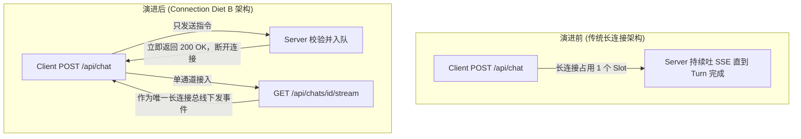
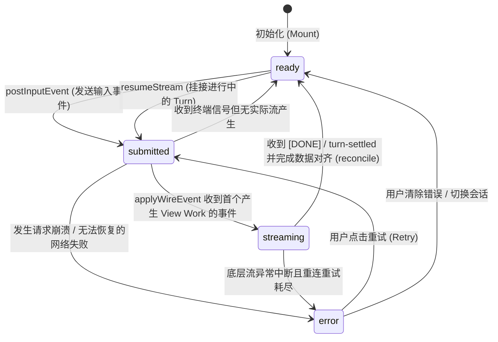
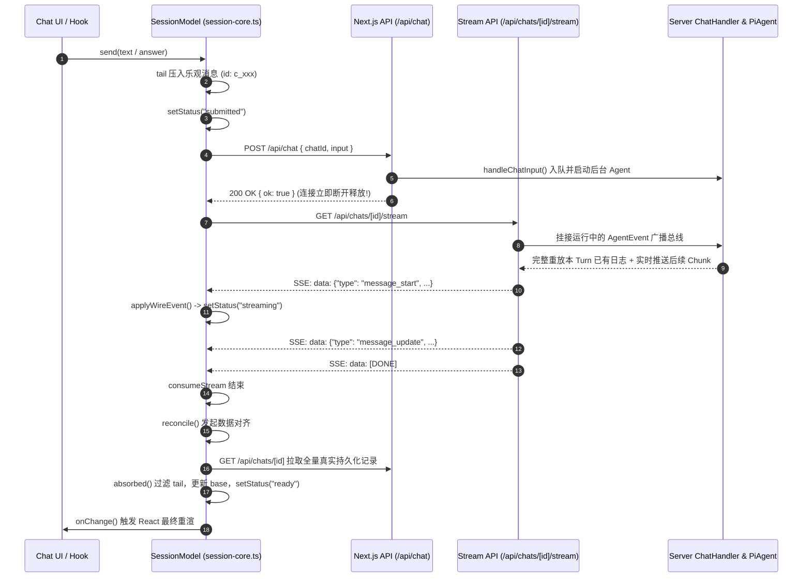

# LearnHarness 前端核心架构深度拆解：会话状态机与 SSE 实时同步机制

> **适用范围**：深入理解 LearnHarness 前端架构设计哲学、纯 TypeScript 状态机实现、端到端实时流同步协议与复杂并发竞态治理。  
> **代码取证环境**：LearnHarness `0.4.1`，严格基于源码路径与行号对照。

---

## 目录
1. [全局设计哲学与架构硬约束](#1-全局设计哲学与架构硬约束)
   - 1.1 纯 TS 状态机 vs React 绑定的权衡 (`session-core.ts`)
   - 1.2 "服务端独占转录所有权"（Server-Owned Transcript）与 One View 协议
   - 1.3 Connection Diet B 演进史：打破浏览器 6 连接限制
2. [会话状态机模型与生命周期全景](#2-会话状态机模型与生命周期全景)
   - 2.1 状态机模型与跃迁矩阵（Mermaid）
   - 2.2 双层内存消息结构：`base` 与 `tail`
   - 2.3 乐观数据吸收算法（`absorbed` 与 `c_` 前缀）
3. [双通道端到端时序调用链拆解](#3-双通道端到端时序调用链拆解)
   - 3.1 正常提交与流式回放时序图（POST Ack + GET Reattach）
   - 3.2 409 Conflict 竞态恢复机制（`turnInFlight` 探测轮询）
   - 3.3 Reattach 断线重连与全量事件回放
4. [SSE 事件总线与 Slot 槽位管理](#4-sse-事件总线与-slot-槽位管理)
   - 4.1 高性能事件分帧：`sseEvents` 异步生成器
   - 4.2 为什么拒绝 Delta 拼接？Pi-AI 全量 Partial 替换模型
   - 4.3 槽位跟踪：`streamingMessageId` 根治流式重复块 Bug
   - 4.4 状态跃迁判定点：消解首字等待焦虑（`Thinking...` 占位）
5. [React 适配层与纯函数视图投影](#5-react-适配层与纯函数视图投影)
   - 5.1 `components/session.ts` 极薄适配器与 `useReducer` 避坑
   - 5.2 `core/view.ts` 纯函数投影：`projectView(messages, live)`
   - 5.3 跨组件状态广播：`lh:turn-state` 自定义事件
6. [总结与架构启示](#6-总结与架构启示)

---

## 1. 全局设计哲学与架构硬约束

### 1.1 纯 TS 状态机 vs React 绑定的权衡 (`session-core.ts`)
在大多数基于 Next.js / React 构建的 AI Chat 应用（例如基于 Vercel AI SDK 的 `useChat`）中，状态逻辑通常深嵌在 React Hook 或 React Context 中。然而，LearnHarness 做出了极具前瞻性的架构决策——**将状态机完全剥离为不依赖任何 React 运行时的纯 TypeScript 类**：

- **源码依据**：[components/session-core.ts#L1-L14](file:///home/antigravity/nakseuksa/learnharness/components/session-core.ts#L1-L14)
  > *"THE SESSION MODEL (Wave D): the chat session's state machine, extracted PURE — no React, one injectable fetch — so the attach/replay/settle/error/abort paths are testable in the repo's node:test world. The React hook (components/session.ts) is a thin adapter: it re-renders on change and projects the view (core/view.ts)."*

#### 关键优势：
1. **脱离渲染器的纯净单元测试**：状态机的流解析、断线重试、409 轮询、乐观消息吸收等全部逻辑均可在 Node.js 原生测试（`node:test` + `tsx`）中快速执行，无需搭建 JSDOM、React Testing Library 或浏览器沙箱。
2. **依赖注入与测试隔离**：`fetch` 通过构造函数形参注入（[components/session-core.ts#L78-L84](file:///home/antigravity/nakseuksa/learnharness/components/session-core.ts#L78-L84)），测试时可随意注入模拟流（Mock Stream），而生产环境中做原生绑定包装避免 `Illegal invocation`。
3. **避免 React 闭包陷阱与 StrictMode 竞态**：长生命周期的异步网络流若由 React Hook 直接驱动，极易遭遇 StrictMode 双重挂载触发的流取消、组件重渲导致的闭包过期等问题。`SessionModel` 拥有独立的实例引用生命周期。

### 1.2 "服务端独占转录所有权"（Server-Owned Transcript）与 One View 协议
传统聊天架构常常让前端保存并管理一条消息列表，发送请求时将整条历史一并 POST 到服务端。LearnHarness 明确否定了这种做法：

- **源码依据**：[components/session-core.ts#L8-L14](file:///home/antigravity/nakseuksa/learnharness/components/session-core.ts#L8-L14) 与 [src/server/chat-handler.ts#L86-L98](file:///home/antigravity/nakseuksa/learnharness/src/server/chat-handler.ts#L86-L98)
  - 前端向服务端发起请求时，**仅携带 `{ chatId, input }` 单一事件**，严禁携带客户端转录副本。
  - 持久化记录（`ChatRecord` / `LhMessage[]`）**就是** Agent 的真实状态。
  - 浏览器只是该记录的“投影视图（View）”。

### 1.3 Connection Diet B 演进史：打破浏览器 6 连接限制
这是 LearnHarness 前后端协同中最惊艳的工程演进之一。



- **源码依据**：[app/api/chats/[id]/stream/route.ts#L1-L15](file:///home/antigravity/nakseuksa/learnharness/app/api/chats/%5Bid%5D/stream/route.ts#L1-L15) 与 [src/server/chat-handler.ts#L960-L970](file:///home/antigravity/nakseuksa/learnharness/src/server/chat-handler.ts#L960-L970)
  > *"CONNECTION DIET B (owner, 2026-10-10): the POST no longer holds the turn's SSE stream open for its whole duration. It acknowledges acceptance and CLOSES; the submitter attaches through GET /api/chats/[id]/stream — the same universal reattach wire a returning visitor uses. The browser's 6-connections-per-origin pool is the scarce resource."*

#### 架构权衡剖析：
- HTTP/1.1 标准下，主流浏览器（Chrome / Safari / Firefox）对同一个域名的并发持久连接上限为 **6 个**。
- 如果用户开多个 Tab、后台任务在运行、又有侧边栏轮询，传统的 POST SSE 会一直占用连接槽位。一旦连接池耗尽，页面的所有新请求（包括 Next.js RSC 导航请求）将陷入完全假死（Freeze）。
- 方案：**POST 仅作轻量 ACK（确认即断）**，下行流统一汇聚到 `GET /api/chats/[id]/stream` 单一重连总线。

---

## 2. 会话状态机模型与生命周期全景

### 2.1 状态机模型与跃迁矩阵（Mermaid）
`SessionModel` 内部定义了严格的状态集合：`ready | submitted | streaming | error`，以及独立的数据对齐状态 `reconciliation: ready | syncing | failed`。



- **源码依据**：[components/session-core.ts#L71](file:///home/antigravity/nakseuksa/learnharness/components/session-core.ts#L71)
  ```typescript
  export type SessionStatus = "ready" | "submitted" | "streaming" | "error";
  ```

### 2.2 双层内存消息结构：`base` 与 `tail`
前端如何保证在流式吐字、网络重连、乐观更新时既流畅又不闪烁？`SessionModel` 采用了经典的**双层消息拓扑**：

- **源码依据**：[components/session-core.ts#L281-L282](file:///home/antigravity/nakseuksa/learnharness/components/session-core.ts#L281-L282)
  ```typescript
  // THE STATE: the record (server canon) + the live tail (this client's
  // optimistic appends and the streaming turn's messages). The tail dies
  // at every full sync; the write-ahead absorbs the optimistic entries.
  private base: LhMessage[];
  private tail: LhMessage[] = [];
  ```

- **`base`（服务端权威 Canon）**：来自服务端持久化存储（`ChatRecord.messages`）的真实快照。只在初始化、页面重载或回合结束（Settle Reconcile）时批量更新。
- **`tail`（本地临时尾巴）**：承载前端乐观插入的临时消息（如用户刚刚打出的文本泡泡、答题动作）以及当前流式回合（Turn）正在生成的 Assistant 消息切片与工具调用卡片。
- **合并投影**：对外输出时，通过 `nativeHistory()`（[components/session-core.ts#L359-L364](file:///home/antigravity/nakseuksa/learnharness/components/session-core.ts#L359-L364)）将 `[...this.base, ...this.tail]` 组合后传入 `projectView` 进行纯函数渲染。

### 2.3 乐观数据吸收算法（`absorbed` 与 `c_` 前缀）
当用户点击发送时，前端不能傻等服务端落盘才显示气泡，而是立即在 `tail` 中压入带有本地临时 ID 的乐观消息：

- **本地 ID 构造器**：[components/session-core.ts#L88-L91](file:///home/antigravity/nakseuksa/learnharness/components/session-core.ts#L88-L91)
  ```typescript
  let localSeq = 0;
  function localId(): string {
      return `c_${Date.now().toString(36)}_${(localSeq++).toString(36)}`;
  }
  ```
  所有以 `c_` 开头的 ID 均为前端乐观派生，**绝非**服务端的真实消息 ID。

- **吸收判定算法 `absorbed()`**：[components/session-core.ts#L173-L206](file:///home/antigravity/nakseuksa/learnharness/components/session-core.ts#L173-L206)
  回合结算后，前端重新拉取最新的服务端 `record`。此时必须把 `tail` 里的乐观消息剔除，换成服务端持久化的真实消息。
  **为什么不能按 ID 匹配？** 因为服务端落盘时会生成由它决定的正规 UUID，绝不包含 `c_`。
  因此，`absorbed` 实行**内容级深度等价比对**：
  - `role === "user"`：比对文本内容或数组结构。
  - `role === "toolResult"`：比对 `toolCallId`。
  - `role === "custom"`（Marker 标记消息）：比对 `customType` 及 `details` 的 JSON 结构哈希（`sameDetails`）。
  这一机制成功根治了历史上的“答题思维卡片重复显示”（The doubled-card bug, 2026-10-05）。

---

## 3. 双通道端到端时序调用链拆解

### 3.1 正常提交与流式回放时序图



### 3.2 409 Conflict 竞态恢复机制（`turnInFlight` 探测轮询）
当服务端已经在为一个后台任务（如后台定时唤醒、图谱抽取或并发提交）运行 Turn 时，用户若同时提交新输入，会发生什么？

- **源码依据**：[components/session-core.ts#L558-L584](file:///home/antigravity/nakseuksa/learnharness/components/session-core.ts#L558-L584)
- **处理契约**：
  1. 服务端发现已有 Turn 正在运行，严格返回 **HTTP 409 Conflict**（[src/server/chat-handler.ts#L243-L244](file:///home/antigravity/nakseuksa/learnharness/src/server/chat-handler.ts#L243-L244)）。
  2. 客户端进入 `while (response.status === 409)` 循环：
     - 取消当前 409 响应流。
     - 检查信号未中止且未超时（默认 `waitMaxMs = 30000ms`）。
     - 调用 `delay(this.pollMs, signal)` 沉睡 **500ms**（[components/session-core.ts#L74](file:///home/antigravity/nakseuksa/learnharness/components/session-core.ts#L74)）。
     - 发起轻量状态探测：调用 `turnInFlight(this)` 查询 `/api/jobs?chatId=...`（[components/session-core.ts#L107-L115](file:///home/antigravity/nakseuksa/learnharness/components/session-core.ts#L107-L115)）。
     - 一旦发现当前 Turn 已经运行完毕（`turnInFlight === false`），**以完全相同的 Payload 原地重新发起 POST 请求**！

> [!IMPORTANT]
> **设计精妙之处**：因为 409 发生时，服务端的写前持久化（Write-Ahead）根本没有被准入触发，因此客户端保留原 Payload 自动原地重发具备严格的幂等性与零副作用安全。

### 3.3 Reattach 断线重连与全量事件回放
用户在中途刷新网页、弱网掉线、或者切换回标签页时，系统如何恢复？
- 客户端挂载时调用 `resumeStream()`（[components/session-core.ts#L485-L498](file:///home/antigravity/nakseuksa/learnharness/components/session-core.ts#L485-L498)）。
- 服务端 `GET /api/chats/[id]/stream` 发现该会话存在活跃的 Turn 对象，**将该 Turn 自启动以来积累的所有 `AgentEvent` 完整回放一遍，紧接着无缝拼接实时事件**。
- 如果请求到达时 Turn 恰好刚刚结束，服务端返回专属的轻量结算信号：`data: {"type": "turn-settled"}\n\n[DONE]`（[app/api/chats/[id]/stream/route.ts#L8](file:///home/antigravity/nakseuksa/learnharness/app/api/chats/%5Bid%5D/stream/route.ts#L8)）。客户端收到后知晓回合已结案，立即触发全量记录对齐。

---

## 4. SSE 事件总线与 Slot 槽位管理

### 4.1 高性能事件分帧：`sseEvents` 异步生成器
LearnHarness 没有引入臃肿的第三方 EventSource polyfill，而是实现了一个极为紧凑、高性能的 `ReadableStream` 异步生成器：

- **源码依据**：[components/session-core.ts#L127-L149](file:///home/antigravity/nakseuksa/learnharness/components/session-core.ts#L127-L149)
```typescript
export async function* sseEvents(
    reader: ReadableStreamDefaultReader<Uint8Array>
): AsyncGenerator<Record<string, unknown>, boolean> {
    const decoder = new TextDecoder();
    let buf = "";
    for (;;) {
        let chunk = await reader.read();
        const { done, value } = chunk;
        if (done) return false;
        buf += decoder.decode(value, { stream: true });
        for (;;) {
            const end = buf.indexOf("\n\n");
            if (end === -1) break;
            const event = buf.slice(0, end);
            buf = buf.slice(end + 2);
            const dataLine = event.split("\n").find((l) => l.startsWith("data: "));
            if (!dataLine) continue;
            const data = dataLine.slice("data: ".length);
            if (data === "[DONE]") return true;
            yield JSON.parse(data) as Record<string, unknown>;
        }
    }
}
```
通过流式 `TextDecoder({ stream: true })` 配合双换行 `\n\n` 切帧，确保跨 TCP 数据包断包时不会发生 JSON 截断解析崩溃。

### 4.2 为什么拒绝 Delta 拼接？Pi-AI 全量 Partial 替换模型
在大众惯性思维中，大模型流式输出就是拼接 diff 或 delta 字符（`message.text += chunk`）。但在复杂的智能体 Harness 中，Delta 拼接存在致命缺陷：
1. 一旦发生网络瞬断重连或丢包重传，字符容易重复或乱序拼接。
2. 当大模型输出包含复杂的 Markdown 代码块、KaTeX 公式或思维链块时，中间状态的局部字符拼装极易让 AST 解析器崩溃。

因此，底层驱动内核 `@earendil-works/pi-agent-core` 广播的 `message_update` 事件**携带的是当前整个 AssistantMessage 的全量累积快照**（Full Partial Message）。
- **前端动作**：`SessionModel.applyWireEvent` 收到事件后，执行的是**就地全量替换（REPLACE）**，从不做字符串累加（[components/session-core.ts#L588-L589](file:///home/antigravity/nakseuksa/learnharness/components/session-core.ts#L588-L589)）。

### 4.3 槽位跟踪：`streamingMessageId` 根治流式重复块 Bug
在流式传输期间，底层模型生成的 AssistantMessage 在持久化到磁盘前是**没有服务器分配的 ID** 的！
如果前端为每一个收到的 `message_update` 随机生成一个 ID 塞进列表，会导致可怕的灾难：
> *"pi streams AssistantMessages with NO id... minting a fresh id per event made every message_update APPEND a full copy — a divider + thinking block per chunk, cleaned up only by the settle sync."*  
> —— [components/session-core.ts#L637-L649](file:///home/antigravity/nakseuksa/learnharness/components/session-core.ts#L637-L649)

**解法：单槽位管理机制（The In-flight Message Slot）**
1. **`message_start` 到达**：前端为其铸造临时 ID（或复用已有 ID），保存在 `this.streamingMessageId` 成员变量中，并在 `tail` 数组中开辟唯一的槽位条目（[components/session-core.ts#L660-L666](file:///home/antigravity/nakseuksa/learnharness/components/session-core.ts#L660-L666)）。
2. **`message_update` 持续到达**：严格锁定 `this.streamingMessageId` 对应的那个槽位，通过数组替换（`tail.with(idx, withId)`）就地更新内容（[components/session-core.ts#L668-L671](file:///home/antigravity/nakseuksa/learnharness/components/session-core.ts#L668-L671)）。
3. **`message_end` 标志结束**：将 `this.streamingMessageId` 清空重置为 `null`，该槽位正式锁定完成，等待后续的 Tool 执行或下一轮消息循环（[components/session-core.ts#L672-L674](file:///home/antigravity/nakseuksa/learnharness/components/session-core.ts#L672-L674)）。

### 4.4 状态跃迁判定点：消解首字等待焦虑（`Thinking...` 占位）
用户发送问题后，前端状态何时刻由 `submitted` 变为 `streaming`？
- 很多应用的实现只要收到第一个 SSE 字节就切换状态。但这在实际体验中非常糟糕：因为服务端建连后首先派发的是 `agent_start`、`turn_start` 等内部生命周期事件，此时大模型还没生成任何可见文字，过早切入流式会让界面陷入尴尬的空白闪烁。
- **LearnHarness 的精巧设计**：[components/session-core.ts#L590-L594](file:///home/antigravity/nakseuksa/learnharness/components/session-core.ts#L590-L594) 与 [components/session-core.ts#L737-L741](file:///home/antigravity/nakseuksa/learnharness/components/session-core.ts#L737-L741)
  - `applyWireEvent` 返回布尔值：指示该事件是否真正产生了**视图可见工作（View Work）**。
  - 只有在收到了**第一个实际产生视图变更的事件**时，`consumeStream` 才会真正将状态切为 `streaming`！
  - 在整个 Provider 建连与首字等待窗口内，状态稳定保持在 `submitted`，从而让 `Thinking...` 骨架占位动画完整平滑地盖住这段冷启动延迟。

---

## 5. React 适配层与纯函数视图投影

### 5.1 `components/session.ts` 极薄适配器与 `useReducer` 避坑
`components/session.ts` 作为连通纯 TS 状态机与 React 渲染世界的桥梁，代码极其精炼（168 行），但蕴含了深刻的 React 并发与性能思考：

- **源码依据**：[components/session.ts#L31-L51](file:///home/antigravity/nakseuksa/learnharness/components/session.ts#L31-L51)
```typescript
const modelRef = useRef<SessionModel | null>(null);
if (modelRef.current === null) {
    modelRef.current = new SessionModel({ chatId, initialMessages, initialError });
}
const model = modelRef.current;

// 历史避坑注解（2026-09-26）：
// 使用 useReducer 生成自增版本号 version。
// 严禁将 dispatch 直接作为 useMemo 的依赖，因为 React 保证 dispatch 引用完全不可变，
// 导致 memo 只在 mount 时计算一次，整个界面彻底“冻结”看不见任何流式更新！
const [version, bump] = useReducer((n: number) => n + 1, 0);
useEffect(() => {
    model.onChange = bump;
    return () => { model.onChange = undefined; };
}, [model, bump]);
```

- **组件卸载时及时切断连接（Connection Diet A）**：
  在 `useEffect` 的清理函数中无条件调用 `model.stop()`（[components/session.ts#L71-L73](file:///home/antigravity/nakseuksa/learnharness/components/session.ts#L71-L73)）。当用户切到其他路由时，立即切断下行流并释放浏览器连接槽位，杜绝死组件在后台空耗流的连接泄漏。

### 5.2 `core/view.ts` 纯函数投影：`projectView(messages, live)`
服务端存储的 `LhMessage[]` 是原始的扁平数组。如何将其转化为用户看到的精美交互卡片？
LearnHarness 采用了**纯函数投影（Pure Projection）**方案：
- **入口**：[src/core/view.ts#L142](file:///home/antigravity/nakseuksa/learnharness/src/core/view.ts#L142) `export function projectView(messages: readonly LhMessage[], live?: LiveTurnState): LhViewMessage[]`
- **核心投影规则**：
  1. **分组折叠（Grouping Rule）**：连续的 `assistant` 消息与关联的 `toolResult` 被折叠合并为一个 `assistant` 视图消息卡片组（[src/core/view.ts#L16-L20](file:///home/antigravity/nakseuksa/learnharness/src/core/view.ts#L16-L20)）。
  2. **逆向追溯绑定工具结果**：工具执行结果 `toolResult` 从后向前搜索其所属的 `toolCallId`，直接挂载到该 ToolPart 内部（[src/core/view.ts#L157-L178](file:///home/antigravity/nakseuksa/learnharness/src/core/view.ts#L157-L178)）。
  3. **干净问题占位过滤**：Agent 发起提问时，wire 上的临时测试占位会被 projectView 主动忽略，保持 Part 处于 `input-available` 状态，以便在界面底部挂载交互式的 `QuestionDock`。
  4. **学习计划块（PlanBlock）原地切入**：学习计划标记（`plan-block` marker）不是单独发一条新消息，而是切入到最近一次成功的 `plan_init` 工具调用正下方呈现。

### 5.3 跨组件状态广播：`lh:turn-state` 自定义事件
左侧全局侧边栏（Sidebar）需要实时显示哪几个会话正在运行 Spinner 动画。但各个会话有独立的状态机，侧边栏不可能频繁轮询。
- **源码依据**：[components/session.ts#L79-L95](file:///home/antigravity/nakseuksa/learnharness/components/session.ts#L79-L95)
- **解法**：`useChatSession` 内部监控 `state.status` 的变化。只要进入 `submitted | streaming`，立即派发全局自定义事件：
  ```typescript
  window.dispatchEvent(
      new CustomEvent("lh:turn-state", { detail: { id: chatId, running } })
  );
  ```
  侧边栏通过监听该事件实现 0 延迟即时变色与动画启停，彻底告别 2.5 秒的轮询延迟。

---

## 6. 总结与架构启示

| 维度 | 常见社区实现（如标准 Vercel AI SDK） | LearnHarness 工程实现 | 核心收益 |
|---|---|---|---|
| **状态宿主** | 深嵌于 React Hook / 上下文 | **完全解耦的纯 TypeScript 类** (`SessionModel`) | 可在 `node:test` 进行 100% 纯内存单元测试，规避 React 闭包陷阱 |
| **转录权属** | 客户端本地维护并随 POST 全量提交 | **服务端独占真实记录，客户端仅发纯事件** | 杜绝客户端篡改、杜绝超大 Payload、天然保证多端一致性 |
| **下行通道** | POST 请求长连接直接输出 SSE | **Connection Diet B：POST 立即 ACK + GET 单一重连总线** | 彻底根治浏览器 6-并发连接池耗尽导致的多 Tab / 导航假死 |
| **流式组装** | 拼接局部 Delta 字符串 | **Pi-AI 全量 Partial 替换 + Slot 槽位管理** | 杜绝丢包导致的消息乱序错位，完美消除重复块渲染 Bug |
| **并发竞态** | 粗暴阻断或前端禁用按钮 | **409 Conflict + 500ms 异步探测重试循环** | 保障多会话唤醒与用户提交的安全交织与最终一致性 |
| **视图构建** | 服务端拼装好 HTML 或臃肿 JSON | **纯函数投影 `projectView(messages)`** | 保持存储层扁平简洁，展示层具备极高灵活性与确定性 |

LearnHarness 的前端会话状态机向我们展示了如何在现代 Web 与 AI 交互的交汇处，通过**严格的职责切分、纯函数思想、状态单调对齐与抗脆弱的网络协议设计**，构筑起工业级健壮的智能体交互基座。
