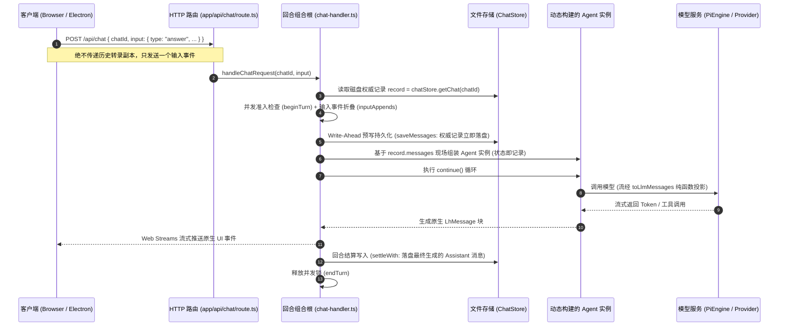
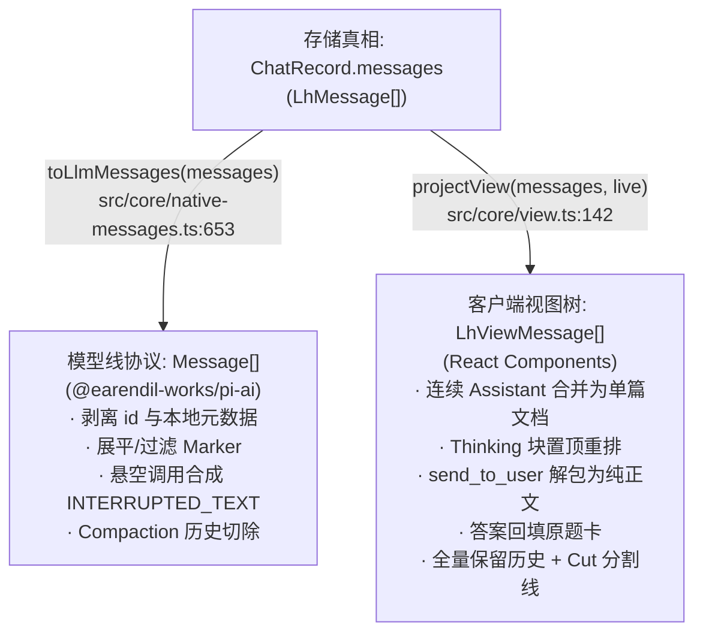
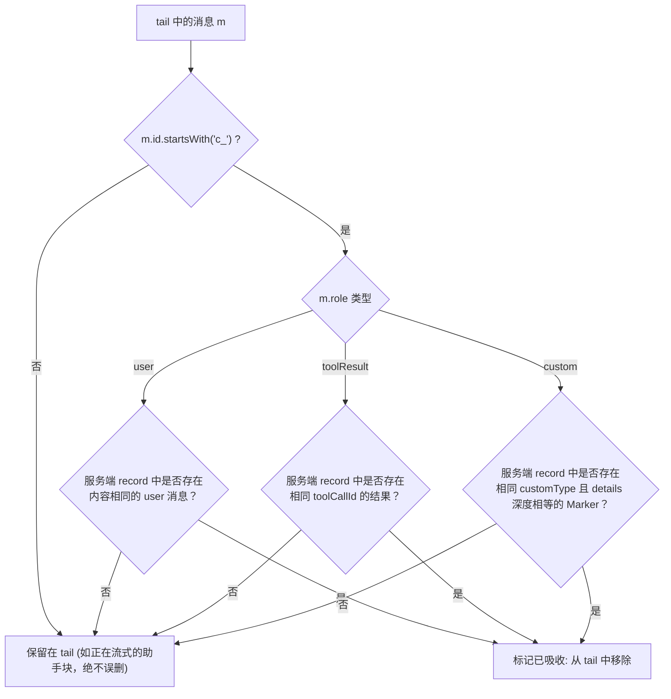

# 第 1 讲：无状态回合重建与状态投影（Stateless Turn & Dual Projections）

> **讲次定位**：掌握 LearnHarness 运行时的基石——理解“服务端转录独占权”、“状态即记录（The Record IS the State）”、“同源双端纯函数投影”以及“客户端乐观状态机”的工程实现。  
> **源码基准**：严格基于 learnharness 真实代码（引用附带相对路径与行号 `path:line`）。

---

## 1. 架构总览：从“有状态会话”到“事件溯源记录”

在大多数初级 LLM 聊天应用中，客户端通常维护着一个 `messages` 数组，每次向后端发请求时，把整个 `messages` 完整发给服务器。这种设计在构建复杂的导师智能体（Agent Harness）时会迅速崩溃：
- **安全性与权威性丧失**：客户端可以随意篡改历史上下文、伪造工具返回或注入提示词。
- **并发与竞态冲突**：多窗口同时打开、后台异步任务返回、用户中途插话会导致严重的状态分叉。
- **Token 滥用与重复计算**：每次请求上传巨大的 JSON 数组，网络开销大且无法实现服务端细粒度的上下文剪裁与压缩。

LearnHarness 采取了截然相反的系统哲学：**服务端独占转录所有权（Server-Exclusive Transcript Authority）**。



---

## 2. 服务端转录独占权与回合组合根（Composition Root）

### 2.1 输入事件契约（The Input-Events Contract）

根据 [src/server/chat-handler.ts:86-98](file:///home/antigravity/nakseuksa/learnharness/src/server/chat-handler.ts#L86-L98) 的架构设计：
`POST /api/chat` 的请求体只允许携带两个字段：
```ts
{
  chatId: string,
  input: TurnInput
}
```
其中 `TurnInput`（定义于 [src/core/input-events.ts:31-77](file:///home/antigravity/nakseuksa/learnharness/src/core/input-events.ts#L31-L77)）是一个受控的强类型联合事件：
- `text`：用户发送普通文本或文件附件。
- `answer`：学习者提交单选题、多选题或简答题答案。
- `thinking`：学习者在自由思考输入框提交的推演过程。
- `continue`：用户点击继续，或后台唤醒继续生成。
- `steers`：后台异步子任务（如研究员 Researcher）完成后的系统插话唤醒。
- `retry`：针对上一次出错回合的局部重试。

服务端拥有唯一的真实转录（Transcript）。`chat-handler.ts` 是整个回合的**组合根（Turn Composition Root）**：
1. **纯事件折叠**：调用 `inputAppends(record, input)`（[src/core/input-events.ts:140](file:///home/antigravity/nakseuksa/learnharness/src/core/input-events.ts#L140)），根据当前磁盘上的记录和用户输入事件，纯函数计算出本次应该追加的消息数组 `appends`。
2. **预写持久化（Write-Ahead Persistence）**：在调用模型之前，将 `[...record.messages, ...appends]` 立即写入磁盘（[src/server/chat-handler.ts:605](file:///home/antigravity/nakseuksa/learnharness/src/server/chat-handler.ts#L605)）。这样即使模型调用中途断网、崩溃或用户刷新浏览器，用户的作答数据已经安全落盘，绝不丢失。
3. **状态即记录（The Record IS the Agent State）**：
   ```ts
   // src/server/chat-handler.ts:680
   agentOpts.messages = asAgentMessages(agentMessages);
   ```
   服务端**从不常驻跨请求的 Agent 实例**。每次 HTTP 请求到达，根据最新的 `record.messages` 现场动态 `new Agent(...)`，执行单次回合，回合结束后该 Agent 实例即被垃圾回收。

---

## 3. 持久化真相（Stored Truth）与派生视图（Derived State）

在 LearnHarness 中，数据架构的核心守则：**严格区分“持久化真相（Stored Truth）”与“纯函数派生状态（Derived State）”**。

### 3.1 权威消息类型：`LhMessage` 与 `LhMarkerMessage`

保存在磁盘 `data/chats/<chatId>.json` 中的 `ChatRecord.messages` 数组，其元素类型为 `LhMessage`（定义于 [src/core/native-messages.ts:95-100](file:///home/antigravity/nakseuksa/learnharness/src/core/native-messages.ts#L95-L100)）：

```ts
export type LhMessage = (UserMessage | AssistantMessage | ToolResultMessage | LhMarkerMessage) & {
	id: string;
	cliContextWindow?: number;
};
```

这里 `UserMessage`、`AssistantMessage`、`ToolResultMessage` 均继承自底层 `@earendil-works/pi-ai` 的原生协议。而 LearnHarness 扩展了第 4 种一等公民——**自定义标记消息（`LhMarkerMessage`）**（[src/core/native-messages.ts:66-86](file:///home/antigravity/nakseuksa/learnharness/src/core/native-messages.ts#L66-L86)）：

```ts
export interface LhMarkerMessage {
	id: string;
	role: "custom";
	customType:
		| "graph-context"       // 注入图谱相关命题快照
		| "probe-handoff"       // 探测完成转入教学的交接指令
		| "subagent-steer"      // 子任务完成投递的结果
		| "subagent-abort"      // 子任务被取消的记录
		| "plan-block"          // 计划树生成的阶段性快照卡片
		| "practice-thinking"   // 练习模式下学习者提交的思路草稿
		| "practice-next"       // 推进下一题的占位
		| "problem-dismissed"   // 学习者跳过/搁置题目的标记
		| "compaction";         // 上下文历史截断与摘要标记
	content: string;
	display: boolean;
	details: unknown;
	timestamp: number;
}
```

### 3.2 真相边界对比表

| 概念项 | 是否落盘到 `ChatRecord`？ | 物理位置或派生机制 | 架构设计考量 |
|---|---|---|---|
| **会话历史消息** | **是（权威真相）** | `data/chats/<id>.json` 的 `messages` | 包含所有 user/assistant/toolResult 及 Marker 消息，不可篡改 |
| **用量与费用账本** | **是（追加账本）** | `ChatRecord.turns` 数组（[src/server/chat-handler.ts:620-635](file:///home/antigravity/nakseuksa/learnharness/src/server/chat-handler.ts#L620-L635)） | 平行记录每次调用模型的 Token 开销，与对话消息分离，便于对账 |
| **题卡交互状态**（`input-streaming` / `input-available` / `output-available`） | **否（纯派生）** | 由 `projectView` 动态计算（[src/core/view.ts:311-348](file:///home/antigravity/nakseuksa/learnharness/src/core/view.ts#L311-L348)） | 一个悬空工具调用只要没有对应的 `toolResult`，读取时自然处于 `input-available`，无需在数据库记录“等待作答”标志 |
| **连续讲义分组**（`LhViewMessage`） | **否（纯派生）** | 由 `projectView` 将多个连续的 assistant 步骤折叠合并 | 模型生成的多个连续 assistant 步在 UI 上合成单一连贯文章 |
| **思维链置顶顺序** | **否（纯派生）** | 由 `projectView` 稳定分区重排（[src/core/view.ts:227-234](file:///home/antigravity/nakseuksa/learnharness/src/core/view.ts#L227-L234)） | 磁盘保留物理吐字顺序，UI 投影保障思考过程始终悬浮在正文顶部 |
| **计划树节点状态**（`current` / `visited`） | **否（纯派生）** | 由 `src/core/phases.ts` 纯函数扫描消息历史推导 | 避免多处更新引发的状态不同步，由执行过的 `plan_init` 工具与后续对话动态推断当前正在第几步 |

---

## 4. 同源双端纯函数投影矩阵（Dual-Projection Matrix）

同一份持久化消息数组 `LhMessage[]`，在系统中需要同时服务于两个截然不同的受众：
1. **面向大模型线协议（The Wire）**：通过纯函数 `toLlmMessages(messages)`（[src/core/native-messages.ts:653](file:///home/antigravity/nakseuksa/learnharness/src/core/native-messages.ts#L653)）转换。
2. **面向浏览器渲染视图（The UI View）**：通过纯函数 `projectView(messages, live)`（[src/core/view.ts:142](file:///home/antigravity/nakseuksa/learnharness/src/core/view.ts#L142)）转换。



### 4.1 双端投影对比矩阵

下表展示了各类消息在这两个纯函数管道中的精确变换对比：

| 持久化消息分类 (`LhMessage`) | 模型端投影：`toLlmMessages()` ([native-messages.ts:653](file:///home/antigravity/nakseuksa/learnharness/src/core/native-messages.ts#L653)) | 浏览器端投影：`projectView()` ([view.ts:142](file:///home/antigravity/nakseuksa/learnharness/src/core/view.ts#L142)) | 架构设计考量 |
|---|---|---|---|
| **普通用户输入** (`role === "user"`) | 剥离 `id`，调用 `expandUserCitations` 展开笔记引用链接为模型可读文本（`:720`） | 转换为 `LhViewMessage`，解析为文本块 `textPart` 或图片块 `ImageContent`（`:204-212`） | 模型需要看到引用笔记的具体内容；UI 保持简洁链接渲染 |
| **助手思考链** (`AssistantMessage` 含 `thinking` 块) | 原样保留在 `content` 数组中传递给支持思维链的 Provider（`:720`） | 提取为 `type: "reasoning"` 部件，**稳定重排到所有 `text` 和 `toolCall` 部件上方**（`:227-234`） | 部分模型（如 GLM）会在作答尾部吐出尾随思考 Token，UI 投影确保“思考框”始终稳定在正文上方 |
| **多步助手消息** (连续多个 `role === "assistant"`) | 保持数组中的多个独立 Assistant 消息原样传输（`:720`） | **全部合并进入同一个 `LhViewMessage` 助手气泡**，并在步与步之间插入 `{ type: "step-start" }` 分割（`:311-317`） | 大模型的多步工具调用对学习者而言应该是一篇行云流水的讲义，而非破碎的来回对话框 |
| **显式输出工具** (`toolCall` 中的 `send_to_user`) | 保留原生 `toolCall` 块及紧随其后的 `toolResult`（`:720`） | 若执行成功，调用 `sendToUserText(block)` **直接解包为普通文本正文**，隐藏工具边框；仅在报错时渲染错误卡片（`:267-280`） | 模型受提示词叙述守卫约束必须通过工具显式发信；对用户而言它是正常正文，不能出现“工具卡片”外框 |
| **未答悬空工具调用** (有 `quiz` 等工具调用，但尚无用户回答) | 若该助手消息未中断，**凭空合成一条带 `INTERRUPTED_TEXT` 的 `toolResult` 结果**挂在后方（`:735-742`） | 映射为 `type: "tool-quiz"`，根据 `streamingMessage` 判定置为 `state: "input-available"`，触发底部答题栏挂载（`:260, 345`） | 大模型 API（如 Anthropic/OpenAI）强校验：如果历史消息中存在 `tool_use`，后面必须紧跟 `tool_result`，否则报 400 协议错误；而 UI 视图正是靠未配对的悬空调用识别当前需展示的输入卡 |
| **学习者答题结果** (`role === "toolResult"`) | 剥离 `id`，只发送精简紧凑的 JSON 文本 `compactAnswerForModel`（`:720`） | **不创建新气泡**，反向查找提问的 `toolCallId` 卡片，通过 `applyResult` 将完整判分数据 `details` 原地挂载并更新为已答状态（`:157-178, 220-222`） | **双受众设计（Two Audiences）**：大模型只需知道选项索引和正确与否（省 Token）；用户界面需要原卡片刷新，展示详细解析和绿/红判分徽章 |
| **计划树快照** (`customType: "plan-block"`) | 命中 `marker.customType === "plan-block"`，直接 `continue` **完全过滤丢弃**（`:700`） | 定位前一个助手组中最后一个成功的 `tool-plan_init` 部件，通过 `splice` **原地插入计划卡片**（`:478-488`） | 模型早已从 `plan_init` 工具参数得知了计划树；该 Marker 只是为了让 UI 在历史中正确渲染当时的进度快照 |
| **阶段切换交接** (`customType: "probe-handoff"`) | 展平为一条标准用户消息，内容为预置指令 `HANDOFF_TEXT`（`:707-713`） | 渲染为阶段切换的系统弱提示线（`:391-398`） | 模型需要看到具体的交接文本指令以激活 Teacher 规划；学习者只需要看到平静的阶段过渡条 |
| **历史上下文压缩** (`customType: "compaction"`) | **切除历史**：截断 `firstKeptMessageId` 之前的所有消息，仅在最顶部置顶一条摘要消息 `head`（`:662-675`） | **全量保留**：不隐藏任何早期消息，仅在被切除点上方插入一条 `data-compaction-cut` 分割线，原位渲染摘要入口（`:180-202`） | Compaction 旨在降低模型上下文消耗和费用，但学习者向上滚动阅读时绝对不能丢失早先的教学记录 |

---

## 5. 客户端纯 TS 会话状态机（`SessionModel`）

LearnHarness 的客户端没有将流式状态散落在 React 组件的 `useState` 中，而是在 [components/session-core.ts:266](file:///home/antigravity/nakseuksa/learnharness/components/session-core.ts#L266) 中实现了一个**无 React 依赖的纯 TypeScript 状态机 `SessionModel`**。

### 5.1 双列表架构：`base` 与 `tail`

```ts
// components/session-core.ts:281-282
private base: LhMessage[];   // 服务端已确认的权威历史 (从 GET /api/chats/:id 同步)
private tail: LhMessage[];   // 客户端乐观追加项 + 正在流式接收的临时项
```

- 当用户点击发送或提交选项时，客户端立即使用 `localId()` 生成一个带 `c_` 前缀的临时消息（如 `c_m1a2b3`）压入 `tail`，UI 瞬间乐观渲染，零延迟。
- 随后客户端向后端发起 `POST /api/chat` 并读取 SSE 流。

### 5.2 权威消解：`absorbed()` 纯函数

当服务端在 Write-Ahead 阶段将消息落盘，并通过流式或轮询将权威记录同步回客户端时，客户端如何知道哪条乐观消息已经被吸收，从而避免**一条消息渲染出两个重复卡片**？

答案是 [components/session-core.ts:173-206](file:///home/antigravity/nakseuksa/learnharness/components/session-core.ts#L173-L206) 的 `absorbed()` 纯函数：



**为什么不能根据 `m.id === r.id` 来去重？**  
因为客户端生成的临时 ID 是以 `c_` 开头的随机字串，而服务端在落盘时会调用 `newMessageId()` 生成统一格式的权威 UUID。二者 ID 永远不可能相同，必须依据业务特征（用户文本、`toolCallId`、Marker 的结构体哈希）进行等价性消解。

---

## 6. 正向证据门控（Positive Evidence Gate）

在多步流式响应中，常见的前端缺陷是：当回合处于 `inFlight`（流式传输中）时，页面上所有的工具卡片都变成“加载中”旋转图标。这会导致上一轮已经回答完成的题目卡片突然重新闪烁变成骨架屏。

LearnHarness 在 [src/core/view.ts:245](file:///home/antigravity/nakseuksa/learnharness/src/core/view.ts#L245) 实施了**正向证据门控（Positive Evidence Gate）**：
```ts
const streamingMessage = live?.streamingIds.has(m.id) === true;
```
只有当当前遍历到的这条消息的 `m.id` **明确存在于本回合当前流式消息集合 `streamingIds` 中时**，它的工具块才被允许进入 `"input-streaming"` 状态。历史悬空卡片因为其 `m.id` 不在本轮集合中，哪怕整个会话繁忙，也绝对保持静态的 `"input-available"`，消除了复杂的异步竞态闪烁。

---

## 7. 核心架构启示总结

1. **State as Ledger, View as Projection**：  
   会话历史就是单一事实真相（Single Source of Truth）。不要在数据库里冗余存储“当前阶段”、“题目是否已做”等派生字段，将它们全部交给纯函数在读取时即时投影。
2. **两套受众，两次变形**：  
   LLM 需要紧凑、协议合法、展开引用的 Token 序列；学习者需要结构化、图文并茂、具有交互动效的富文本组件。在底层不可变记录之上分叉出 `toLlmMessages` 与 `projectView`，是实现高内聚低耦合的关键典范。
3. **Write-Ahead 持久化保障确定性**：  
   用户输入先入盘、再调用模型。任何模型端崩溃或异常中止都不会导致用户输入丢失，重新加载时系统依然能够凭借不可变记录准确还原现场。

---

## 本讲讨论与答疑思考点

在进入 **第 2 讲：自适应教学状态机与角色分派缝（Role Dispatch Seam）** 之前，你可以结合本讲内容思考或提问以下要点：
1. **中断恢复思考**：如果大模型在调用一个普通工具（如 `search`）中途用户刷新了页面，重新进入会话时，`toLlmMessages` 合成的 `INTERRUPTED_TEXT` 是如何让下一次模型调用不崩溃的？
2. **Token 经济性思考**：为什么在 `newAnswerResult` 中要把面向模型的文本和面向 UI 的 `details` 拆开，而不是直接把题目的题目题干再发一遍给模型？
