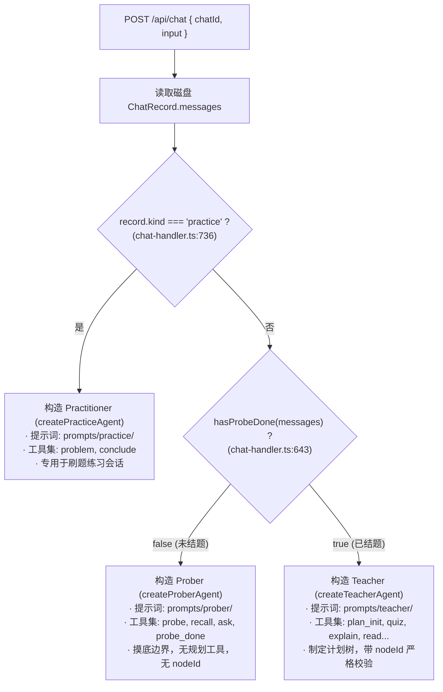
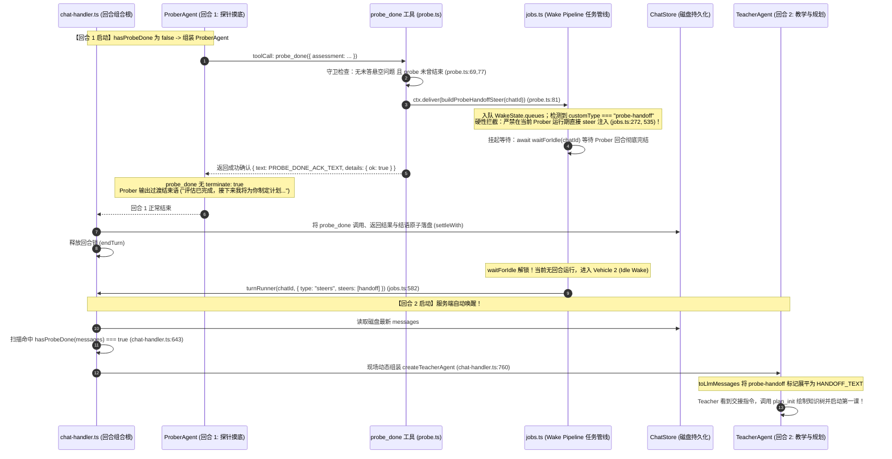

# 第 2 讲：自适应教学状态机与角色分派缝（Role Dispatch: Prober / Teacher / Practitioner）

> **讲次定位**：深入剖析 LearnHarness 运行时的角色分派体系——理解为什么“多阶段智能体”绝不该通过修改运行期 Prompt 实现，掌握基于不可变转录（Transcript Seam）的无状态角色判定、工具契约物理隔离、以及 Prober → Teacher 原子交接的时序闭环。  
> **源码基准**：严格基于 learnharness 真实代码（引用附带相对路径与行号 `path:line`）。

---

## 1. 架构总览：为什么拒绝“单一超级 Agent 统一全场”？

很多 LLM 教学或多阶段工作流系统倾向于设计一个拥有几十个工具、几千行 Prompt 的“全能 Agent”，并在系统提示词中写道：
> *“当你处于第一阶段时，请提问摸底；当你觉得摸底差不多了，请切换到第二阶段开始制定教学大纲……”*

这种设计在工程生产中存在致命缺陷：
1. **提示词注意力漂移（Prompt Drift）**：模型极难在超长提示词中严格遵守阶段边界，经常在摸底时就迫不及待地开始长篇大论讲课，或者在讲课中途遗忘当前的教学计划。
2. **工具 Schema 污染与幻觉调用**：在探针摸底阶段暴露写计划、生成动画等高级工具，模型极易产生幻觉参数调用，导致无意义的报错。
3. **缺少强工程确定性**：何时阶段交接变成了模型不可控的随机行为，后端系统无法保证“先探明边界、再生成计划树、再依树讲授”的教学法刚性约束。

LearnHarness 的设计哲学是：**角色的本质是“系统提示词 + 暴露工具集 + 拦截钩子”的三元组；角色的切换是“转录分派缝（Transcript Seam）”的无状态物理分派**。



---

## 2. 三大智能体角色职责与边界

在 LearnHarness 中，系统定义了三种 `AgentKind`（[src/agent/teacher-agent.ts:100-104](file:///home/antigravity/nakseuksa/learnharness/src/agent/teacher-agent.ts#L100-L104)）：

### 2.1 探测者：Prober（探针摸底）
- **核心使命**：探明学习者的理解边界（*“Bracket the learner's edge”*）。通过 1~3 道针对依赖前提的测试，摸清学习者的理解下限（Floor）与上限（Ceiling），明确教学起点。
- **行为约束**：
  - 严禁展开长篇大论教学；
  - 只有探测类出题工具（`probe` / `recall`）和澄清工具（`ask_user_question`）；
  - **绝不暴露计划工具（`plan_init`）**，出题参数中**绝不包含 `nodeId` 字段**；
  - 摸底完成后必须调用 `probe_done` 提交学习者能力评估报告，触发交接。

### 2.2 讲师：Teacher（规划与讲授）
- **核心使命**：以 Prober 产出的摸底评估为输入，首先调用 `plan_init` 生成有向无环依赖图（DAG）的计划树，随后按照计划树的节点逐级讲授、提问和巩固。
- **行为约束**：
  - 拥有全套完整工具集（规划、文件检索、图像展示、后台子任务生成）；
  - 出题工具为 `quiz` / `explain`，其参数**必须携带必填字段 `nodeId`**，并且该 `nodeId` 会在调用时实时校验是否属于当前计划树上的合法节点；
  - 绝不暴露 `probe_done` 工具。

### 2.3 练习导师：Practitioner（课后练习）
- **核心使命**：专门针对 `kind === "practice"` 的独立练习会话。从第 1 回合起常驻，不经历探针与规划阶段。
- **行为约束**：
  - **极简工具集**：核心工具只有 `problem`（出题并隐藏解答）与 `conclude`（批改并揭示解答）；
  - 不存在 `plan_init`，也不存在 `quiz`；
  - 采用苏格拉底式提示梯子（Hint Ladder），支持学习者分步推导。

---

## 3. 转录分派缝（The Transcript Seam）的物理实现

在 [src/server/chat-handler.ts](file:///home/antigravity/nakseuksa/learnharness/src/server/chat-handler.ts) 中，服务端在完成 Write-Ahead 持久化后，执行以下核心分派代码：

```ts
// src/server/chat-handler.ts:643
const teaching = hasProbeDone(agentMessages);

// src/server/chat-handler.ts:734-780
const constructed: TeachingAgent = buildAgent
    ? buildAgent({ ...agentOpts, teaching })
    : record.kind === "practice"
        ? createPracticeAgent({ chatId, chatStore: stores.chatStore, ... }, agentOpts)
        : teaching
            ? createTeacherAgent(teacherCtx, agentOpts)
            : createProberAgent(proberCtx, agentOpts);
```

### 3.1 什么是 `hasProbeDone`？

`hasProbeDone` 是一个纯函数，定义于 [src/core/native-messages.ts:782-785](file:///home/antigravity/nakseuksa/learnharness/src/core/native-messages.ts#L782-L785)：

```ts
export function hasProbeDone(messages: readonly LhMessage[]): boolean {
    return probeDoneResultIds(messages).size > 0;
}
```

它调用 `probeDoneResultIds(messages)`（[src/core/native-messages.ts:760-780](file:///home/antigravity/nakseuksa/learnharness/src/core/native-messages.ts#L760-L780)），遍历整段会话消息历史：
1. 查找是否存在 `role === "assistant"` 的消息调用了工具 `name === "probe_done"`；
2. 并且在该调用之后，是否存在对应的 `role === "toolResult"` 且 `isError !== true` 的成功结果。

**工程启示**：
- **无状态重建**：服务器不需要在数据库里维护一个诸如 `status: "PROBING" | "TEACHING"` 的可变枚举字段。
- **不可篡改性**：消息记录（Transcript）本身就是状态机。只要历史记录中存在一条成功的 `probe_done` 调用与返回，任何时候加载这个会话，计算结果都必然是 `teaching === true`，确定性构建 `TeacherAgent`。

---

## 4. 角色工具集物理隔离契约

为了彻底杜绝大模型的跨阶段幻觉，LearnHarness 在工具命名、参数 Schema 以及代码实现上实施了**严格的物理硬隔离**。

下表详细对比三大角色的核心工具契约（标准六列表格）：

| 工具名 (`name`) | 定义位置 (`path:line`) | 暴露门控角色 | 参数预处理与 Schema (`prepareArguments` / `parameters`) | 软失败返回值（内循环自愈） | 成功返回值与 `terminate` 标志 |
|---|---|---|---|---|---|
| **`probe`** (选择题) | [src/agent/tools.ts:206](file:///home/antigravity/nakseuksa/learnharness/src/agent/tools.ts#L206) | 仅 **Prober** | `prepareQuestionArguments` + `probeQuizInputSchema`（**无 `type` 与 `nodeId` 字段**） | `invalidInputResult("probe", problems)` (`isError: true`) | `questionResult()` (`terminate: true`) |
| **`recall`** (自由回忆) | [src/agent/tools.ts:250](file:///home/antigravity/nakseuksa/learnharness/src/agent/tools.ts#L250) | 仅 **Prober** | `prepareQuestionArguments` + `explainInputBase`（**无 `nodeId`**） | `invalidInputResult("recall", problems)` (`isError: true`) | `questionResult()` (`terminate: true`) |
| **`probe_done`** (结题交接) | [src/agent/tools/probe.ts:51](file:///home/antigravity/nakseuksa/learnharness/src/agent/tools/probe.ts#L51) | 仅 **Prober** | `healToolRecord` + `probeDoneInputSchema`（评估摘要） | `{ ok: false, error: "..." }`（业务字段告知原因） | `toToolResult({ text: PROBE_DONE_ACK_TEXT, details: { ok: true } })` (**无 `terminate`，让 Prober 讲完结语**) |
| **`plan_init`** (制定大纲) | [src/agent/tools/plan.ts:50](file:///home/antigravity/nakseuksa/learnharness/src/agent/tools/plan.ts#L50) | 仅 **Teacher** | `planInitInputSchema`（有向无环计划图） | `{ ok: false, error: "..." }` | `{ ok: true }` 并持久化计划树到 `ChatRecord.tree` |
| **`quiz`** (教学选择题) | [src/agent/tools.ts:376](file:///home/antigravity/nakseuksa/learnharness/src/agent/tools.ts#L376) | 仅 **Teacher** | `prepareQuestionArguments` + `quizInputObject`（**强制包含必填 `nodeId` 和 `type`**） | `invalidInputResult("quiz", problems)`（含 `nodeIdProblem` 校验失败） | `questionResult()` (`terminate: true`) |
| **`explain`** (教学自由问答) | [src/agent/tools.ts:222](file:///home/antigravity/nakseuksa/learnharness/src/agent/tools.ts#L222) | 仅 **Teacher** | `prepareQuestionArguments` + `explainInputObject`（**强制包含 `nodeId`**） | `invalidInputResult("explain", problems)` | `questionResult()` (`terminate: true`) |
| **`problem`** (练习发题) | [src/agent/tools/practice.ts:60](file:///home/antigravity/nakseuksa/learnharness/src/agent/tools/practice.ts#L60) | 仅 **Practitioner** | `practiceProblemInputSchema`（题干 + 隐藏解答） | `invalidInputResult("problem", problems)` | `problemResult()` (`terminate: true`) |
| **`conclude`** (练习结题) | [src/agent/tools/practice.ts:160](file:///home/antigravity/nakseuksa/learnharness/src/agent/tools/practice.ts#L160) | 仅 **Practitioner** | `practiceConcludeInputSchema`（判分与总结） | `{ ok: false, error: "..." }` | `concludeResult()` (**无 `terminate`，允许连贯出下一题**) |

### 4.1 核心设计点：为什么 Prober 的出题工具叫 `probe`，Teacher 叫 `quiz`？
在早期版本中，两个阶段的出题工具都命名为 `quiz`。这导致了一个经典的 LLM 习惯迁移缺陷（见 [src/agent/tools.ts:198-205](file:///home/antigravity/nakseuksa/learnharness/src/agent/tools.ts#L198-L205) 注释）：
> 当从 Prober 切换到 Teacher 后，Teacher 在调用 `plan_init` 制定好大纲后的第一道题，依然习惯性地按照探针阶段没有 `nodeId` 的参数格式输出 `quiz(...)`，导致第一道教学题立即因为缺少 `nodeId` 校验失败而触发重试。

为了彻底阻断模型的历史惯性，代码将 Prober 阶段的多选工具重命名为 **`probe`**，问答工具重命名为 **`recall`**；而在 Teacher 阶段则命名为 **`quiz`** 与 **`explain`**。不同的工具名称在模型注意力中形成了天然的边界线，彻底解决了跨阶段参数遗漏问题。

---

## 5. Prober → Teacher 原子交接时序全解析

教学会话如何从 Prober 无缝切到 Teacher，是整个 Agent Harness 中最精妙的并发控制流设计：



### 5.1 `probe_done` 的三道防线

根据 [src/agent/tools/probe.ts:66-79](file:///home/antigravity/nakseuksa/learnharness/src/agent/tools/probe.ts#L66-L79)：
1. **会话存在性检查**：`!record` 拦截非法会话。
2. **悬空未答问题拦截**：`hasUnresolvedQuestion(record.messages)`。如果上一道探测题学生还没有作答，绝不允许结题，强制返回错误：*"A question is still open — resolve it before concluding the probe."*
3. **单次结题守卫**：`probeConcluded(record.messages)`。整个学习生命周期内 `probe_done` 只能成功结算一次，防止重复触发交接。

### 5.2 致命死锁规避：为什么 `probe-handoff` 绝不能走 Live Steering？

在 LearnHarness 中，后台子任务完成时，通常有两种投递方式（详见第 4 讲）：
- **Vehicle 1（Live Steering）**：如果当前正有一个 Agent 在流式生成中，直接调用 `agent.steer(msg)` 插话注入当前正在运行的 Agent 循环。
- **Vehicle 2（Idle Wake）**：如果当前没有 Agent 运行，等待空闲后拉起全新的服务端请求。

**为什么 `probe-handoff` 必须且只能走 Vehicle 2？**
- 当 Prober 刚刚调用完 `probe_done` 时，**回合 1 正在运行**（`isTurnRunning(chatId) === true`）。
- 如果此时通过 Vehicle 1 将 `probe-handoff` 强行塞给当前的 Agent，接管这个 Hand-off 指令的将是**尚未退出的 `ProberAgent` 实例**！
- 而 `ProberAgent` 的提示词是摸底，更严重的是它**根本没有挂载 `plan_init` 工具**。它收到交接指令后尝试画大纲，会立刻因为找不到 `plan_init` 工具而发生灾难性调用崩溃！

因此，`jobs.ts` 在两处设置了刚性代码断点：
```ts
// src/server/jobs.ts:272 (handOffEligible)
if (!entry.waking && !entry.deferred && entry.handedTo !== agent && entry.steer.customType !== "probe-handoff") {
    agent.steer(entry.steer);
}

// src/server/jobs.ts:534 (pump)
const handoffWaits = stillPending.some(e => e.steer.customType === "probe-handoff");
if (handable.length > 0 && !handoffWaits) { return; }
if (handable.length > 0) {
    await waitForIdle(chatId); // 强制等待 Prober 完结释放锁
    continue;
}
```
只有等待 `ProberAgent` 说完结语、写盘完毕、`endTurn()` 释放了进程锁，`jobs.ts` 才通过 `turnRunner` 启动回合 2，此时重新读盘，`hasProbeDone` 返回 `true`，正式构建装备了 `plan_init` 的 `TeacherAgent`！

---

## 6. 异常容错与降级恢复能力

分布式与无状态架构的核心优势在于**无惧网络抖动与进程重启**：

1. **队列异常自动降级（Self-Healing by Transcript）**：
   在 [src/agent/tools/probe.ts:81-87](file:///home/antigravity/nakseuksa/learnharness/src/agent/tools/probe.ts#L81-L87) 中：
   ```ts
   try {
       ctx.deliver(buildProbeHandoffSteer(ctx.chatId));
   } catch (err) {
       console.error(`[chat ${ctx.chatId}] probe handoff queueing failed:`, err);
   }
   ```
   如果唤醒队列在排队时遭遇内存错误，代码仅仅记录日志而不会抛出异常中断当前回合。  
   **为什么？** 因为 `probe_done` 的成功调用与评估内容已经随回合 1 写入了磁盘。即使自动唤醒失败，学习者下一次在输入框发送任何文本（如“你好”或“我们开始吧”），服务端重新执行 `chat-handler.ts` 时，扫描到的 `hasProbeDone` 依然是 `true`，依然会正确无误地构建 `TeacherAgent` 启动大纲规划！

2. **Practitioner 的回合级闭包门控（`PracticeGate`）**：
   在练习模式下，学习者可能会在一次交互中先触发上一题的批改总结（`conclude`），模型紧接着在同一轮输出中提出下一道新题（`problem`）。  
   由于 Write-Ahead 只持久化了回合初期的输入，磁盘上的记录在回合结束前是冻结的。为了防止 `conclude` 与 `problem` 在同一个回合执行时因为磁盘状态未更新而相互判定冲突，[src/agent/tools/practice.ts:50-60](file:///home/antigravity/nakseuksa/learnharness/src/agent/tools/practice.ts#L50-L60) 设计了 **`PracticeGate` 闭包状态机**：
   每次请求现场构造该 Gate，在内存闭包中实时跟踪本回合内的出题与结题状态，既保证了单次回合内多工具调用的时序一致性，又杜绝了跨回合的状态泄露。

---

## 本讲讨论与答疑思考点

在进入 **第 3 讲：工具即控制流与中断机制（Tools as Control Flow & Question Stopper）** 之前，你可以结合本讲内容思考或提问以下要点：
1. **架构扩展性思考**：如果未来要为 LearnHarness 新增一个“考前冲刺复习（Reviewer）”角色，按照当前架构，应该在哪些文件定义其 `AgentKind`、分派缝判定规则以及工具集？
2. **控制流时序思考**：为什么 `probe_done` 工具在成功执行后，返回的对象中**不带** `terminate: true`？如果给它加上 `terminate: true` 会对学习者的主观体验产生什么副作用？
