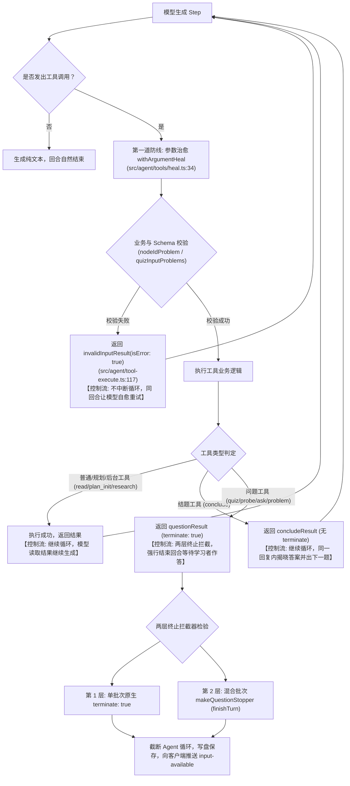
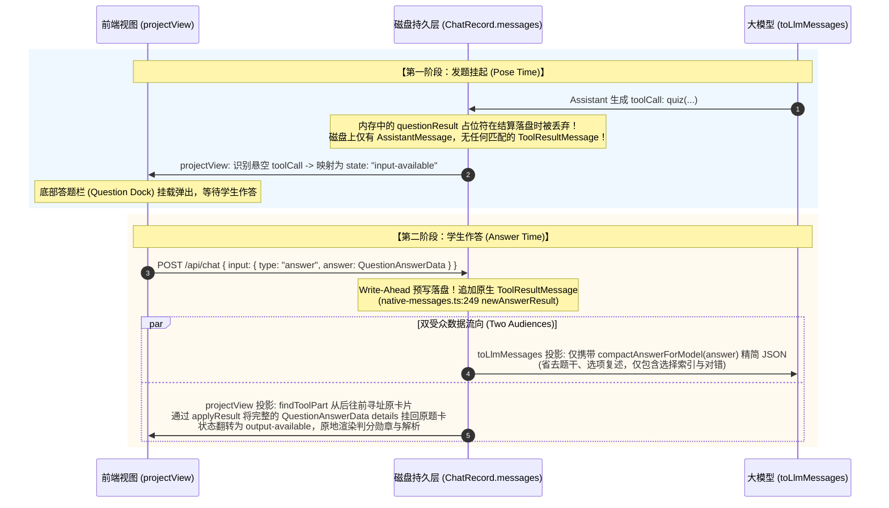

# 第 3 讲：工具即控制流与中断机制（Tools as Control Flow & Question Stopper）

> **讲次定位**：掌握 LearnHarness 中工具调用的最高阶用法——在智能体运行时中，工具绝不仅仅是“外部 API 插件”，更是**驱动回合执行循环暂停、重试自愈与人机交互交接的核心控制流（Tool-as-Control-Flow）**。  
> **源码基准**：严格基于 learnharness 真实代码（引用附带相对路径与行号 `path:line`）。

---

## 1. 架构总览：工具如何作为“执行循环控制器”？

在标准的 ReAct 智能体循环中，工具通常是同步执行并立即将结果返给大模型，驱动模型继续思考并输出最终文本。但在**教学导师系统（Tutor Agent）**中，这种朴素机制直接面临三大工程困境：
1. **教学等待反模式**：模型提出一道选择题（`quiz`）后，绝不能由系统自问自答，更不能让模型一次性把题目、选项、答案和后续讲义一股脑全吐出来。**提出问题必须立刻强制终止当前 LLM 执行循环**，将控制权交还给学习者。
2. **混合调用穿透风险**：模型可能在同一条回复中既输出了正文，又调用了普通工具（如 `read`），最后调用了出题工具（`quiz`）。如果底层框架只依赖简单的返回标识，稍有不慎就会导致循环未截断，模型继续盲目生成。
3. **参数格式脆弱性**：弱模型（如 GLM 或某些开源模型）在输出工具参数时，经常出现双重 JSON 转义、字符串包数组、缺失必填计划节点等毛病。若直接抛出异常崩溃，会导致整个回合中断；若由后端代为乱猜，又会违背教学原则。

LearnHarness 的设计范式是：**将工具调用体系化为控制流拦截器（Stopper）、自愈触发器（Self-Healer）与双受众分流器（Two-Audiences Bifurcator）**。



---

## 2. 问题停止器（Question Stopper）与两层终止机制

当大模型调用了出题工具（`quiz`、`probe`、`ask_user_question`、`problem`）时，系统必须保证：**该工具的成功提出必定导致本回合物理终止，绝不允许模型继续向下执行**。

为了实现这一刚性保证，LearnHarness 构建了**双保险兜底防御机制（Belt-and-Suspenders Architecture）**：

### 2.1 第一层防线：单工具批次原生终止（`terminate: true`）

在 [src/agent/tool-execute.ts:222-251](file:///home/antigravity/nakseuksa/learnharness/src/agent/tool-execute.ts#L222-L251) 中，问题类工具执行成功后返回的对象显式标记了 `terminate: true`：

```ts
// src/agent/tool-execute.ts:222-233
export function questionResult(): AgentToolResult<null> {
	return {
		content: [
			{
				type: "text",
				text: "Question posed — the turn ends here; the learner's graded answer arrives as this call's result.",
			},
		],
		details: null,
		terminate: true,
	};
}
```

底层 `@earendil-works/pi-agent-core` 的原生执行循环在每个批次（Batch）执行完后，会检查该批次内的工具结果。**如果该批次内的所有工具结果均带有 `terminate: true`**，循环引擎原生退出。

### 2.2 第二层防线：混合批次兜底终止器（`makeQuestionStopper` + `finishTurn`）

**为什么仅有 `terminate: true` 是不够的？**  
大模型有时会在同一条 Assistant 消息中同时发出多个工具调用（混合批次，Mixed Batch），例如：
- `toolCall 1`: `send_to_user({ text: "请看下面的题目..." })`
- `toolCall 2`: `quiz({ question: "...", ... })`

在混合批次中，`send_to_user` 返回的结果是不带 `terminate: true` 的。按照底层引擎的语义，只有“批次内全部为 terminate”才会退出，因此混合批次会**穿透**第一层防线，导致模型误以为还需要继续生成下一轮！

为了彻底封死这一漏洞，LearnHarness 在 [src/agent/teacher-agent.ts:182-202](file:///home/antigravity/nakseuksa/learnharness/src/agent/teacher-agent.ts#L182-L202) 编写了独立的 `makeQuestionStopper`：

```ts
// src/agent/teacher-agent.ts:182-202
function makeQuestionStopper(kind: AgentKind) {
	return (context: {
		message: { content: Array<{ type: string; id?: string; name?: string }> };
		toolResults: Array<{ toolCallId: string; isError?: boolean }>;
	}): boolean => {
		const called = new Set(
			context.message.content
				.filter((c) => c.type === "toolCall" && c.name !== undefined && (
					(QUESTION_TOOLS as readonly string[]).includes(c.name) ||
					(kind === "practice" && c.name === PRACTICE_PROBLEM_TOOL)
				))
				.map((c) => c.id!),
		);
		if (called.size === 0) return false;
		// 关键守卫：只有当每一个被调用的问题工具都成功结算（无 isError）时，才触发停止！
		for (const result of context.toolResults) {
			if (called.has(result.toolCallId) && result.isError) return false;
		}
		return true;
	};
}
```

并将该停止器挂载在 `new Agent` 的 `finishTurn` 钩子上（[src/agent/teacher-agent.ts:272](file:///home/antigravity/nakseuksa/learnharness/src/agent/teacher-agent.ts#L272)）：
```ts
finishTurn: (turn) => (stopper(turn) ? { action: "end" } : undefined)
```
无论批次多么混乱，只要包含有效的问题提出，`finishTurn` 就会在所有工具结果挂载后、下一轮推理开始前**强制返回 `{ action: "end" }`**，掐断循环。

### 2.3 校验失败绝不终止：支持同回合自我修复

注意 `makeQuestionStopper` 中的负向判定（`:197-199`）：
```ts
for (const result of context.toolResults) {
    if (called.has(result.toolCallId) && result.isError) return false;
}
```
如果模型发出的问题参数不合法（如选项数不足、缺少正确答案、或者 `nodeId` 不在计划树上），工具执行会返回 `isError: true`。  
此时 **`stopper` 明确返回 `false`**！执行循环**不会中断**，模型将在同一回合内立刻读取到错误详情，重新生成正确的题目参数，实现零人工介入的自我修复。

---

## 3. 参数前置治愈与内循环自愈重试

为了保障复杂出题在弱模型下的高成功率，LearnHarness 设计了两个相互配合的工程机制：

### 3.1 参数前置治愈（Universal Argument Heal）

在大模型生态中，弱模型或某些特定推理框架在输出复杂 JSON 参数时，极易产生非标准畸形表达：
- 将数组字段编码为字符串：`options: "[\"A\", \"B\"]"`；
- 将枚举字段加带多余引号：`type: "\"predict\""`（著名的 Whitehead 死循环事件，见 [src/agent/tools/heal.ts:8-15](file:///home/antigravity/nakseuksa/learnharness/src/agent/tools/heal.ts#L8-L15) 注释）。

LearnHarness 在 [src/agent/tools/heal.ts:34-48](file:///home/antigravity/nakseuksa/learnharness/src/agent/tools/heal.ts#L34-L48) 抽象了**通用参数治愈包装器 `withArgumentHeal` 与 `healToolRecord`**：

```ts
// src/agent/tools/heal.ts:34-40
export function withArgumentHeal(tool: AgentTool<any>): AgentTool<any> {
	const inner = tool.prepareArguments;
	return {
		...tool,
		prepareArguments: (args: unknown) => 
			healEncodedArguments(inner ? inner(args) : args, tool.parameters),
	};
}
```

在底层框架进行严格的 TypeBox Schema 校验**之前**，`prepareArguments` 钩子会先运行纯函数 `healEncodedArguments`：
1. 自动剥离多余的双重引号与反斜杠；
2. 自动尝试将 JSON 字符串反序列化为数组/对象；
3. 将治愈后的干净对象送入 Schema 校验。  
所有工具在注册时必须经过 `healToolRecord` 统一包裹，从而在源头上化解了 90% 以上由模型格式毛刺引发的无效调用。

### 3.2 内循环自愈报错：`invalidInputResult`

如果参数存在根本性的逻辑错误（例如单选题没有正确选项、选项文本为空、或引用的 `nodeId` 根本不在当前教学计划中），系统绝不粗暴 `throw Error`，而是调用 [src/agent/tool-execute.ts:117-131](file:///home/antigravity/nakseuksa/learnharness/src/agent/tool-execute.ts#L117-L131) 返回结构化的错误工具结果：

```ts
// src/agent/tool-execute.ts:117-131
export function invalidInputResult(
	toolName: string,
	problems: string[],
): AgentToolResult<{ tool: string; problems: string[] }> {
	return {
		content: [
			{
				type: "text",
				text: `Invalid tool input for tool "${toolName}":\n${problems.map((p) => `- ${p}`).join("\n")}`,
			},
		],
		isError: true,
		details: { tool: toolName, problems },
	};
}
```

**为什么这种设计极具威力？**
- 对模型而言：它收到了一条标准的 `toolResult`，且 `isError: true`，文本中清晰罗列出所有缺陷（例如 `- nodeId "chain-rule" matches no node in this session's plan map`）。模型在同一个上下文内能够准确理解自己错在哪，并在下一步立即更正。
- 对前端而言：`details` 中保留了原始结构体，UI 不会因为后端异常中断而白屏崩溃。

---

## 4. 问答闭环在三层的非对称演化（Pose → Answer）

一次完整的“提问与作答”生命周期，在磁盘持久层（Disk）、大模型上下文（Model）、以及前端渲染树（UI）这三层之间，经历着完全不同的状态流转。



### 4.1 三层状态流转详细对比表

| 阶段 | 磁盘持久层 (`ChatRecord.messages`) | 大模型上下文 (`toLlmMessages`) | 前端视图树 (`projectView`) |
|---|---|---|---|
| **提问刚完成，学生尚未作答 (Pose 挂起期)** | **仅保存 `AssistantMessage` 里的 `toolCall` 块**。<br/>内存中的 `questionResult()` 占位符在落盘时被显式过滤丢弃，磁盘上**绝不落盘任何假数据**（[src/core/native-messages.ts:28-33](file:///home/antigravity/nakseuksa/learnharness/src/core/native-messages.ts#L28-L33)）。 | 若此时因意外刷新开启新回合，`toLlmMessages` **凭空合成一条 `INTERRUPTED_TEXT` 结果**追加在后（[src/core/native-messages.ts:735-742](file:///home/antigravity/nakseuksa/learnharness/src/core/native-messages.ts#L735-L742)），防止大模型 API 报未闭合协议错误。 | `toolPartOf` 检测到未结算的调用，将其设为 **`state: "input-available"`**（[src/core/view.ts:345](file:///home/antigravity/nakseuksa/learnharness/src/core/view.ts#L345)），驱动页面底部 Question Dock 弹出。 |
| **学生提交答案后 (Answer 结算期)** | 追加一条权威 `ToolResultMessage`（[src/core/native-messages.ts:249](file:///home/antigravity/nakseuksa/learnharness/src/core/native-messages.ts#L249)）：<br/>- `content`: 精简 JSON 字符串<br/>- `details`: 完整 `QuestionAnswerData` | 剥离应用 ID，大模型**仅读取 `content` 中的精简文本**（[src/core/question-core.ts:783](file:///home/antigravity/nakseuksa/learnharness/src/core/question-core.ts#L783) `compactAnswerForModel`），完全屏蔽冗余题目。 | 不生成新消息气泡！通过 `findToolPart(toolCallId)`（[src/core/view.ts:157](file:///home/antigravity/nakseuksa/learnharness/src/core/view.ts#L157)）反向查找原题卡，执行 `applyResult` 将状态变更为 **`state: "output-available"`**，**原地渲染判分勋章与解析**。 |

### 4.2 双受众精简设计（The Two Audiences Diet）

在传统 LLM 应用中，当用户作答后，系统往往会把题目、选项、学生答案、解析完整拼成一段长文本丢给模型，这被称为“Token 翻倍陷阱”。

在 LearnHarness 中，[src/core/native-messages.ts:243-266](file:///home/antigravity/nakseuksa/learnharness/src/core/native-messages.ts#L243-L266) 确立了严格的 **Two Audiences 原则**：
- **受众 A：大模型**：题干、选项、解析早在发题时就已经作为参数在上一条 Assistant 消息里对模型可见了。模型需要的只是学生的表现数据。因此 `content` 经 `compactAnswerForModel` 压缩后仅包含：
  ```json
  {
    "kind": "choice",
    "answers": [{ "index": 0, "label": "A" }],
    "correct": true,
    "confidence": 0.9,
    "thinking": "我运用了链式法则..."
  }
  ```
  每个问答回合为模型节省了数百个无意义的 Token。
- **受众 B：学习者界面**：UI 需要完整的解析、题目富文本与选项列表以原地渲染答卷卡。这些数据被完整封装在 `details` 字段中供前端投影使用。

---

## 5. 工具控制流的对比：问题 vs 结题 vs 后台任务

为了全面掌握工具即控制流，我们需要横向对比系统中三种不同语义的工具设计：

| 工具类型 | 典型代表 | 是否带有 `terminate: true`？ | 回合执行控制流机制 |
|---|---|---|---|
| **问题提出工具 (Question Tools)** | `quiz`, `probe`, `ask_user_question`, `problem` | **是** | **中断当前回合**。内存返回占位符，触发双层停止器，挂起服务器等待客户端发起下一次 `POST`。 |
| **练习结题工具 (Conclude Tools)** | `conclude` | **否** ([src/agent/tool-execute.ts:253](file:///home/antigravity/nakseuksa/learnharness/src/agent/tool-execute.ts#L253)) | **不中断当前回合**。结题结果返回给模型后，模型继续在同一轮次中输出结语，并紧接着调用 `problem` 提出下一道新题，保证连贯的用户交互。 |
| **后台任务调度工具 (Job Tools)** | `research`, `demo`, `visual`, `pdf` | **否** | **不中断当前回合**。向服务端后台调度器派发异步任务，工具立即返回 `{ ok: true, jobId }` 确认信息，模型继续推进教学，后台子任务完成后通过 Steer 异步插话唤醒。 |

---

## 6. 核心架构启示总结

1. **Tools are First-Class Loop Controllers**：  
   不要把工具仅仅当作数据查询函数。合理利用工具的返回值（`terminate: true` 与 `isError: true`）以及生命周期钩子（`finishTurn`），可以直接对 LLM 的生成循环进行微秒级的精准流控。
2. **容错机制前置化与自愈化**：  
   利用 `prepareArguments` 治愈参数毛刺，利用 `invalidInputResult` 驱动模型同回合自我修复。严禁在工具内部轻率抛出阻断性异常。
3. **分层投影与双受众分离**：  
   将持久化结构（干净最小集）、模型线传输（Token 极致精简）、UI 渲染树（交互富状态）解耦，是构建工业级导师智能体不发生数据混乱的核心保证。

---

## 本讲讨论与答疑思考点

在进入 **第 4 讲：后台任务与双通道投递（Background Jobs: Live Steering vs. Idle Wake）** 之前，你可以结合本讲内容思考或提问以下要点：
1. **多题并发思考**：如果模型在同一回复中一口气输出了两道并行的 `quiz` 调用，根据前端 `pendingQuestionOf` 的正向扫描逻辑，学习者会如何作答？服务端如何保障题目的展示顺序？
2. **控制流对比思考**：为什么 `conclude` 工具绝对不能加 `terminate: true`，而 `problem` 工具必须加 `terminate: true`？如果给 `conclude` 加上了 `terminate: true`，学习者每做完一道题后会经历怎样多余的等待操作？
