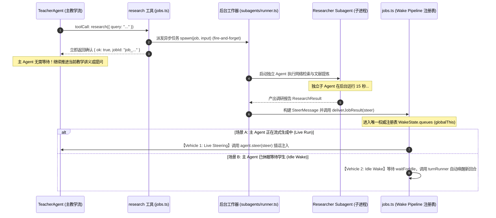
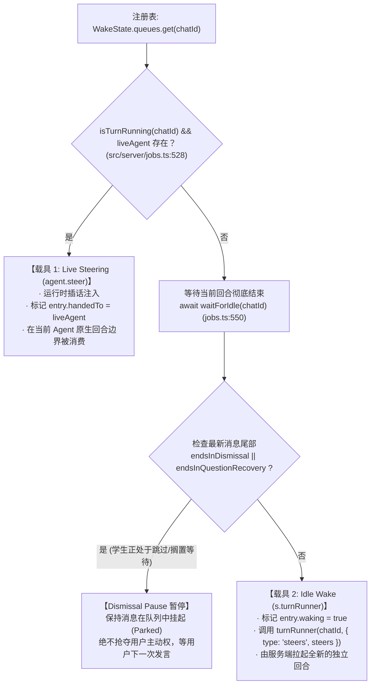
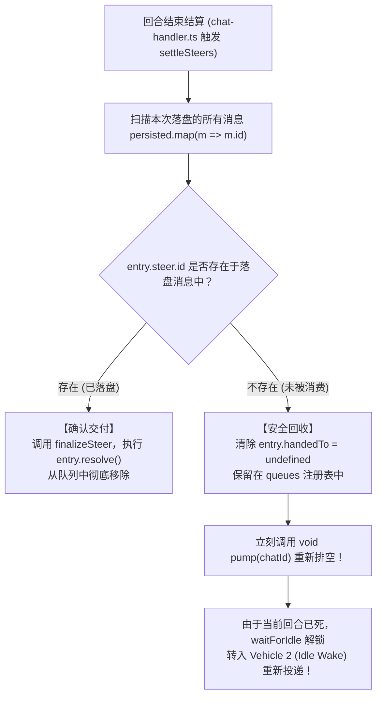

# 第 4 讲：后台任务机制：Live Steering 与 Idle Wake（Background Jobs & Concurrency）

> **讲次定位**：掌握复杂智能体系统中最具挑战的并发与异步通讯架构——理解 LearnHarness 如何解耦长耗时子任务（Web 研究、PDF 分析、富媒体构建），掌握“唯一注册表 vs 双投递载具”的设计哲学、Live Steering 运行时插话与 Idle Wake 服务端自动唤醒、以及基于不可变记录的未消费 Steer 回收闭环（`settleSteers`）。  
> **源码基准**：严格基于 learnharness 真实代码（引用附带相对路径与行号 `path:line`）。

---

## 1. 架构总览：长耗时异步任务的工程困境

在构建具备深度辅助能力的导师智能体时，往往需要执行极度耗时的外部能力：
- **学术与互联网深度调研（`research`）**：调用外部搜索引擎（Tavily/Exa/Brave）检索文献并由子 Agent 提炼摘要，耗时通常在 10s ~ 30s。
- **教材与课件深度精读（`pdf`）**：加载学习者上传的几十页甚至上百页 PDF 讲义，提取章节逻辑并向量化检索。
- **互动演示与可视化构建（`demo` / `visual`）**：由专门的子 Agent 编写可执行的 HTML/JS 演示程序或生成 SVG/Mermaid 图表。

如果在主交互回合中让主 Agent **同步等待**这些任务完成：
1. **用户交互被彻底冻结**：学习者在几十秒内无法打字、无法作答、无法互动；
2. **HTTP 连接极易超时**：网关超时（504 Gateway Timeout）会导致整个教学回合崩溃；
3. **并发竞态与状态错乱**：如果后台任务返回时，学习者正好提交了一道选择题答案，两个事件并发到达服务器，极易产生转录分叉或写写冲突。

LearnHarness 的设计哲学是：**主教学流与后台任务彻底解耦；工具调用非阻塞即时返回；完成结果通过“注册表 + 双载具管道”可靠投递**。



---

## 2. 投递机制的本质解构：唯一权威注册表 vs 投递载具

在很多初级系统中，往往直接将后台消息往正在运行的 WebSocket 或 EventEmitter 里一发了事。如果连接刚好断开，或者 Agent 恰好正在退出，消息就会永久丢失。

LearnHarness 确立了严格的抽象：**必须彻底区分“权威注册表（Registry）”与“临时投递载具（Vehicle）”**（见 [src/server/jobs.ts:111-128](file:///home/antigravity/nakseuksa/learnharness/src/server/jobs.ts#L111-L128)）。

### 2.1 唯一权威注册表（The Registry）

存放于 Node.js 进程级全局单例 `globalThis.__lhWakePipeline` 中：
```ts
// src/server/jobs.ts:111-135
interface WakeState {
	turnRunner?: TurnRunner;
	// 唯一权威投递注册表：chatId -> 待投递消息队列 (FIFO)
	queues: Map<string, QueuedSteer[]>;
	// 用户插话消息队列 (Composer Steering)
	userSteers: Map<string, UserSteerEntry[]>;
	// 当前正在流式运行的 Agent 实例集合
	liveAgents: Map<string, Agent>;
	// 当前正在执行排空循环的 chatId 集合
	pumping: Set<string>;
    ...
}
```
**设计不变式**：
- 任何后台任务完成或用户插话，必须首先封装为 `QueuedSteer` 压入 `WakeState.queues`。
- **压入队列绝不等于投递成功**。只要该消息尚未在磁盘的 `ChatRecord.messages` 中找到落盘证据，它就必须永远驻留在该注册表中。

### 2.2 两套投递载具（Vehicles）

注册表中的待投递消息，通过 [src/server/jobs.ts:440-620](file:///home/antigravity/nakseuksa/learnharness/src/server/jobs.ts#L440-L620) 的 `pump(chatId)` 调度循环分派给两套不同的载具：



#### 载具 1：Live Steering（运行时插话注入）
- **触发条件**：当前会话正有一个 Agent 实例在执行中（`live && isTurnRunning(chatId)`，[src/server/jobs.ts:528](file:///home/antigravity/nakseuksa/learnharness/src/server/jobs.ts#L528)）。
- **执行方式**：
  调用 `agent.steer(entry.steer)`（`:273`），并将队列条目标记为 `entry.handedTo = agent`。
- **在模型循环内的消费时机**：
  在底层 `@earendil-works/pi-agent-core` 中，`steeringMode: "all"`（[src/agent/teacher-agent.ts:280](file:///home/antigravity/nakseuksa/learnharness/src/agent/teacher-agent.ts#L280)）配置生效。当前正在运行的模型在完成一个生成步（例如调完一个工具拿到返回后），会在步与步的原生边界处，一次性检出所有被 steer 注入的标记，把它们作为额外的环境通知加入当前上下文，在同一个持续运行的回合内继续生成！

#### 载具 2：Idle Wake（空闲自动唤醒）
- **触发条件**：当前没有 Agent 运行（会话处于休眠状态，等待学生输入）。
- **执行方式**：
  等待 `waitForIdle(chatId)`（[src/server/jobs.ts:550](file:///home/antigravity/nakseuksa/learnharness/src/server/jobs.ts#L550)）确保彻底空闲后，重读磁盘最新记录，调用：
  ```ts
  // src/server/jobs.ts:597
  await s.turnRunner(chatId, { type: "steers", steers });
  ```
  `s.turnRunner` 是 `chat-handler.ts` 的包装适配器。它由服务端主动构造一个 `TurnInput { type: "steers", steers }` 事件，像接收到普通用户请求一样，走完整的 Write-Ahead 预写持久化、准入检查并构建新的 `TeacherAgent`，自动开启新的一轮讲授！

---

## 3. 边界刚性约束与防死锁设计

### 3.1 `probe-handoff` 强行阻断 Live Steering
在第 2 讲中我们提到，当 Prober 调用 `probe_done` 时，会发射一条 `probe-handoff` 消息。  
在 [src/server/jobs.ts:272, 534](file:///home/antigravity/nakseuksa/learnharness/src/server/jobs.ts#L272) 中有硬编码检查：
```ts
// src/server/jobs.ts:272
if (entry.steer.customType !== "probe-handoff") {
    agent.steer(entry.steer);
}
```
**为什么？** 绝不允许把交接指令作为 Live Steering 塞给当前还没退出的 `ProberAgent`。当队列中含有 `probe-handoff` 时，`pump` 显式执行 `await waitForIdle(chatId)` 挂起，直到 Prober 退出释放锁，再由 Vehicle 2（Idle Wake）拉起 Teacher。

### 3.2 用户搁置暂停机制（The Dismissal Pause）
在 [src/server/jobs.ts:575-587](file:///home/antigravity/nakseuksa/learnharness/src/server/jobs.ts#L575-L587) 中：
```ts
if (endsInDismissal(fresh.messages) || endsInQuestionRecovery(fresh.messages)) {
    parked = true;
    return;
}
```
**场景**：学习者面对一道难题，点击了“跳过/搁置这道题（Dismiss）”。此时系统的状态是“静静等待学习者主动说明他想做什么”。  
如果此时恰好一个后台研究任务（`research`）完成了，**系统绝不应该立即自动拉起 Idle Wake 强行向学习者说话**。后台结果必须安静地在队列中挂起（Parked）。直到学习者下一次在输入框主动打字发送新内容时，这些挂起的后台结果才会作为附带上下文随新回合一起投递。

---

## 4. 未消费 Steer 结算回收机制（`settleSteers`）

在分布式与并发系统中，最容易引发数据丢失的边界是：**消息已经交给了执行器，但执行器中途暴毙**。

### 4.1 核心竞态场景：Steer 注入与 Question Stopper 的碰撞

假设后台调研刚刚完成，Vehicle 1 将调研结果通过 `agent.steer(steer)` 注入了当前正在运行的 `TeacherAgent`（标记了 `entry.handedTo = agent`）。  
然而，就在同一个生成步中，`TeacherAgent` 发出了一道选择题 `quiz` 调用。根据第 3 讲的剖析，`quiz` 触发了 **Question Stopper**，导致当前回合在工具结果挂载后**立刻物理终止**！

此时发生了一个严重的悬空：
- `TeacherAgent` 在来得及执行下一次 LLM 生成（来得及阅读这个 Steer）之前，回合就已经被强行关闭并销毁了！
- 如果系统以为“只要调用了 `agent.steer` 就算投递成功”，那么这个调研结果就会随着 `TeacherAgent` 的垃圾回收而被永久丢弃！

### 4.2 优雅的结算对账闭环：`settleSteers`

在 LearnHarness 中，当任何一个回合结束时（无论是正常结束、被中断还是出错），`chat-handler.ts` 必须调用 [src/server/jobs.ts:401-424](file:///home/antigravity/nakseuksa/learnharness/src/server/jobs.ts#L401-L424) 的 `settleSteers`：

```ts
// src/server/jobs.ts:401-424
export function settleSteers(
    chatId: string, 
    persisted: { id?: string }[], 
    failed = false, 
    settledAgent?: Agent
): void {
    const queue = state().queues.get(chatId);
    if (!queue || queue.length === 0) return;
    
    // 提取当前回合真正写入磁盘的消息 ID 集合
    const deliveredIds = new Set(persisted.map((m) => m.id).filter(Boolean));
    const remaining: QueuedSteer[] = [];
    
    for (const entry of queue) {
        if (deliveredIds.has(entry.steer.id)) {
            // 真正落盘证据确凿：正式确认交付并完成 Promise！
            finalizeSteer(entry.steer);
            entry.resolve();
        } else {
            // 曾被交给即将死亡的 agent，但并没有被实际写盘消费！
            const handedHere = entry.handedTo !== undefined && (!settledAgent || entry.handedTo === settledAgent);
            if (handedHere) {
                entry.handedTo = undefined; // 清空交接标记，回收回注册表！
            }
            remaining.push(entry);
        }
    }
    
    if (remaining.length === 0) state().queues.delete(chatId);
    else {
        state().queues.set(chatId, remaining);
        // 关键动作：立刻重新启动 pump 调度循环！
        void pump(chatId);
    }
}
```



**工程启示**：
这是典型的**对账补偿机制（Reconciliation Loop）**。智能体实例是消耗品（Disposable Vehicle），被销毁或意外退出是常态；而全局注册表是真实真相。任何未被落盘确认的货物，会在结算边界被自动回收，并通过另一套载具重新送达，实现了 100% 不丢消息的高可靠闭环。

---

## 5. 消息落地真实性判定（Truth vs Transient）

在 LearnHarness 中，严防以下三种对投递完成的常见误判：

| 伪完成阶段 | 为什么不能当作“已完成”？ |
|---|---|
| **`ctx.deliver(steer)` 执行完毕** | 这只是将消息放入了内存 `WakeState.queues` 队列，进程一旦重启或发生异常，消息尚未落地。 |
| **`agent.steer(steer)` 执行完毕** | 只是将消息推入了当前 Agent 内部的临时队列，一旦当前回合被 Question Stopper 截断，该消息根本不会被模型读到。 |
| **`s.turnRunner(...)` HTTP 返回 200** | HTTP 200 只代表服务端接收并启动了回合，如果流式传输中途进程被杀或模型崩溃，消息可能未持久化。 |
| **唯一权威准则：`steerDelivered`** | 唯有当消息的 `steer.id` 真实存在于磁盘持久化的 `ChatRecord.messages` 数组中时，系统才认定该消息已经不可逆地投递成功（[src/core/contracts/jobs.ts:446](file:///home/antigravity/nakseuksa/learnharness/src/core/contracts/jobs.ts#L446)）。 |

---

## 6. 核心架构启示总结

1. **分离“注册表”与“载具”**：  
   不要将临时运行的 Agent 实例作为消息队列。把所有异步消息委托给宿主环境的全局权威注册表，Agent 只是可丢弃的消费载具。
2. **双通道投递兼顾敏捷与可靠**：  
   会话活跃时，通过 Live Steering 在生成步边界无缝插话；会话空闲时，通过 Idle Wake 自动拉起服务端回合主动向用户汇报。
3. **闭环对账自愈（Reconciliation on Settlement）**：  
   在回合结算时，以持久化落盘证据（Persisted IDs）为基准对账。未消费的消息自动归还队列并重新触发调度，彻底规避复杂的分布式死锁与丢信问题。

---

## 本讲讨论与答疑思考点

在进入 **第 5 讲：分段提示词体系与叙述守卫（Segmented Prompts & Narrative Guardrails）** 之前，你可以结合本讲内容思考或提问以下要点：
1. **多任务并发思考**：如果主 Agent 在同一回合连续调用了 `research` 与 `visual` 两个后台工具，当它们在不同时间点相继完成时，`WakeState.queues` 是如何保障它们按序安全投递的？
2. **用户干预思考**：如果学习者在后台研究员还在检索时，直接点击了前端的“停止/取消”按钮，系统是如何通过 `POST /api/activity/abort` 实现对底层子任务进程的级联取消（Abort Cascade）的？
