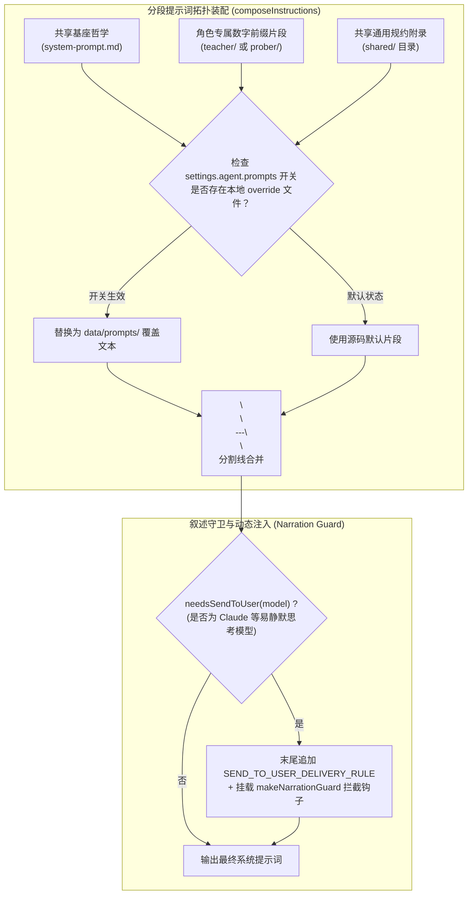
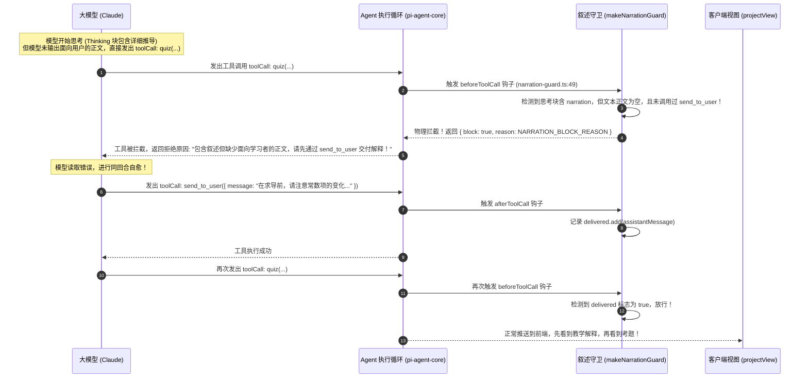
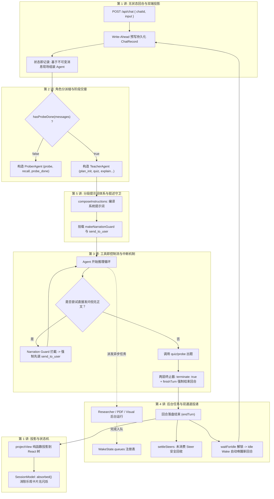

# 第 5 讲：分段提示词体系与叙述守卫（Segmented Prompts & Narrative Guardrails）

> **讲次定位**：掌握 LearnHarness 管控大模型教学质量与输出伦理的“最后一公里”——理解分段提示词（Segmented Prompts）的确定性拓扑装配与每回合热覆盖、深入剖析叙述守卫（Narration Guard）如何物理拦截大模型“只思考不讲授就发问”的隐蔽缺陷、以及“预测-讲授-检查（Predict-Teach-Check）”循环与思维链外显化的工程落地。  
> **源码基准**：严格基于 learnharness 真实代码（引用附带相对路径与行号 `path:line`）。

---

## 1. 架构总览：从“大杂烩 Prompt”到“分段编译与运行时拦截”

在许多 AI 应用中，系统提示词往往是一个长达数千字的巨型 Markdown 或字符串模板。这种朴素做法面临三大工程失控：
1. **模块间交叉污染**：教学哲学、提问技巧、工具参数说明、格式要求混作一团，修改一处容易引起其他能力的隐蔽退化。
2. **缺乏动态热定制能力**：无法根据不同的学习者风格、模型特性或实验开关，精准替换某一个具体维度的策略。
3. **“静默发问”的顽疾**：具备强思维链（Reasoning / Thinking）的模型（如 Claude 3.7 Sonnet 或深思模型），极易在内部思考块中把题目背后的逻辑推演得清清楚楚，却**忘记面向学习者输出任何解释正文**，直接抬手调用 `quiz` 工具向学习者发问。对学习者而言，就是突兀地甩出一张考卷，没有任何启发教学。

LearnHarness 的解决方案是：**静态分段拓扑编译 + 运行时动态热开关 + `beforeToolCall` 叙述守卫物理拦截**。



---

## 2. 分段提示词（Segmented Prompts）拓扑结构

在 [src/agent/prompts/](file:///home/antigravity/nakseuksa/learnharness/src/agent/prompts/) 目录下，系统将所有教学法则进行了细粒度的原子解耦：

```text
src/agent/prompts/
├── system-prompt.md           # 共享教学哲学基座（苏格拉底原则、教学使命）
├── prober/                    # 探测者专属片段目录
│   └── 10-probe-doctrine.md   # 探测摸底原则（探明边界，严禁长篇讲授）
├── teacher/                   # 讲师专属片段目录
│   ├── 05-method.md           # 核心教学方法论
│   ├── 10-planning.md         # 知识树规划准则（DAG、原子命题）
│   ├── 20-teaching.md         # 单步讲授原则
│   ├── 28-predictions.md      # 预测先于解释（Predict before Explain）
│   ├── 30-question-principles.md # 题目设计规范与防猜测
│   ├── 40-jobs.md             # 后台任务调度指引
│   ├── 50-demos.md            # 交互式演示设计
│   └── 55-images.md           # 图像展示规范
├── practice/                  # 练习导师专属片段目录
│   ├── 00-base.md             # 练习哲学基座（无 teaching base）
│   └── 10-doctrine.md         # 练习出题与提示梯子（Hint Ladder）
└── shared/                    # 跨角色共享规约附录
    ├── 10-voice.md            # 导师语气与人格设定
    ├── 15-accuracy.md         # 严谨性与事实真实性契约
    ├── 16-mental-model.md     # 心智模型与思维链外显化规约
    ├── 20-question-tools.md   # 题目工具的底层设计规范
    ├── 25-confidence.md       # 自信心与猜题纠偏
    ├── 30-learner-files.md    # 学习者本地文件检索规范
    ├── 35-side-conversations.md # 侧边支线提问处理
    └── 40-formatting.md       # LaTeX 与 Markdown 排版规范
```

### 2.1 装配顺序（The Composition Order）

在 [src/agent/prompt-segments.ts](file:///home/antigravity/nakseuksa/learnharness/src/agent/prompt-segments.ts) 与 [src/agent/teacher-agent.ts:87-94](file:///home/antigravity/nakseuksa/learnharness/src/agent/teacher-agent.ts#L87-L94) 中，`composeInstructions(kind, switches)` 按照严格的拓扑顺序装配：

1. **Prober 装配顺序**：
   `system-prompt.md` → 字典序排序的 `prober/*.md` → 字典序排序的 `shared/*.md`。
2. **Teacher 装配顺序**：
   `system-prompt.md` → 字典序排序的 `teacher/*.md`（按 `05-`, `10-`, `20-`, `28-`, `30-` 严格递进）→ 字典序排序的 `shared/*.md`。
3. **Practice 装配顺序（独占白名单）**：
   `practice/` 片段 → **显式白名单收敛的 shared 附录**（`10-voice.md`、`15-accuracy.md`、`16-mental-model.md`、`35-side-conversations.md`、`40-formatting.md`）。  
   *注意：练习模式没有 `system-prompt.md` 讲授基座，也不包含文件检索与发题工具附录，保持提示词高度聚焦于解题辅导。*

每个片段之间由三横线 `\n\n---\n\n` 物理隔开，空白片段被自动剔除。

---

## 3. 按回合热覆盖与无缝开关（Hot Overrides & Toggles）

LearnHarness 允许高级用户或研究人员在不修改源码、不重启服务的情况下，自由微调或重写任何一个提示词片段。

### 3.1 覆盖机制三定律（The Three Laws of Overrides）

根据 [src/agent/prompt-segments.ts:20-28](file:///home/antigravity/nakseuksa/learnharness/src/agent/prompt-segments.ts#L20-L28)：
1. **镜像目录法则**：用户覆盖文件放置在 `data/prompts/`（由 `PROMPTS_OVERRIDE_DIR` 定义），目录结构与源码完全一致（例如 `data/prompts/teacher/28-predictions.md`）。
2. **开关与文件双重门控**：**仅有覆盖文件存在绝不会生效**！必须在 `settings.json` 的 `agent.prompts[segmentPath]` 中显式将开关置为 `true`。这使得用户可以随时在系统设置中一键开关覆盖，即时对比默认效果与微调效果。
3. **每回合动态解析（Fresh per Turn）**：
   在 `chat-handler.ts:727` 中，每次请求将 `effectiveSettings().agent.prompts` 注入 Agent 工厂；工厂现场调用 `composeInstructions(kind, promptSwitches)`。因此，用户刚保存的提示词在**下一个对话回合立刻生效**，而正在运行的回合保持不可变，绝不中途突变。

---

## 4. 叙述守卫（Narration Guard）与显式输出管道

大模型在教学场景中存在一个众所周知的痛点：**思维链与用户正文的割裂**。  
具有原生思考能力的大模型（如 Claude 3.7）在生成时，往往会在内部 Thinking 中推导：
> *“学习者在这里可能混淆了导数和偏导数，我需要先给他解释一下为什么常数项会归零，然后再出一道题考他……”*

推导完毕后，模型以为自己已经“讲”过了，在正文区域没有任何文字输出，直接触发了 `quiz` 工具！学习者看到的结果就是：毫无前戏地突然弹出一道考题，体验极其突兀。

LearnHarness 构建了一套精密的**工程闭环防御体系**：



### 4.1 显式输出工具：`send_to_user`

在 [src/agent/tools/send-to-user.ts](file:///home/antigravity/nakseuksa/learnharness/src/agent/tools/send-to-user.ts) 中，系统定义了 `send_to_user` 工具：
- **适用范围**：当模型检测为 Claude 或包含深度思考的模型时自动挂载（`sendToUserApplies`，`:16-22`）。
- **强制指令**：在系统提示词末尾强行注入 `SEND_TO_USER_DELIVERY_RULE`（[src/agent/narration-guard.ts:12-17](file:///home/antigravity/nakseuksa/learnharness/src/agent/narration-guard.ts#L12-L17)）：
  > *“所有面向学习者的解释、点拨、过渡正文必须通过 `send_to_user` 发送。普通文本可能被转换为思考摘要，Thinking is not delivery！”*
- **UI 纯正文解包**：在第 1 讲的双端投影中我们拆解过，前端 `projectView` 在渲染到 `send_to_user` 时，会**直接剥离其工具外壳，将其还原为普通的纯文本正文**（[src/core/view.ts:267-280](file:///home/antigravity/nakseuksa/learnharness/src/core/view.ts#L267-L280)）。学习者完全感知不到这是一个工具，看到的依然是连贯流畅的讲义。

### 4.2 `beforeToolCall` 拦截钩子（`makeNarrationGuard`）

在 [src/agent/narration-guard.ts:42-62](file:///home/antigravity/nakseuksa/learnharness/src/agent/narration-guard.ts#L42-L62) 中：
```ts
// src/agent/narration-guard.ts:49-60
beforeToolCall: async ({ assistantMessage, toolCall }) => {
    if (blocked >= NARRATION_GUARD_MAX_BLOCKS) return undefined;
    if (!questionLacksDeliveredProse(assistantMessage, toolCall.name, delivered.has(assistantMessage))) {
        return undefined;
    }
    blocked++;
    return { block: true, reason: NARRATION_BLOCK_REASON };
},
afterToolCall: async ({ assistantMessage, toolCall, result, isError }) => {
    if (toolCall.name === SEND_TO_USER_TOOL && !isError && !result.isError) {
        delivered.add(assistantMessage);
    }
    return undefined;
}
```

**工作逻辑**：
1. 当大模型尝试调用任何问题工具（`quiz`、`explain`、`probe`、`recall` 等）时，钩子首先检查当前助手消息中是否含有思考链特征（`isNarrationBlock`）；
2. 如果存在内部思考，但同时**既没有普通正文输出，也没有通过 `send_to_user` 发送过正文**（`questionLacksDeliveredProse`）；
3. 钩子**直接物理拦截该工具调用**（`block: true`），把模型推回执行循环，并送上明确的纠错警告：
   > *“This response contains narration but no delivered learner-facing prose. Write the explanation or commentary the learner needs through send_to_user, then retry this question.”*
4. 模型在同回合内自愈，先调用 `send_to_user` 补全教学讲义，随后再次发起出题，守卫检测到 `delivered` 标记已设置，正式予以放行！

---

## 5. 教学法原则的工程硬编码约束

除了控制流拦截，LearnHarness 还通过提示词片段将严谨的认知科学与教学法原则固化为不可逾越的契约：

### 5.1 预测先于解释（Predict-Teach-Check Cycle）

在 [src/agent/prompts/teacher/28-predictions.md](file:///home/antigravity/nakseuksa/learnharness/src/agent/prompts/teacher/28-predictions.md) 中，系统硬性规定了教学闭环：
$$\text{Predict（提问预测）} \longrightarrow \text{Learner Attempt（作答）} \longrightarrow \text{Teach（针对性讲授）} \longrightarrow \text{Check（巩固检验）}$$

- **预测题（`type: "predict"`）**：在讲授新知识点**之前**提出。目的不是测试正确率，而是引导学习者发现旧心智模型的边界与矛盾，激发求知欲望。
- **检验题（`type: "check"`）**：在讲授**之后**提出。必须严格基于刚才讲授的推理链，验证学习者是否真正掌握。
- **前端配合**：在 UI 渲染树中，`predict` 题目默认展开以阻断教学内容直接泄露，`check` 题目折叠在讲义底部“检验你的理解”收起框中，形成完美的认知步调。

### 5.2 思维链外显化（Thinking Fields as Primary Data）

在 [src/agent/prompts/shared/16-mental-model.md](file:///home/antigravity/nakseuksa/learnharness/src/agent/prompts/shared/16-mental-model.md) 中，系统确立了学习者思考字段的一等公民地位：
> *“One answer is one bit; the thinking is the picture.”（一个选择题答案只有 1 个比特的信息量，而思维链才是学习者的心智全景图。）*

- 每一个交互组件均配备了开放式的 Thinking 输入框，鼓励学习者自言自语、写出犹豫与直觉推演。
- 提示词明确要求导师 Agent：**阅读学习者写出的每一个思考字词**。如果学习者选对了答案但推理模型是错的，必须严肃纠偏；如果学习者推理逻辑完全正确但最终计算失误，则应给予肯定并指出微小漏洞。
- 这种机制促使导师 Agent 的用户心智建模（Learner Modeling）在每一次回合中持续迭代。

---

## 6. 全系列 5 大专题知识图谱大串联

至此，我们已经完整走完了 LearnHarness 核心智能体运行时的 5 大专题。让我们用一张宏大的端到端执行全景图，将它们彻底融会贯通：



---

## 课程总结与结业探讨

恭喜你！通过这 5 个专题的层层递进，你已经站在了现代智能体运行时（Agent Harness）的最前沿设计高度：
1. **彻底摆脱对客户端状态与长寿命服务进程的依赖**，掌握了以**不可变转录（Transcript）为唯一真相**的架构体系；
2. **掌握了智能体角色划分的本质解法**，用转录分派缝与工具物理隔离彻底降服了大模型的提示词漂移；
3. **理解了工具即控制流的高阶范式**，运用两层终止机制、参数治愈与同回合自愈重试，打造坚不可摧的交互循环；
4. **攻克了异步长耗时任务的并发协同难关**，通过注册表与载具分离、Live Steering 与 Idle Wake、以及基于持久化证据的对账回收，实现了零消息丢失；
5. **构筑了严密的教学质量守卫**，利用分段提示词热开关与 `beforeToolCall` 叙述守卫，从物理机制上保障了大模型教学的专业性与体贴性。

你可以随时针对这 5 讲中的任何细节提问，或者我们可以基于这套架构讨论实际工程落地与二次扩展！
