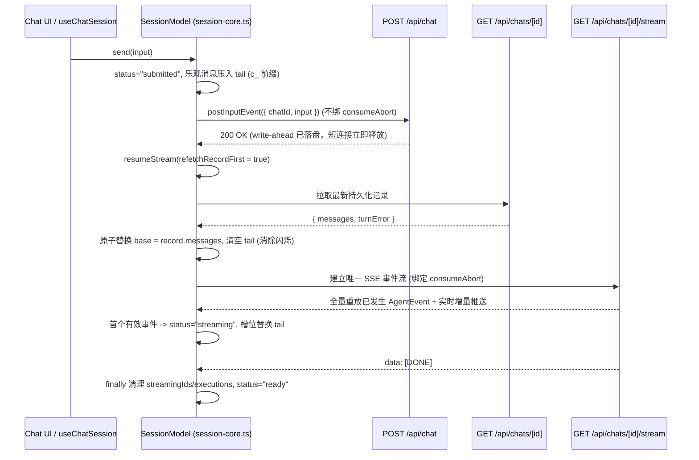
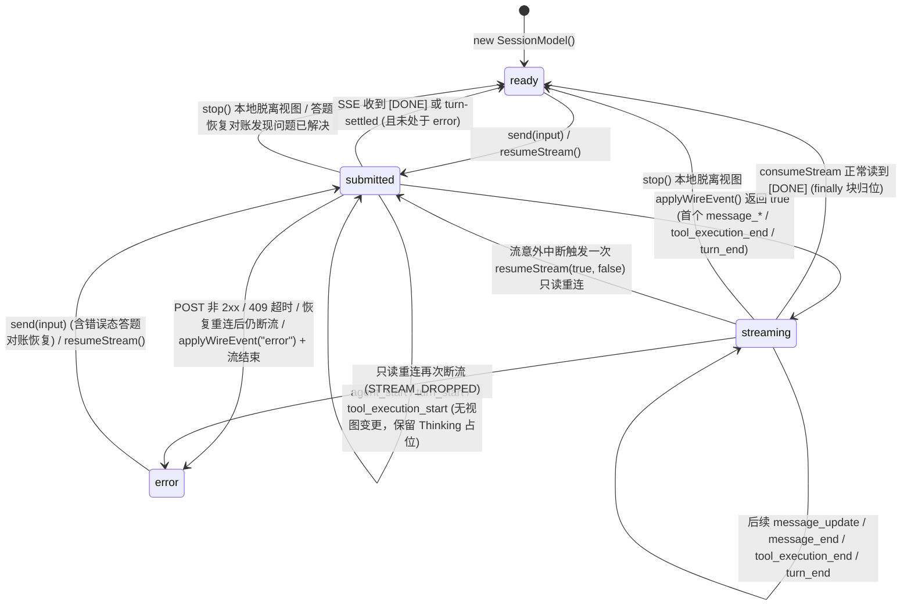

# SessionModel 状态机与实现深度拆解

**总览**：`SessionModel`（`components/session-core.ts:226`）是 LearnHarness 客户端会话视图的纯 TypeScript 确定性状态机，零 React 依赖、单 `fetch` 依赖注入。它不持有会话真相，而是维护服务端权威**持久化**快照（`base`）与本地乐观/流式临时队列（`tail`），消费同一套原生 `AgentEvent` **SSE 事件流**，并通过纯函数 `projectView()`（`src/core/view.ts:128`）实时派生渲染视图 `LhViewMessage[]`。

---

## 1. 架构定位与三大核心不变量

### 1.1 纯 TS 提取与“导入法则”边界
- **零渲染器耦合**：`components/session-core.ts:1-14` 将附着、重放、回合收尾、错误与中止逻辑完全剥离出 React 生命周期，使全部并发时序可在 Node 原生测试运行器（`tests/session-core.test.ts:1`）中脱离 DOM 做确定性验证。
- **遵循导入法则（Import Law）**：`components/session-core.ts:18-37` 仅从浏览器安全的桶导出 `../src/core`（`src/core/index.ts:1`）引入纯函数与契约类型，绝不跨层引用 `src/server` 或 `src/store`（由 `eslint.config.mjs:7-18` 强制约束）。
- **`fetch` 绑定保护**：构造函数（`components/session-core.ts:278`）采用 `opts.fetch ?? ((...args) => globalThis.fetch(...args))` 包装接收者上下文，防止浏览器原生 `window.fetch` 脱离 `Window` 调用抛出 `"Illegal invocation"`（注释 `:274-277`）。

### 1.2 One View 协议：服务端独占持久化所有权
- **客户端只发输入事件**：`POST /api/chat` 请求体恒为 `{ chatId: this.chatId, input }`（`components/session-core.ts:339`），其中 `input` 为单一**输入事件** `ChatInput`（`src/core/input-events.ts:49`），严禁客户端上传消息列表副本。
- **回合脱离视图独立存活**：每一个**回合**（turn）都是服务端拥有的后台执行体（`src/server/turn-runs.ts:32` 中的 `globalThis.__lhTurnRuns`）。浏览器页面只是一个可随时挂接或脱离的只读/触发视图——关闭标签页或路由跳转调用 `stop()`（`components/session-core.ts:898`）仅取消本地流读取器（触发服务端 `ReadableStream.cancel()` 退订，`src/server/pi/ui-stream.ts:341-346`），绝不杀死服务端正在运行的回合。

### 1.3 Connection Diet A & B：突破同源 6 连接上限
HTTP/1.1 下浏览器对同一源最多允许 6 条并发持久连接。LearnHarness 通过两项连接节流设计根治多会话切换假死：
1. **Connection Diet A（卸载即断流，`components/session.ts:62-74`）**：组件卸载时 `useEffect` 清理函数立即执行 `model.stop()`，释放该页面持有的 `GET /api/chats/[id]/stream` 长连接。
2. **Connection Diet B（POST 确认即关 + 统一重连流，`components/session-core.ts:756-768`、`app/api/chats/[id]/stream/route.ts:18`）**：
   - `POST /api/chat` 完成准入校验与 **write-ahead（预写）**后立即返回短 JSON 确认并关闭连接；客户端调用 `await res.text().catch(() => {})`（`:763`）排空响应体释放连接槽。
   - 随后发送者与刷新重进的访问者一样，统一通过 `await this.resumeStream(true)`（`:768`）挂接到唯一的 **SSE 事件流**端点 `GET /api/chats/[id]/stream`。



---

## 2. 内部状态全景：18 个实例字段与对外快照契约

### 2.1 对外输出快照 `SessionState`（`components/session-core.ts:180-196`）

```ts
export interface SessionState {
	messages: LhViewMessage[];
	nativeMessages: LhMessage[];
	/** Server-read history only; optimistic bubbles are not delivery proof. */
	hasConfirmedConversation: boolean;
	/** Completed conversation usage; null after compaction or before first usage. */
	contextTokens: number | null;
	status: SessionStatus;
	error: { message: string } | null;
	steerQueue: SteerQueueItem[];
}
```

每次调用 `getState()`（`components/session-core.ts:288-315`）时，均基于当前内存状态实时纯函数计算：
- `messages`：`projectView([...this.base, ...this.tail], live)`（`:307`），仅当 `statusValue === "submitted" || statusValue === "streaming"` 时传入 `live = { executions, inFlight: true, streamingIds }`（`:289-292`）。
- `hasConfirmedConversation`：仅检查权威层 `this.base.some(m => m.role === "user" || m.role === "assistant")`（`:309`），本地乐观气泡不算已确认对话。
- `contextTokens`：`measuredContextTokens(messages, this.incompleteUsageIds)`（`src/core/context-usage.ts:9`），排除尚未收到 `message_end` 的流式消息，且遇到**上下文压缩**标记（`customType === "compaction"`）立即归 `null`（`:15`）。

### 2.2 `SessionModel` 18 个内部实例字段分类拆解（`components/session-core.ts:226-267`）

| 分组 | 字段签名 (`session-core.ts:line`) | 职责与生命周期不变量 |
|---|---|---|
| **身份与配置** | `readonly chatId: string` (`:227`)<br/>`fetch: typeof globalThis.fetch` (`:229`)<br/>`private readonly pollMs: number` (`:232`)<br/>`private readonly waitMaxMs: number` (`:233`) | 会话唯一 ID、可注入 HTTP 客户端，以及 409 冲突轮询间隔（默认 `TURN_POLL_MS = 500`，`:42`）与最大等待上限（默认 `TURN_WAIT_MAX_MS = 30_000`，`:44`）。 |
| **通知回调** | `onChange?: () => void` (`:236`)<br/>`private onReattachSettled?: () => void` (`:234`) | `mutate()`（`:317`）、`setStatus()`（`:322`）、`setError()`（`:331`）触发 `onChange` 驱动 React 重绘；当重连流收到 `turn-settled` 哨兵时触发 `onReattachSettled`（`:510`）。 |
| **双层消息存储** | `private base: LhMessage[]` (`:241`)<br/>`private tail: LhMessage[] = []` (`:242`) | `base` 仅存服务端权威**原生记录**；`tail` 存本地 `c_` 前缀乐观消息（`localId()`，`:56`）与流式回合中的临时消息。每次全量同步（`setMessages`，`:928`）必将 `tail` 清空。 |
| **流式与执行叠加层** | `private executions = new Map<string, LiveExecution>()` (`:247`)<br/>`private streamingIds = new Set<string>()` (`:248`)<br/>`private incompleteUsageIds = new Set<string>()` (`:249`)<br/>`private streamingMessageId: string \| null = null` (`:251`) | 仅在回合运行期间有效：`streamingMessageId` 锁定当前流式助手消息槽位；`streamingIds` 提供流式正向证据；`executions` 记录 `tool_execution_end` 结果；`incompleteUsageIds` 屏蔽未完结消息的半成品 token 统计。 |
| **草稿与未确认答案** | `private questionDrafts = new Map<string, QuestionDraft>()` (`:243`)<br/>`private unconfirmedAnswers = new Map<string, string>()` (`:245`) | 按 `questionKey` 缓存**答题 dock** 表单草稿与阅读思考文本（跨越乐观卸载保留在内存中）；`unconfirmedAnswers` 追踪已通过 `send()` 乐观入列但尚未经服务端记录确认的回答消息 ID（`msgId -> questionKey`）。 |
| **状态、双轨错误与续跑门控** | `private statusValue: SessionStatus = "ready"` (`:252`)<br/>`readyRef = true` (`:266`)<br/>`private errorValue: { message: string } \| null = null` (`:254`)<br/>`private liveFailureId: string \| null = null` (`:258`)<br/>`private automaticContinuationBlocked = false` (`:256`) | `statusValue` 为四态主状态，`readyRef` 同步镜像 `status === "ready"`（`:324`）；`errorValue` 存请求/流传输级瞬态错误，与从记录末尾派生的 `providerError` 双轨并存；`automaticContinuationBlocked` 阻止在清除错误横幅后误触发自动**挂载续跑**。 |
| **双控制器并发所有权** | `private consumeAbort: AbortController \| null = null` (`:261`)<br/>`private latestRequest: AbortController \| null = null` (`:264`) | 单阅读器互斥：新 `send`/`resumeStream` 会 `abort()` 旧 `consumeAbort`；`stop()` 清空 `consumeAbort` 但**故意保留 `latestRequest`**，使组件卸载后仍在飞的首条消息 POST 若遭拒绝仍能报错。 |
| **插纸条队列** | `private steerQueueValue: SteerQueueItem[] = []` (`:231`) | 存放运行中回合已发出但尚未出现在消息流中的**插纸条**（`steer_<localId>`），经纯函数 `visibleQueuedSteers()`（`:207`）过滤展示。 |

---

## 3. 状态机跃迁全景图与完整转移矩阵

`SessionStatus` 定义于 `components/session-core.ts:39`：
```ts
export type SessionStatus = "ready" | "submitted" | "streaming" | "error";
```

### 3.1 状态跃迁图



### 3.2 状态转移与副作用完整矩阵

| 当前 `status` | 触发动作 / 网络事件 (`path:line`) | 守卫条件 | 下一 `status` | `base` / `tail` 与附属状态精确变更 |
|---|---|---|---|---|
| `ready` 或 `error` | `send(input, onAccepted, questionKey)` (`:647`) | `(readyRef \|\| status === "error")` 且 `questionKey` 匹配当前**待答问题闸门** (`:652-653`) | `submitted` (`:661`) | 中止旧 `consumeAbort`；清空 `errorValue` 与 `liveFailureId`；若非 `continue` 则解除 `automaticContinuationBlocked`（`:696`）；将乐观消息压入 `tail`（`:699-719`）。 |
| `submitted`（由 `error` 进入 `send("answer")`） | 对账 `GET /api/chats/:id` 发现 `turnInFlight === false` 且原问题已不在待答位 (`:663-689`) | `current?.toolCallId !== input.toolCallId` (`:684`) | `ready` (`:687`) | `setMessages(record.messages, record.turnError)` 采纳权威记录并清空 `tail`，**绝不重复 POST 该答案**，返回 `false`。 |
| 任意态 | `resumeStream(refetchRecordFirst, allowRecovery)` (`:564`) | 无（强制抢占旧读取器） | `submitted` (`:592`) | 中止旧 `consumeAbort`；若 `!refetchRecordFirst` 立即清空 `tail` / `incompleteUsageIds` / `streamingMessageId`（`:586-590`）；否则等拉回记录后**原子替换** `base` 并清空 `tail`（`:609-619`）。 |
| `submitted` | `consumeStream` 收到 `agent_start` (`:381`) | `this.consumeAbort === controller` | 保持 `submitted` | `automaticContinuationBlocked = false`，若有残留 `errorValue` 则清空（`:384-385`），返回 `false`（维持页面 `Thinking…` **占位**）。 |
| `submitted` | `consumeStream` 收到首个使 `applyWireEvent` 返回 `true` 的事件 (`:513-517`) | `!sawEvent && acted && statusValue !== "error"` | `streaming` (`:516`) | 助手消息按槽位写入/替换 `tail`（或更新 `executions`），`streamingIds` 记录该消息 ID。 |
| `submitted` / `streaming` | `consumeStream` 收到 `{"type":"turn-settled"}` (`:505-511`) | `this.consumeAbort === controller` | `ready` (`:527`) | `sawDone = true`，调用 `onReattachSettled?.()` 触发外层 `syncFromServer()`；`finally` 中清空 `streamingIds` 与 `executions`。 |
| `submitted` / `streaming` | `consumeStream` 读到 `data: [DONE]` (`:124, 503`) | `this.consumeAbort === controller && statusValue !== "error"` | `ready` (`:527`) | `finally` 中清空 `streamingIds` 与 `executions`（保留 `tail` 中的本回合产物，直至外层收到通知执行全量同步）。 |
| `submitted` / `streaming` | 流未见 `[DONE]` 提前 EOF 或抛 `StreamReadError` (`:498-501, 530-537`) | `allowRecovery === true`（首次断流） | `submitted`（进入重连） | 自动调用 `await this.resumeStream(true, false)`（`:537`）：先重拉权威 `base`，再单次重放同一服务端回合，**绝不重发用户输入**。 |
| `submitted` / `streaming` | 二次断流（`allowRecovery === false`）或 `send` / `resumeStream` 捕获异常 (`:533, 634-644, 770-794`) | 未被新请求取代（或命中 `detachedOpening`，`:772`） | `error` (`:643, 790`) | 回滚未确认的乐观回答（`unconfirmedAnswers`）或失败的首条乐观文本气泡；写入 `errorValue`，并将 `automaticContinuationBlocked = true`（`:333`）。 |
| 任意态 | `stop()` (`:898`) | 无 | `ready` (`:904`) | `consumeAbort?.abort(); consumeAbort = null`；清空 `streamingIds`、`streamingMessageId`、`executions`；**保留已有 `tail` 与 `latestRequest`**。 |

---

## 4. 核心链路物理执行流拆解

### 4.1 发送与 409 身份重试链路：`send()` → `postInputEvent()` → `resumeStream(true)`

1. **前置门控与同题出现次数校验（`components/session-core.ts:648-655`）**：
   - 若 `!this.readyRef && this.statusValue !== "error"`，直接返回 `false`。
   - 若 `input.type === "answer"`，调用 `pendingQuestionOf([...this.base, ...this.tail])`（`src/core/native-messages.ts:685`）拿到当前待答项 `subject`。当传入渲染作用域键 `questionKey` 时，要求 `subject?.key === questionKey && subject.toolCallId === input.toolCallId`（`:652-653`），防止历史重复 `toolCallId` 导致答案串位。
2. **本地乐观消息构造（`components/session-core.ts:699-719`）**：
   - 镜像服务端 `inputAppends()`（`src/core/input-events.ts:214`）的行为，用 `localId()` 生成 `c_` 前缀 ID 立即推入 `this.tail`：
     - `"text"` → `{ ...newUserMessage(input.text), id: localId() }`
     - `"thinking"` → `{ ...newThinkingMessage(input.problemCallId, input.text), id: localId() }`
     - `"next"` → `{ ...newNextMessage(), id: localId() }`
     - `"answer"` → 通过 `pendingCallTool`（`:130`）反查工具名，构造 `{ ...newAnswerResult(input.toolCallId, tool, input.answer), id: localId() }`，并在 `this.unconfirmedAnswers` 中登记 `result.id -> expectedKey ?? input.toolCallId`（`:715`）。
     - `"continue"` / `"retry"` / `"retry-question"` → 无乐观消息压入。
3. **POST 不绑 `consumeAbort` 与 409 轮询重试（`components/session-core.ts:338-357, 736`）**：
   - `this.postInputEvent(input)` **故意不传 `controller.signal`**（注释 `:722-735`），防止 React StrictMode 模拟卸载调用 `stop()` 时把 ~100ms 的首条消息 POST 中途杀死。
   - 若服务端因后台唤醒回合正在运行而返回 `409`（此时服务端尚未执行预写，无任何落盘副作用），`postInputEvent` 循环取消响应体、每 `pollMs`（500ms）探测 `GET /api/jobs?chatId=...` 的 `turnInFlight`（`:75-83`），一旦 `turnInFlight === false` 则**原样重发同一份 JSON 请求体**，最长等待 `waitMaxMs`（30s）。
4. **错误信封保留与转接重连流（`components/session-core.ts:740-769`）**：
   - 若返回非 2xx：对 `503 models_not_configured` / `provider_key_missing` 原样保留 JSON 文本（供 `components/chat.tsx:657-661` 识别并弹出模型配置弹窗）；对 `retry` / `retry-question` 的 `400` 解析出人类可读的 `refusal.error`（`:744-750`）。
   - 返回 2xx 后置 `accepted = true`，触发 `onAccepted?.()`，排空短响应体；若当前 `this.consumeAbort === controller` 未被取代，调用 `await this.resumeStream(true)` 接入统一 **SSE 事件流**。

### 4.2 SSE 分帧与全量 Partial 槽位替换：`sseEvents()` → `consumeStream()` → `applyWireEvent()`

1. **字节流抗切分 SSE 生成器 `sseEvents`（`components/session-core.ts:95-120`）**：
   - 使用 `TextDecoder` 的 `{ stream: true }` 模式持续拼接多字节 UTF-8 字符（如中文或数学符号被 TCP 分包切断时不会乱码，由 `tests/session-core.test.ts:44` 的 `dripped` 逐字节测试锁定）。
   - 按 `\n\n` 切帧，提取 `data: ` 行：遇到 `"[DONE]"` 返回生成器终值 `true`（`:115`）；流提前结束（`done === true`）返回 `false`（`:105`）；底层 `reader.read()` 抛错包装为 `StreamReadError`（`:90, 103`），与 `JSON.parse` 协议异常严格区分。
2. **禁止 Delta 拼接，按单槽位整包替换（`components/session-core.ts:375-456`）**：
   - Pi 的 `native wire`（`src/server/pi/ui-stream.ts:7-23`）在每个 `message_update` 中发送**完整的 partial `AssistantMessage`**，且流式期间 `message.id` 为 `undefined`（服务端直到 `persistTurn` 回合收尾时才盖正式 ID）。
   - **槽位算法（`:419-447`）**：
     - `message_start`：分配 `const id = message.id ?? this.streamingMessageId ?? localId()`，记录 `this.streamingMessageId = id`，加入 `this.streamingIds` 与 `this.incompleteUsageIds`，追加到 `this.tail` 末尾。
     - `message_update`：复用 `this.streamingMessageId`，在 `this.tail` 中按 `id` 找到原下标并通过 `this.tail.with(idx, withId)` **原地整包替换**（根治每次 chunk 追加一个重复气泡与思考块的 Bug，注释 `:409-413`）。
     - `message_end`：从 `incompleteUsageIds` 移除 `id`；若 `stopReason === "error"` 则记录 `this.liveFailureId = id` 并清空旧连接错误 `this.errorValue = null`（`:423-428`）；最后置 `this.streamingMessageId = null` 释放槽位供下一轮模型调用使用（`:445`）。
3. **非助手消息与工具事件的实时折叠**：
   - **中途注入的标记消息**（`role !== "assistant"` 的 `message_start` / `message_end`，如回合内消化的插纸条或后台结果，`components/session-core.ts:392-406`）：按其自带的确定性 `message.id` 在 `this.tail` 中做 Upsert。
   - **工具执行完毕（`tool_execution_end`，`:449-462`）**：以 `agent.toolCallId` 为键写入 `this.executions`（记录 `{ isError, output: result?.details, errorText }`）。在 `projectView` 中，出题工具的成功占位结果会被故意忽略以保持 `"input-available"` 等待学习者作答，而校验失败（`isError: true`）会立刻渲染为 `"output-error"` 错误卡片（`src/core/view.ts:321-334`）。
   - **单步工具结果批次（`turn_end`，`:464-474`）**：将 `agent.toolResults` 逐条盖上 `localId()` 追加进 `this.tail`。
4. **首帧 `Thinking…` 占位无缝交接（`components/session-core.ts:369-374, 513-517` + `src/core/view.ts:270-280`）**：
   - `agent_start`、`turn_start`、`tool_execution_start` 在 `applyWireEvent` 中均返回 `false`，使 `status` 维持在 `"submitted"`，前端持续展示 `Thinking…` 占位，覆盖连接大模型首包前的空白等待期。
   - 当首个 `message_start` 到达时，`applyWireEvent` 返回 `true` 将状态切为 `"streaming"`；即便此时 `assistant.content` 为空数组，`projectView` 也会因 `live?.streamingIds.has(m.id)` 为真而合成一个空的 `{ type: "reasoning", text: "" }` 部件（`src/core/view.ts:275-276`），与前序占位平滑衔接、既不闪烁也不双倍渲染。

---

## 5. 旁路交互通道：插纸条、静默丢弃与视图脱离

除发起或重连主回合外，`SessionModel` 还提供三条**不启动新回合**的旁路操作：

1. **运行中插纸条 `steer(text)`（`components/session-core.ts:806-841`）**：
   - 生成客户端唯一键 `` const id = `steer_${localId()}` ``（`:809`），**不推入 `tail`、不改 `status`**，而是推入 `this.steerQueueValue` 渲染在输入框上方的排队提示条。
   - 请求 `POST /api/chats/${this.chatId}/steer`。若成功，当服务端 Agent 在下一个响应边界消化该插纸条时，SSE 事件流会推回带相同 `steer_...` ID 的消息事件写入 `tail`，`visibleQueuedSteers()`（`:207-213`）检测到 `messages` 中已存在该 `id`，排队提示条自动消失。
   - **409 回合收尾竞态回退（`:825-829`）**：若发送瞬间服务端回合恰好结束返回 `409`，立即调用 `dropSteer()` 移除排队项，并无缝降级调用 `await this.send({ type: "text", text: t })` 发起新回合。
2. **静默丢弃问题 `dismissQuestion()` 与丢弃练习题 `dismissProblem()`（`components/session-core.ts:856-894`）**：
   - 仅在 `this.readyRef === true` 时允许调用。
   - 先乐观向 `this.tail` 追加已标记 `dismissed: true` 的 `newAnswerResult` 或 `newProblemDismissedMarker(problemCallId)`（立即释放**答题 dock** 恢复自由输入框），随后请求静默路由 `POST /api/chats/${this.chatId}/dismiss` 落盘，**不触发推理回合、不唤醒后台投递**（记录末尾满足 `endsInDismissal`，`src/core/native-messages.ts:822`）。
3. **本地脱离视图 `stop()`（`components/session-core.ts:898-905`）**：
   - 仅取消本地 `consumeAbort` 流订阅并清理流式叠加集（`streamingIds` / `streamingMessageId` / `executions`），置 `status = "ready"`，**保留已收到的半截 `tail`**。若用户真的要杀死服务端回合，需经确认弹窗请求 `/api/activity/abort`（调用服务端 `abortTurn(chatId)`，`src/server/turn-runs.ts:81`）。

---

## 6. 权威同步、乐观吸收算法与挂载续跑门控

### 6.1 乐观数据吸收纯函数 `absorbed(m, record)`（`components/session-core.ts:139-172`）
因为本地乐观消息使用客户端生成的 `c_` 前缀 ID，而服务端 **write-ahead（预写）**落盘时会调用 `newMessageId()` 重新分配服务端正式 ID，两者无法按 `id` 直接判等。`absorbed()` 按以下四分支做内容等价吸收：

| `tail` 消息类型 | 前置条件 (`:140`) | 判定已被服务端权威 `record` 吸收的充要条件 (`session-core.ts:line`) | 解决的历史缺陷 |
|---|---|---|---|
| 用户文本 (`role === "user"`) | `m.id.startsWith("c_")` | `record` 中存在 `r.role === "user" && r.content === m.content`（`:142-146`） | 防止预写落盘后用户发送气泡短暂出现双份 |
| 问题回答 (`role === "toolResult"`) | `m.id.startsWith("c_")` | `record` 中存在 `r.role === "toolResult" && r.toolCallId === m.toolCallId`（`:148-154`） | 每个提问 `toolCallId` 仅能回答一次，按调用 ID 精确去重 |
| 自定义标记 (`role === "custom"`) | `m.id.startsWith("c_")` | `record` 中存在同 `customType` 且 `JSON.stringify(r.details) === JSON.stringify(m.details)` 的记录（`:162-178`） | 根治练习会话提交 `practice-thinking` 或 `practice-next` 时在采纳窗口内出现双卡片（`:157-160`） |
| 流式助手消息或服务端消息 | `!m.id.startsWith("c_")`（或 `role === "assistant"`） | 恒返回 `false`（`:140, 171`） | 严禁中途追加同步误删正在流式生成的助手消息 |

### 6.2 两种权威记录同步模式：`adoptRecord` vs `setMessages`
1. **回合中只追加采纳 `adoptRecord(record)`（`components/session-core.ts:949-963`）**：
   - **触发时机**：`components/chat.tsx:853-876` 在状态从非 `submitted` 跃迁至 `submitted` 时开启一个自终止的三次定时窗口（`400ms / 1000ms / 2000ms`），以及回合进行中收到服务端 `record-changed` 通知时调用 `adoptAppendOnly`（`:828-837`）。
   - **安全守卫（`:950-952`）**：检查当前 `this.base` 的每一个 ID 是否仍完整存在于新 `record` 中（`baseAbsorbed` 检查）。若发现记录发生非纯追加重写（如清理或替换），立即放弃并交由空闲态全量同步兜底。
   - **无损合并（`:954-958`）**：更新 `this.base = record`，清理已解决问题的草稿，执行 `this.tail = this.tail.filter(m => !absorbed(m, record))`——既让服务端刚插入的后台**制品**（`subagent-steer`）在流式期间即时显现，又消除了已被预写吸收的乐观消息，同时保留末尾正在流式吐字的助手消息。
2. **空闲态全量快照替换 `setMessages(record, turnError)`（`components/session-core.ts:928-940`）**：
   - **触发时机**：回合收尾后的 `syncFromServer()`（`components/chat.tsx:790-805`）或错误恢复对账（`components/session-core.ts:679`）。
   - **行为**：将 `this.base` 替换为 `record`，若有服务端回写失败记忆 `turnError` 则挂起错误并封锁自动续跑，彻底清空 `incompleteUsageIds`、`tail = []` 与 `streamingMessageId = null`。

### 6.3 自动挂载续跑门控 `continueIfOwed(record)`（`components/session-core.ts:967-971`）
```ts
async continueIfOwed(record: readonly LhMessage[]): Promise<void> {
	if (this.statusValue === "ready" && !this.automaticContinuationBlocked && this.getState().error === null && needsContinuation(record)) {
		await this.send({ type: "continue" });
	}
}
```
四重条件缺一不可：
1. `statusValue === "ready"`（当前无在途请求）；
2. `!this.automaticContinuationBlocked`（未刚经历错误或手动关闭错误横幅——关闭横幅绝不等于授权自动重跑失败回合，`:256`）；
3. `this.getState().error === null`（含持久化的模型级失败 `failedResponseAtEnd` 也一并拦截）；
4. `needsContinuation(record)`（`src/core/native-messages.ts:894`）为真：记录末尾是一批连续 `toolResult`、非用户主动丢弃（`!isDismissedResult`）、非畸形题恢复标记（`!endsInQuestionRecovery`）、非练习出题占位确认（`!posedProblem`），且其所属 `AssistantMessage` 的全部 `toolCall` 均已有结果但尚无后续助手回应。

---

## 7. 五大高危并发竞态与异常恢复设计复盘

1. **React StrictMode 双重挂载杀死首条提问（The Dead-Session-Start Bug & `detachedOpening`）**：
   - **根因**：新建会话带 `?prompt=` 首次挂载时，React StrictMode 在开发态会模拟“挂载 → 卸载（调用 `stop()`）→ 重挂载”。早先 `POST /api/chat` 绑定了 `consumeAbort`，在约 8ms 时被 `stop()` 直接中止，导致首条消息从未落盘。
   - **解法**：① `postInputEvent` 不传 `consumeAbort`（`components/session-core.ts:736`）；② `stop()` 清空 `consumeAbort` 但保留 `this.latestRequest = controller`（`:659, 900`）；③ 若该脱离视图的首条 POST 因未配置模型/密钥而遭服务端 503 拒绝，`catch` 分支通过 `const detachedOpening = failedOpening && this.consumeAbort === null && this.latestRequest === controller`（`:772`）放行错误写入，确保重挂载后的视图依然能弹出配置引导框，且精确清理该次失败自身的乐观气泡（`:769-771`）。
2. **答题提交网络不确定态的防双发对账（Uncertain Answer Recovery，`components/session-core.ts:663-695, 783-788`）**：
   - **场景**：学习者点击提交答案后网络断连——客户端无法仅凭报错判断服务端预写究竟成功与否。
   - **解法**：首次失败时从 `tail` 移除未确认的乐观回答以恢复提交按钮（`:636-640, 783-788`），同时 `questionDrafts` 保留表单填写内容。当学习者再次点击提交（此时 `recovering === true`）时，**先不发 POST**，而是先请求 `GET /api/chats/:id` 对账（`:665`）：若服务端回合其实已在运行则直接 `resumeStream(false)`（`:680-682`）；若该题已被写入记录则直接 `setStatus("ready")` 采纳真相（`:684-688`），彻底杜绝同一题二次提交触发 `400`。
3. **重连前清空 `tail` 引发的答题框闪回（The Flicker Fix，`components/session-core.ts:574-631`）**：
   - **场景**：Connection Diet B 下 `send()` 刚把乐观答案放进 `tail`（题卡已收起），紧接着调用 `resumeStream(true)`。若在请求 `GET /api/chats/:id` **之前**先清空 `tail`，在服务端慢响应期间（实测开发态编译可达 1.7s）已答完的题目会突然重新弹回界面，等记录返回又消失。
   - **解法**：当 `refetchRecordFirst === true` 时推迟清空 `tail`，直到 `record.messages` 返回后再于同一个 `mutate()` 事务中原子执行 `this.base = record.messages!; this.tail = [];`（`:610-619`）；仅在挂载直连（`refetchRecordFirst === false`，`:585`）或拉取记录失败（`:623`）时才预先清空 `tail` 防止重放叠影。
4. **会话繁忙不复活历史悬空调用（Positive Evidence Gate，`src/core/view.ts:224, 307-346`）**：
   - **场景**：练习模式中上一回合留下一张已落盘的 `problem` 题卡，本回合学习者提交 `practice-thinking` 使会话再次进入流式状态（`live.inFlight === true`）。
   - **解法**：`toolPartOf` 绝不根据 `live.inFlight` 决定微光加载态，而是只认正向证据 `const streamingMessage = live?.streamingIds.has(m.id) === true`（`src/core/view.ts:224`）。只有当前正在流式接收的那条新助手消息内的工具调用才显示 `"input-streaming"`，历史消息中的题卡稳态保持 `"input-available"`（验证见 `tests/session-core.test.ts:1696-1737`）。
5. **双轨错误模型与服务端内存态保存失败通知（`components/session-core.ts:293-305` + `src/server/turn-runs.ts:95-102`）**：
   - **模型级持久化错误（`providerError`）**：从 `failedResponseAtEnd(messages)`（`src/core/input-events.ts:278`）派生。当用户发起**失败重试**进入 `submitted`/`streaming` 时，通过 `!live || latest.id === this.liveFailureId`（`components/session-core.ts:298`）在首帧思考时立刻隐藏上一轮的旧错误横幅，但若本轮流式生成再次以 `stopReason === "error"` 结束（写入 `liveFailureId`），则立即显示新错误。
   - **回合收尾写盘失败通知（`turnError` / `settledTurnResponse`）**：若服务端模型生成成功但落盘失败，服务端在 `globalThis.__lhTurnFailures`（`src/server/turn-runs.ts:34`）登记瞬态错误文本，并在 `settledTurnResponse` 中于 `turn-settled` 之前先推一帧 `data: {"type":"error","errorText":...}`（`:98-99`），确保晚附着的客户端不会把写盘失败误判为空回合成功。

---

## 8. React 极薄适配层与宿主接线图谱

### 8.1 `useChatSession`（`components/session.ts:31-152`）的三项关键胶水职责
1. **单实例稳定引用 + `version` 计数器驱动重算（`:34-54, 77`）**：
   - `modelRef` 保证整个会话挂载期内只创建一个 `SessionModel` 实例。
   - 使用 `const [version, bump] = useReducer((n: number) => n + 1, 0)`（`:46`）挂载到 `model.onChange = bump`，并以 `[model, version]` 作为 `useMemo(() => model.getState(), ...)` 的依赖——避开了误将恒定不变的 `dispatch` 函数放入依赖数组导致界面永久冻结的陷阱（注释 `:41-45`）。
2. **挂载直连与卸载断流（`:70-74`）**：`initiallyInFlight === true` 时调用 `model.resumeStream(false)`（跳过多余的首次记录重拉，直接回放服务端事件日志）；组件卸载时调用 `model.stop()`。
3. **跨组件回合状态广播 `lh:turn-state`（`:85-95`）**：监听 `status` 在运行态（`"submitted" | "streaming"`）与静止态（`"ready" | "error"`）之间的跨越边沿，向 `window` 派发 `CustomEvent("lh:turn-state", { detail: { id: chatId, running } })`，使侧边栏会话列表无需等待轮询即可瞬时点亮或熄灭运行指示器。

### 8.2 宿主组件 `components/chat.tsx` 与测试套件锚点对照

| 协作切面 | `components/chat.tsx` 调用锚点 | 对应核心回归测试 (`tests/session-core.test.ts:line`) |
|---|---|---|
| 409 冲突等待与原样重发 | `send()` 内部调用 `postInputEvent` | `describe("postInputEvent ..."` (`:151`) |
| Connection Diet B 发送转重连与首条消息脱离保护 | `send()` (`:260` 解构，多处输入入口调用) | `describe("send ..."` (`:233`) |
| 模型错误横幅隐藏/重现与收尾失败通知 | `error` 渲染 + BYOK 拒绝拦截 (`:655-689`) | `describe("provider-error banner ..."` (`:488`) |
| SSE 断流单次只读重连恢复 | `consumeStream` 内部自愈 | `describe("truncated stream recovery"` (`:710`) |
| 错误横幅关闭后禁止自动续跑替换失败回合 | `mountContinuation` (`:445`) + `syncFromServer` (`:804`) | `describe("automatic continuation after recovery failure"` (`:838`) |
| 答题提交网络中断对账与防二次提交 | `submitAnswer` (`:1774`) + `questionDraft` (`:546, 1696`) | `describe("answer submission recovery"` (`:884`) |
| 重连全量回放、`turn-settled` 哨兵与防闪烁替换 | `setReattachSettled` (`:268, 809`) + `attachToRunningTurn` (`:490`) | `describe("resumeStream ..."` (`:1142`) |
| 回合内 400ms/1s/2s 窗口追加采纳与乐观去重 | `adoptAppendOnly` (`:828-876`) | `describe("adoptRecord — append-only adoption"` (`:1439`)、`describe("absorbed ..."` (`:1739`) |
| 静默丢弃暂停与挂载续跑判定 | `dismissQuestion` (`:418`) / `dismissProblem` (`:432`) | `describe("needsContinuation ..."` (`:1510`)、`describe("the dismissal pause ..."` (`:1550`) |
| 流式正向证据门控防历史题卡复活 | `messages` 渲染树消费 | `describe("the live-view law ..."` (`:1696`) |
