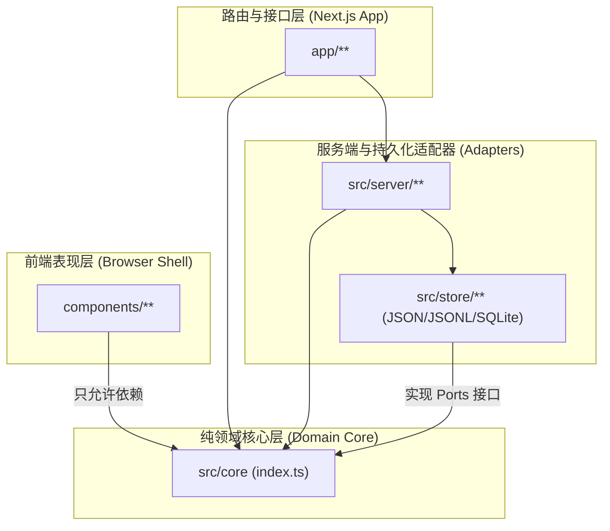
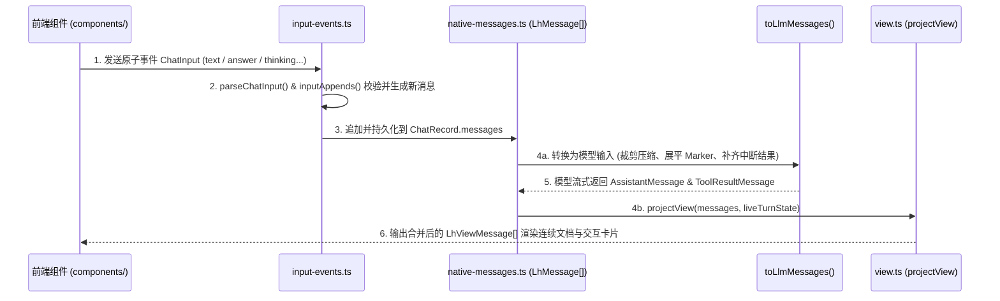

# LearnHarness `src/core` 核心包架构与代码详解

> [!NOTE]
> 本文档面向熟悉 **Java / Spring / DDD（领域驱动设计）** 的开发者，结合 Java 工程概念全面解析 [`src/core`](file:///d:/0.default/learnharness/src/core/index.ts) 包的架构设计、模块职责与核心数据流。

---

## 一、TypeScript 导入语法与 Java 概念对照

以 [`components/session-core.ts`](file:///d:/0.default/learnharness/components/session-core.ts#L1-L21) 开头的导入代码为例：

```typescript
import {
	needsContinuation,
	pendingQuestionOf,
	failedResponseAtEnd,
	measuredContextTokens,
	newAnswerResult,
	newNextMessage,
	newProblemDismissedMarker,
	newThinkingMessage,
	newUserMessage,
	projectView,
	lhLog,
	type ChatInput,
	type LhMarkerMessage,
	type LhMessage,
	type LhViewMessage,
	type LiveExecution,
	type QuestionAnswerData,
	type QuestionDraft,
} from "../src/core";
```

### 1. 语法含义拆解
这是 TypeScript（ES Module）中的**具名导入（Named Imports）**，从上级目录的 [`src/core/index.ts`](file:///d:/0.default/learnharness/src/core/index.ts)（聚合导出入口，俗称 Barrel File / 门面模块）按需引入两类成员：
- **运行时函数（不带 `type` 前缀）**：包括状态判断函数（如 `needsContinuation`）、消息构造工厂（如 `newUserMessage`）、视图投影函数（`projectView`）和日志工具（`lhLog`）。
- **纯编译期类型（带 `type` 前缀）**：如 `type LhMessage`、`type ChatInput`。`type` 关键字告诉编译器这些符号仅用于静态类型检查，编译为 JavaScript 时会被**彻底擦除（Type Erasure）**，不会在运行时产生任何代码或循环引用。

### 2. 与 Java 的等价映射

| TypeScript 写法 | 相当于 Java 中的语法/概念 | 说明 |
| :--- | :--- | :--- |
| `import { newUserMessage, ... }` | `import static com.lh.core.MessageFactory.newUserMessage;` | Java 没有顶层独立函数，对应工具类/工厂类的**静态导入（`import static`）** |
| `import { type LhMessage, ... }` | `import com.lh.core.model.LhMessage;` | 对应导入 Java 的 `interface`、`record` 或 `class` |
| `from "../src/core"` (`index.ts`) | 包门面（Package Facade） | 统一对外暴露核心包公共 API，隐藏内部子模块细节 |

---

## 二、`src/core` 的架构定位與设计铁律

在整体架构中，[`src/core`](file:///d:/0.default/learnharness/src/core/index.ts) 是**六边形架构（Hexagonal Architecture / Ports & Adapters）的纯领域核心层（Domain Core）**。

[`src/core/index.ts`](file:///d:/0.default/learnharness/src/core/index.ts#L1-L16) 规定了三条核心架构铁律：

1. **100% 纯逻辑与浏览器安全（Pure & Browser-Safe）**：
   - 不包含任何 Node.js 内置模块（无 `fs` 文件读写、无网络请求、无数据库驱动）。
   - 全部由纯函数（Pure Functions，相同输入必得相同输出）和不可变数据结构组成，既能在服务端运行，也能安全打包进浏览器前端。
2. **严格的依赖方向门禁（由 `eslint.config.mjs` 强制约束）**：
   - `components/**`（前端 UI 组件）$\rightarrow$ **只能**导入 `@/src/core`。
   - `app/**`（Next.js 路由层）$\rightarrow$ 只能导入 `@/src/core` 和 `@/src/server`。
   - `src/store/**`（存储适配器）与 `src/server/**`（服务端服务）单向依赖 `src/core`，而 **`src/core` 绝不反向依赖任何外部适配器**。
3. **控制客户端打包体积**：
   - 仅服务端使用的重型纯算法（如 [`clusters.ts`](file:///d:/0.default/learnharness/src/core/clusters.ts) 社区发现算法、[`graph.ts`](file:///d:/0.default/learnharness/src/core/graph.ts) 图谱合并推导）不从 `index.ts` 重导出，避免将重型依赖打入浏览器 Bundle。



---

## 三、`src/core` 六大核心板块详解

### 1. 领域契约与存储端口（Contracts & Storage Ports）
*相当于 Java 中的 `domain.model` (DTO/Entity) 与 `domain.repository` (Repository Interfaces)*

- **[`contracts.ts`](file:///d:/0.default/learnharness/src/core/contracts.ts) 及 `contracts/` 子目录**：定义全局单一事实来源（Single Source of Truth）的数据结构：
  - [`contracts/chat.ts`](file:///d:/0.default/learnharness/src/core/contracts/chat.ts)：会话记录 `ChatRecord`、列表摘要 `ChatSummary`、Token 统计 `TurnUsage`、标准提示词文本常量。
  - [`contracts/plan.ts`](file:///d:/0.default/learnharness/src/core/contracts/plan.ts)：教学计划树 `PlanTree` 结构。
  - [`contracts/graph.ts`](file:///d:/0.default/learnharness/src/core/contracts/graph.ts)：全局知识图谱节点 `GraphNode`、推理链 `GraphChain`、提取覆盖记录 `CoverageEntry`。
  - [`contracts/jobs.ts`](file:///d:/0.default/learnharness/src/core/contracts/jobs.ts)：后台异步子智能体任务 `JobRecord`。
  - [`contracts/models.ts`](file:///d:/0.default/learnharness/src/core/contracts/models.ts)：AI 模型与提供商定义。
- **[`ports.ts`](file:///d:/0.default/learnharness/src/core/ports.ts)**：定义**存储端口接口**（遵循“每个实体一个接口，绝不用通用 KV 接口”的原则）：
  - [`ChatStore`](file:///d:/0.default/learnharness/src/core/ports.ts#L33-L66)：会话记录的增删改查、保存消息列表、记录 Token 消耗。
  - [`GraphStore`](file:///d:/0.default/learnharness/src/core/ports.ts#L76-L131)：知识图谱节点、推理链、检查点及坐标账本（Append-only Ledgers）的读写。
  - [`JobStore`](file:///d:/0.default/learnharness/src/core/ports.ts#L154-L169)：后台异步任务的生命周期管理。
  - [`SettingsStore`](file:///d:/0.default/learnharness/src/core/ports.ts#L182-L187)、[`PromptOverrideStore`](file:///d:/0.default/learnharness/src/core/ports.ts#L200-L210)、[`AuthStore`](file:///d:/0.default/learnharness/src/core/ports.ts#L223-L231)：用户配置、System Prompt 覆盖与 API Key 存储接口。

---

### 2. 原生消息模型与大模型转换切面（Native Messages）
*相当于核心状态机与防腐层转换器（ACL Converter）*

文件：[`native-messages.ts`](file:///d:/0.default/learnharness/src/core/native-messages.ts)

- **核心类型 [`LhMessage`](file:///d:/0.default/learnharness/src/core/native-messages.ts#L95-L100)**：
  - 直接复用底层 Agent 框架（`@earendil-works/pi-ai`）的 `UserMessage | AssistantMessage | ToolResultMessage` 加上应用自定义的 [`LhMarkerMessage`](file:///d:/0.default/learnharness/src/core/native-messages.ts#L66-L86)，并统一附带唯一字段 `id: string`。
  - **设计哲学**：“记录即 Agent 状态（The record IS the agent state）”，重放历史时无需二次转换。
- **自定义标记消息 [`LhMarkerMessage`](file:///d:/0.default/learnharness/src/core/native-messages.ts#L66-L86)**：
  - `role: "custom"`，通过 `customType` 区分 9 种特殊场景：`graph-context`（图谱上下文注入）、`probe-handoff`（水平探测转教学阶段交接）、`subagent-steer` / `subagent-abort`（子智能体结果注入/中止）、`plan-block`（计划树快照卡片）、`practice-thinking`（练习思路提交）、`practice-next`（下一题信号）、`problem-dismissed`（跳过练习题）、`compaction`（长上下文摘要压缩点）。
- **构造工厂函数（Constructors）**：
  - [`newUserMessage`](file:///d:/0.default/learnharness/src/core/native-messages.ts#L182-L189)、[`newAnswerResult`](file:///d:/0.default/learnharness/src/core/native-messages.ts#L206-L223)、[`newThinkingMessage`](file:///d:/0.default/learnharness/src/core/native-messages.ts#L316-L326)、[`newNextMessage`](file:///d:/0.default/learnharness/src/core/native-messages.ts#L334-L344)、[`newProblemDismissedMarker`](file:///d:/0.default/learnharness/src/core/native-messages.ts#L352-L362) 等。
  - 其中 [`newAnswerResult`](file:///d:/0.default/learnharness/src/core/native-messages.ts#L206-L223) 实现了**双受众分离（Two Audiences）**：给大模型看的 `content` 是精简版答案（避免重复题目描述浪费一倍 Token），而给前端 UI 看的 `details` 保留完整的判分与解析数据。
- **唯一面向大模型的转换器 [`toLlmMessages`](file:///d:/0.default/learnharness/src/core/native-messages.ts#L583-L667)**：
  1. **执行压缩裁剪（Compaction Cut）**：若存在上下文压缩标记，将压缩点之前的历史替换为一段摘要。
  2. **处理自定义 Marker**：过滤纯 UI 标记（如 `plan-block`、`problem-dismissed`），将其余 Marker 展平为大模型可读的标准 `user` 消息。
  3. **剥离本地元数据**：去掉大模型协议不识别的 `id` 和 `cliContextWindow`。
  4. **悬空工具调用修复（Dangling Tool Call Synthesis）**：如果某轮已完成的助手消息留有未回答的工具调用，自动补齐一条 `INTERRUPTED_TEXT` 的 `toolResult`，防止大模型 API 报错。
- **状态扫描探针（Native Scans）**：
  - [`pendingQuestionOf`](file:///d:/0.default/learnharness/src/core/native-messages.ts#L685-L706)：检查最新助手消息是否有等待用户作答的互动题（决定前端底部是否弹出答题面板）。
  - [`activeProblemOf`](file:///d:/0.default/learnharness/src/core/native-messages.ts#L481-L514)：练习模式下查找当前正在进行中的练习题。
  - [`needsContinuation`](file:///d:/0.default/learnharness/src/core/native-messages.ts#L801)：判断消息流末尾是否停留在未消费的 `toolResult` 上，决定是否自动触发下一轮生成。

---

### 3. 客户端输入事件契约（Input Events）
*相当于 CQRS / Command 模式中的命令解析与状态变更计算*

文件：[`input-events.ts`](file:///d:/0.default/learnharness/src/core/input-events.ts)

客户端调用 `POST /api/chat` 时，**绝不上传整个聊天记录**，只上传一个原子输入事件 [`ChatInput`](file:///d:/0.default/learnharness/src/core/input-events.ts#L49-L66)：

| 事件 `type` | 含义与触发场景 | 校验与产生的追加消息（[`inputAppends`](file:///d:/0.default/learnharness/src/core/input-events.ts#L214-L257)） |
| :--- | :--- | :--- |
| `"text"` | 用户在输入框发送普通文本 | 如有挂起的跳过题目先合成结题对，再追加 [`newUserMessage`](file:///d:/0.default/learnharness/src/core/native-messages.ts#L182-L189) |
| `"answer"` | 用户提交互动测验题答案 | 校验题目必须处于未回答状态，追加 [`newAnswerResult`](file:///d:/0.default/learnharness/src/core/native-messages.ts#L206-L223) |
| `"continue"` | 页面加载或后台任务完成后继续生成 | 仅结算挂起的跳过题目，基于现有记录直接唤醒 Agent |
| `"retry"` | 点击失败横幅的“重试”按钮 | 不追加新消息，通过 [`retryDrops`](file:///d:/0.default/learnharness/src/core/input-events.ts#L305-L316) 临时剔除末尾报错的助手消息后重跑 |
| `"retry-question"` | 题目参数生成截断/损坏时请求重出题 | 为损坏的题目生成报错 `toolResult`，提示模型重新出题 |
| `"thinking"` | 练习模式下提交解题思路或答案 | 校验当前存在激活的练习题，追加 [`newThinkingMessage`](file:///d:/0.default/learnharness/src/core/native-messages.ts#L316-L326) |
| `"next"` | 练习模式下两道题之间点击“下一题” | 校验当前无激活练习题，追加 [`newNextMessage`](file:///d:/0.default/learnharness/src/core/native-messages.ts#L334-L344) |

此外还提供 [`failedResponseAtEnd`](file:///d:/0.default/learnharness/src/core/input-events.ts#L280-L287) 用于检测最后一条消息是否因错误中断，以便前端展示重试横幅。

---

### 4. 客户端视图投影层（Client View Model）
*相当于 MVVM 中的 ViewModel / Presenter 转换器*

文件：[`view.ts`](file:///d:/0.default/learnharness/src/core/view.ts)

底层持久化的 [`LhMessage[]`](file:///d:/0.default/learnharness/src/core/native-messages.ts#L95-L100) 是按 Agent 循环步骤拆碎的多条 `assistant` 和 `toolResult` 消息。[`projectView`](file:///d:/0.default/learnharness/src/core/view.ts#L128-L292) 负责将它们投影为前端组件直接渲染的 [`LhViewMessage[]`](file:///d:/0.default/learnharness/src/core/view.ts#L66-L72)：

1. **连续助手消息合并（Continuous Document Grouping）**：
   - 将连续的多轮 `assistant` + `toolResult` 聚合成**同一个** `role: "assistant"` 的视图消息，中间用 `{ type: "step-start" }` 分隔。
2. **思考过程置顶律（Reasoning Above Text）**：
   - 无论底层模型返回 `thinking` 块的顺序如何，稳定排序将所有 `reasoning` 部分排在正文上方。
3. **工具结果回填（Tool Result Pairing）**：
   - 扫描 `toolResult` 消息并逆向查找到发起该调用的 `tool-*` 视图块，将答案挂载到对应题目卡片的 `output` 上。
4. **实时流状态融合（[`LiveTurnState`](file:///d:/0.default/learnharness/src/core/view.ts#L84-L96)）**：
   - 区分正在流式生成的工具调用（`input-streaming` 闪烁态）与已落盘等待作答的调用（`input-available` 就绪态）。
5. **内联拼接计划树卡片（Plan Block Splicing）**：
   - 将 `plan-block` 标记无缝插入到最后一次成功的 `tool-plan_init` 调用正下方。

---

### 5. 教学法、互动题与知识图谱核心算法（Pedagogy & Graph）
*相当于核心业务规则引擎（Domain Services）*

| 模块文件 | 核心职责 |
| :--- | :--- |
| [`question-core.ts`](file:///d:/0.default/learnharness/src/core/question-core.ts) / [`tool-parts.ts`](file:///d:/0.default/learnharness/src/core/tool-parts.ts) / [`answer-presentation.ts`](file:///d:/0.default/learnharness/src/core/answer-presentation.ts) | 互动题（单选、多选、填空、排序等）的入参校验、判分逻辑、草稿状态 `QuestionDraft` 与模型侧答案压缩 |
| [`pending.ts`](file:///d:/0.default/learnharness/src/core/pending.ts) / [`phases.ts`](file:///d:/0.default/learnharness/src/core/phases.ts) | 定义提问工具集合 `QUESTION_TOOLS`，识别会话当前所处阶段（Probe 摸底阶段 vs Teach 教学阶段） |
| [`plan-tree.ts`](file:///d:/0.default/learnharness/src/core/plan-tree.ts) | 教学大纲树的初始化、节点增删改与完成度状态计算 |
| [`graph.ts`](file:///d:/0.default/learnharness/src/core/graph.ts) / [`chains.ts`](file:///d:/0.default/learnharness/src/core/chains.ts) / [`graph-deletion.ts`](file:///d:/0.default/learnharness/src/core/graph-deletion.ts) | 知识图谱命题节点与推理链的合并推导、从推理链派生边（Edges）、删除会话时的图谱账本清理计算 |
| [`layout.ts`](file:///d:/0.default/learnharness/src/core/layout.ts) / [`clusters.ts`](file:///d:/0.default/learnharness/src/core/clusters.ts) | 图谱可视化节点坐标布局与 Louvain 社区聚类划分 |
| [`coverage.ts`](file:///d:/0.default/learnharness/src/core/coverage.ts) / [`session-markdown.ts`](file:///d:/0.default/learnharness/src/core/session-markdown.ts) | 计算哪些对话消息已被知识提取器处理过；将会话格式化为统一的 Markdown 文档（供知识提取与用户导出共用） |

---

### 6. 基础设施纯工具模块（Settings, Cost, Events, Utils）

| 模块文件 | 核心职责 |
| :--- | :--- |
| [`context-usage.ts`](file:///d:/0.default/learnharness/src/core/context-usage.ts) / [`compaction.ts`](file:///d:/0.default/learnharness/src/core/compaction.ts) | 计算当前上下文已用 Token 数（[`measuredContextTokens`](file:///d:/0.default/learnharness/src/core/context-usage.ts)）与剩余预算百分比；管理长对话压缩切点 |
| [`prices.ts`](file:///d:/0.default/learnharness/src/core/prices.ts) / [`cost-summary.ts`](file:///d:/0.default/learnharness/src/core/cost-summary.ts) | 各大模型 Token 单价目录与会话累计费用汇总计算 |
| [`settings.ts`](file:///d:/0.default/learnharness/src/core/settings.ts) / [`settings-resolution.ts`](file:///d:/0.default/learnharness/src/core/settings-resolution.ts) / [`auth-keys.ts`](file:///d:/0.default/learnharness/src/core/auth-keys.ts) | 用户设置校验、默认值合并决议、API Key 格式校验与脱敏展示 |
| [`events.ts`](file:///d:/0.default/learnharness/src/core/events.ts) | 全栈响应式事件总线（Push Architecture）的事件类型词典与发布/订阅实现 |
| [`logger.ts`](file:///d:/0.default/learnharness/src/core/logger.ts) | 统一结构化日志工具（导出 [`lhLog`](file:///d:/0.default/learnharness/src/core/logger.ts)） |

---

## 四、核心数据流全景图

下面展示了用户交互、核心记录、大模型与前端视图四者在 `src/core` 中的完整闭环：


