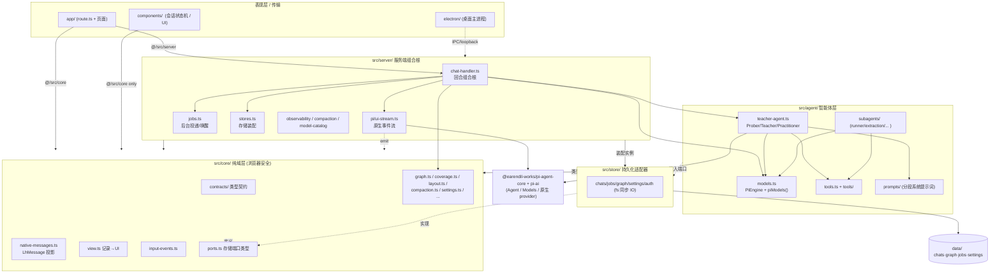
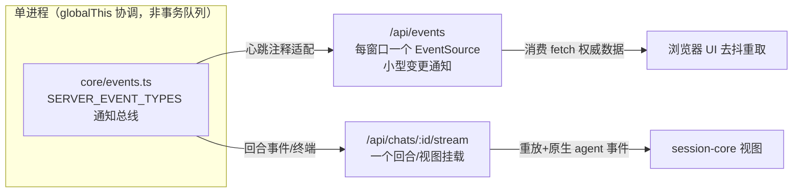
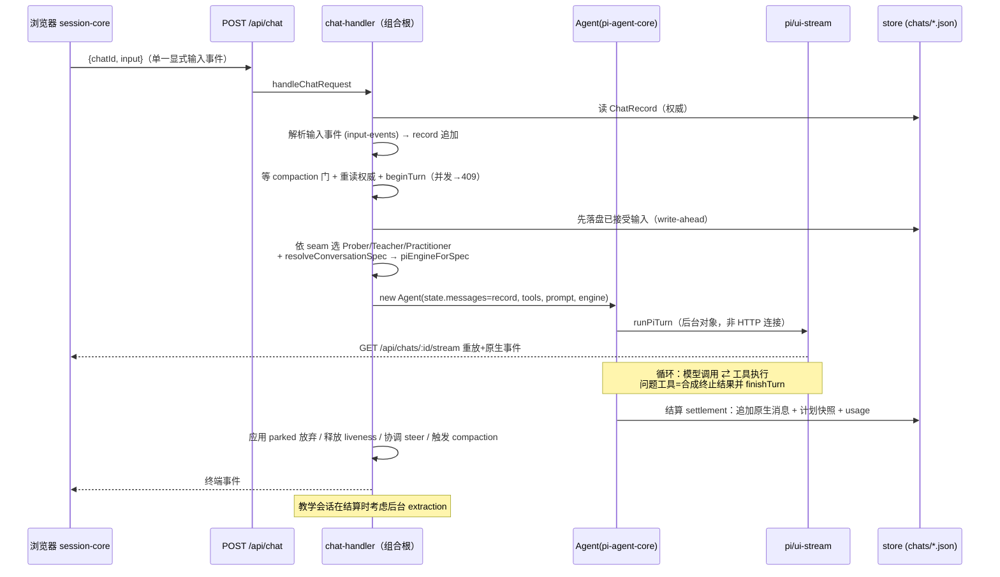
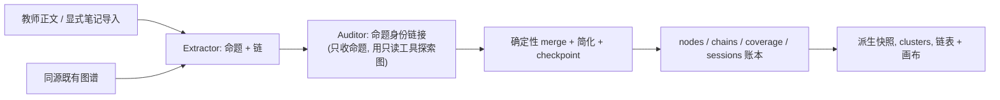

# LearnHarness（`lh`）项目全局架构与核心模块解析

> 版本：`0.4.1` · License：AGPL-3.0-only · 作者：Amos Blomqvist
> 定位描述（`package.json` / `app/layout.tsx` metadata）：**"An agent harness for learning: adaptive teaching, practice, and a persistent knowledge graph."**

---

## 1. 项目核心定位、技术栈与整体目录分层

### 1.1 核心定位

LearnHarness 是一个**面向学习的智能体运行时（agent harness）**，其核心是一个"有记忆的导师智能体"。它把一次完整的"教学对话"作为一等公民，围绕它构建了三条主线：

- **自适应教学（Adaptive Teaching）**：探测者（Prober）→ 规划者/教师（Teacher）的分阶段教学，通过选择题 / 自由回忆 / 讲解 / 计划树推进。
- **对话式练习（Conversational Practice）**：`practice` 会话类型，`problem` + `conclude` 工具，隐藏解答、结题揭示。
- **持久化知识图谱（Persistent Knowledge Graph）**：从教学正文与导入笔记中**事后**抽取命题（propositions）与推理链（chains），形成跨会话、跨来源的推理图谱，并可视化（Canvas 画布 + 链表视图）。

关键设计哲学（见 `docs/architecture.md`）：**服务器独占转录（transcript）所有权**——`POST /api/chat` 只携带 `{chatId, input}`（一个显式输入事件），从不携带客户端转录副本；持久化记录（`ChatRecord` / `LhMessage`）**就是** agent 的状态（`state.messages = record.messages` + `continue()`）。浏览器只是该记录的"投影视图（view）"。

### 1.2 技术栈

| 层 | 技术 | 说明 |
|---|---|---|
| 应用框架 | **Next.js 16**（App Router）+ **React 19** + TypeScript | `app/` 页面与 `route.ts` HTTP 路由 |
| 桌面宿主 | **Electron 44**（`electron-builder` 打包 macOS arm64） | 生产环境以 loopback 子进程拉起 standalone Next 服务器，加载沙箱渲染器 |
| 智能体内核 | **`@earendil-works/pi-agent-core` / `pi-ai` 1.4.0** | 提供 `Agent`、`Models`、`StreamFunction`、`LhMessage` 原生消息、thinking level、provider 目录（BYOK，无工厂固定模型） |
| MCP | `@modelcontextprotocol/sdk` | 工具/外部能力 |
| 图谱可视化 | **d3-force / d3-zoom / d3-shape / d3-selection**、`@xyflow/react`、`dagre-d3-es`、Canvas 2D | 布局 `core/layout.ts`，画布 `graph-canvas.ts` / `graph-view.tsx` |
| 渲染 | `streamdown`（cjk/code/math/mermaid）、`katex`、`mermaid`、`motion`、`pdfjs-dist`、`@resvg/resvg-js` | 富文本、公式、图表、PDF |
| 样式 | Tailwind CSS 4（`@tailwindcss/postcss`）、`class-variance-authority`、`radix-ui`、`cmdk`、`next-themes` | |
| 校验/类型 | `zod`、`typebox` | 工具参数 / 请求体 |
| 测试 | 原生 **node:test**（`tsx --test tests/*.test.ts(x)`）+ 注入式 fake engine / ports | 不依赖真实账号 |
| 语言 | i18n（`en` / `zh-CN`） | `src/i18n/` |

### 1.3 整体目录分层

代码库采用**强制 import 边界的分层架构**（`eslint.config.mjs` 执行）：

```text
lh/
├── app/            # 表现层 / HTTP 传输：页面 + 服务端组件 + route.ts
│   ├── api/        #   chat / chats / graph / jobs / keys / models / search / settings / subscriptions ...
│   ├── chat/[id]   #   会话页
│   └── page.tsx    #   首页（首跑门控：三个模型槽未配置则显示 setup CTA）
├── components/     # 浏览器会话状态、转录投影/渲染、问题/练习 dock、图谱与设置 UI
│   ├── session-core.ts  # 纯 TS 会话状态机（attach/replay/settle/error/abort）
│   ├── chat.tsx / graph-view.tsx / plan-block.tsx / question-dock.tsx ...
│   ├── ai-elements/ artifacts/ settings/ ui/
├── src/
│   ├── server/     # 服务端组合根：admission、liveness、持久化协调、provider 配置、HTTP 服务
│   │   ├── chat-handler.ts   # 回合组合根（turn composition root）
│   │   ├── stores.ts         # 存储组合根（唯一装配 fs 适配器处）
│   │   ├── pi/ui-stream.ts   # 原生 agent 事件流（非 UIMessage SSE）
│   │   └── jobs.ts / compaction.ts / observability.ts / model-catalog.ts ...
│   ├── agent/      # 原生 agent 构造、工具、provider 流、后台 worker
│   │   ├── teacher-agent.ts  # Prober / Teacher / Practitioner 构造
│   │   ├── models.ts         # PiEngine 工厂 + 进程级 pi-ai Models 集合
│   │   ├── tools.ts + tools/ # 工具注册（probe/quiz/plan/... + read/grep/find/web/graph/jobs）
│   │   ├── subagents/        # researcher / demo-builder / visual-maker / pdf-reader / extraction
│   │   └── prompts/          # 分段系统提示词（prober/ teacher/ practice/ shared/）
│   ├── core/       # 纯域逻辑 + 契约 + 投影（浏览器安全 barrel 唯一入口）
│   │   ├── contracts/        # chat / graph / jobs / plan / probe / models / ... 类型契约
│   │   ├── native-messages.ts# LhMessage 记录 ↔ LLM 消息投影
│   │   ├── view.ts           # 记录 → UI 消息/部件/产物 投影
│   │   ├── input-events.ts   # 输入事件解析（text/answer/verdict/continue/steer）
│   │   ├── graph.ts / coverage.ts / layout.ts / compaction.ts / settings.ts ...
│   ├── store/      # 文件系统持久化适配器（chats/jobs/graph/settings/auth/...）
│   └── i18n/       # 国际化
├── electron/       # 桌面主进程：main.cjs、订阅/ChatGPT IPC、凭据与浏览器 helper
├── data/           # 可变数据（LH_DATA_DIR 可重定位）：chats/ graph/ jobs/ settings.json
├── scripts/        # 构建 / 冒烟 / 打包 / 图标 / 校验
├── tests/          # node:test 测试 + fixtures（含 golden-data 真记录）
└── docs/           # architecture / vision / teaching-methodology / claude-code / ...
```

**Import 边界法（关键架构约束）**：
- `components/**` → 只能经 **`@/src/core`**（浏览器安全 barrel）。
- `app/**` → 只能经 **`@/src/core` + `@/src/server`**。
- `core` 不得 import `agent` / `server` / `store`；`agent` 不得 import `server` / `store`。
- 服务器专属纯模块（如 `core/graph.ts` 的发射/推导）需存储 port 注入，故**不**在 core barrel 导出，由 server 直接 import。
- `src/server/stores.ts` 是**唯一**存储装配点；`src/server/index.ts` 是 app 可见的服务端门面。

---

## 2. 核心模块 / 包之间的依赖关系

### 2.1 分层依赖图（Mermaid）



**依赖方向要点**：
- `core` 是依赖汇聚的"地基"：`agent`、`server`、`store`、`components`、`app` 都可依赖它，但它**不依赖任何上层**。
- `agent` 与 `server` 通过**注入的 port 实例**（`stores.ts` 装配的 `chatStore`/`graphStore`/`jobStore`）协作，而非直接 import `store`；`agent` 需要配置/密钥时由 `server` 注入（如 `configureProviderSource`、`providerKeyMissing`、`searchProvider`）。
- `pi-ai` 的 `Models` 集合是进程级单例（`piModels()`），`server/stores.ts` 启动时 `syncCustomProvider()` 把自定义端点注册进去。

### 2.2 两条 SSE 通知通道



- `/api/chats/:id/stream`：单个运行回合/视图挂载，重放 + 原生 agent 事件，然后终端。
- `/api/events`：每个打开窗口一个 `EventSource`，只承载"发生了变更"的小通知，消费者再 fetch 权威数据；**通知无持久重放日志**。

---

## 3. 关键启动入口、主流程控制链路与核心数据结构

### 3.1 启动入口

**Web / 仓库开发**：`npm run dev`（`next dev`）→ Next 16 启动；`config.ts` 将可变数据锚定到 `LH_DATA_DIR`（默认仓库 `data/`），只读资源（提示词）锚定 `ROOT`。

**Electron 桌面**：
- `electron/main.cjs` 生产环境以**私有 loopback 子进程**拉起 standalone Next 服务器（`scripts/build-server.mjs` 构建 standalone），设置 `LH_DATA_DIR`/`LH_AUTH_FILE`，加载沙箱渲染器。
- 导航/权限守卫、私域凭据传输是桌面边界（非 Web 多用户认证系统）。
- `app/layout.tsx` 的 **RootLayout** 是浏览器端组合根，逐层包裹 Provider：
  `ServerEventsProvider → I18nProvider → AppearanceProvider → SidebarProvider → ActivityProvider → AppShell`，外加 `UpdateBanner`（Electron 自动更新推送）。

**首跑门控（`app/page.tsx`）**：`force-dynamic` 每导航重读 `settings.json`；`slotsConfigured(record?.models)` 检查 strong/cheap/vision 三个模型槽是否已配置——未配置则首页显示 setup CTA，会话无法启动。

### 3.2 主流程控制链路（一次教学回合）

这是系统的核心闭环，全部由 `src/server/chat-handler.ts` 的 `handleChatRequest`（`app/api/chat/route.ts` 仅一行转发）编排：



**回合组合七步（`chat-handler.ts` 注释明确）**：
1. 读记录、校验输入与重试资格、解析会话模型与 provider 可用性——缺失模型/凭据/就绪态**显式拒绝**（503 `models_not_configured`），绝不猜回落。
2. 等该会话 compaction 门，重读权威，校验追加。
3. 声明每-chat liveness（`beginTurn`，竞争→409），**推理前**先落盘已接受输入；订阅自动输入可暂存至投递准入。
4. 构造 prober/teacher/practitioner；**先**注册 live steering 缝，再注册运行回合句柄。
5. 返回短确认；浏览器挂 `/api/chats/:id/stream`，已完成的竞争回合返回已结算终端而非另起回合。
6. 结算时追加本次运行的新原生消息 + 计划快照 + usage；成功问题占位符是回路装置、不持久化；abort 也保存部分输出。
7. 应用 parked 放弃、释放 liveness 与 running-agent 注册、协调 steer 投递、考虑后台 compaction；教学会话可触发 extraction。

**关键不变式**：持久化失败不是"成功的空回合"——输入落盘失败在推理前拒绝；回复落盘失败在流终端前上报；清理即便正常结算失败也释放 liveness。

### 3.3 后台工作与投递（Jobs）

`src/agent/subagents/runner.ts` 独立运行 researcher / pdf-reader / demo-builder / visual-maker。**worker 完成 ≠ 会话投递**。`src/server/jobs.ts` 拥有进程本地注册表（确定性 marker id），两种投递载具：
- **Live run**：合格 marker 在原生边界进入 Pi steering 队列（绝不在 call 与 result 之间）；问题停止器可让其未被消费，结算时回 pending。
- **Idle wake**：等待一个无回合、无未答问题、未暂停、已同意的会话，再启动带 marker 的常规回合；409 退避，同意拒绝保留队列所有权。

"marker 已存入会话记录"（而非 HTTP 确认或流可见）才是投递确认。

### 3.4 知识图谱：抽取与覆盖

主路径（`core/coverage.ts` + `agent/subagents/extraction.ts`）：



- 覆盖判定：对教师正文（含成功 `send_to_user`）做 SHA-256 指纹，与 `coverage.jsonl` 比较；未覆盖状态是**派生**的。
- `graph.enabled` 门控自动抽取；`graph.rendering` 仅选择首页呈现（off 时首页显示 chains 视图，不删数据）。默认触发阈值 `graph.extractionChunkTokens = 4096`（最小 500）。
- 抽取是常规**构造**写入方，但不是唯一图谱变更者——节点删除、会话删除、链简化、位置提交也写图谱文件。

### 3.5 核心数据结构

| 结构 | 位置 | 说明 |
|---|---|---|
| **`ChatRecord`** | `contracts/chat.ts` | 一个持久会话 `data/chats/<id>.json`：`messages: LhMessage[]`、`kind?`（缺省=teach，`practice` 选 practitioner）、`tree?: PlanTree`、`turns?: TurnUsage[]`（追加式用量日志）、`extractions?`、`settings?: ChatSettings`、`version?`（schema 戳，更新版本记录读取时拒绝） |
| **`LhMessage`** | `native-messages.ts:95` | `(UserMessage \| AssistantMessage \| ToolResultMessage \| LhMarkerMessage) & {…id 字段}`。扩展 Pi 原生消息 + 记录 id + 应用自定义 marker；provider/model/usage/thinking 元数据保持原生 |
| **`PlanTree` / `PlanNodeStatus`** | `contracts/plan.ts` | `plan_init` 解析受限 Mermaid 并校验 DAG；current/visited/upcoming 状态派生自带 tag 的调用，而非打分 |
| **`GraphNode` / `GraphChain`** | `contracts/graph.ts` | **链是存储真相**（chains-primary）：`GraphChain{id:"arg_…", premises[], conclusion, provenance[]}`，独立论证为独立链；边（`GraphEdge`）是派生视图，永不存储；provenance 到消息粒度（chat+message 或 notes `src_…`） |
| **`ChatSettings`** | `contracts/chat.ts` | 每-chat 会话 agent 的 model/thinking 覆盖（背景子 agent 从不覆盖——基础设施固定） |
| **`PiEngine`** | `agent/models.ts` | `{model, streamFn, level?}`——agent 循环运行的模型 + 流函数，可注入 fake 用于测试 |
| **`ResolvedModelSpec`** | `agent/models.ts` | `{provider, id, thinkingLevel?}`——settings 解析链的输出，`piEngineForSpec` 据此建引擎 |
| **`ModelRole`** | `config.ts` | `prober/teacher/researcher/demoBuilder/visualMaker/pdfReader/extractor/auditor`；无工厂固定模型，链空则诚实拒绝 |
| **`Settings`（delta）** | `core/settings.ts` | `settings.json`：delta 形状，缺键 → 工厂默认（`FACTORY_SETTINGS`）；`version` 是私有 schema 计数器（非应用版本） |
| **`TurnUsage`/`CallUsage`/`ExtractionRunUsage`** | `contracts/chat.ts` | "金钱通道"：平行追加日志（不塞进 message，避免被下次持久化覆盖）；成本/上下文折叠发生在读取时（`core/prices.ts`） |

**两个投影（同一记录的两种消费）**：
- `core/native-messages.ts` → `toLlmMessages`：剥离应用元数据、marker 扁平化为 user 文本、省略纯呈现 marker、应用 compaction 切点、为已完成代次中未答调用补合成中断结果——**面向 LLM**。
- `core/view.ts` → `projectView`：把原生记录分组为 UI 消息/部件/产物——**面向浏览器**（非存储格式、非 provider 线上格式；**不使用** AI SDK `useChat`/`addToolOutput`）。

### 3.6 存储布局（`config.ts` / `store/`）

| 数据 | 持久化 | 说明 |
|---|---|---|
| 会话 / 计划 / 结局 / 用量 | `chats/*.json` | 同步读改写，带 schema 版本戳 |
| worker 计算与投递义务 | `jobs/*.json` | |
| 命题/链断言、抽取 checkpoint/覆盖 | `graph/{nodes,chains,sessions,coverage}.jsonl` | 追加式账本；JSONL 读取跳过损坏行 |
| 导入源元数据 / 静止位置 / 渲染偏好 | `graph/sources.json` / `positions.json` / `render-settings.json` | 读改写 JSON map |
| 非密钥设置 / 提示词覆盖 | `settings.json` / `prompts/` | |
| API key / 自定义端点凭据 | `auth.json`（`LH_AUTH_FILE`） | 与 settings 分离；启动时 fill-gap 反映进 `process.env`，真实 env 变量优先 |

适配器用**同步文件系统操作**：单事件循环内读/改/写不交错，但**非**跨进程锁 / 崩溃原子性；一个数据/凭据 profile 对应一个服务器所有者。

---

## 4. 架构特性小结（设计要点）

1. **服务器独占转录**：客户端永不回传转录副本，`{chatId, input}` 单事件驱动；重开未答问题无需新模型调用（pending 由记录派生）。
2. **无状态回合引擎**：agent 每个 POST 都从记录重建、回合结束即丢弃；记录是唯一真相（Pi Engine Swap，`docs/pi-engine-swap.md`）。
3. **BYOK 贯穿到底**：无工厂固定模型，一切引擎由 settings 解析链（role override → slot → 空拒绝）驱动。
4. **回合 vs 视图分离**：浏览器断开只是脱离**视图**，回合无订阅者仍运行；显式 abort 独立。`session-core.ts` 纯 TS 状态机（attach/replay/settle/error/abort）+ 注入式 fetch，可在 node:test 中确定性驱动。
5. **强制分层 import 法**：core 纯域、agent 智能体、server 组合、store 持久化，边界由 eslint 执行；`stores.ts` 单点装配，未来换 SQLite 只改这一文件 + 适配器。
6. **单进程协调**（`globalThis` 锁/注册表）：回合 liveness、steering、抽取 serial、背景 LLM 信号量——是 JSON 记录上的单进程协调，**非**事务队列 / 严格一次执行。

**测试入口**（验证缝）：`tests/chat-flow.test.ts`、`session-core.test.ts`、`turn-recovery.test.ts`、`job-delivery-recovery.test.ts`、`extraction.test.ts`、`notes-import-route.test.ts`、`practice-flow.test.ts`、`prompt-overrides.test.ts`、`golden-fixtures.test.ts`。测试通过注入 engine/ports 与假 provider 传输运行，不要求真实账号。

---

*参考文档：`docs/architecture.md`（本报告的权威实现参考）、`docs/vision.md`（图谱愿景）、`docs/teaching-methodology.md`（教学法）、`docs/claude-code.md` / `custom-providers.md` / `compaction-accounting.md` / `desktop-release.md`（专项）。*
